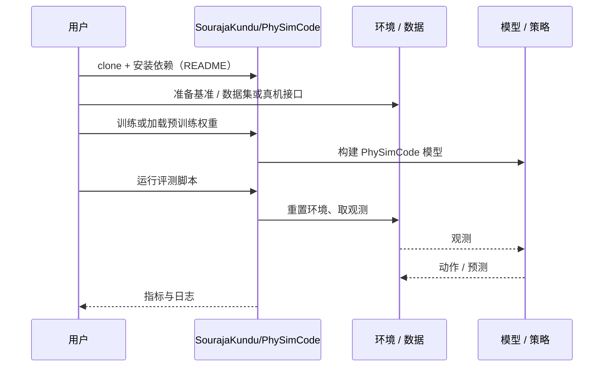

# PhySimCode（arXiv:2610.15722）

**PhySimCode**（*PhySimCode: A Benchmark and Evaluation Method for Physics Video to Code Generation*，[arXiv:2610.15722](https://arxiv.org/abs/2610.15722)，[项目页](https://sourajakundu.github.io/PhySimCode/)，[代码](https://github.com/SourajaKundu/PhySimCode)）来自 [具身智能小站 2026-10-14 盘点](../../sources/blogs/wechat_embodied_station_41_papers_streamingwam_2026-10-14.md)，属「世界模型与记忆」组。

## 一句话定义

**要求模型从原始视频恢复物理规律、参数并生成可运行仿真代码；分别评规律、仿真等价性、可执行性与参数恢复。**

## 英文缩写速查

| 缩写 | 英文全称 | 简要说明 |
|------|----------|----------|
| V2C | Video-to-Code | 视频到代码生成 |
| Sim | Simulation | 仿真 |
| LLM | Large Language Model | 大语言模型 |

## 为什么重要

- 会描述物理不等于会重建动力学；需要可执行的评测。
- 开源结论：**已开源**（步骤 2.5，2026-10-14）。仓库可达。
- 同期同组工作见 [流式动作块与世界模型记忆：具身智能小站 10-14 期 41 篇阅读坐标](../overview/embodied-station-2026-10-14-41-papers-technology-map.md)。

## 核心机制

| 项 | 内容 |
|----|------|
| **arXiv** | [2610.15722](https://arxiv.org/abs/2610.15722) |
| **开源** | **已开源** |
| **要点** | 基准 + 多维评测方法。 |
| **文内指标** | 以原文为准。 |

## 源码运行时序图

以下为按仓库入口（`SourajaKundu/PhySimCode`）推断的通用运行链路；入库日仅核实仓库可达，未逐文件阅读，具体脚本名以 README 为准。

## 实验与评测

- 以原文为准。
- **读法：** 本页为索引级摘要，依据公众号转述的官方摘要与仓库信息整理；逐项数字与 baseline 以原文 PDF 为准。

## 与其他工作对比

- 横向索引见 [流式动作块与世界模型记忆：具身智能小站 10-14 期 41 篇阅读坐标](../overview/embodied-station-2026-10-14-41-papers-technology-map.md)；同 arXiv 不重复造页。

## 结论

**视频→仿真评测必须跑代码；只比描述会高估模型。**

1. 开源边界：**已开源** — 仓库可达。
2. 核心机制：基准 + 多维评测方法。
3. 复现与选型前核对任务协议、硬件与基准口径，勿直接横比公众号摘录数字。

## 关联页面

- [video-as-simulation](../concepts/video-as-simulation.md)
- [simulation-evaluation-infrastructure](../concepts/simulation-evaluation-infrastructure.md)
- [paper-video2world-coding-agents-benchmark](./paper-video2world-coding-agents-benchmark.md)
- [embodied-station-2026-10-14-41-papers-technology-map](../overview/embodied-station-2026-10-14-41-papers-technology-map.md)

## 参考来源

- [physimcode_physics_video_to_code_arxiv_2610_15722.md](../../sources/papers/physimcode_physics_video_to_code_arxiv_2610_15722.md)
- [wechat_embodied_station_41_papers_streamingwam_2026-10-14.md](../../sources/blogs/wechat_embodied_station_41_papers_streamingwam_2026-10-14.md)
- [arXiv:2610.15722](https://arxiv.org/abs/2610.15722)

## 推荐继续阅读

- [arXiv PDF](https://arxiv.org/pdf/2610.15722)
- [项目页](https://sourajakundu.github.io/PhySimCode/)
- [https://github.com/SourajaKundu/PhySimCode](https://github.com/SourajaKundu/PhySimCode)
