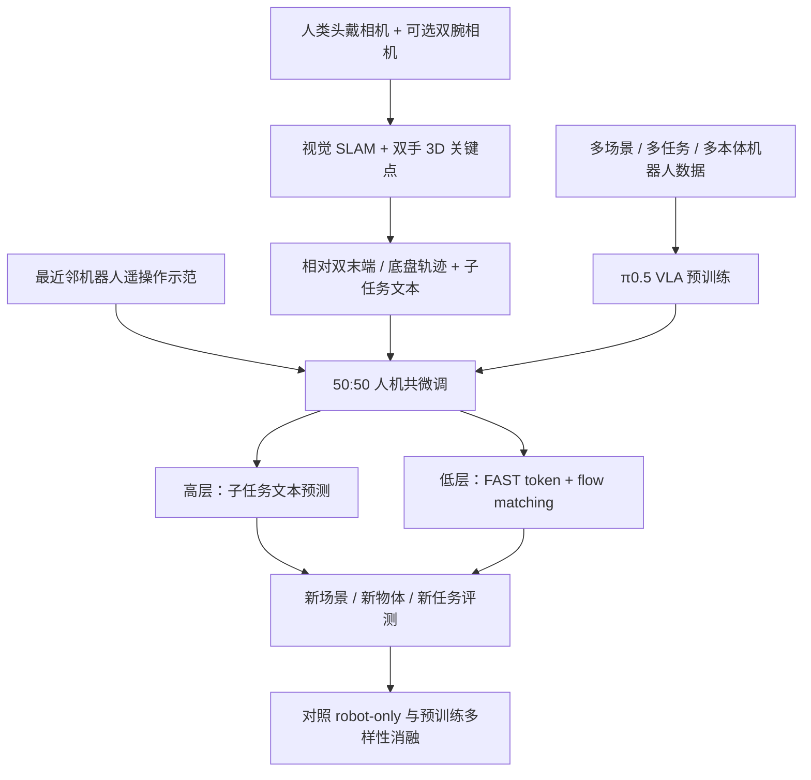

# 人视频到机器人：随预训练多样性出现的迁移

**Emergence of Human to Robot Transfer in Vision-Language-Action Models**（[PI 官方 PDF](https://www.pi.website/download/human_to_robot.pdf)，[arXiv:2512.22414](https://arxiv.org/abs/2512.22414)，RSS 2026，[官方研究页](https://www.pi.website/research/human_to_robot)）由 **物理智能（Physical Intelligence）** 与 **佐治亚理工学院（Georgia Tech）** 提出。问题不是再设计一种人手到夹爪的翻译，而是：π₀.₅ 这类通才在预训练变多样之后，能否把第一人称人视频当成又一种本体直接吃进去。

## 一句话定义

> **人机迁移被写成预训练多样性的函数：机器人数据够杂，微调时加入人视频才开始有用。**

## 英文缩写速查

| 缩写 | 英文全称 | 简要说明 |
|------|----------|----------|
| VLA | Vision-Language-Action | 被微调的 π₀.₅ |
| Ego | Egocentric video | 可穿戴相机的人视频，动作为 3D 手位置 |
| X-emb | Cross-embodiment | 预训练里除目标机器人以外的本体 |

## 为什么重要

人视频便宜，但外观和动作都和机器人不同。常见做法是遮挡身体、生成机器人手，或改硬件去贴近人。本文声称这些对齐可以先不做什么：把人视频按现有多本体格式加入微调，迁移会在预训练规模上来之后自己出现。这和「多采一点人视频就能替代机器人数据」不是同一句话。

## 流程总览

以下按本页已归纳的机制与资料绘制，表示模块或阅读路径关系。

## 核心原理

- **数据采集与动作对齐（Sec. IV-A）：** 人类操作者佩戴头戴高分辨率相机及可选左右腕部同步相机采集片段式演示（Bussing 3h、Spice 3h、Dresser 3h、Sort Eggs 5h）。系统通过 visual SLAM 重建头显世界系 6D 位姿 $e_t \in \mathbb{R}^6$，并追踪头显系下双手各 17 个 3D 关键点 $h_t^{e_t} \in \mathbb{R}^{3\times 17}$；以每只手的手掌、中指、无名指关键点构造相对 6-DoF 末端动作块，底盘动作由头显轨迹投影近似，不估计人手夹爪开合（人类动作向量共 $2\times 6 + 6 = 18$ 维，机器人为含夹爪的 16 维，夹爪开合仅由机器人数据监督；这里是末端动作语义上的**近似对齐**，并非逐维同构）。
- **共微调配方（$\pi_{0.5}+\text{ego}$）：** 预训练只用机器人数据，并按场景–任务组合多样性切成 0%、25%、50%、75%、100%（限定 ARX 与移动 ARX）以及 `100% + X-emb`（完整 $\pi_{0.5}$ 跨本体混合）。微调阶段以 50-50 比例混入人视频与最近邻机器人数据，不使用任何外观掩码、生成式替换或显式分布对齐损失，同时监督高层子任务语言预测 $\pi_{\text{HL}}(l_t^{\text{subtask}}|o_t,l_t)$ 与低层连续/FAST 动作预测 $\pi_{\text{LL}}(a|o_t,l_t^{\text{subtask}})$。
- **隐式表征对齐：** 作者对 VLM 骨干末层前 200 个输出 token 做均值池化并绘制 t-SNE：预训练不足时人与机器人特征分离，多样性升高后特征自然重叠，且这种重叠来源于更多样化的机器人预训练，而非预训练阶段见过人视频。

## 评测

博客称四个泛化设置（bussing、香料、梳妆台、分鸡蛋）上，$\pi_{0.5}$ 加入人数据后平均性能约为不加的 2 倍；论文给出具体分数提升：**Spice** 32% → 71%、**Dresser** 25% → 50%、**Bussing** 53% → 63%、**Sort Eggs** 分拣准确率 57% → 78%（平均多放对 4 颗蛋）。

- **预训练尺度曲线：** 多样性 0% 和 25% 时人数据几乎无帮助；75%、100% 以及跨本体混合（`100% + X-emb`）后增益显著放大。
- **跨本体对照：** Sort Eggs 与 Dresser 上人数据微调接近目标机器人域内数据；Bussing 上目标机器人域内数据仍显著更优（65% vs 25%），而人类→ARX 与 UR5→ARX 迁移曲线形态相近。
- **消融实验：** 移动操作任务上仅向 HL 或仅向 LL 注入人数据均明显弱于 HL+LL 双层共训；腕部相机在 Dresser 与 Bussing 上带来显著增益，在 Spice 与 Eggs 上相近。

### 计分与统计口径（官方 PDF Appendix A）

| 任务 | 计分方式 | 仅在人视频中出现的新因素 |
|---|---|---|
| Bussing | 9 件物品的正确归置数，归一化到 [0,1] | 新物体类别 |
| Spice | 3 瓶香料全部放回架子的二值成功 | 未见过的厨房 |
| Dresser | 项链和发夹分别放进对应收纳盒的二值成功 | 未见过的卧室 |
| Sort Eggs | 12 颗鸡蛋按颜色正确入盒，并奖励关盒动作；归一化到 [0,1] | 颜色分拣规则 |

每项实验 **20–40 次评测**，误差棒为 **1 标准误（SE）**。不同任务的 0.53→0.63 等是对应**基准分数**，不宜全部叫成功率；鸡蛋的 57%→78% 另是作者报告的分拣准确率。预训练「0/25/50/75/100%」表示作者采样的数据多样性档位，而非可外推的模型参数临界阈值。

## 结论

**人视频是预训练已经「见过足够多机器人」之后的增益项，不是跳过机器人数据的捷径。**

- 配方简单：50-50 共微调，3D 手部关键点相对位姿，无生成式对齐
- 先看预训练多样性（场景/任务/跨本体覆盖），再决定值不值得采人视频
- 高层子任务预测与低层动作预测须同步纳入人数据监督
- 有的任务人数据接近机器人域内数据，精细抓取/放置类（Bussing）仍然差一截
- 特征重叠是解释性观察，不是可直接监控的上线指标

## 与其他工作对比

| 对照 | 差异读法 |
|------|----------|
| [EgoMimic](./paper-ego-03-egomimic.md) | 同为第一视角人视频 + 3D 手轨迹与机器人数据共训；EgoMimic 讲人数据的缩放效率，本页讲迁移何时出现（取决于机器人预训练多样性） |
| [Masquerade](./paper-notebook-masquerade-learning-from-in-the-wild-human-video.md) | 编辑人视频以闭合视觉具身差距；本页图像不做对齐 |
| [EgoBridge](./paper-sa-2509-19626-egobridge-domain-adaptation-for-generalizable-im.md) | 用最优传输显式对齐人机分布；本页依赖预训练带来的隐式特征重叠 |
| [人到机器人迁移分类](../overview/ego-category-02-human-to-robot.md) | 同类路线的综述入口 |

## 源码运行时序图

**不适用**。截至 2026-11-23，PI 官方研究页 Paper 入口仅指向论文 PDF，未列本文专属可运行源码、训练数据或复现脚本；通用 openpi 仓库不应冒充该实验的公开实现，因此不虚构源码运行时序图。

## 工程实践

| 项 | 实践要点 |
|----|----------|
| **采集相机配置** | 建议在头戴相机之外加配双腕同步相机（论文消融显示对 Dresser/Bussing 等遮挡/近距操作增益显著，有助于最大化任务覆盖面） |
| **轨迹提取要求** | 需稳定运行 visual SLAM（恢复 6D 头显位姿）与 3D 手部关键点追踪（17 点），并按帧率切分与机器人一致的相对末端动作块 |
| **混合与分层监督** | 微调按 50-50 混合人数据与最近邻机器人数据，保留机器人夹爪监督，并对高层子任务文本与低层动作同步共训 |
| **前置门槛检查** | 若自有基座模型预训练跨场景/跨本体多样性不足（对应论文 0%–25% 区间），直接混入人视频难以产生正迁移甚至可能退化 |

## 局限与风险

- 截至 2026-11-23 未见本文专属代码、实验数据开放。「大约 2 倍」是官方博客概括，单任务要按 PDF 图表与 Appendix A 评分定义解释。
- 图 5 的 t-SNE 重叠是表征可视化的相关性证据，不能单独证明跨本体对齐是收益的唯一因果机制；本实验也没有展示任意无动作标签网络视频可直接用于同一配方。
- 动作用的是手部 3D 位置，默认采集系统能提供这个量；只有 RGB 视频时本文配方不完整。
- 不要把它和 [Ego 分类 02](../overview/ego-category-02-human-to-robot.md) 里的其他对齐方法混成同一种算法。

## 关联页面

- [Imitation Learning (IL, 模仿学习)](../methods/imitation-learning.md) — 人类轨迹仅在微调阶段加入，需将预训练多样性与示范迁移收益分开解释。

- [VLA 纵深：Stage 3 数据与 Scaling](../../roadmap/depth-vla.md)
- [跨本体迁移纵深：Stage 4 人→机迁移](../../roadmap/depth-cross-embodiment.md)
- [π₀.₅](./paper-pi05-open-world-vla.md)
- [Ego 分类：人→机器人](../overview/ego-category-02-human-to-robot.md)
- [VLA](../methods/vla.md)
- [Robot Olympics](./pi-robot-olympics.md)

## 参考来源

- [论文全文归档（含 PI 官方 PDF 与附录复核）](../../sources/papers/human_to_robot_arxiv_2512_22414.md)
- [PI 官网技术文章索引](../../sources/sites/pi-website-technical-articles.md)

## 推荐继续阅读

- [PI 官方论文 PDF（13 页）](https://www.pi.website/download/human_to_robot.pdf)
- [arXiv:2512.22414](https://arxiv.org/abs/2512.22414)
- [RSS 2026 页面](https://www.roboticsproceedings.org/rss22/p072.html)
