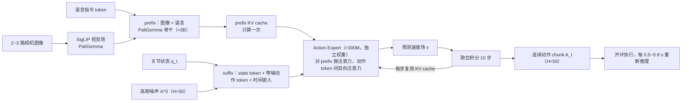
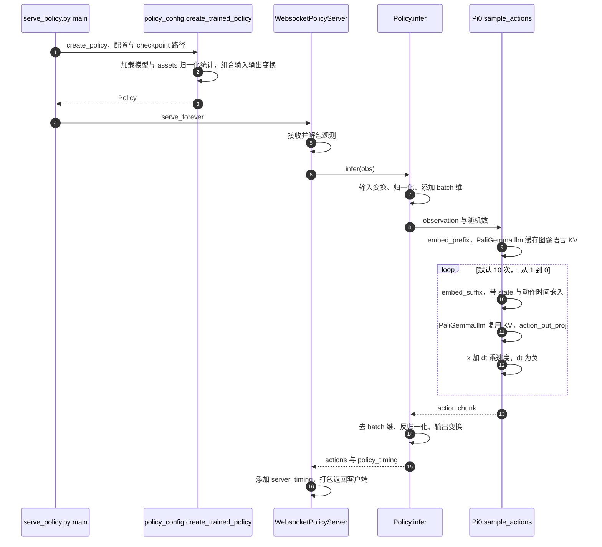
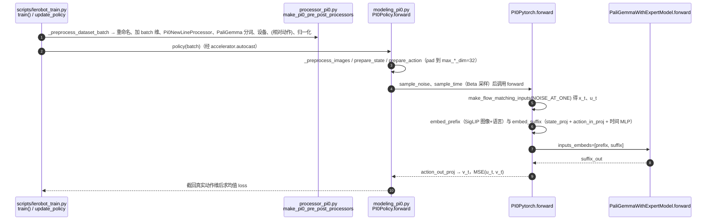
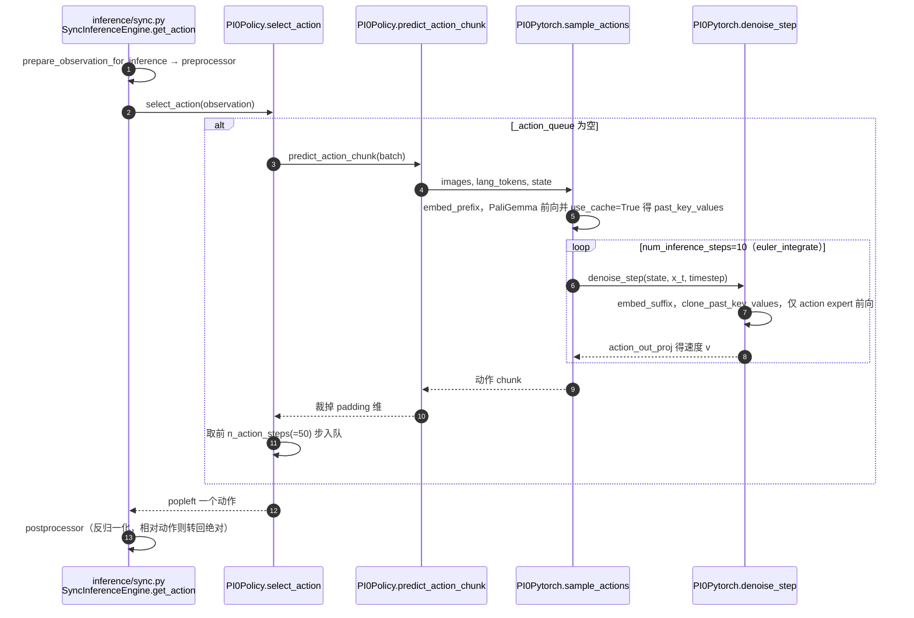

# π₀：流匹配动作专家的通用 VLA

**π₀**（*π0: A Vision-Language-Action Flow Model for General Robot Control*，[arXiv:2410.24164](https://arxiv.org/abs/2410.24164)，[代码](https://github.com/Physical-Intelligence/openpi)）由 **Physical Intelligence** 提出：预训练 VLM 负责语义，**Action Expert** 用 **Flow Matching** 生成连续动作，面向叠衣服、装袋等精细操作与约 **50 Hz** 控制。

## 一句话定义

**PaliGemma 初始化的 VLM 骨干 + 一组独立权重的小型 Action Expert，用条件流匹配（flow matching）一次生成 H=50 步连续动作 chunk，推理时只做 10 步欧拉积分。**

> 纠错（2026-11-05 对照论文 §IV 与 LeRobot 源码）：旧版一句话写的「语义骨干冻结或缓更新」论文里没有这个说法——论文是把 VLM 与 action expert 一起在混合数据上训练；LeRobot 的 `PI0Config` 默认也是 `freeze_vision_encoder=False`、`train_expert_only=False`（仅为省显存才可选冻结）。「比多步扩散更快」也未在论文正文核到直接对比，请勿当作论文结论引用。

## 英文缩写速查

| 缩写 | 英文全称 | 简要说明 |
|------|----------|----------|
| FM | Flow Matching | 连续时间生成式动作头 |
| VLM | Vision-Language Model | 语义骨干（PaliGemma 类） |
| VLA | Vision-Language-Action | 本工作的模型类别 |
| DP | Diffusion Policy | 多步去噪对照，见 [论文](./paper-diffusion-policy.md) |

| WAM | World Action Model | 世界预测与动作生成耦合 |
| IDM | Inverse Dynamics Model | 先预测未来再反推动作 |
| WM | World Model | 环境前向预测模型 |

## 为什么重要

- 纳入 [VLA/WM 阅读路线](../../sources/blogs/wechat_embodied_ai_lab_vla_wm_reading_roadmap_2026-09-02.md) 的动作头进阶。
- 方法页 [π₀-policy](../methods/π0-policy.md) 讲模型族；**本页是 π₀ 论文 canonical 节点**。
- 后续 [π₀.7](../methods/pi07-policy.md) 仍用流匹配动作头。
- **已开源** 入口是 **openpi**；公众号写的 `physical-intelligence/pi0` **仓库不存在**。

## 核心信息

| 项 | 内容 |
|----|------|
| **机构** | 物理智能（Physical Intelligence） |
| **骨干** | 预训练 VLM（PaliGemma 类） |
| **动作** | Flow Matching Action Expert |
| **频率** | 约 50 Hz 控制 |
| **开源** | **已开源** [Physical-Intelligence/openpi](https://github.com/Physical-Intelligence/openpi) |

## 流程总览

图依据：论文 §IV（模型）、§IV 推理段与附录 B/D（H=50、10 步、KV 缓存、各机器人推理间隔）。

## 核心方法

以下数字均读自论文正文/附录（arXiv:2410.24164）：

- **骨干与参数：** 以 3B 的 PaliGemma 为基座，新增约 300M 参数的 action expert（从头初始化），合计 3.3B；action expert 宽度 1024、MLP 维 4096。
- **动作表示：** 动作 chunk 长度 H=50；每个动作对应一个 action token 送入 action expert；state 与图像经线性层投影到与语言 token 相同的嵌入空间。
- **训练目标：** 条件流匹配，噪声样本 A^τ = τA + (1−τ)ε，网络回归 A − ε；流匹配时间 τ 取自偏向低 τ（高噪声）的 shifted-beta 分布，阈值 s=0.999（论文约定 τ=0 为噪声、τ=1 为数据）。
- **注意力与缓存：** 论文称 action expert 使用全双向注意力掩码，动作 token 互相可见；推理时缓存观测 prefix 的 key/value，只重算动作 token 后缀。（LeRobot 里 prefix 不看后缀的掩码见 `embed_suffix` 的 `att_masks`，属源码读到的实现。）
- **推理：** 10 步前向欧拉积分（δ=0.1）；论文表 I 在 RTX 4090 上测得板载总推理 73 ms（图像编码 14 ms + 观测前向 32 ms + 10 步动作前向 27 ms），含 Wi-Fi 的离板总计 86 ms。
- **执行：** 论文未做动作聚合（试过 temporal ensembling 反而变差）；20 Hz 的 UR5e/Franka 每执行 16 步推理一次（0.8 s），50 Hz 机器人每执行 25 步推理一次（0.5 s）。
- **数据：** 预训练混合含 OXE 子集（Magic Soup）、Bridge v2、DROID 与 π 自采灵巧数据集；论文称开源数据约占混合的 9.1%。

## 评测

| 实验（论文 §VI） | 设置与结果 | 解读边界 |
|---|---|---|
| 基座直接提示 | 5 类任务，每任务/方法 10 回合；完整模型 700k 步，另设 160k 步 parity 版本；两者均优于文中 OpenVLA、Octo 基线 | 指标是归一化平均任务进度，含部分得分；不是统一整任务成功率 |
| 语言跟随 | 清桌、摆桌、装袋；比较直接任务提示、人类子指令与高层 VLM 子指令 | 高层规划器是外部模块，不是动作专家自行生成语言规划 |
| 新技能微调 | 5 个任务、1/5/10 小时数据；平均每任务 10 次评估，比较 ACT、Diffusion Policy、OpenVLA、Octo 与从头训练版本 | 不同任务/数据量提升不一致，不能泛化为固定提升倍数 |
| 复杂多阶段 | 叠衣、移动叠衣、卸烘干机、清桌、装盒、装蛋等；图 13 报告各任务 10 回合平均进度，完整模型均超过最大分的一半 | 部分任务需高层语言引导；不代表所有任务稳定完整完成 |

预训练数据按正文 §V：自采 903M timesteps、7 类机器人配置、68 个任务，混合 OXE/Bridge v2/DROID，公开数据占采样混合的 9.1%；任务-机器人组合按样本数的 0.43 次幂加权。博客（2024-10-31）称 8 种机器人，本文保留其版本差异，不自行等同口径。

**控制与推理分开看：** H=50 是预测动作数，10 是积分次数；论文表 I 的 RTX 4090 单次板载推理为 73 ms、离板含网络为 86 ms。20 Hz 机器人执行 16 步后重推理，50 Hz 机器人执行 25 步后重推理。50 Hz 不意味着每 20 ms 重跑整个 VLM。

## 结论

**高频精细操作优先流匹配动作头；复现入口记 openpi，不要去找不存在的 pi0 仓。**

- Action Expert 与 VLM 骨干用两套权重、同一 Transformer 内联合训练（并非分开训练；旧版此条表述已纠正）
- 论文未给出等条件 DDPM 速度对照；只可确认采用 10 步流积分与动作块执行
- 混合数据是通才的前提，不是单任务 trick
- 后继 π₀.₅ 在预训练阶段改用 FAST 离散动作 token、后训练再接 flow-matching action expert（见 [π0.5](./paper-pi05-open-world-vla.md)），并非单纯换提示与数据；π₀.₇ 请见方法页
- 部署要对齐动作归一化、字段映射和推理频率（见 openpi 归档）

## 源码运行时序图

本次核对官方 OpenPI 提交 `215abfb217dbac7d5f1273282331b9b1866c0479`：README、`scripts/serve_policy.py`、`policies/policy_config.py`、`policies/policy.py`、`serving/websocket_policy_server.py` 与 `models/pi0.py`。下图对应 JAX π₀ 服务分支（`pi05=False`），不是 LeRobot 适配版。

### 官方 OpenPI 服务推理

源码时间约定是 `x_t=t*noise+(1-t)*actions`、目标 `noise-actions`、`dt=-1/num_steps`，与论文 τ=0 为噪声的约定相反。JAX 实现缓存图像/语言 prefix，state 在每步 suffix 重算；不能把论文附录中可缓存 state 的优化直接当作此版实现。服务只返回动作块，执行节拍由客户端决定。本次未下载模型或进行 GPU/真机性能复现。

### LeRobot 适配版（既有核对保留）

以下两图沿用上一轮固定提交 `9e5ee9859480e425a97a6836bb3fee479539beb5` 的源码核对，与上述官方入口分开阅读。

### 训练（`lerobot-train --policy.type=pi0`）

### 推理（`lerobot-rollout` 同步引擎）

## 工程实践

官方 OpenPI 接入先选 π₀ 对应配置与 checkpoint，保持相机字段、state/action 维度和 checkpoint assets 的归一化统计一致，再由机器人客户端执行动作块。先检查观测映射与反归一化输出，再测推理延迟与动作执行节拍。

### LeRobot 实现要点

- **入口：** `policy.type=pi0`；基座权重 [`lerobot/pi0_base`](https://huggingface.co/lerobot/pi0_base)，LIBERO 版 `lerobot/pi0_libero`（见 `docs/source/pi0.mdx`）；依赖 `pip install -e ".[pi]"`。文档明确「实现改编自 openpi」，代码里多处注释 `see openpi …`。
- **默认配置（`configuration_pi0.py`）：** `paligemma_variant=gemma_2b`、`action_expert_variant=gemma_300m`、`chunk_size=n_action_steps=50`、`num_inference_steps=10`、`max_state_dim=max_action_dim=32`（不足补零）、图像 224×224、`time_sampling_beta_alpha=1.5, beta_beta=1.0, scale=0.999, offset=0.001`，与论文的 Beta(1.5,1)、s=0.999 吻合。
- **与论文约定的差异（读源码）：** LeRobot 里 π0 用 `FlowConvention.NOISE_AT_ONE`（噪声在 t=1），与论文 τ=0 为噪声的写法时间轴相反，属实现约定，不影响方法本身。
- **相对动作：** `use_relative_actions` 默认关闭；开启后处理顺序为「raw → relative → normalize → model → unnormalize → absolute」，需先用 `lerobot-edit-dataset … recompute_stats --relative_action true` 重算统计量。
- **加速/省显存：** `compile_model`、`gradient_checkpointing`、`dtype=bfloat16`；`train_expert_only=true` 冻结 VLM 仅训 action expert；评估时多相机图像在 `_embed_images` 中合批过视觉塔。
- **RTC：** `PI0Policy.supports_rtc`，开 RTC 时必须走 `predict_action_chunk`（`select_action` 里 `assert not self._rtc_enabled()`）。
- **限制：** PaliGemma 分词器为受限访问模型（`google/paligemma-3b-pt-224`，需在 Hub 同意许可）；LeRobot 文档未提供 π0 的复现成功率表（π0.5 才有 LIBERO 对照表，见 [π0.5](./paper-pi05-open-world-vla.md)）。

## 局限与风险

- **开放边界：** 官方已公开训练/推理代码和 π₀ base/部分专家权重；原论文全部自采预训练数据未完整公开。博客链接是介绍页，代码入口为 OpenPI。
- **研究局限（§VII）：** 数据组成与权重的最优选择、达到高可靠性所需数据量、跨任务/机器人正迁移仍未解决；不能从这些操作实验推论已验证自动驾驶或腿足运动通用性。
- **算力读法：** 固定版 README 估计推理显存 >8 GB、LoRA >22.5 GB、全参 >70 GB；是官方估计，不是本次实测。

- **仓名：** 不要按公众号 `pi0` 去 clone。
- **算力：** 通才权重与微调配置仍重。
- **与 token VLA：** 生态工具（OFT 等）不一定即插即用。

## 与其他工作对比

| 工作 | 相对本页 |
|------|----------|
| [Diffusion Policy](./paper-diffusion-policy.md) | 多步去噪动作头，无大规模 VLM |
| [OpenVLA](./paper-openvla.md) | 自回归离散 token |
| [π₀.7 方法页](../methods/pi07-policy.md) | 同族后继，多模态提示 |
| [DeicticVLA](./paper-deicticvla.md) | 以 π₀ 为骨干的三模式 LI/VLI/VI 指示接口（arXiv:2608.28108） |

## 关联页面

- [π₀ 方法页](../methods/π0-policy.md)
- [π₀.7](../methods/pi07-policy.md)
- [Robbyant（蚂蚁灵波）](./robbyant.md) — LingBot-VLA 同属 VLM + flow 动作专家族，可作跨公司对照
- [Diffusion Policy](./paper-diffusion-policy.md)
- [OpenVLA](./paper-openvla.md)
- [VLA/WM 14 篇路线](../overview/vla-wm-reading-roadmap-14-papers-technology-map.md)
- [DexHoldem](./paper-dexholdem.md) — 真机扑克榜上 π₀ 与 π₀.₅ 并列最高 SPSR
- [DeicticVLA](./paper-deicticvla.md) — π₀ 全参微调 + SAM 2 指示 mask；真机未见类别 VLI/VI 100% vs LI 16.7%
- [AtomicVLA](./paper-atomicvla.md) — openpi 基座上 SG-MoE 原子技能；LIBERO-LONG +10% vs π₀（arXiv:2603.07648）

- 列表实体：[Awesome World-Action Models（RCL）](paper-rcl-wam-robot-learning-control-survey.md)
- 技术地图：[RCL Awesome WAM 技术地图](../overview/rcl-awesome-wam-technology-map.md)
- 方法/任务：[generative-world-models.md](../methods/generative-world-models.md)、[manipulation.md](../tasks/manipulation.md)

- [paper-gr00t-n1-5](./paper-gr00t-n1-5.md)
- [depth-robotics-diffusion-dit-flow](../../roadmap/depth-robotics-diffusion-dit-flow.md)
- [awesome-world-action-models-rcl](paper-rcl-wam-robot-learning-control-survey.md)
- [vla](../methods/vla.md)
- [locomotion](../tasks/locomotion.md)

## 推荐继续阅读

- [arXiv:2410.24164](https://arxiv.org/abs/2410.24164)
- [Physical-Intelligence/openpi](https://github.com/Physical-Intelligence/openpi)

- [Awesome World-Action Models (RCL) 仓库](https://github.com/rcl-robotics/Awesome-World-Action-Models)
- [原文](https://www.roboticsproceedings.org/rss21/p010.html)

## 参考来源

- [官方 PDF 全文归档](../../sources/papers/pi0_arxiv_2410_24164.md)：2026-11-06 下载的 17 页版本，正文与附录 A–E 完整阅读。
- [官方发布页归档](../../sources/sites/pi0.md)：博客与源码开放边界。
- [官方 OpenPI 固定版源码](https://github.com/Physical-Intelligence/openpi/tree/215abfb217dbac7d5f1273282331b9b1866c0479)：上述服务入口至动作采样函数。

- [pi0_arxiv_2410_24164](../../sources/papers/pi0_arxiv_2410_24164.md)
- [具身智能研究室 VLA/WM 阅读路线](../../sources/blogs/wechat_embodied_ai_lab_vla_wm_reading_roadmap_2026-09-02.md)
- [openpi 仓库归档](../../sources/repos/openpi.md)
- [LeRobot 仓库归档](../../sources/repos/lerobot.md)：固定提交 `9e5ee98…` 的 `policies/pi0/` 源码与 `docs/source/pi0.mdx`
- [arXiv PDF](https://arxiv.org/pdf/2410.24164)：2026-11-05 重读 §IV、附录 B/D

- [`sources/papers/rcl_awesome_wam_ref_502ccb43b26687d765d7_0-a-vision-language-action-flow-model-fo.md`](../../sources/papers/rcl_awesome_wam_ref_502ccb43b26687d765d7_0-a-vision-language-action-flow-model-fo.md) — 本条目策展摘录
- [`sources/papers/rcl_awesome_wam_catalog.md`](../../sources/papers/rcl_awesome_wam_catalog.md) — 列表总表
- [`sources/repos/awesome-world-action-models-rcl.md`](../../sources/repos/awesome-world-action-models-rcl.md)
- [`docs/PAPERS.md`](https://github.com/RCL-Robotics/Awesome-World-Action-Models/blob/main/docs/PAPERS.md) — 上游论文目录
- 论文：<https://www.roboticsproceedings.org/rss21/p010.html>
