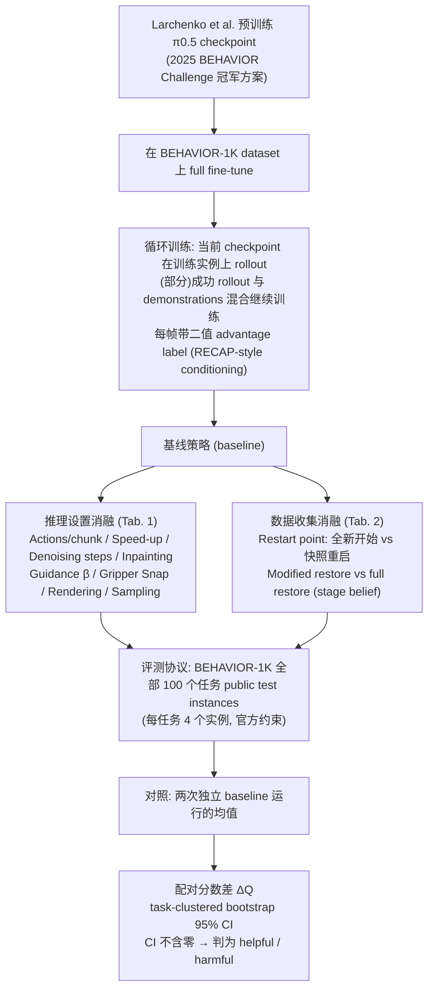

# pi0.5 Inference Settings on BEHAVIOR-1K（arXiv:2610.37917）

**pi0.5 Inference Settings on BEHAVIOR-1K**（*What Actually Matters? A Paired Evaluation of Inference Settings for π₀.₅ on BEHAVIOR-1K*，[arXiv:2610.37917](https://arxiv.org/abs/2610.37917)，[项目页](https://rubenhammele.github.io/behavior2026)）来自 [具身智能小站 2026-10-30 盘点](../../sources/blogs/wechat_embodied_station_28_papers_event2reward_progress_rewards_2026-10-30.md)，属「奖励学习与 VLA 策略」组。

## 一句话定义

**在 BEHAVIOR-1K 全部百项任务上配对比较动作执行长度、播放速度和去噪步数。**

## 英文缩写速查

| 缩写 | 英文全称 | 简要说明 |
|------|----------|----------|
| pi0.5 Inference Settings on BEHAVIOR-1K | What Actually Matters? A Paired Evaluation of Inference Settings for π₀.₅ on BEHAVIOR-1K | 本文方法 / 基准的简称 |

## 为什么重要

- VLA 的推理技巧能否跨家务任务成立。部分常用技巧不能稳定迁移，观察结果时要把策略状态与时间预算一起考虑。
- 开源结论：**项目页未列 GitHub**（步骤 2.5，2026-10-30）。项目页未列本文评测代码；页面链接的 IliaLarchenko/behavior-1k-solution 是被微调的挑战赛冠军方案（经 git ls-remote 可达），不是本文代码。
- 同期同组工作见 [进度奖励、接触监督与规划验证：具身智能小站 10-30 期 28 篇阅读坐标](../overview/embodied-station-2026-10-30-28-papers-technology-map.md)。

## 流程总览

图依据：分析/实证研究设计图，论文 §2 Experimental Setup（Training、Benchmark and Statistical Analysis）、§3.1 Inference Ablations、§3.2 Data Collection、Tab. 1 / Tab. 2；不含结论数字。

## 核心机制

| 项 | 内容 |
|----|------|
| **arXiv** | [2610.37917](https://arxiv.org/abs/2610.37917) |
| **开源** | **项目页未列 GitHub** |
| **要点** | 在 BEHAVIOR-1K 全部百项任务上配对比较动作执行长度、播放速度和去噪步数。 |
| **文内指标** | 公众号转述：部分常用技巧不能稳定迁移，观察结果时要把策略状态与时间预算一起考虑。 |

## 源码运行时序图

**不适用（项目页未列 GitHub）** — 项目页未列本文评测代码；页面链接的 IliaLarchenko/behavior-1k-solution 是被微调的挑战赛冠军方案（经 git ls-remote 可达），不是本文代码。 不编造运行脚本；代码公开后再补。

## 实验与评测

- 公众号转述：部分常用技巧不能稳定迁移，观察结果时要把策略状态与时间预算一起考虑。
- **读法：** 本页为索引级摘要，依据公众号转述的官方摘要与仓库信息整理；逐项数字与 baseline 以原文 PDF 为准。

## 与其他工作对比

- 横向索引见 [进度奖励、接触监督与规划验证：具身智能小站 10-30 期 28 篇阅读坐标](../overview/embodied-station-2026-10-30-28-papers-technology-map.md)；同 arXiv 不重复造页。

## 结论

**VLA 的推理技巧能否跨家务任务成立：部分常用技巧不能稳定迁移，观察结果时要把策略状态与时间预算一起考虑。**

1. 开源边界：**项目页未列 GitHub** — 项目页未列本文评测代码；页面链接的 IliaLarchenko/behavior-1k-solution 是被微调的挑战赛冠军方案（经 git ls-remote 可达），不是本文代码。
2. 核心机制：在 BEHAVIOR-1K 全部百项任务上配对比较动作执行长度、播放速度和去噪步数。
3. 复现与选型前核对任务协议、硬件与基准口径，勿直接横比公众号摘录数字。

## 关联页面

- [reinforcement-learning](../methods/reinforcement-learning.md)
- [vla](../methods/vla.md)
- [imitation-learning](../methods/imitation-learning.md)
- [diffusion-policy](../methods/diffusion-policy.md)
- [embodied-station-2026-10-30-28-papers-technology-map](../overview/embodied-station-2026-10-30-28-papers-technology-map.md)

## 参考来源

- [pi05_inference_settings_behavior_1k_arxiv_2610_37917.md](../../sources/papers/pi05_inference_settings_behavior_1k_arxiv_2610_37917.md)
- [wechat_embodied_station_28_papers_event2reward_progress_rewards_2026-10-30.md](../../sources/blogs/wechat_embodied_station_28_papers_event2reward_progress_rewards_2026-10-30.md)
- [arXiv:2610.37917](https://arxiv.org/abs/2610.37917)
- [arXiv PDF](https://arxiv.org/pdf/2610.37917)：已通读全文（§1 Introduction、§2 Experimental Setup、§3 Experiments & Results、§4 Conclusion；论文仅 2 页正文）

## 推荐继续阅读

- [arXiv PDF](https://arxiv.org/pdf/2610.37917)
- [项目页](https://rubenhammele.github.io/behavior2026)
