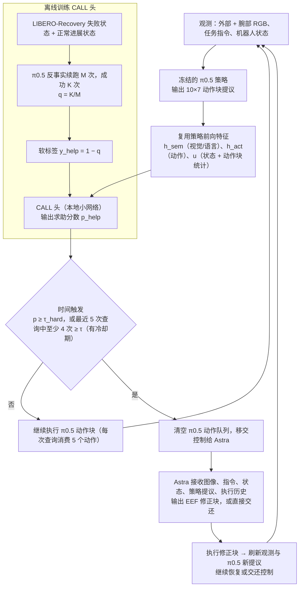

# π0.5 CALL Astra（arXiv:2610.14117）

**π0.5 CALL Astra**（*Make π0.5 Learn to Call Astra for Reliable Robot Manipulation*，[arXiv:2610.14117](https://arxiv.org/abs/2610.14117)，[项目页](https://kykgeek.github.io/Pi05_CALL_Astra/)）来自 [具身智能小站 2026-10-14 盘点](../../sources/blogs/wechat_embodied_station_41_papers_streamingwam_2026-10-14.md)，属「VLA 与动作生成」组。

## 一句话定义

**冻结 π0.5，用复用策略特征的 CALL 头判断何时请求外部模型介入恢复；证据来自 LIBERO 仿真。**

## 英文缩写速查

| 缩写 | 英文全称 | 简要说明 |
|------|----------|----------|
| VLA | Vision-Language-Action | 视觉–语言–动作策略 |
| CALL | Call head | 触发外部求助的分类头 |
| LIBERO | Lifelong Robot Learning Benchmark | 操作基准 |

## 为什么重要

- 本地策略按需求助可提升可靠性，但要看调用频率与成本。
- 开源结论：**项目页未列 GitHub**（步骤 2.5，2026-10-14）。项目页入库日未列 GitHub。
- 同期同组工作见 [流式动作块与世界模型记忆：具身智能小站 10-14 期 41 篇阅读坐标](../overview/embodied-station-2026-10-14-41-papers-technology-map.md)。

## 流程总览

图依据：论文 §2.1–2.4 与 Fig. 1。

## 核心机制

| 项 | 内容 |
|----|------|
| **arXiv** | [2610.14117](https://arxiv.org/abs/2610.14117) |
| **开源** | **项目页未列 GitHub** |
| **要点** | LIBERO；关注成功、调用频率与每回合成本。 |
| **文内指标** | 以原文为准。 |

## 源码运行时序图

**不适用（项目页未列 GitHub）** — 项目页入库日未列 GitHub。 不编造运行脚本；代码公开后再补。

## 实验与评测

- 以原文为准。
- **读法：** 本页为索引级摘要，依据公众号转述的官方摘要与仓库信息整理；逐项数字与 baseline 以原文 PDF 为准。

## 与其他工作对比

- 横向索引见 [流式动作块与世界模型记忆：具身智能小站 10-14 期 41 篇阅读坐标](../overview/embodied-station-2026-10-14-41-papers-technology-map.md)；同 arXiv 不重复造页。

## 结论

**求助策略的评价是三元的：成功率、外部调用率、单回合成本。**

1. 开源边界：**项目页未列 GitHub** — 项目页入库日未列 GitHub。
2. 核心机制：LIBERO；关注成功、调用频率与每回合成本。
3. 复现与选型前核对任务协议、硬件与基准口径，勿直接横比公众号摘录数字。

## 关联页面

- [vla](../methods/vla.md)
- [π0-policy](../methods/π0-policy.md)
- [embodied-station-2026-10-14-41-papers-technology-map](../overview/embodied-station-2026-10-14-41-papers-technology-map.md)

## 参考来源

- [pi05_learn_to_call_astra_arxiv_2610_14117.md](../../sources/papers/pi05_learn_to_call_astra_arxiv_2610_14117.md)
- [wechat_embodied_station_41_papers_streamingwam_2026-10-14.md](../../sources/blogs/wechat_embodied_station_41_papers_streamingwam_2026-10-14.md)
- [arXiv:2610.14117](https://arxiv.org/abs/2610.14117)
- [arXiv PDF](https://arxiv.org/pdf/2610.14117)：已通读方法部分（实验与附录以略读为准）：§1 Introduction、§2 Method（2.1–2.4）、§3.1–3.3 实验设定与结果

## 推荐继续阅读

- [arXiv PDF](https://arxiv.org/pdf/2610.14117)
- [项目页](https://kykgeek.github.io/Pi05_CALL_Astra/)
