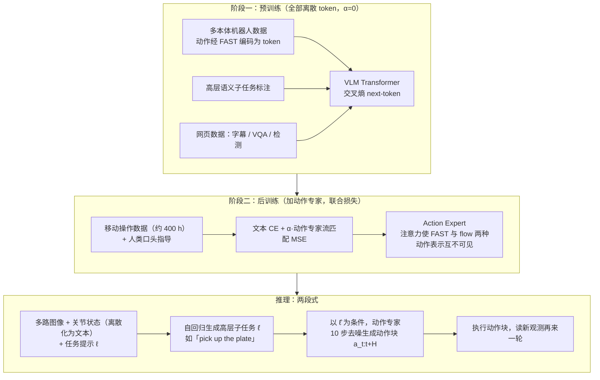
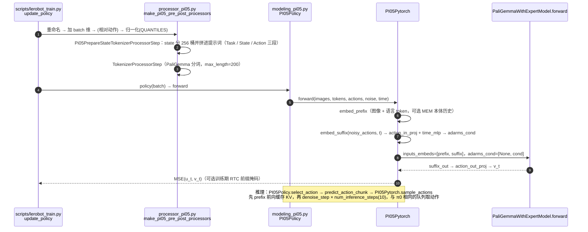
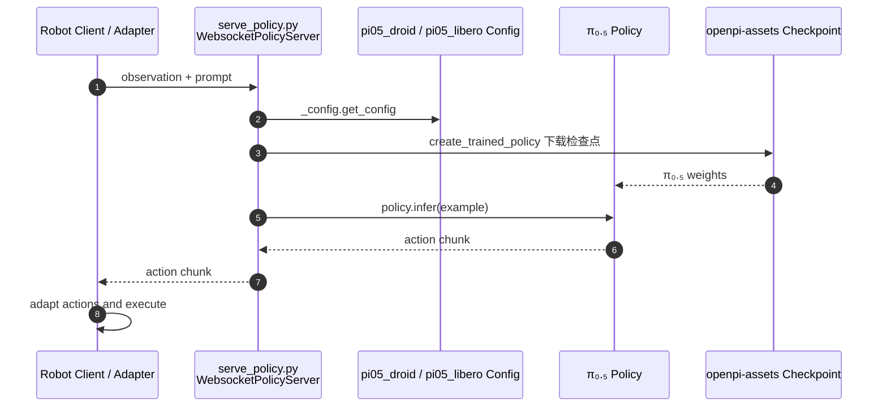

# π0.5（HMI P059）

**π0.5**（*π0.5: A Vision-Language-Action Model with Open-World Generalization*，2025，[arXiv:2504.16054](https://arxiv.org/abs/2504.16054)）收录于具身智能研究室 [论文与项目总索引](https://github.com/RealXiaoze/humanoid-motion-intelligence/blob/main/%E8%AE%BA%E6%96%87%E4%B8%8E%E9%A1%B9%E7%9B%AE/README.md) **P059**，主分类为 **世界模型、VLA与Agent**。官方资料：[项目页](https://www.pi.website/blog/pi05) · [论文 PDF](https://www.pi.website/download/pi05.pdf) · [openpi 代码仓](https://github.com/Physical-Intelligence/openpi)。本页编译自原论文、官方项目页与代码仓，并参考 HMI 策展解读，非原文镜像。

## 一句话定义

预训练用 FAST 离散动作吃异构数据，后训练再为目标本体接入连续 flow 专家；推理时先出语义子任务再高频生成动作块。

## 英文缩写速查

| 缩写 | 英文全称 | 简要说明 |
|------|----------|----------|
| VLA | Vision-Language-Action | 视觉语言动作模型 |
| FAST | Frequency-space Action Sequence Tokenization | 离散动作 token 化 |
| FM | Flow Matching | 连续动作专家生成 |
| BC | Behavior Cloning | 示范数据监督主线 |

| WAM | World Action Model | 世界预测与动作生成耦合 |
| IDM | Inverse Dynamics Model | 先预测未来再反推动作 |
| WM | World Model | 环境前向预测模型 |

## 为什么重要

- Flow matching很适合精细连续控制，但不方便与文本、网页问答和只有语义标注的数据用同一个自回归目标混合。π0.5先用FAST将连续动作压缩成离散token，与多本体轨迹、高层语义预测和web数据共同预训练。这个阶段的目标不是达到最精细的底层控制，而是建立场景、任务、本体和动作语义之间的广泛对应。
- 在 HMI 六条技术路线中属于 **世界模型、VLA与Agent**，是这条路线下可直接下钻的一页。
- 与相邻方法对照时，优先看问题设定与接口，而不是只记算法名。

## 核心信息

| 字段 | 内容 |
|------|------|
| HMI ID | P059 |
| 年份 | 2025 |
| 分组 | 世界模型、VLA与Agent |
| 开源状态 | 部分开源（openpi；完整数据与训练管线未全部公开） |
| 原文 | https://arxiv.org/abs/2504.16054 |

## 核心原理

π0.5不是简单把π0换一批数据继续训练。它面向家庭移动操作的长时任务，把统一模型拆成两个训练阶段和两种推理节奏：预训练用离散表示吃下异构数据，后训练再为目标本体加入连续动作专家。执行时同一模型先产生语义子任务，然后以它为条件生成低层动作。

## 流程总览

图依据：论文 Fig.3、§III-A/B（式 (1)、α 权衡、FAST+flow 联合训练、10 步去噪）。论文称本阶段二所用移动操作数据约 400 小时（§I）。

> LeRobot 注意：上图是**论文的完整配方**。LeRobot 的 `policies/pi05/` 只实现其中的「PaliGemma + flow-matching action expert」推理/微调路径，没有高层子任务文本生成，也没有 FAST 预训练损失（见下文「LeRobot 实现要点」）。

## 工程实践

π₀.₅ 的训练将来自不同机器人、一般视觉语言任务和高层语义标注等异构资料共同使用：离散 FAST 动作 token 可让 VLM 骨干学习机器人动作与语义任务，连续 flow-matching 专家负责精细动作生成。推理时先选择高层子任务，再条件化生成低层动作块；FAST token 是训练监督表示，不是部署时直接发送给电机的控制量。

| 检查项 | 建议 |
|--------|------|
| 一手来源 | 回 arXiv / DOI / 项目页核对数值与声明 |
| 开源边界 | 部分开源（openpi；完整数据与训练管线未全部公开） |
| 官方代码与权重 | [openpi](https://github.com/Physical-Intelligence/openpi) 提供 π₀.₅ 基础及 LIBERO、DROID checkpoint，并含训练、推理示例 |

## 源码运行时序图

### A. LeRobot 实现（固定提交 `9e5ee98…`，`src/lerobot/policies/pi05/`）

已通读 `modeling_pi05.py`、`processor_pi05.py`、`configuration_pi05.py`。训练与推理与 [π0](./paper-pi0.md) 同构，区别在于：state 离散成 256 桶写进文本提示；时间步不再拼进动作 token，而是经 `time_mlp_in/out` 作为 adaRMSNorm 条件 `adarms_cond`；没有 `state_proj`。

### B. 官方原仓 openpi（沿旧版，已用 GitHub main 分支 `scripts/serve_policy.py` 抽查）

openpi 已提供可运行的 π₀.₅ 推理与微调入口；代码公开，但原始预训练数据未全部公开。抽查确认：`serve_policy.py` 的 `create_default_policy` 为 `pi05_droid`、`pi05_libero` 等环境配置分别指定 `gs://openpi-assets/checkpoints/…` 检查点，经 `_policy_config.create_trained_policy` 建策略，再由 `websocket_policy_server.WebsocketPolicyServer` 提供服务（该抽查针对 main 分支，不是固定提交）。机器人侧仍需适配观测与动作接口。

## LeRobot 实现要点

- **入口与权重：** `policy.type=pi05`；基座 [`lerobot/pi05_base`](https://huggingface.co/lerobot/pi05_base)，LIBERO 基座 `lerobot/pi05_libero_base`（见 `docs/source/pi05.mdx`）；依赖 `pip install -e ".[pi]"`；需接受 `google/paligemma-3b-pt-224` 分词器的 Hub 许可。
- **实现了什么：** 论文的「后训练」推理形态——PaliGemma（`gemma_2b`）+ `gemma_300m` action expert，flow matching，`num_inference_steps=10`，`chunk_size=n_action_steps=50`。state 在 `Pi05PrepareStateTokenizerProcessorStep` 中用 `np.digitize` 离散为 256 桶并写入提示词，与论文「本体状态离散化后作为文本 token 输入」一致；归一化默认 `QUANTILES`（状态与动作）。
- **没有实现什么（读源码+文档确认）：** ① 没有高层子任务自回归生成（`modeling_pi05.py` 里没有文本解码路径）；② 没有 FAST 离散动作预训练损失；③ MEM 长时程语言记忆未实现（`pi05.mdx` 的 Tip 明说只做短时视觉/本体记忆）。因此「π0.5 开放世界泛化」的分层推理效果不能直接用 LeRobot 的 `pi05` 复现，只能当作「π0.5 权重 + flow 动作头」使用。
- **LeRobot 扩展（非原论文）：** `use_visual_memory`/`use_proprioceptive_memory`（[MEM, arXiv:2603.03596](https://arxiv.org/abs/2603.03596) 的短时记忆，默认关）；`rtc_training_max_delay`（[训练期 RTC, arXiv:2512.05964](https://arxiv.org/abs/2512.05964)，默认 0）；`use_relative_actions`。这三项的论文本页未读，仅据 `docs/source/pi05.mdx` 转述。
- **知识隔离（knowledge insulation）：** `modeling_pi05.py` 的 `compute_layer_complete` 带 `knowledge_insulation` 开关（action query 看 detach 的 VLM KV），但 `PaliGemmaWithExpertModel.knowledge_insulation` 类属性默认 `False`，`PI05Config` 里没有对应配置项；真正启用它的是别的策略（如 `fineart_vla` 通过 `config.knowledge_insulation` 赋值）。详见 [Knowledge Insulation](./paper-knowledge-insulation.md)。
- **文档给出的复现数字（`docs/source/pi05.mdx`，LeRobot 在 LIBERO 微调 6k 步 vs OpenPI 参考）：** Spatial 97.0 / 98.8、Object 99.0 / 98.2、Goal 98.0 / 98.0、LIBERO-10 96.0 / 92.4，平均 97.5 / 96.85（单位 %，LeRobot / OpenPI；文档自述，本次未重跑）。

## 实验与评测读法

- 把「仿真指标 / 真机证据 / 仅项目演示」分开记账。
- 对照同组相邻工作（见关联页面）时，对齐任务定义与观测接口，再比成功率。
- 综述类条目关注分类框架与缺口，不把引用列表当作选型排名。

## 结论

**π0.5 应作为 HMI「世界模型、VLA与Agent」线上的独立一页来读：先抓住其真正改变的问题接口，再决定是否进入复现或对比实验。**

- 核心贡献是问题表达或管线接口，而不只是单一网络结构名。
- 开源状态：部分开源（openpi；完整数据与训练管线未全部公开）。
- 可与站内相邻页交叉阅读。
- 数值、消融与许可以一手来源为准；本页是编译索引。
- openpi 已发布可运行训练/推理代码及部分 checkpoint；完整预训练数据与完整训练数据配方仍未全部公开。

## 局限与风险

- 后训练集中使用与目标家庭机器人最相关的数据，加入flow-matching action expert，并包含人类监督者给出的高层子任务。运行时，模型以较慢节奏输出“走到水槽前”、“拿起海绵”这类语义动作，再以当前子任务为条件高频生成action chunk。这是模型内的分层控制：两层共享表示，但不用同一频率重做全部决策。
- openpi 公开的是可运行代码与特定 checkpoint，不能据此推断原始预训练数据和完整数据混合物均已公开。
- 经典控制论文与现代 RL/VLA 论文的「可复现」标准不同，选型时分开评估。

## 与其他工作对比

| 维度 | 本工作（π0.5） | [π0](../methods/π0-policy.md) | [π0.7](../methods/pi07-policy.md) | [基础策略](../concepts/foundation-policy.md) |
|------|----------------|------------------------------|----------------------------------|----------------------------------------------|
| 动作表示 | 预训 FAST 离散 + 后训连续 flow 专家 | 单一 flow-matching 连续动作 | 多模态提示 steer，异质数据对齐 | 通才/基础策略的抽象概念 |
| 目标场景 | 家庭移动操作长时任务、开放世界泛化 | 复杂操作的通用建模 | 组合任务 + 跨本体泛化 | 单一大模型覆盖多任务/本体 |
| 分层 | 先出语义子任务再高频 action chunk | 无显式两阶段分层 | 训练/推理提示 steer | — |
| 关系/取舍 | π0 的后继，加两阶段+分层；两种动作表示须对齐 | π0.5 的基座前身 | π 系更新代，蒸馏 RL 专精 | π 系均属其一种实现 |

## 关联页面

- [ActiveScale](./paper-activescale.md) — 在 π0.5 上加历史与位姿监督相机 token，联合学习视角及操作，不是此基座默认能力
- [HMI 论文覆盖导读](../queries/hmi-papers-coverage.md)
- [Humanoid Motion Intelligence](./humanoid-motion-intelligence.md)
- [Knowledge Insulation（知识隔离）](./paper-knowledge-insulation.md) — 解释 π₀.₅ 异构 co-training 中 FAST 监督与连续动作专家的梯度隔离
- [π0-policy](../methods/π0-policy.md)
- [pi07-policy](../methods/pi07-policy.md)
- [Robbyant（蚂蚁灵波）](./robbyant.md) — LingBot-VLA 1.0 / 2.0 与 LingBot-VA 论文均以 π₀.₅ 为对照基线
- [vla](../methods/vla.md)
- [Indi](./paper-indi.md) — 在 π0.5 与 GR00T-N1.7 上蒸馏行为意图（arXiv:2608.23478）
- [foundation-policy](../concepts/foundation-policy.md)
- [Emergent Transfer](./paper-emergent-transfer-cross-config.md) — 以 π₀.₅ 为骨干的跨配置遗留数据三相共训研究
- [RoboHarness](./paper-robo-harness.md) — 以 π₀.₅ 为异构策略库成员之一的长时程编排框架
- [ActFovea](./paper-actfovea.md) — 对冻结 π₀ 加运行时防护（π 系列部署侧对照）
- [WCM](./paper-wcm-world-critic-model.md) — 把 π₀.₅ 作为 flow matching 主干做 RL 后训练
- [CLIFT](./paper-clift-closed-loop-iterative-finetuning.md) — 以 π₀.₅ 作开放权重对照，同管线下明显落后于托管 API 的 GROD
- [G0.5](./paper-galaxea-g05.md) — VLM-as-Actor 开源对照；真机微调表直接打 π₀.₅
- [χ₀ / kai0](./paper-kai0.md) — 以 π₀.₅ 为唯一可跑通骨干做协同叠衣后训练；相对基线 SR 约 +250%
- [SPD](./paper-spd.md) — 灵巧真机：π0 风格单帧长 chunk 弱于历史+短 chunk（CoRL 2026）
- [FlashVLA](./paper-flashvla.md) — 在 \(\pi_{0.5}\) 上做流式异步动作解码（arXiv:2608.27384，已开源）
- [APXInf](./apxinf.md) — RLinf 生态端侧推理引擎；Thor FP8 将 OpenPI 端侧 ~278 ms 压至 ~26 ms 量级；LIBERO-10 92.2%
- [CLAP](./paper-clap-cross-embodiment.md) — 跨本体视频 WM 对 \(\pi_{0.5}\) 做推理时规划（arXiv:2608.27406，已开源）
- [GPT 6 Astra 具身策略评测](./paper-gpt-6-astra-embodied-policy.md) — RoboDojo 十任务上 π0.5 作「小脑」：混合 48% SR，仅 14.4% 步由 GPT 修正
- [RoboLab](./robolab.md) — RoboLab-120 Default 指令约 **28%** SR / **43.4** Score（Leaderboard 快照）

- 列表实体：[Awesome World-Action Models（RCL）](paper-rcl-wam-robot-learning-control-survey.md)
- 技术地图：[RCL Awesome WAM 技术地图](../overview/rcl-awesome-wam-technology-map.md)
- 方法/任务：[generative-world-models.md](../methods/generative-world-models.md)、[manipulation.md](../tasks/manipulation.md)

- [humanoid-motion-intelligence](../entities/humanoid-motion-intelligence.md)
- [robodojo](./robodojo.md)
- [paper-autohorizon](./paper-autohorizon.md)
- [awesome-world-action-models-rcl](paper-rcl-wam-robot-learning-control-survey.md)
- [locomotion](../tasks/locomotion.md)

## 参考来源

- [官方 π₀.₅ 项目页归档](../../sources/sites/pi05-open-world-generalization.md)
- [openpi 官方仓库归档](../../sources/repos/openpi.md)
- [LeRobot 仓库归档](../../sources/repos/lerobot.md)：固定提交 `9e5ee98…` 的 `policies/pi05/` 源码与 `docs/source/pi05.mdx`
- [arXiv PDF](https://arxiv.org/pdf/2504.16054)：2026-11-05 重读 §III-A/B、Fig.3
- [pi05_reading_arxiv_2504_16054](../../sources/papers/pi05_reading_arxiv_2504_16054.md)：arXiv 全文通读归档
- [sources/papers/hmi_p059_pi05-open-world-vla.md](../../sources/papers/hmi_p059_pi05-open-world-vla.md)
- [SPD 论文归档](../../sources/papers/spd_corl_2026.md) — 灵巧真机上 π0 风格 chunk 对照
- [sources/repos/humanoid-motion-intelligence.md](../../sources/repos/humanoid-motion-intelligence.md)
- [HMI 论文总索引](https://github.com/RealXiaoze/humanoid-motion-intelligence/blob/main/%E8%AE%BA%E6%96%87%E4%B8%8E%E9%A1%B9%E7%9B%AE/README.md)
- [sources/papers/chi0_kai0_arxiv_2602_09021.md](../../sources/papers/chi0_kai0_arxiv_2602_09021.md) — χ₀ 以 π₀.₅ 为生产向后训练基线

- [`sources/papers/rcl_awesome_wam_ref_a351afa5504418f3e26f_0-5-a-vision-language-action-model-with.md`](../../sources/papers/rcl_awesome_wam_ref_a351afa5504418f3e26f_0-5-a-vision-language-action-model-with.md) — 本条目策展摘录
- [`sources/papers/rcl_awesome_wam_catalog.md`](../../sources/papers/rcl_awesome_wam_catalog.md) — 列表总表
- [`sources/repos/awesome-world-action-models-rcl.md`](../../sources/repos/awesome-world-action-models-rcl.md)
- [`docs/PAPERS.md`](https://github.com/RCL-Robotics/Awesome-World-Action-Models/blob/main/docs/PAPERS.md) — 上游论文目录
- 论文：<https://proceedings.mlr.press/v305/black25a.html>

- [flashvla_arxiv_2608_27384](../../sources/papers/flashvla_arxiv_2608_27384.md)

- [clap_arxiv_2608_27406](../../sources/papers/clap_arxiv_2608_27406.md)

## 推荐继续阅读

- [arXiv:2504.16054](https://arxiv.org/abs/2504.16054)
- [Physical Intelligence π₀.₅ 项目页](https://www.pi.website/blog/pi05)
- [论文 PDF](https://www.pi.website/download/pi05.pdf)
- [Knowledge Insulation 技术说明](https://www.pi.website/research/knowledge_insulation)
- [代码](https://github.com/Physical-Intelligence/openpi)
- [HMI 逐篇解读 P059](https://github.com/RealXiaoze/humanoid-motion-intelligence/blob/main/%E8%AE%BA%E6%96%87%E4%B8%8E%E9%A1%B9%E7%9B%AE/%E8%AE%BA%E6%96%87%E9%80%90%E7%AF%87%E8%A7%A3%E8%AF%BB/P059.md)

- [Awesome World-Action Models (RCL) 仓库](https://github.com/rcl-robotics/Awesome-World-Action-Models)
- [原文](https://proceedings.mlr.press/v305/black25a.html)
