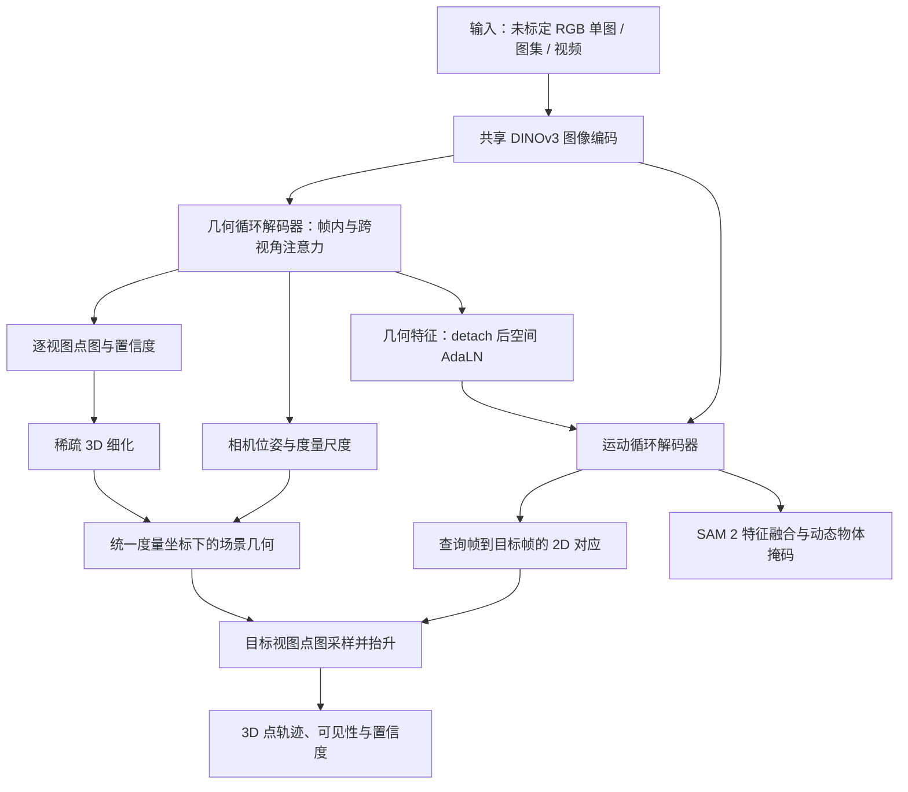
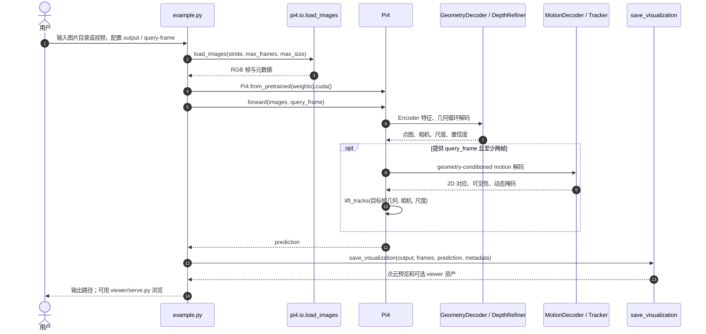

# π⁴（Pi4）：4D 场景几何与运动基础模型 / A Foundation Model for 4D Scene Geometry and Motion

## 一句话定义

**π⁴（Pi4）** 是统一的 4D 场景**感知**基础模型：从未提供相机标定的 RGB 图像或视频中，恢复每视角稠密三维几何、相机位姿与度量尺度，并在多图输入时联合估计像素/三维点轨迹和运动物体掩码；它**不是**预测未来动作的世界动作模型。

## 英文缩写速查

| 缩写 | 英文全称 | 简要说明 |
|---|---|---|
| Pi4 / π⁴ | A Foundation Model for 4D Scene Geometry and Motion | 论文模型，统一几何与运动感知 |
| RGB | Red, Green, Blue | 模型接收的图像通道；不要求附加深度或相机外参 |
| DINOv3 | DINO version 3 | 几何与运动分支共享的视觉编码器 |
| AdaLN | Adaptive Layer Normalization | 将几何特征注入运动解码器的空间条件机制 |
| SAM 2 | Segment Anything Model 2 | 运动物体掩码头采用的冻结视觉特征编码器 |
| SfM | Structure from Motion | 经典多视图结构与相机联合恢复；用于方法对照 |
| ATE | Absolute Trajectory Error | 长序列相机轨迹误差，越小越好 |
| AJ | Average Jaccard | 论文 2D/3D 点跟踪评测指标，越大越好 |

## 核心信息

| 项 | 核对结果 |
|---|---|
| 机构 | 上海人工智能实验室、上海交通大学、浙江大学 |
| 作者 | Yifan Wang、Weiguang Zhao、Ni Yang、Haoyu Guo、Junting Dong、Weinan Zhang、Chunhua Shen |
| 论文 | [arXiv:2611.23144v1（2026-11-17）](https://arxiv.org/html/2611.23144v1)，[PDF](https://arxiv.org/pdf/2611.23144) |
| 项目 / 实现 | [项目主页](https://yyfz.github.io/pi4/) · [推理代码](https://github.com/yyfz/Pi4) · [模型权重](https://huggingface.co/yyfz233/Pi4) |
| 输入 | 单张图、无序图像集合或视频，均为 RGB；无需输入相机标定；点跟踪须至少两幅图 |
| 输出 | 本地稠密点图、相机位姿、度量尺度和可信度；指定查询帧时额外输出 2D/3D 跟踪、可见性、跟踪置信度与动态掩码 |
| 模型规模 | 联合几何 + 运动模型约 **0.5B** 参数；论文 Table 2 的 **343M** 是单独用于几何比较的模型规模，不应混写 |

## 为什么重要

- 统一过去分开解决的多视角三维重建、相机估计、密集点匹配、运动跟踪与运动物体分割；输入可来自随手拍摄而非固定相机阵列。
- 从论文中的 π³ 无参考视角几何表示出发，增加**几何条件运动分支**，而不是直接对三维终点做独立回归；3D 轨迹通过目标帧重建表面上的像素对应点抬升得到。
- 推理可在一次网络前向中联合处理大量视图；但「一次前向」不等于常数算力，显存开销仍随帧数增长，长序列精度也存在边界。
- 对机器人是**视觉几何和轨迹感知的上游组件**；将点图用于 Real2Sim 仍需要碰撞几何、物性、关节与物理验证。

## 核心原理

**1. 共享编码、独立循环解码。** DINOv3 提取每幅图的特征；几何和运动分支各自反复使用帧内 / 跨视角 Transformer 块，块内共享循环权重，两个分支之间不共享解码器参数。论文评估采用几何 16 轮、运动 8 轮解码；几何分支无固定参考视角与视图顺序嵌入。

**2. 几何、相机和尺度。** 点图用每像素相机射线与正深度参数化；相机头预测位姿，尺度头预测序列度量因子；稀疏三维 U-Net 按射线/对数深度细化局部几何。论文使用相对相机监督，使输入视图顺序改变不会任意改变结果身份。

**3. 几何条件对应关系。** 在冻结几何网络后训练运动解码器，借空间 AdaLN 接收几何特征。跟踪头先得到查询帧到目标帧的二维对应点，再在**目标帧**的重建点图上采样并变换到共同度量坐标，形成三维点轨迹：

```text
2D 对应关系 U(q→i, u)  →  目标视图点图 X_i[U(q→i, u)]  →  3D 轨迹 Y(q→i, u)
```

这保证可见的轨迹点**按构造**落在预测表面上，但并不保证表面本身对真实世界完全准确。

**4. 动态掩码及分阶段训练。** 融合运动特征与冻结 SAM 2 图像编码器特征输出逐帧运动物体概率。几何训练用公共数据、多视角场景渲染、前景抑制互联网视频伪标签与 GameRealm；运动阶段冻结几何网络，另行训练跟踪和掩码头。互联网视频仅保留原始图像**可见背景**对应的伪标签，避免把视频修补区域当真实几何监督。

## 流程总览



运动估计和掩码只在多图跟踪请求中启用。这里的 4D 指**场景结构随观测变化的跟踪**，不意味着有显式未来动作预测或动力学仿真。

## 源码运行时序图

以下顺序核对官方 `example.py`、`pi4/io.py`、`pi4/models/pi4.py`、`pi4/visualization.py` 和 README。官方仓库目前提供固定架构的**推理路径**，不应将论文中的训练阶段误作仓库已有训练 CLI。



复现示例：`python example.py examples/figure_skating.mp4 --output outputs/pi4-demo --query-frame 0 --stride 1 --max-frames 25 --viewer`；然后 `python viewer/serve.py outputs/pi4-demo --port 8080`。这里只说明官方已核实的调用关系，**未在本任务环境运行 CUDA 推理**。

## 工程实践

| 维度 | 建议 / 来源约束 |
|---|---|
| 开源状态 | **已开源推理代码 + 权重**；官方 README 和 `docs/inference.md` 明确为固定推理模型，**未提供完整训练框架**；代码与模型权重采用 **CC BY-NC 4.0**，商业使用受限 |
| 环境 | Linux x86-64、Python 3.11、NVIDIA BF16 GPU；README 推荐 PyTorch 2.12.1 + CUDA 12.6 + Triton 3.7.1，稀疏几何细化需要 CUDA |
| 输入 | `[B,T,3,H,W]` 浮点 RGB、范围 `[0,1]`，高宽为 16 的倍数。图像、排序的图片目录或视频由 `load_images` 处理 |
| 输出核对 | `local_points` 与相机平移首先处于网络原生尺度；`metric_scale` 给度量化比例。`tracks_3d` 已由抬升函数变换到预测度量坐标，不能重复缩放 |
| 运行预算 | 官方 A800 测试 150 帧（512×288）峰值显存 **12.03 GiB**；小显存先减帧数。此值不是其它 GPU 的保证，也不能据此宣称 8GB 显卡可完整跑 150 帧 |
| 训练事实 | 论文报告 **64 张 A800**，几何阶段约 30 万次优化更新，运动阶段约 10 万次；最高训练视图数 **64**，不等于推理只支持 64 帧 |
| 用于机器人 | 可作为相机轨迹、背景/运动目标筛选、稠密场景几何及视频跟踪的感知线索；碰撞、质量/摩擦、关节及接触可行性必须由下游另做 |

## 实验与评测

- **几何（Table 2）：** 10 个比较方法、4 组共 **16 个任务–数据集设置**。π⁴ 的总体平均排名 **3.00（第一）**，Pi3X **3.10（第二）**；但单图深度子组 π⁴ 排名 **3.50**、Pi3X **2.57**，因此不是每一子任务都领先。论文几何表列的 π⁴ 参数量为 **343M**，不是全部几何+运动系统。
- **长序列（Oxford Spires，Table 3）：** 六条路线、每条 **361–800 帧**，π⁴ 完成 6/6；ATE **0.7337 m**、CD **1.1573 m**、F1@4m **0.9392**。DVLT 对应 ATE **1.3885 m**、CD **1.5238 m**。该结果是论文列出的特定数据集/协议。
- **单目跟踪（Table 4a）：** 在 ADT、PointOdyssey、Panoptic Studio、GameRealm(Long) 的论文聚合上，π⁴ 平均 2D AJ **72.43**、3D AJ **47.68**；并非所有指标最佳。3D 分数采用对齐协议，不能当直接绝对米制误差比较。
- **多视角跟踪（Table 4b）：** 58 个场景–相机配置，四相机、24 个同步时刻；平均 2D AJ 排名第一，2D APD 与两项 3D 指标排名第二。
- **运动物体分割（Table 5）：** SegTrackv2、FBMS Test、YTVOS19-M 的平均 J&F **85.04**，次于 GMOS 的 **87.48**；不能称分割全面 SOTA。
- **消融（`6）：** 几何条件运动相较未条件化版本整体 EPE 降低 **7.17 像素**，大相机基线图像对降低 **8.10 像素**；该差异来自匹配消融设置，而非机器人真实任务收益。

## 与其他工作对比

| 工作 | 关键区别 | 注意 |
|---|---|---|
| [VGGT](paper-vggt-visual-geometry-grounded-transformer.md) | 前馈统一几何、相机和点轨迹的基线 | π⁴ 额外明确几何条件运动分支、掩码与长上下文训练方案 |
| π³ / Pi3X（论文比较对象） | 无参考视角、排列等变几何设计的前身 | π⁴ 沿用该几何表述，扩展联合运动估计；不能用总参数量直接比几何模型 |
| [GenSfM](paper-gensfm.md) | 稀疏物体视图下，生成完整物体 mesh/3DGS 并估计相机 | π⁴ 偏场景点图与运动**感知**，不负责不可见物体形状生成 |
| 经典 SfM / BA | 优化多视角几何一致性 | π⁴ 前馈速度与统一任务范围有价值，论文承认长序列精度不总优于优化法 |

## 结论

**π⁴ 适合无标定 RGB 的联合几何与运动感知，但不应把一次前馈的视觉重建误作物理一致的数字孪生或未来动力学模型。**

1. 输入单图可做几何；需要 2D/3D 跟踪时至少两帧，并提供 `query_frame`。
2. 运动先回归二维对应、再从目标视图点图抬升到三维，重点检查**几何误差导致的轨迹偏差**。
3. 比性能应区分几何模型 **343M** 与完整约 **0.5B**，并按 16 项几何设置和跟踪独立协议评判。
4. 准备推理前先确认 NVIDIA CUDA/BF16、所需显存及许可；官方开放推理，不代表训练脚本已开放。
5. 若用于 SLAM/Real2Sim，仍需长序列校正、物理建模与实际场景精度验证。

## 局限与风险

- **相机与物体运动混淆：** 大幅运动前景遮挡、弱纹理背景下，仍会把前景运动解释为场景静止或相机运动。
- **坐标原点敏感：** 离重建原点更远的相机，位姿误差可能更大。
- **长序列外推：** 即使能一次处理远超 64 视图的序列，也不保证全局相机轨迹稳定；论文明确指出与传统几何优化的精度差距。
- **工程边界：** 输出点云与轨迹不包含可靠的物体质量、摩擦、铰接关系或经验证的碰撞形状；本论文不是操作策略、动作规划、世界动作模型或实时 SLAM 系统。
- **复现边界：** 已核实代码与权重可获取，但本次只静态阅读了源码；没有做 GPU 实测，显存和精度使用论文/官方 README 口径。

## 关联页面

- [VGGT：Visual Geometry Grounded Transformer](paper-vggt-visual-geometry-grounded-transformer.md) — 统一前馈几何的对照基线。
- [GenSfM：联合形状生成与相机估计](paper-gensfm.md) — 物体生成补全与场景几何跟踪的分工。
- [Real2Sim 纵深 Stage 1](../../roadmap/depth-real2sim.md) — 视觉感知结果如何接入下游可仿真资产构建。
- [VGGT 几何状态综述](../overview/vggt-geometric-state-survey.md) — 相机、点图和点跟踪的更广泛谱系。
- [LingBot-Map：流式三维重建](../methods/lingbot-map.md) — 对比 π⁴ 一次前向联合处理多帧与流式建图的输入窗口、内存管理和长程一致性。
- [立体匹配基础模型与基准生态](../methods/stereo-matching-foundation-models.md) — 对比需校正双目几何的视差/深度输出，与 π⁴ 不依赖标定的多视角点图/相机/轨迹联合估计。
- [机器人视觉感知栈选型闭环](../queries/robot-perception-stack-selection-loop.md) — 将 π⁴ 放进稠密几何、运动分割、轨迹跟踪与算力/实时性选型。

## 参考来源

- [π⁴ 论文原文归档](../../sources/papers/pi4_arxiv_2611_23144.md)
- [官方项目页归档](../../sources/sites/pi4-4d-scene-geometry-motion.md)
- [官方推理仓库归档](../../sources/repos/pi4-4d-scene-geometry-motion.md)

## 推荐继续阅读

- [论文 HTML 全文（v1）](https://arxiv.org/html/2611.23144v1) · [PDF](https://arxiv.org/pdf/2611.23144)
- [官方项目主页与交互演示](https://yyfz.github.io/pi4/)
- [官方 GitHub 推理实现与运行说明](https://github.com/yyfz/Pi4)
- [官方推理文档](https://github.com/yyfz/Pi4/blob/main/docs/inference.md)
- [Hugging Face 权重](https://huggingface.co/yyfz233/Pi4)
