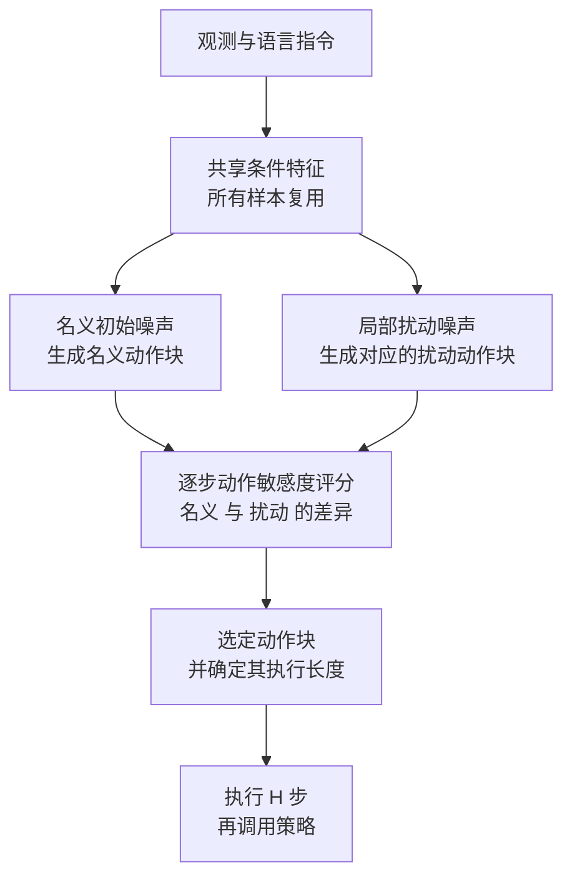

# PICES：扰动感知的 VLA 动作块与执行长度选择

**PICES**（*Perturbation-Informed Chunk and Execution Horizon Selection*；论文 *Accelerating VLA Inference with Perturbation Informed Execution*，[arXiv:2610.19656](https://arxiv.org/abs/2610.19656)）面向动作分块 VLA：在一次策略调用中，同时比较名义动作块与其局部扰动版本的差异，据此决定每个候选块应执行多少步，并从中选出实际执行的块，以减少策略调用次数。

## 英文缩写速查

| 缩写 | 英文全称 | 简要说明 |
|------|----------|----------|
| VLA | Vision-Language-Action | 以视觉与语言为输入、输出机器人动作的策略 |
| PICES | Perturbation-Informed Chunk and Execution Horizon Selection | 本文方法：扰动感知的动作块与执行长度联合选择 |
| Horizon | Execution Horizon | 每次策略调用后实际执行的动作步数，本文的核心自由度 |
| RMSE | Root Mean Square Error | 论文用来比较名义 chunk 与参考动作偏差的指标 |
| AAC | 全称未核实 | 文中对比的既有分块加速方法之一（缩写沿用论文）|

## 为什么重要

- **推理延迟限制了执行频率：** 动作专家每次调用都要多步去噪，论文在 Jetson 上测得的单次调用延迟处于百毫秒量级。
- **固定 horizon 很粗糙：** 长 horizon 摊薄成本，却减少了中途修正的机会；短 horizon 则多次调用、成本高。
- **训练免费：** 方法只在推理时改变采样与选择规则，可以叠加到已有 VLA 检查点上。

## 核心信息

| 项 | 内容 |
|----|------|
| **机构** | 首尔大学（SNU） |
| **平台 / 评测** | Jetson Orin、Jetson Thor 推理延迟；仿真含 SimplerEnv–Fractal 与 LIBERO，另有真实机械臂三任务 |
| **数据 / 模型** | 在公开 VLA 检查点上测试（流匹配动作专家，并与分块加速方法对比） |
| **开源** | **未核实**：论文与摘要声明代码位于匿名仓库 `anonymous.4open.science/r/PICES_VLA-B1BF`；2026-10-15 访问返回 401，内容与许可证无法核对 |

## 核心原理

### 流程总览

- **输入：** 观测、语言指令，以及动作专家的初始噪声。
- **关键机制：** 同一条件特征下生成多条名义与扰动动作块；对每一步计算两者差异，差异小说明该段动作稳定、可以执行更久；候选块各自得到执行长度，再选出名义块。
- **输出：** 本次执行的动作块前缀与下一次调用之前的步数。

## 工程实践

| 项 | 建议 |
|----|------|
| 部署 | 在 Jetson 或同等边缘 GPU 上实测单次调用延迟，再换算吞吐 |
| 候选数 | 论文显示候选数量会影响结果，应按延迟预算与成功率折中调参 |
| 扰动尺度 | 扰动过大会误判稳定段，过小则区分度不足，需在验证集上扫描 |
| 对照 | 与固定 horizon 基线、以及 sample-matched 变体同时比较，区分"加速"与"多采样"的贡献 |
| 源码运行时序图 | **不适用**（匿名仓库本次无法访问，无法核实可运行入口） |

## 实验与评测

- **摘要结论：** 相对固定 horizon 基线，策略推理 wall-clock 时间最高 **2.3×** 加速（Jetson Orin 与 Thor），成功率同时提升。
- **仿真：** SimplerEnv–Fractal 六个 Google Robot 任务（每任务 100 episodes），记录成功率、平均策略调用次数与单次延迟；LIBERO 四个 suite 的平均成功率与调用次数。
- **真机：** 三个操作任务。
- **对比：** AAC、AutoHorizon、A3 等方法，以及 sample-matched 变体（同样的采样预算）。

## 结论

**PICES 的价值在于把"何时重新调用策略"变成按动作稳定性决定的问题，而不是固定的超参。**

1. **加速来自更少的策略调用，而非更小的模型** — 在同一检查点上减少调用次数，是边缘部署的直接收益。
2. **扰动敏感度是可用的稳定性信号** — 名义与扰动动作一致的段可以放心执行更久，分歧大的段需要频繁重规划。
3. **读加速比要看硬件** — 2.3× 是 Jetson Orin 与 Thor 上相对固定 horizon 的 wall-clock 数字，换平台需重新测。
4. **与采样预算对照** — 候选数增加本身会消耗算力，应与 sample-matched 变体对比，避免把多采样当成加速。
5. **代码可复现性待确认** — 目前只能依据论文描述复现，匿名仓库公开后需要再核查。

## 与其他工作对比

| 维度 | PICES | 固定执行 horizon | 其他分块加速方法（如 AAC、AutoHorizon） |
|------|-------|------------------|----------------------------------------|
| 是否需要训练 | 否 | 否 | 视方法而定 |
| horizon 选择依据 | 扰动敏感度，逐候选 | 固定常数 | 各方法自有规则 |
| 对成功率的影响 | 论文称同时提升 | 长 horizon 可能减少修正机会 | 文中列出的对比结果不一 |

与 [动作分块](../methods/action-chunking.md) 的基本假设一致，本文关注的是分块之后的执行长度，而非分块本身的设计。

## 局限与风险

- **依赖动作专家结构：** 方法依赖流匹配动作专家的去噪过程，换成其他动作头需要重新验证。
- **边缘收益与任务相关：** 不稳定或接触丰富的阶段会退化为短 horizon，加速比随任务变化。
- **实现细节未核实：** 代码为匿名链接，本次无法访问；扰动尺度、候选数等超参需以论文附录为准。
- **安全相关：** 执行更长的动作块意味着更长时间不再观测，在动态环境中需配合 [控制与推理频率解耦](../concepts/control-inference-frequency-decoupling.md) 的监控。

## 关联页面

- [动作分块](../methods/action-chunking.md) — 分块策略的基本概念
- [VLA](../methods/vla.md) — 本文作用的策略类别
- [滚动时域策略执行](../concepts/receding-horizon-policy-execution.md) — 执行长度与重规划的关系
- [控制与推理频率解耦](../concepts/control-inference-frequency-decoupling.md) — 推理慢于控制时的系统结构
- [流匹配具身策略](../concepts/flow-matching-embodied-policy.md) — 本文所依赖的动作生成方式

## 参考来源

- [PICES 论文归档](../../sources/papers/pices_arxiv_2610_19656.md) — 摘要、论文 HTML 摘录与代码链接核查
- [微信图文：31 篇具身论文速览（2026-10-15）](../../sources/raw/wechat_embodied_station_robot_31_papers_2026-10-15.md) — 文章中的一句话转述

## 推荐继续阅读

- [arXiv:2610.19656](https://arxiv.org/abs/2610.19656) — 完整论文，含 Jetson 延迟分析与附录
- [OpenVLA（arXiv:2406.09246）](https://arxiv.org/abs/2406.09246) — 本文引用的 VLA 代表性工作，可作为背景阅读
