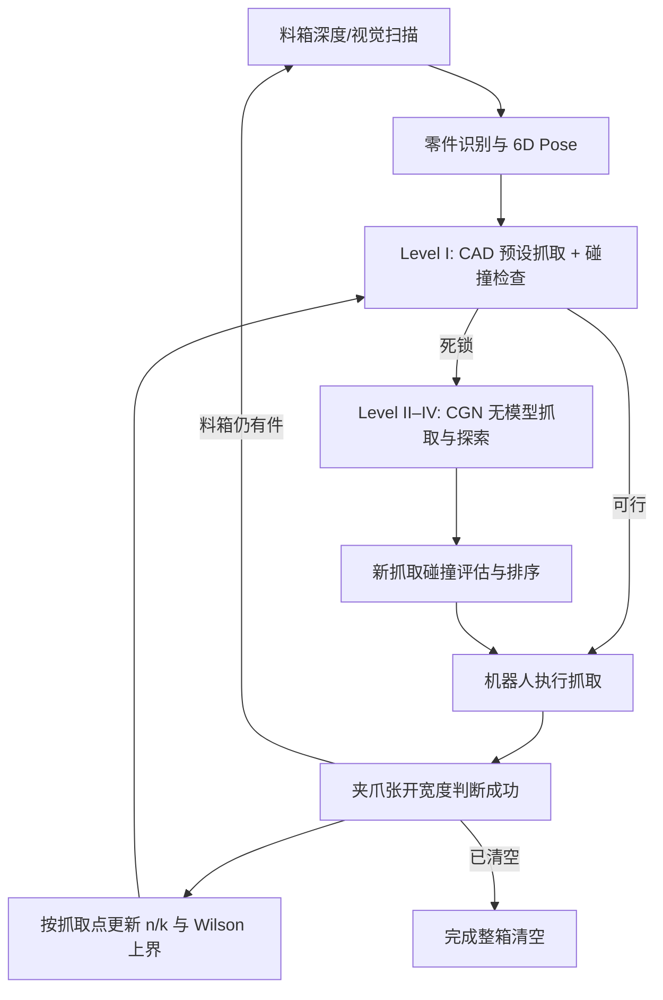

# Picking Bins Empty：在线抓取点自学习的层级混合工业料箱清空

**英文：** Picking Bins Empty: A Hierarchical Hybrid Approach with Online Self-Learning of Grasp Points for Reliable Industrial Bin-Picking · [原论文](https://arxiv.org/abs/2608.28175)

## 一句话定义

将基于 CAD 的精确抓取与模型无关抓取和基于夹爪反馈的在线统计相结合，以多级 fallback 降低工业料箱抓取遇到长尾姿态时的死锁。

## 英文缩写速查

| 缩写 | 英文全称 | 简要说明 |
|---|---|---|
| CAD | Computer-Aided Design | 零件先验几何及预设抓取点 |
| 6D | Six-Dimensional Pose | 物体姿态估计，3D 平移与旋转 |
| CGN | Contact-GraspNet | 模型无关候选抓取生成器 |
| GSR | Grasp Success Rate | 尝试抓取成功率，区别整箱清空率 |
| CI | Confidence Interval | 在线抓取评价采用的 Wilson 置信区间 |

## 为什么重要

产线更看重能否把整箱零件抓空，而不只是平均单次抓取成功率。基于模型的规划可能因最后几个零件的遮挡与碰撞约束死锁；模型无关抓取虽可补救，却需要解决可靠性与节拍。

## 核心信息

| 维度 | 内容 |
|---|---|
| 论文身份 | arXiv:2608.28175（v1（2026-08-28）） |
| 奖项 | IROS 2026 Best Paper Award for Industrial Robotics Research for Applications（[2026 四大顶会策展索引](../../sources/blogs/wechat_shenlan_four_robotics_conferences_12_awards_2026_11_17.md)） |
| 源码/数据 | 论文原文可公开访问；未找到研究团队提供的完整系统官方源码/项目入口，不能声称已开源 |
| 研究定位 | Picking Bins Empty：在线抓取点自学习的层级混合工业料箱清空 |

## 流程总览

## 核心原理与方法

四层分层：优先基于已知零件 CAD/6D pose 和预设 grasp 点进行碰撞检查；不可行时调用无模型抓取候选和探索；按实机夹爪开口宽度判断抓取是否成功，将每个 grasp 的成功次数 n/k 更新到 Wilson 区间，依上置信界和人工先验做候选排序；陷入死锁时继续向后备层级升级。

## 源码运行时序图

**不适用：** 已核对论文 v1 的系统方法与实验描述，但没有公开可运行的系统代码/训练脚本入口，无法依据真实仓库绘制调用序列。工程落地需要确保 CAD/抓取点标注、6D pose、碰撞检查、夹爪行程反馈和错误处置共同闭环。

## 工程实践

**源码运行时序图不适用**：已核对论文 v1 的系统方法与实验描述，但没有公开可运行的系统代码/训练脚本入口，无法依据真实仓库绘制调用序列。工程落地需要确保 CAD/抓取点标注、6D pose、碰撞检查、夹爪行程反馈和错误处置共同闭环。

## 实验与评测

作者在 **三种汽车工业零件**进行料箱试验：仅模型方案整箱清空率 **50.9%**，混合策略达到 **100%**（论文实验范围内）。模型无关候选生成增加约 **1.01s**，4096 候选碰撞检查约 **1.36s** 开销，需与人工干预减少共同核算节拍。

## 结论

**总判：将基于 CAD 的精确抓取与模型无关抓取和基于夹爪反馈的在线统计相结合，以多级 fallback 降低工业料箱抓取遇到长尾姿态时的死锁。**

1. 产线验收同时统计整箱清空率、抓取成功率与总周期时长。
2. 优先稳定模型抓取，陷入死锁时再启用代价更高的探索层。
3. 按真实夹爪反馈更新抓取点置信度，比永远沿用人工预设顺序更能适应零件差异。
4. 100% 清空是论文三类工件的实验结果，不应直接承诺为通用工业 SLA。

## 与其他工作对比

与纯 CAD 方案相比，后备候选能解决遮挡与不可达死锁；与纯 CGN 相比，优先用验证过的抓取点提高单次可靠性并维持可预测工艺。

## 局限与风险

三类零件与试验料箱中 100% 清空不等于任意工业零件、工况都达到 100%；探索可能降低部分初期抓取成功率；夹爪行程只能间接判断抓取，复杂缠绕零件和视觉错误仍需额外异常处理。

## 关联页面

- [VL-Nav](./paper-vl-nav.md)
- [SteadyTray](./paper-notebook-steadytray.md)
- [操作任务](../tasks/manipulation.md)
- [接触操作路线](../../roadmap/depth-contact-manipulation.md)

## 参考来源

- [原始论文阅读归档](../../sources/papers/picking-bins-empty_arxiv_2608_28175.md)（v1（2026-08-28）；已标注方法、评测和局限）
- [2026 四大顶会获奖综述（仅用于奖项线索）](../../sources/blogs/wechat_shenlan_four_robotics_conferences_12_awards_2026_11_17.md)

## 推荐继续阅读

- [原论文全文（arXiv HTML）](https://arxiv.org/html/2608.28175)

