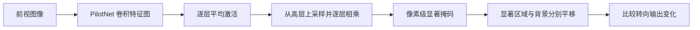

# PilotNet：解释端到端转向网络的视觉依据

*Explaining How a Deep Neural Network Trained with End-to-End Learning Steers a Car*（[arXiv:1704.07911](https://arxiv.org/abs/1704.07911)）。

## 一句话定义

利用多层卷积特征激活逐级构造显著性掩码，定位 PilotNet 转向预测所依赖的图像区域。

## 英文缩写速查

| 缩写 | 英文全称 | 简要说明 |
|---|---|---|
| CNN | Convolutional Neural Network | 被解释的视觉转向网络 |
| PilotNet | Pilot Network | NVIDIA 网络名称 |
| LRP | Layer-wise Relevance Propagation | 论文讨论的另一类解释方法 |
| YUV | Luma and Chrominance Color Space | 网络摄像头输入表示 |

## 为什么重要

端到端控制可以学习到有用的道路视觉特征，但仅有转向结果无法说明模型关注的环境线索。这篇工作提供可视化与干预实验作为解释依据。

## 核心信息

| 项目 | 内容 |
|---|---|
| 原始论文 | [arXiv:1704.07911](https://arxiv.org/abs/1704.07911) |
| 研究机构 | 英伟达（NVIDIA）、纽约大学、Google Research |
| 原文复核状态 | **已阅读原始论文全文（含方法与实验，附录情况见来源归档）** |

## 核心原理

先对每层卷积特征图求平均，从较高层向较低层反卷积式上采样，并将上层掩码与下层平均激活逐级相乘，直到输入分辨率。最终掩码归一化到 [0,1]，叠加显示显著像素。论文另将掩码区域与背景分别平移，比较转向输出响应，以验证掩码不是仅凭视觉直觉挑出的区域。

## 流程总览

## 工程实践

先确认网络架构、输入归一化和特征层范围，再构造每层的平均图与逐层掩码；对显著区域按原论文阈值与约 30 像素膨胀处理后单独平移，对照移动背景像素得到的预测变化。实验是针对固定 PilotNet 的诊断，不需要重新训练 VLA。

## 源码运行时序图

**不适用**：未核实与此论文逐项对应的官方可运行实现。

## 实验与评测

已核对论文 PDF 的逐层掩码算法示意、实际高亮图像与显著区域横移实验。上采样的反卷积按原卷积核与步长匹配，权重设 1、bias 设 0；论文的区域平移消融显示：仅平移显著区域可引发接近整图平移的转向响应，而移动背景像素的影响更小。可视例子中，车道边界、停靠车辆及草丛边缘都可能被高亮。

## 结论

**本研究的定位：利用多层卷积特征激活逐级构造显著性掩码，定位 PilotNet 转向预测所依赖的图像区域。**

1. 显著掩码提供空间可解释性线索，不等同具备安全证明。
2. 对掩码区域做输入干预可检验其对转向输出的实际影响。
3. 高层激活向低层投影的方法不要求额外的人为目标检测器。
4. 应与原始 DAVE-2 的闭环控制实验共同阅读。

## 局限与风险

显著性是针对所测试图像/模型的局部证据，不能代替分布外鲁棒性与安全测试；遮挡和图像干预可能带来非自然输入。**源码运行时序图不适用**（本轮未核实对应官方完整实现）。

## 与其他工作对比

[DAVE-2](./paper-dave2-end-to-end-driving.md) 建立端到端视觉转向，[本论文](./paper-pilotnet-saliency.md) 解释其视觉线索；不同于 [VLA token 综述](./paper-vla-action-tokenization-survey.md) 的动作表示系统分类。

## 关联页面

- [DAVE-2 原论文](./paper-dave2-end-to-end-driving.md)
- [VLA token 综述](./paper-vla-action-tokenization-survey.md)
- [11 篇历史阅读路线](../overview/robot-learning-foundations-11-papers.md)

## 参考来源

- [论文核验与阅读归档](../../sources/papers/pilotnet_saliency_arxiv_1704_07911.md)
- [arXiv 官方原文](https://arxiv.org/abs/1704.07911)

## 推荐继续阅读

- [官方相关一手资源](https://developer.nvidia.com/blog/explaining-deep-learning-self-driving-car/)
