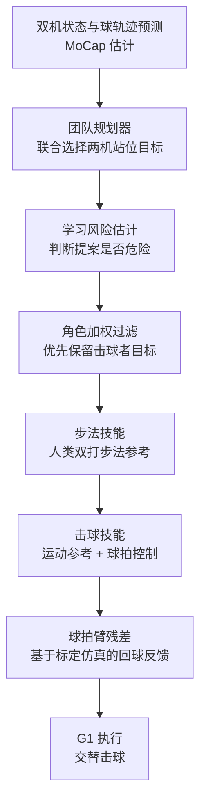

# PingpongDuo：人形乒乓球双打与安全团队协同

**PingpongDuo**（论文 *PingpongDuo: Agile Humanoid Table Tennis Doubles with Safe Team Coordination*，[arXiv:2610.20579](https://arxiv.org/abs/2610.20579)，[项目页](https://www.archon.tech/research/PingpongDuo)）由上海创智学院、源策未来（Archon Robotics）、香港大学与英伟达的作者提出：在两台 Unitree G1 上实现 **乒乓球双打**，用团队层的风险感知站位规划避免队友碰撞，并用个体层的步法与击球技能保证击球精度。

## 一句话定义

**把双人乒乓球拆成「谁去哪站位」与「怎样移动并击球」两层：团队层用学习风险估计过滤站位提案，个体层用步法、击球与球拍残差三段技能完成连续交替回球。**

## 英文缩写速查

| 缩写 | 英文全称 | 简要说明 |
|------|----------|----------|
| PingpongDuo | 论文框架名（非缩写） | 本文框架：人形双打乒乓球系统 |
| CBF | Control Barrier Function | 控制屏障函数，作为启发式安全过滤的对照 |
| RL | Reinforcement Learning | 团队站位策略与技能训练的基础范式 |
| SRC / SRH | 论文表 III 指标缩写（未在摘要中展开） | SRC 为接触成功率，SRH 为回球成功率（由正文推断，定义以表 II 为准） |
| MPJPE | Mean Per-Joint Position Error | 策略对自身参考动作的跟踪误差 |
| MoCap | Motion Capture | 实验中用于机器人与球状态估计的动捕系统 |

## 为什么重要

- **双打比单打难一个量级：** 两台机器人共享窄桌旁的工作区，击球必须严格交替，任何一方抢位都会造成碰撞或漏击。
- **快速移动与精准击球存在耦合：** 步法后身体残余运动会让击球精度下降，本文用球拍臂残差在击球阶段修正，而不是只靠加强步法。
- **对多机协同有参考价值：** 论文用「风险估计 + 角色加权过滤」处理团队安全，而不是把全部规则写死在规划里，适合作为人形多机协作的小型基准。

## 核心信息

| 项 | 内容 |
|----|------|
| **机构** | 上海创智学院（Shanghai Innovation Institute）；源策未来（Archon Robotics）；香港大学（HKU）；英伟达（NVIDIA） |
| **平台** | 双台 Unitree G1（29 DoF）；仿真 Isaac Lab，控制 50 Hz |
| **数据 / 参考** | 人类双打的步法动作采集作为运动参考；球飞行与接触参数用真实测量标定的仿真器 |
| **开源** | **未开源**（截至 2026-10-15）：项目页仅列论文 PDF、视频与网页交互回放，无代码链接；论文未声明代码发布 |

## 核心原理

### 流程总览

### 团队层：风险感知的联合站位

- 规划器同时为两台机器人选择站位目标，使击球者有足够空间，同时为下一拍留出时间与位置。
- 学习到的风险估计先过滤危险提案，再由 **角色加权过滤** 偏向当前击球者的目标，非击球者的规划位置随之调整。
- 论文用 RL 训练规划策略（表 I 中 RL + Learned Risk），启发式规则与 CBF 滤波作为对照。

### 个体层：步法与击球分离，再组合

- **步法与击球技能** 分别训练，用人类动作参考约束风格；两个技能的训练状态相互产生，以支持快速切换。
- **球拍臂残差** 只在击球阶段激活（相位门控），根据仿真中的回球反馈修正七维手臂动作；仿真器用真实球飞行与接触测量做标定，并做分阶段网格搜索。

## 工程实践

| 项 | 建议 |
|----|------|
| 复现入口 | 论文未公开代码；可先复现「规则站位 + 单机击球」基线，再加入风险过滤 |
| 站位安全 | 用学习风险估计过滤提案，比纯规则或启发式 CBF 更能避免机器人接触（论文 Fig. 5 示例） |
| 击球精度 | 步法后用手臂残差修正，比单纯加强步法在接触成功率上更稳（表 III：67.4% vs 55.2%） |
| 标定 | 球-台接触与空气阻力需用动捕标定；论文先做 drop 与斜撞测量再网格搜索 |
| 源码运行时序图 | **不适用**（论文未公开可运行代码，无法对齐仓库入口） |
| 开源状态 | 未开源（2026-10-15 核查：项目页与论文均无代码链接） |

## 实验与评测

- **仿真规划器（表 I）：** RL + Learned Risk 平均回报 4.87±0.74，高于 Rule-based 的 3.60±0.40 与其他启发式变体（约 3.79）。
- **仿真策略（表 III）：** 本文 Composed 设计（SRC 67.4%、SRH 55.6%、Ep 7.43 cm）优于复现的 HITTER 与 SMASH Composed 设计；Joint（单策略）设计的 SRH 为 46.6%，但 Ep 更低（6.00 cm）。
- **击球残差消融：** 去掉 arm refinement 后 SRC 55.2%、SRH 44.2%，说明残差在移动后的击球中有效。
- **真机：** 2.15 m 清球与回位 2.4 s 完成（峰值 2.23 m/s）；两台机器人连续 10+ 次严格交替击球（摘要）。

## 结论

**双人乒乓球的瓶颈在「站位与击球的耦合」：风险过滤保证安全，分层技能与击球残差保证精度。**

1. **站位要过滤，不能只规划** — 学习风险估计 + 角色加权过滤，在表 I 中明显优于纯规则站位（回报 4.87 vs 3.60）。
2. **步法与击球分开训练再组合** — 单策略（Joint）在 Ep 上更好，但组合设计在 SRC/SRH 上更稳，论文以组合为主设定。
3. **击球残差是精度的关键** — 去掉后 SRH 从 55.6% 降到 44.2%，说明步法残余运动需要在击球阶段修正。
4. **仿真结果需与真机区分** — 摘要中的 13.2% 与 2 cm 指标来自仿真，真机侧重于 2.4 s 清球与 10+ 次交替击球的可行性。
5. **基线为作者复现** — HITTER 与 SMASH 按双打指令改编，对比结论依赖这一适配。

## 与其他工作对比

| 对照 | 差异读法 |
|------|----------|
| [HITTER / SMASH（论文基线）](./paper-notebook-towards-versatile-humanoid-table-tennis.md) | 单人乒乓球为主；本文扩展到双人站位协同，基线为作者改编复现 |
| [Sony AI ACE 乒乓](./paper-sony-ai-ace-table-tennis.md) | 面向竞技对打的感知-控制系统；本文侧重双机协同安全 |
| [乒乓球分层技能学习](../methods/table-tennis-strategy-skill-learning.md) | 仿真体育动画中的技能层与策略层；本文是真机双人版的分层设计 |
| [人形多机协同](../concepts/humanoid-multi-robot-coordination.md) | 多机角色与编队的一般框架；本文给出乒乓球场景的风险过滤实例 |

## 局限与风险

- **仅双机、单桌、单球路：** 论文场景固定为两台 G1 与一张乒乓台，扩展到更多机器人或复杂对手未验证。
- **依赖动捕：** 球与机器人状态由 MoCap 估计，真实比赛的视觉感知未覆盖。
- **仿真指标与真机指标不同口径：** 13.2% 为仿真回球成功率提升，摘要未说明相对/绝对；真机只给出清球时间与交替次数。
- **未开源：** 无代码与权重，复现依赖自行实现分层框架与标定流程。

## 关联页面

- [Archon Robotics（源策未来）](./archon-robotics.md) — 论文第二机构与项目页所属团队
- [乒乓球分层技能学习方法](../methods/table-tennis-strategy-skill-learning.md) — 技能层与策略层的分层思路
- [人形多机协同](../concepts/humanoid-multi-robot-coordination.md) — 多机角色与安全过滤的上位框架
- [Sim2Real](../concepts/sim2real.md) — 标定仿真器与真机部署的通用问题
- [人形乒乓球通用策略（notebook）](./paper-notebook-towards-versatile-humanoid-table-tennis.md) — 单人乒乓球对照

## 参考来源

- [pingpongduo_arxiv_2610_20579.md](../../sources/papers/pingpongduo_arxiv_2610_20579.md) — 论文摘录与开源核查
- [arXiv:2610.20579](https://arxiv.org/abs/2610.20579) — 原文（Submitted 2026-10-14）
- [PingpongDuo 项目页](https://www.archon.tech/research/PingpongDuo) — 论文 PDF、视频、交互回放（无代码）

## 推荐继续阅读

- [PingpongDuo 项目页](https://www.archon.tech/research/PingpongDuo) — 论文 PDF、视频与交互回放
- [arXiv 全文 PDF](https://arxiv.org/pdf/2610.20579) — 方法与表 I–III 的原始数字
