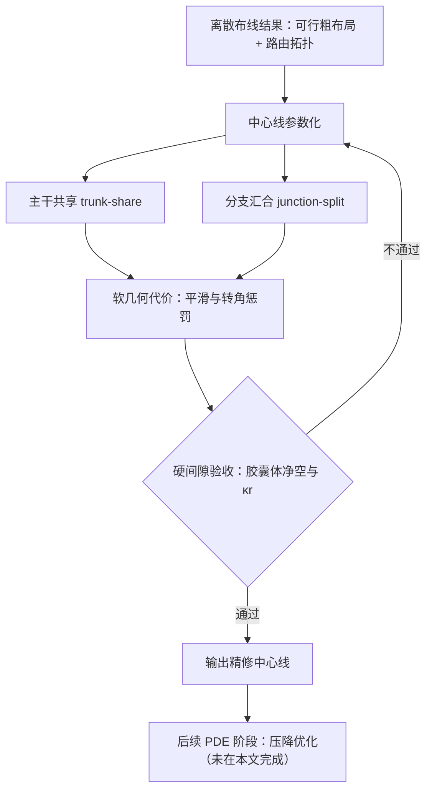

# 拓扑保持的多用途管路中心线精修

**拓扑保持的多用途管路中心线精修**（*Topology-Preserving Multi-Usage Pipe Centerline Refinement under Permanent Tubular Occupancy*，[arXiv:2610.19403](https://arxiv.org/abs/2610.19403)）针对已经给定路由拓扑与可行粗布局的分支管路，在永久管状占据的约束下，精修每根管的中心线，减少离散布线留下的直角转折。

## 英文缩写速查

| 缩写 | 英文全称 | 简要说明 |
|------|----------|----------|
| AM | Additive Manufacturing | 增材制造；论文的典型对象是增材制造的液压歧管 |
| PDE | Partial Differential Equation | 偏微分方程；压降物理优化被推迟到后续 PDE 阶段 |
| κr | curvature × radius | 曲率与管半径之积；论文以 κr ≲ 1 作为几何条件之一 |

## 为什么重要

离散的多组管路布线（网格或粗图上）能得到可行路径，但路径常含大量轴向直角转折，对永久占据的流体管路，会损害几何公平性与流动质量。经典机器人路径平滑处理的是单条临时开放轨迹，与"带终端用途、跨组静态占据的分支管网"不是同一问题。本文把这一下游精修阶段形式化，对管路设计与布线自动化有参考价值。

## 核心信息

| 项目 | 内容 |
|------|------|
| 论文 | Topology-Preserving Multi-Usage Pipe Centerline Refinement under Permanent Tubular Occupancy，arXiv:2610.19403（2026-10-14 提交，cs.RO） |
| 作者 | Deng Quan（提交记录中署名 Quan Deng），单人署名 |
| 机构 | 论文页未列出（未核实） |
| 数据/平台 | 多组套件（8 组 × 8 终端，管半径 r = 2，胶囊体净空）；未命名公开数据集 |
| 开源状态 | **未开源**：论文页只列 PDF、TeX 源码与 DOI，未声明代码；文章所附 `bladesaber/MAPF_Pipeline` 与本文的对应关系未核实（2026-10-15 核查） |

## 核心原理

**一句话机制：** 固定拓扑，把中心线拆成"主干共享"与"分支汇合"两类参数，用软几何代价优化形状，再用硬间隙判定是否接受。

- **拓扑保持：** 路由拓扑在精修中固定，只调整几何。
- **多用途交汇冲突：** 论文指出单一共享分支点无法同时满足各终端用途，因此需要"共享 + 分裂"的混合参数化。
- **验收：** 软代价负责优化，硬间隙负责可行性，不满足则回到参数化。

## 工程实践

| 项 | 说明 |
|----|------|
| 输入 | 给定的路由拓扑与可行粗布局；管半径与跨组占据约束 |
| 判定 | 胶囊体（capsule）净空；κr ≲ 1 作为几何条件 |
| 指标 | 完全硬接受成功率；软目标相对下降（论文报告约 95%） |
| 代码 | 论文未公布代码；文章所附仓库无描述、无许可证可见，且与论文关联未核实，不可直接复现 |
| 源码运行时序图 | **不适用**（论文未声明官方代码，所附仓库未能确认对应本文） |

## 实验与评测

- **设置：** 多组套件，8 组 × 8 终端，管半径 r = 2，使用胶囊体净空判定。
- **结果（转述）：** 报告完全硬接受成功率、κr ≲ 1，以及软目标相对约 95% 的下降。
- **数据：** 页面未描述公开数据集，无法与其他布线或平滑方法做数值对比（未核实）。
- **压降：** 论文明确将压降的物理优化推迟到后续 PDE 阶段，本文不包含。

## 结论

**一句话总判：这篇论文解决的是布线之后的几何精修问题，其价值在问题形式化与硬约束验收，而非通用的平滑算法。**

1. **问题边界清楚** — 面向给定拓扑的永久占据分支管网，与单轨迹平滑不同。
2. **交汇冲突是核心难点** — 单一共享分支点无法同时满足多终端用途，需要混合参数化。
3. **硬验收与软代价分工** — 先用硬间隙保证可制造可行性，再用软代价优化几何。
4. **数字需按条件读** — "约 95% 下降"是软目标的相对变化，不代表流动性能提升，压降尚未评估。
5. **复现暂不可行** — 论文未公布代码，且文章所附仓库与本文的对应关系未核实。

## 与其他工作对比

- **与经典路径平滑：** 经典方法对单条临时开放轨迹做 fairing，本文面向带终端用途与静态占据的分支管网。相关的优化框架参见 [约束优化](../concepts/constrained-optimization.md) 与 [碰撞距离优化](../concepts/collision-distance-optimization.md)。
- **与构型空间规划：** [构型空间](../concepts/configuration-space.md) 的思路可用于理解"占据"约束，但本文的对象是管路几何而非机器人关节空间。
- **与多智能体路径规划（MAPF）：** 文章所附仓库名称含 MAPF，但论文页本身未使用该术语，二者的关系未核实。

## 局限与风险

- 论文只报告了单一实验套件的结果，泛化性未知。
- 压降与流动质量尚未评估，几何改善不等于流动改善。
- 未公开代码与数据，结果难以独立复现。
- 作者单人署名、机构未列出，结果的同行评审状态未知（arXiv 预印本）。

## 关联页面

- [约束优化](../concepts/constrained-optimization.md)：精修问题的数学框架参照。
- [碰撞距离优化](../concepts/collision-distance-optimization.md)：几何净空与距离约束的相关思路。
- [构型空间](../concepts/configuration-space.md)：占据与可行性的基本概念。

## 参考来源

- [pipe_centerline_arxiv_2610_19403 归档](../../sources/papers/pipe_centerline_arxiv_2610_19403.md)

## 推荐继续阅读

- [arXiv:2610.19403：Topology-Preserving Multi-Usage Pipe Centerline Refinement](https://arxiv.org/abs/2610.19403)
- [DOI：10.48550/arXiv.2610.19403](https://doi.org/10.48550/arXiv.2610.19403)
