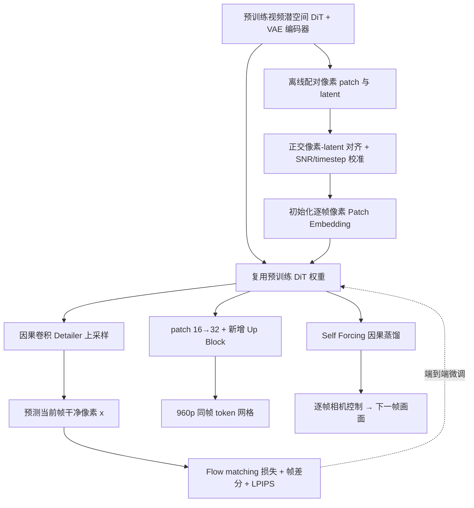

# PixVid：Back to Pixels — 从潜空间视频扩散回到像素逐帧生成

**英文：** Back to Pixels: Lifting Latent Video Diffusion into Pixel Space。Yanke Song、Shuo Chen、Chris Rockwell 等（共 12 位作者），Roblox、加州大学默塞德分校、宾夕法尼亚大学、德克萨斯大学奥斯汀分校；2026-11-12 [arXiv:2611.17336v1](https://arxiv.org/abs/2611.17336)。

## 一句话定义

**PixVid 保留预训练视频 Diffusion Transformer 主干，用像素 Patch Embedding 与因果卷积 Detailer 替代时空 VAE，使视频条件和输出按单帧对齐，而非按压缩的多帧 latent 块对齐。**

## 英文缩写速查

| 缩写 | 英文全称 | 简要说明 |
| --- | --- | --- |
| PixVid | Pixel Video | 本文逐帧像素空间视频生成方法简称 |
| VAE | Variational Autoencoder | 被移除的时空视频编码/解码瓶颈 |
| DiT | Diffusion Transformer | 保留权重、继续微调的视频主干 |
| SNR | Signal-to-Noise Ratio | 迁移初始化时要校准的信噪比 |
| LPIPS | Learned Perceptual Image Patch Similarity | 像素训练中使用的感知辅助损失 |
| VBench | Video Benchmark | 视频生成质量基准 |
| FVD | Fréchet Video Distance | 比较生成视频分布的评测指标 |

## 为什么重要

- **条件对齐：** 时域压缩 VAE 的一个 latent 覆盖多帧，快速运动下的逐帧深度/相机条件难对齐；PixVid 让每个 token 属于单独一帧。
- **像素分辨率缩放：** 双倍边长若沿用固定 patch，会令每帧 token 增至 4 倍；PixVid 用更大的 patch 加一个 detailer 上采样层保持 DiT token 网格不变。
- **交互响应：** 不必等待一个多帧 latent 块的后续控制输入到齐，再开始该块生成；但延迟收益以逐帧计算、较低吞吐为代价。

## 核心信息

| 项目 | 论文及项目页核对结果 |
| --- | --- |
| 机构 | Roblox、加州大学默塞德分校（UC Merced）、宾夕法尼亚大学（UPenn）、德克萨斯大学奥斯汀分校（UT Austin） |
| 基座 | Wan2.1-T2V-14B（常规 T2V / 高分辨率）；SolarWM-5B（交互自回归对照） |
| 核心算子 | 离线 pixel–latent 正交对齐、timestep/SNR 校准、像素 Patch Embedding、因果 3D 卷积 Detailer |
| 训练 | x-prediction + flow matching 损失 + 时间差分 Charbonnier + LPIPS；较大 noise shift |
| 推理 | 像素空间 Euler 采样；交互学生使用 Self Forcing 蒸馏 |
| 官方资源 | [论文](https://arxiv.org/html/2611.17336v1) · [项目页](https://chenshuo20.github.io/PixVid/)；2026-11-17 未见可访问官方代码/权重链接 |

## 核心原理与流程总览

1. **迁移而非从零重训：** 离线从像素 patch 与 VAE latent 拟合正交线性映射 `A`，用 `W Aᵀ` 初始化输入 patch embedding；沿用原视频 DiT 权重，再做 timestep 与尺度校准，让主干看见接近原潜空间训练时的输入分布。
2. **输出头重建：** 废弃 VAE decoder 和原线性输出头，使用仅含解码路径的 detailer；每个 up block 做空间转置卷积与时间因果卷积，像素帧 `t` 依赖当前和之前两帧特征，推流时缓存历史特征。
3. **训练目标：** 直接预测干净视频 `x`，将它转换成 flow matching 速度误差训练，并辅以时序差分与感知损失；相比直接预测噪声相关速度，显著减少像素噪点。采用较大的 noise shift 和 Euler 采样。
4. **分辨率适配：** patch 16→32 时融合 2×2 下采样到输入层，再在 detailer 前增一级初始化为最近邻上采样的 up block；逐帧 token 30×52 不变。
5. **交互分支：** 在同类迁移配方上将 SolarWM 主干因果蒸馏，一帧一个 block；实时相机条件逐帧进入，而不是每 4 帧共享压缩 latent 条件。

## 工程实践

| 项目 | 论文报告 / 实现边界 |
| --- | --- |
| 480p T2V | 832×480，16×16 patch，每帧 30×52 tokens |
| 960p T2V | 1664×960，32×32 patch，每帧仍 30×52 tokens |
| 训练成本 | Wan2.1 14B 迁移使用 64K 合成视频、约 1.3M 训练片段（约 4K B200 GPU-hours）；非小型 GPU 即可复现的配方 |
| Detailer | 14B patch16 约 337M 参数、patch32 约 942M 参数；因果核 3 帧，缓存过去两帧 |
| 控制范围 | 论文低延迟实验测试 **相机姿态控制**；并非直接输出机器人关节动作或接触力 |
| 开源状态 | **代码待发布**：截至 2026-11-17 官方项目页未给出可访问的 GitHub/权重 URL；未执行训练或推理验证 |
| 源码运行时序图 | **不适用**：未发现官方可运行源码入口，不虚构脚本或内部调用关系 |

## 实验与评测

| 比较（论文自报） | PixVid | 基线 | 解释 |
| --- | ---: | ---: | --- |
| VBench 总分（480p） | 84.78 | Wan2.1-T2V-14B：84.05 | 第一批 1.3 秒片段评价；不能泛化到任意视频长度 |
| VBench 总分（960p） | 85.09 | Wan2.1-T2V-14B：84.05（480p） | 跨分辨率基准参照，VBench 本身会下采样 |
| 快速运动深度编辑 motion kept | 98% | 同设置微调 latent：83% | 逐帧条件对齐改善运动保持 |
| 快速运动光流误差（px） | 10.7 | 同设置微调 latent：17.9 | 降低运动误差，非所有指标均领先 |
| 控制到屏幕中位延迟 | 34 ms | SolarWM：495 ms | 单 B200 定制内核；对比 1 帧与 12 帧 block |
| 实时生成吞吐 | 29.4 FPS | SolarWM：72.0 FPS | 更低响应延迟 **不等于** 更高生成吞吐 |

**评测注意：** PixVid 的相机转向响应相关性更好（0.95 vs 0.70），但 81 帧序列旋转误差更大（5.44° vs 4.24°）；视觉质量与相机轨迹准确性需分开验收。

## 与其他工作对比

- **Wan2.1 潜空间模型：** 以时空压缩 VAE 获得长视频吞吐；PixVid 复用其语义/运动先验换取单帧生成与条件对齐，不能将“同每帧 token”误读为任意时长成本不变。
- **PixelUMM：** 作为从零训练的像素视频对照；PixVid 的卖点是利用预训练潜空间模型进行低成本迁移，不是宣称所有像素模型天然更优。
- **SolarWM：** 使用时域压缩与 12 帧块换得吞吐；PixVid 减少等待控制输入造成的时延，但额外计算与相机轨迹漂移代价仍在。
- **具身 WAM：** PixVid 是可条件生成的视频底座/Renderer 研究，不带机器人逆动力学动作头、接触状态验证或策略闭环证据；不能直接归类为可部署的 WAM 控制策略。

## 结论

**PixVid 证明了复用潜空间 DiT 与改造像素接口可同时提高逐帧可控性和分辨率扩展灵活性，但其关键收益是消除时间压缩的结构性等待，而非全面降低计算成本。**

1. 建造交互视频世界模型时，分别测量控制到屏幕延迟与解码 FPS，避免用吞吐代替响应。
2. 像素 Patch Embedding 迁移需要 pixel–latent 对齐、信噪比校准，不是简单删除 VAE。
3. 条件逐帧对齐可帮助快运动深度编辑，但长程相机跟随误差仍可能累积。
4. 960p 对比要同时核对 patch 变大、Detailer 参数增加和基准下采样口径。
5. 若用于机器人，只能把它视为视频生成/渲染组件候选；物理一致性、动作可执行性和真实闭环须另行评测。

## 局限与风险

- 逐帧像素展开降低压缩率；论文的 SolarWM 对照中 PixVid 运行速度 29.4 FPS，而压缩基线 72.0 FPS；硬件条件为单 B200 定制推理。
- 81 帧自回归相机控制评测中，旋转/位移误差高于 SolarWM；连续控制仍需监控轨迹漂移。
- VBench 将帧缩放至最多 512 像素评分，960p 细节增益不能用该分数单独证明。
- 论文展示相机控制、文本视频生成和视频编辑，没有真机机械臂/人形动作部署结论；不应把视觉动作响应等同机器人力控。
- 截至 2026-11-17 无可访问官方训练/推理源码入口，无法审计真实运行时序或宣称开箱复现。

## 关联页面

- [生成式世界模型](../methods/generative-world-models.md)
- [扩散运动生成方法](../methods/diffusion-motion-generation.md)
- [视频即仿真](../concepts/video-as-simulation.md)
- [Diffusion Transformer](../concepts/diffusion-transformer.md)
- [世界–动作模型边界](../concepts/world-action-models.md)
- [WAM 纵深路线：Stage 1 世界基座](../../roadmap/depth-wam.md)

## 参考来源

- [PixVid 论文原文归档](../../sources/papers/pixvid_back_to_pixels_arxiv_2611_17336.md)
- [官方项目页归档](../../sources/sites/pixvid-project.md)
- [arXiv HTML v1 全文](https://arxiv.org/html/2611.17336v1)

## 继续阅读

- [官方项目页及交互相机控制对照](https://chenshuo20.github.io/PixVid/)
- [arXiv PDF（含附录）](https://arxiv.org/pdf/2611.17336)
