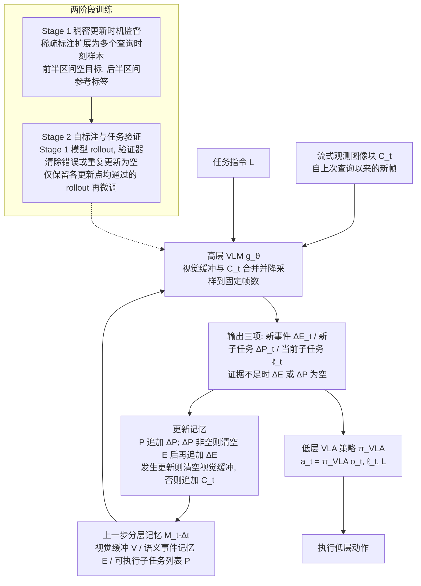

# Plan First, Act Later（arXiv:2610.29329）

**Plan First, Act Later**（*Plan First, Act Later: Streaming Reasoning for Executable Memory in Robot Control*，[arXiv:2610.29329](https://arxiv.org/abs/2610.29329)，[项目页](https://qinghangliu.github.io/pal-webpage/)）来自 [具身智能小站 2026-10-29 盘点](../../sources/blogs/wechat_embodied_station_58_papers_diverse_demonstrations_2026-10-29.md)，属「VLA、智能体与策略后训练」组。

## 一句话定义

**PAL将视觉流整理成事件和可执行子任务清单，执行时选择相关项交给VLA；RoboMME和真机实验支持提前构建记忆，训练还需处理滚动执行中的状态分布。**

## 英文缩写速查

| 缩写 | 英文全称 | 简要说明 |
|------|----------|----------|
| Plan First, Act Later | Plan First, Act Later: Streaming Reasoning for Executable Memory in Robot Control | 本文方法 / 基准的简称 |

## 为什么重要

- 把未来要执行的子任务提前写进记忆。
- 开源结论：**部分开源**（步骤 2.5，2026-10-29）。公众号未给代码链接；项目页挂 Code 入口、链接 QinghangLiu/PAL_official，但 git ls-remote 失败（仓库不存在或私有），不能当作已开源。
- 同期同组工作见 [多样成功示范、触觉工具链与预见式感知：具身智能小站 10-29 期 58 篇阅读坐标](../overview/embodied-station-2026-10-29-58-papers-technology-map.md)。

## 流程总览

图依据：论文 §3 / §4.2–4.3 / Fig.1–3

## 核心机制

| 项 | 内容 |
|----|------|
| **arXiv** | [2610.29329](https://arxiv.org/abs/2610.29329) |
| **开源** | **部分开源** |
| **要点** | PAL将视觉流整理成事件和可执行子任务清单，执行时选择相关项交给VLA；RoboMME和真机实验支持提前构建记忆，训练还需处理滚动执行中的状态分布。 |
| **文内指标** | 公众号未给具体数字，本页不引用。 |

## 源码运行时序图

**部分开源** — 公众号未给代码链接；项目页挂 Code 入口、链接 QinghangLiu/PAL_official，但 git ls-remote 失败（仓库不存在或私有），不能当作已开源。 待可运行代码公开后补图。

## 实验与评测

- 公众号未给具体数字，本页不引用。
- **读法：** 本页为索引级摘要，依据公众号转述的官方摘要与仓库信息整理；逐项数字与 baseline 以原文 PDF 为准。

## 与其他工作对比

- 横向索引见 [多样成功示范、触觉工具链与预见式感知：具身智能小站 10-29 期 58 篇阅读坐标](../overview/embodied-station-2026-10-29-58-papers-technology-map.md)；同 arXiv 不重复造页。

## 结论

**把未来要执行的子任务提前写进记忆：PAL将视觉流整理成事件和可执行子任务清单，执行时选择相关项交给VLA；RoboMME和真机实验支持提前构建记忆，训练还需处理滚动执行中的状态分布。**

1. 开源边界：**部分开源** — 公众号未给代码链接；项目页挂 Code 入口、链接 QinghangLiu/PAL_official，但 git ls-remote 失败（仓库不存在或私有），不能当作已开源。
2. 核心机制：PAL将视觉流整理成事件和可执行子任务清单，执行时选择相关项交给VLA；RoboMME和真机实验支持提前构建记忆，训练还需处理滚动执行中的状态分布。
3. 复现与选型前核对任务协议、硬件与基准口径，勿直接横比公众号摘录数字。

## 关联页面

- [vla](../methods/vla.md)
- [imitation-learning](../methods/imitation-learning.md)
- [reinforcement-learning](../methods/reinforcement-learning.md)
- [llm-robotics-control-interfaces](../concepts/llm-robotics-control-interfaces.md)
- [embodied-station-2026-10-29-58-papers-technology-map](../overview/embodied-station-2026-10-29-58-papers-technology-map.md)

## 参考来源

- [plan_first_act_later_arxiv_2610_29329.md](../../sources/papers/plan_first_act_later_arxiv_2610_29329.md)
- [wechat_embodied_station_58_papers_diverse_demonstrations_2026-10-29.md](../../sources/blogs/wechat_embodied_station_58_papers_diverse_demonstrations_2026-10-29.md)
- [arXiv:2610.29329](https://arxiv.org/abs/2610.29329)
- [arXiv PDF](https://arxiv.org/pdf/2610.29329)：已通读方法部分（实验与附录以略读为准）：摘要、§1 引言、§2 相关工作、§3 预备知识、§4 方法（4.1–4.3）、§5 实验开头

## 推荐继续阅读

- [arXiv PDF](https://arxiv.org/pdf/2610.29329)
- [项目页](https://qinghangliu.github.io/pal-webpage/)
