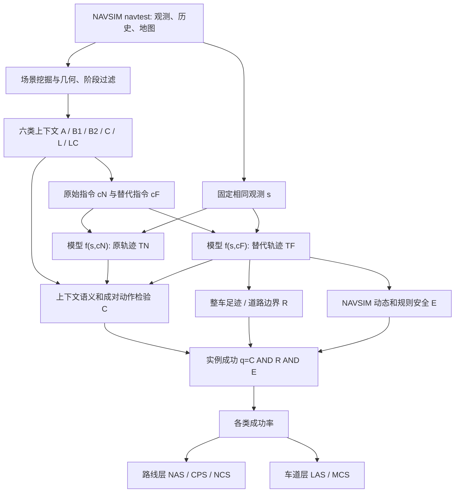

# PlanContext：上下文驾驶决策基准 / Benchmarking In-Context Driving Decision-Making

**PlanContext**（Ruikai Li 等，2026）是北京航空航天大学、地平线、澳门大学、北京智源人工智能研究院、清华大学智能产业研究院及香港大学 OpenDriveLab 合作提出的自动驾驶评测基准，收录的版本为 [arXiv:2611.03067v1](https://arxiv.org/abs/2611.03067)。它是**评测协议，不是新的驾驶控制模型**。

## 一句话定义

**在同一传感器观测和车辆历史下，仅替换高层导航指令，成对检验模型该执行、等待、拒绝还是保持原操作，并同时检查道路合法性与动态安全。**

## 英文缩写速查

| 缩写 | 英文全称 | 简要说明 |
|---|---|---|
| NAVSIM | Navigation Simulation | 本文复用的非反应式驾驶基准及 navtest 场景 |
| PDMS | Predictive Driver Model Score | NAVSIM 原有轨迹质量综合评分 |
| mPDMS | Matched Predictive Driver Model Score | 同一批 PlanContext 物理场景上的匹配 PDMS |
| NAS | Navigation Action Score | 类 A：执行可行替代路线的成功率 |
| CPS | Context Preservation Score | B1/B2/C 三类等待与拒绝情境的宏平均 |
| NCS | Navigation Context Score | NAS 与 CPS 的几何均值，路线层主指标 |
| LAS | Lane Adaptation Score | 类 L：可行邻道变更成功率 |
| MCS | Maneuver Continuity Score | 类 LC：已开始的横向操作连续性成功率 |
| TTC | Time to Collision | 预计碰撞时间，动态安全判据之一 |
| VLA | Vision-Language-Action | 视觉语言动作模型，评测的三种范式之一 |

## 为什么重要

传统 NAVSIM 的 PDMS 强调碰撞、道路规则、进度、舒适性等规划质量；即使一条轨迹安全平稳，也不能证明它理解了**当前导航意图在当前时间是否可执行**。PlanContext 专门评估这项能力：同一指令可能需要立即执行，也可能必须等候、拒绝或维持已经进行的操作。

它的成对设计固定感知输入和本体历史，有助于暴露模型对高层指令的反应缺陷；但这种离线短时诊断仍不能替代真车闭环安全测试。

## 核心信息

| 字段 | 一手论文内容 |
|---|---|
| 论文 | [PlanContext，arXiv:2611.03067v1，2026-11-02](https://arxiv.org/html/2611.03067v1) |
| 作者与机构 | Ruikai Li 等；北京航空航天大学（Beihang University）、地平线（Horizon Robotics）、澳门大学（University of Macau）、北京智源人工智能研究院（BAAI）、清华大学智能产业研究院（AIR, Tsinghua University）、香港大学 OpenDriveLab（The University of Hong Kong） |
| 数据基础 | NAVSIM navtest：5,911 个物理场景，9,561 个场景–条件实例 |
| 轨迹输出 | 固定观测与历史，原指令和替代指令分别预测未来 4 秒的 8 个自车位姿 |
| 评测对象 | 23 个公开的 VA、VLA、WA 端到端驾驶模型 |
| 官方开放状态 | 截至 2026-11-10，官网标注 Code / Datasets Coming soon；已有论文及展示结果，尚无 PlanContext 可运行评测代码入口 |

## 核心原理

### 固定观测下的导航意图干预

对场景 s，模型分别接收原导航指令 cN 和替代导航指令 cF：

$$
T^N=f_{\theta}(s,c^N),\qquad T^F=f_{\theta}(s,c^F).
$$

两次推理的**传感器与车辆历史不变**。判分依据路网拓扑、决策时机和成对轨迹，而不是强制预测逐点复刻唯一的录制真值轨迹。

### 六类场景与期望动作

| 类别 | 场景与时机 | 应对动作 | 实例 |
|---|---|---|---:|
| A | 替代路线在 2 秒内可达 | **Follow**，执行可行替代路线 | 334 |
| B1 | 替代路线要 4.5–8 秒后才可达 | **Wait**，暂缓提前变更 | 251 |
| B2 | 局部路网不存在满足指令的目标 | **Reject**，拒绝无效转向 | 5,285 |
| C | 已越过相应路线决策/承诺点 | **Reject**，拒绝过迟变更 | 580 |
| L | 邻接目标车道几何及拓扑可达 | **Follow**，执行有效换道 | 2,716 |
| LC | 已开始执行横向操作 | **Preserve**，维持操作连续性 | 395 |

A、B1、B2、C 属于路线层，L、LC 属于车道层。论文从 12,840 个候选场景–条件中筛选；通过车辆运动、路网可靠性、拓扑和行为阶段过滤后保留 9,561 条，其中同一物理场景可有多个条件。样本数量极不均衡，所以必须报告类别级指标。

### 决策正确与安全共同成立

论文对一个有效实例采用联合成功条件：

$$
q_i=C_i\land R_i^F\land E_i^F.
$$

- C：在本情境下，原始/替代轨迹的成对响应符合应执行、等待、拒绝或保持的语义规则。
- R：替代轨迹每个预测时刻的**整车足迹**位于准许道路范围。
- E：替代轨迹满足 NAVSIM 的动态和交通规则安全条件，包括碰撞、行驶区域、逆行、交通灯、TTC 与舒适性。

因此仅服从导航而产生风险，或只安全行驶却没执行可行意图，都不能判成功。类 LC 的 uncertain 评价单独排除，不计入二值分母。

### 五项指标

各类别的成功率记为 S_A、S_B1、S_B2、S_C、S_L、S_LC。路线层：

$$
\mathrm{NAS}=S_A,\qquad
\mathrm{CPS}=\frac{S_{B1}+S_{B2}+S_C}{3},\qquad
\mathrm{NCS}=\sqrt{\mathrm{NAS}\cdot\mathrm{CPS}}.
$$

车道层：LAS=S_L，MCS=S_LC。**NCS 是 NAS 与 CPS 的几何均值，非按全部样本数加权的微平均，且 LAS/MCS 不合入 NCS。** 报告 NCS 时应始终同时查看 NAS 与 CPS，以免掩盖「会拒绝但不会执行」的失败模式。

## 流程总览

依据论文 §3 和附录 A–C 构建的**方法评测流程**，不是源码运行调用关系：

## 源码运行时序图

**不适用（截至 2026-11-10）**。官方项目主页 Code 和 Datasets 均标注 Coming soon；未发布可确认的 PlanContext 评测脚本、训练/推理入口或数据构造程序。不能以已经公开的基础 NAVSIM 代码冒充 PlanContext 实现，故没有凭猜测绘制源码 sequenceDiagram。未来代码发布后，应逐一核对入口与调用链再补。

## 实验与评测

### 23 模型：传统规划分数不等于上下文决策能力

论文表 2 报告匹配场景上的 mPDMS 与导航意图干预指标。跨 23 个模型，**mPDMS 与 NCS 的 Spearman 排名相关系数为 −0.542**。它表明模型排序存在明显不一致，而非证明提高 PDMS 会因果地损害决策能力。

| 模型 | mPDMS | NAS (%) | CPS (%) | NCS (%) |
|---|---:|---:|---:|---:|
| [OneVL](./paper-xiaomi-onevl.md) | 80.79 | **22.46** | 68.79 | **39.30** |
| ChainFlow-VLA | 83.14 | 20.96 | 58.88 | 35.13 |
| DrivoR | 83.56 | 19.76 | 61.23 | 34.78 |
| CLOVER | 94.35 | 0.60 | 57.35 | 5.86 |
| Drive-JEPA | 94.18 | 0.00 | 52.37 | 0.00 |

上述为 PlanContext 作者在本基准上的结果，**不是**这些模型在原论文的官方 NAVSIM 全样本 PDMS。例如 OneVL 原论文 NAVSIM PDM-score 88.84，不能直接与此处 80.79 相减。

### 六类平均成功率

| 类别 | 23 模型平均成功率 |
|---|---:|
| A：立即执行可行路线 | 10.01% |
| B1：等待可行变更 | 62.91% |
| B2：拒绝局部无效指令 | 73.28% |
| C：拒绝已过承诺点变更 | 34.98% |
| L：执行可行邻道变更 | **0.45%** |
| LC：保持已有横向动作 | 85.51% |

**最大诊断缺口是可行意图的主动执行**，尤其是类别 L。相较之下，拒绝或保持操作的表现普遍较高；这不能无条件推广到其他地图或真实闭环。

### 统计及人工抽查

- 按 5,911 个物理场景聚类进行 10,000 次配对 bootstrap；23 模型构成 253 组比较，经 Benjamini–Hochberg 多重校正，193 组 NCS 差异满足 q<0.05。
- OneVL 对 ChainFlow-VLA 的 NCS 差为 4.17 个百分点，95% CI 为 [0.74, 7.43]，校正 q=0.0252；若干相邻排名的差异并不显著。
- 三位自动驾驶背景审阅者盲审 500 条场景条件与 11,500 次模型–实例判定，讨论后约 0.7% 与规则自动判定不一致。属抽样质量验证，不能证明全量标签零误差。

## 结论

**PlanContext 为端到端驾驶提供了「能否在正确时间理解并行动」的专项诊断；传统轨迹质量评分无法替代这项检查。**

1. **离线回归成对评测：** 对同一观测切换导航意图，检验应跟随、等待、拒绝、保持的行为差异。
2. **NAS/CPS/NCS 同时报：** 避免一个总分隐藏主动行动与谨慎保持之间的不平衡。
3. **优先排查 L 类：** 23 模型的可行邻道变更平均 LAS 仅 0.45%，提示此协议下的主要能力短板。
4. **正确行为需同时安全：** 判分包含语义、车辆足迹和 NAVSIM 安全约束，不应为追求命令遵守牺牲安全。
5. **保持一致口径：** NAVSIM PDMS、mPDMS 与 PlanContext NCS 的样本、定义和用途不同，不做跨论文生硬数值排名。
6. **注意复现边界：** 当前官方尚未发布完整代码与数据，论文结果属于作者报告，需等待复现资源。

## 工程实践

- 以同版本 NAVSIM navtest、地图和驾驶历史构造固定观测；两次输入仅允许改变高层意图。
- 验证替代目标在局部路网的合法可达性，且区分「应该立即执行」「应该延后」「当前无效」「已过决策点」；对不满足筛选前提的情境不强行分类。
- 将不同模型输出归一至未来 4 秒、8 个后轴中心位姿，再用道路相对几何、完整车辆足迹和统一安全规则进行比较。
- 保存类别内分母及 uncertain 数量；按物理场景聚类计算置信区间，不把同一 scene 的多个干预当成互相独立的样本。
- 将结果作为现有 VLA 模型与导航控制栈的**离线诊断**，再结合交互闭环仿真/真车安全验收。这些是依据论文形成的工程建议，**不是官方已公开可执行 CLI 教程**。

## 局限与风险

- 只评估记录环境中短时 4 秒规划，缺乏真正可反应的长时交互与部署安全证据。
- A/B1 时间阈值、承诺点及车道规则依赖地图和人为设定；保守延后策略与「应立即执行」的标注可能存在边界争议。
- 样本严重不平衡：A 334 条、B2 5,285 条，必须配合类别分数和场景层统计查看结果。
- 模型性能相关性不意味着因果；跨不同数据集、代码版本或驾驶闭环不得直接迁移排名。
- 官方 Code / Datasets 资源仍未发布，不能据此提供经验证的部署命令或源码时序。

## 与其他工作对比

| 工作 | 主要目的 | 与 PlanContext 的区别 |
|---|---|---|
| [NAVSIM](./paper-rcl-ref-e25271fa6f028e5611cf-navsim-data-driven-non-reactive-autonomous-vehic.md) | 非反应式规划轨迹质量、舒适性、合规与安全 | PlanContext 在相同场景上**切换意图**，检查语义决策是否符合当前时机 |
| [OneVL](./paper-xiaomi-onevl.md) | 视觉/语言潜推理来提高驾驶规划效率 | OneVL 是 PlanContext 评测对象之一；两者是模型与基准的关系 |
| Bench2Drive | 交互式闭环驾驶基准 | PlanContext 更擅长隔离导航意图影响，不能替代闭环仿真与安全评估 |

## 关联页面

- [OneVL：视觉语言潜推理驾驶规划](./paper-xiaomi-onevl.md) — 本论文的参评模型与指标口径对照。
- [NAVSIM：基础非反应式驾驶基准](./paper-rcl-ref-e25271fa6f028e5611cf-navsim-data-driven-non-reactive-autonomous-vehic.md) — 数据与 PDMS 规则来源。
- [VLA 方法](../methods/vla.md) — 解释被评测的视觉语言动作模型范式。
- [端到端自动驾驶技术地图](../overview/e2e-autonomous-driving-top10-algorithms.md) — 放回自动驾驶技术路线中理解。
- [具身大模型评测基准选型闭环](../queries/embodied-eval-benchmark-selection-loop.md) — PlanContext 属于固定观测、切换意图的开环决策基准，选型时需与闭环仿真基准互补使用。

## 参考来源

- [arXiv v1 论文全文与附录精读归档](../../sources/papers/plancontext_arxiv_2611_03067.md)
- [官方项目主页与代码/数据开放状态归档](../../sources/sites/plancontext-project.md)
- [arXiv 官方 HTML 全文](https://arxiv.org/html/2611.03067v1)
- [PlanContext 官方网站](https://plancontext.github.io/)

## 推荐继续阅读

- [PlanContext PDF（v1）](https://arxiv.org/pdf/2611.03067v1)
- [NAVSIM 原始源码](https://github.com/autonomousvision/navsim) — 注意不是 PlanContext 评测器源码。
- [OneVL 论文与详情](./paper-xiaomi-onevl.md)
