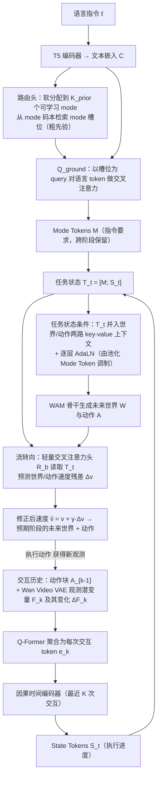

# Plausible Future, Wrong Choice（arXiv:2610.28431）

**Plausible Future, Wrong Choice**（*Plausible Future, Wrong Choice: Steering World-Action Models toward Intended Future*，[arXiv:2610.28431](https://arxiv.org/abs/2610.28431)，[项目页](https://isee-laboratory.github.io/TaskWAM/)）来自 [具身智能小站 2026-10-31 盘点](../../sources/blogs/wechat_embodied_station_50_papers_scenerig_photo_to_sim_2026-10-31.md)，属「世界模型与仿真重建」组。

## 一句话定义

**TaskWAM以任务要求和执行状态两类令牌约束未来生成，并用StageBench测阶段混淆；仿真、真机和多形态实验关注长任务的顺序一致性。**

## 英文缩写速查

| 缩写 | 英文全称 | 简要说明 |
|------|----------|----------|
| Plausible Future, Wrong Choice | Plausible Future, Wrong Choice: Steering World-Action Models toward Intended Future | 本文方法 / 基准的简称 |

## 为什么重要

- 别让合理的未来走错任务阶段。
- 开源结论：**项目页未列 GitHub**（步骤 2.5，2026-10-31）。项目页 HTTP 200，未见 GitHub 链接或 coming soon 字样。
- 同期同组工作见 [单图重建仿真、VLA 适配评测与跨形态世界模型：具身智能小站 10-31 期 50 篇阅读坐标](../overview/embodied-station-2026-10-31-50-papers-technology-map.md)。

## 流程总览

图依据：论文 §3.1–3.4、Fig.2（TaskWAM 框架）；§4 StageBench 为基准，未入图。

## 核心机制

| 项 | 内容 |
|----|------|
| **arXiv** | [2610.28431](https://arxiv.org/abs/2610.28431) |
| **开源** | **项目页未列 GitHub** |
| **要点** | TaskWAM以任务要求和执行状态两类令牌约束未来生成，并用StageBench测阶段混淆；仿真、真机和多形态实验关注长任务的顺序一致性。 |
| **文内指标** | 公众号未给具体数字，本页不引用。 |

## 源码运行时序图

**不适用（项目页未列 GitHub）** — 项目页 HTTP 200，未见 GitHub 链接或 coming soon 字样。 不编造运行脚本；代码公开后再补。

## 实验与评测

- 公众号未给具体数字，本页不引用。
- **读法：** 本页为索引级摘要，依据公众号转述的官方摘要与仓库信息整理；逐项数字与 baseline 以原文 PDF 为准。

## 与其他工作对比

- 横向索引见 [单图重建仿真、VLA 适配评测与跨形态世界模型：具身智能小站 10-31 期 50 篇阅读坐标](../overview/embodied-station-2026-10-31-50-papers-technology-map.md)；同 arXiv 不重复造页。

## 结论

**别让合理的未来走错任务阶段：TaskWAM以任务要求和执行状态两类令牌约束未来生成，并用StageBench测阶段混淆；仿真、真机和多形态实验关注长任务的顺序一致性。**

1. 开源边界：**项目页未列 GitHub** — 项目页 HTTP 200，未见 GitHub 链接或 coming soon 字样。
2. 核心机制：TaskWAM以任务要求和执行状态两类令牌约束未来生成，并用StageBench测阶段混淆；仿真、真机和多形态实验关注长任务的顺序一致性。
3. 复现与选型前核对任务协议、硬件与基准口径，勿直接横比公众号摘录数字。

## 关联页面

- [world-action-models](../concepts/world-action-models.md)
- [generative-world-models](../methods/generative-world-models.md)
- [simulation-evaluation-infrastructure](../concepts/simulation-evaluation-infrastructure.md)
- [embodied-station-2026-10-31-50-papers-technology-map](../overview/embodied-station-2026-10-31-50-papers-technology-map.md)

## 参考来源

- [plausible_future_wrong_choice_arxiv_2610_28431.md](../../sources/papers/plausible_future_wrong_choice_arxiv_2610_28431.md)
- [wechat_embodied_station_50_papers_scenerig_photo_to_sim_2026-10-31.md](../../sources/blogs/wechat_embodied_station_50_papers_scenerig_photo_to_sim_2026-10-31.md)
- [arXiv:2610.28431](https://arxiv.org/abs/2610.28431)
- [arXiv PDF](https://arxiv.org/pdf/2610.28431)：已通读方法部分（实验与附录以略读为准）：问题定义与总览（§3.1–3.2）、结构化任务状态（§3.3）、任务状态条件未来转向（§3.4）、StageBench（§4）

## 推荐继续阅读

- [arXiv PDF](https://arxiv.org/pdf/2610.28431)
- [项目页](https://isee-laboratory.github.io/TaskWAM/)
