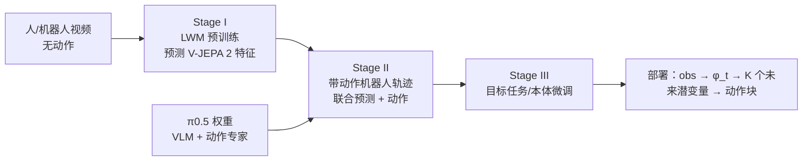
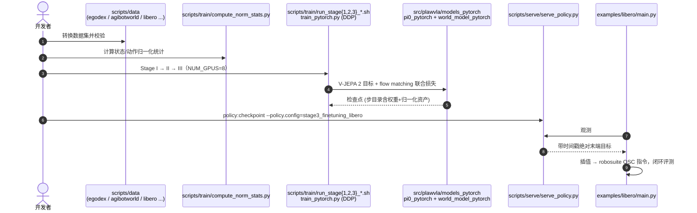

---

type: entity
project_id: plaw-vla
tags:
  - paper
  - vla
  - world-model
  - latent-world-model
  - jepa
  - manipulation
  - mixture-of-transformers
  - open-source
  - corl-2026
  - astribot
  - hitsz
  - polyu
  - u-tokyo
status: complete
updated: 2026-10-27
arxiv: "2610.12285"
project: https://rainyrobo.github.io/PLaW-VLA/
code: https://github.com/RainyRobo/PLaW-VLA
related:
  - ../overview/frontier-manipulation-2026-10-05-10-09.md
  - ../methods/vla.md
  - ../concepts/world-action-models.md
  - ../methods/generative-world-models.md
  - ../tasks/manipulation.md
  - ./paper-pi05-open-world-vla.md
  - ./paper-vjepa2.md
  - ./paper-sa-2512-13030-motus-a-unified-latent-action-world-model.md
  - ./paper-rcl-2510-13626-libero-plus-in-depth-robustness-analysis-of-visi.md
  - ./libero-benchmark.md
  - ./robotwin.md
sources:
  - ../../sources/papers/plaw_vla_arxiv_2610_12285.md
  - ../../sources/sites/plaw-vla.md
  - ../../sources/repos/plaw_vla.md
  - ../../sources/blogs/frontier_manipulation_2026_10_05_10_09.md
summary: "PLaW-VLA（arXiv:2610.12285, CoRL 2026）：在冻结 V-JEPA 2 潜空间并行预测未来状态的三专家 MoT VLA（π0.5 + 约 0.9B），RoboTwin Hard 比 π0.5 高 11.8 点、LIBERO-Plus 零样本 72.7，推理延迟约为 Motus 的 1/19；代码 Apache-2.0 已开源，官方预训练权重待发布。"
tags: [paper, vla, world-model, latent-world-model, jepa, manipulation, mixture-of-transformers, open-source, corl-2026, astribot, hitsz, polyu, u-tokyo, jilin-university]

---

# PLaW-VLA：预测式潜在世界建模的 VLA 策略

## 一句话定义

**PLaW-VLA** 在 π0.5 式 VLA 上增加一个从零训练的「潜在世界模型专家」，在冻结 V-JEPA 2 的表征空间里一次并行预测 K 个未来潜变量，再让动作专家以观测、语义与预测的未来状态为条件解码动作块，不生成、不解码任何视频。

## 英文缩写速查

| 缩写 | 英文全称 | 简要说明 |
|------|----------|----------|
| PLaW | Predictive Latent World Modeling | 本文：在预测导向潜空间里建模未来 |
| VLA | Vision-Language-Action | 视觉语言动作策略 |
| LWM | Latent World Model | 本文第二个专家，预测未来潜变量 |
| MoT | Mixture-of-Transformers | 三个专家按因果顺序组合 |
| V-JEPA 2 | Video Joint-Embedding Predictive Architecture 2 | 冻结的未来表征编码器 |
| CoRL | Conference on Robot Learning | 论文录用会议（2026） |

## 为什么重要

- **反应式 VLA 的缺口：** 只看当前观测的 VLA 不显式知道动作后果；本文在 RoboTwin Hard Horizon III 上比 π0.5 高 **11.8 个百分点**，长程任务受益最明显。
- **预测不必重建像素：** 用 V-JEPA 2 潜空间替换 Cosmos VAE 潜变量，LIBERO-Plus 反而高 1.77 点（72.70 对 70.93），支持「预测导向表征优于重建导向表征」。
- **便宜：** 相对 π0.5 约多 0.9B 参数、约 70 ms（单张 H100）；与 Motus 在相近 LIBERO 成功率下推理延迟约 1/19。
- **开源可跑：** 训练、评测、策略服务代码已公开。

## 核心信息

| 项 | 内容 |
|----|------|
| **机构** | 吉林大学；星尘智能（Astribot）；哈尔滨工业大学（深圳）；香港理工大学；东京大学 |
| **骨干** | π0.5（PaliGemma 3B VLM + 动作专家）+ 从零训练的 LWM 专家；冻结 V-JEPA 2 |
| **真机本体** | 双臂轮式人形机器人（具体型号原文片段未写明） |
| **会议** | CoRL 2026 |
| **开源** | 代码已开源（Apache-2.0）；官方预训练检查点计划发布，截至 2026-10-12 未提供 |

## 核心原理

### 方法栈

| 模块 | 设计 |
|------|------|
| 视觉语言专家 | PaliGemma（3B），产生语义嵌入 φ_t，由 π0.5 初始化 |
| 潜在世界模型专家 | 从零训练；K 个可学习未来查询关注历史潜变量与 φ_t，**一次前向**预测 K 个未来潜变量（消融 K=2，近/远未来） |
| 动作专家 | flow matching 动作块解码，条件含预测的未来潜变量 |
| 注意力 | 结构化因果：语义→潜变量预测→动作，防止未来信息泄漏并减少专家间干扰 |
| 目标表征 | 冻结 V-JEPA 2 对未来观测的 stop-gradient 编码 |
| 损失 | L_joint = L_FM + m·λ_wm·L_wm，m~Bernoulli(1−α)，α=0.3；m=0 时丢弃世界模型 token 但保留动作损失；动作 τ~Beta(1.5,1) |

### 流程总览

## 方法

1. **阶段化训练。** Stage I 只训 LWM，用无动作视频预测冻结 V-JEPA 2 特征；Stage II 在带动作的机器人轨迹上联合训练预测与动作；Stage III 以相同联合目标适配目标任务/本体（学习率 5e-5，线性 warmup）。仓库配置：Stage I 100k 步 batch 512，Stage II 100k 步 batch 256，Stage III（LIBERO）50k 步 batch 256、warmup 10k。
2. **LWM 模块丢弃（α=0.3）。** 30% 的样本屏蔽世界模型 token，使动作专家在无预测时也能工作，这与推理期屏蔽未来状态的消融结果（见下）相呼应。
3. **并行预测。** 与逐帧自回归或视频扩散不同，K 个未来查询一次前向完成，因此延迟增量小。
4. **数据。** LIBERO 1,693 条示教；RoboTwin 2.0 共 50 任务，2,500 条 clean（每任务 50）+ 25,000 条随机化（每任务 500）；真机每任务 400 条示教。
5. 动作块长度、历史帧数、λ_wm、编码器分辨率、GPU 数在所读原文片段中未给出，原文未核实。

## 实验与评测

- **RoboTwin 2.0（Easy / Hard 平均）：** PLaW-VLA 85.6 / 83.2；π0.5 82.7 / 76.8；X-VLA 72.9 / 72.8；π0 65.9 / 58.4。Horizon III：PLaW-VLA 82.4 / 79.2，π0.5 78.6 / 67.4（Hard +11.8）。逐任务 Hard：36 个提升、4 个持平、10 个下降。
- **LIBERO：** 平均 **97.4**（Spatial 98.9 / Object 99.0 / Goal 97.1 / Long 94.6），π0.5 96.9，VLA-JEPA 97.2，OpenVLA-OFT 97.1；VLA-JEPA 在 Goal 与 Long 上更强，领先并不均匀。
- **LIBERO-Plus 零样本：** 平均 **72.7**（Robot 73.5、Layout 89.9、Light 93.1、Background 93.6、Language 75.7、Noise 55.2、Camera 41.5）；OpenVLA-OFT 69.6、π0-FAST 61.6、π0 53.6。相机与噪声扰动仍是弱项。
- **消融（LIBERO / LIBERO-Plus）：** 完整 97.40/72.70；去世界模型 96.05/65.49；去预测损失 96.30/67.56；去未来条件 96.85/69.81；Cosmos VAE 替代 96.65/70.93；去 Stage I 96.28/69.05；去 Stage II 95.65/66.03；去 I+II 94.05/60.80。推理时屏蔽未来状态：全部 93.05、屏蔽远期 95.45、屏蔽近期 95.80。
- **真机（项目页，π0 / π0.5 / PLaW-VLA，%）：** Fold Towel 50/60/80，Pack Toy 46.7/50/66.7，Organize Stationery 43.3/41.7/55，Play Basketball 47.5/42.5/50；零样本变体 Fold Towel 30/50/80、Organize Stationery 35/40/48.3。论文正文用归一化任务进度图，非表格数字。

## 源码运行时序图

官方仓库 [RainyRobo/PLaW-VLA](https://github.com/RainyRobo/PLaW-VLA)（归档见 [sources/repos/plaw_vla.md](../../sources/repos/plaw_vla.md)）提供训练脚本与 LIBERO 评测/策略服务：

最短路径：`run_stage3_libero_quickstart.sh`（无官方预训练检查点时回退 π0.5 公开权重、随机初始化世界模型模块）→ 起服务 → `examples/libero/main.py`。由于官方预训练检查点待发布，该路径**不等于**复现论文的 Stage I/II 预训练收益。

## 工程实践

| 项 | 建议 |
|----|------|
| 环境 | Linux、CUDA 12.8、Python 3.12、`uv sync --frozen`，需打 transformers 补丁 |
| 快速验证 | Stage III LIBERO quickstart；再按 `docs/benchmarks.md` 跑 RoboTwin / LIBERO-Plus |
| 迁移新本体 | 定义数据集配置与归一化契约，把观测编码为规范状态，实现「规范绝对末端目标→原生控制器」适配器，无需改模型结构 |
| 延迟预算 | 相对 π0.5 约 +70 ms（H100）；对高频闭环需再评估 |
| 数据 | LIBERO EEF 数据集已在 HF；论文预训练混合依赖作者核验清单（`docs/data.md`） |

## 结论

**PLaW-VLA 的结论是：在 VLA 里加一个轻量、并行、预测导向的潜在世界模型，比重建像素更划算，但增益主要来自「世界模型 + 预训练阶段」的组合而非任一单项。**

1. **用预测导向编码器当目标** — V-JEPA 2 比 Cosmos VAE 在 LIBERO-Plus 高 1.77 点。
2. **世界模型是最大单项贡献** — 去掉它 LIBERO-Plus 掉 7.21 点（72.70→65.49）。
3. **Stage I/II 预训练都有用** — 全去掉 LIBERO-Plus 掉到 60.80；去 Stage II 掉 6.67 点。
4. **预测对近期与远期都有价值** — 屏蔽全部未来状态 LIBERO 降到 93.05，屏蔽任一半也略降。
5. **长程任务收益更大** — RoboTwin Hard Horizon III +11.8，而 LIBERO 总体仅 +0.5。
6. **别指望开箱即用** — 官方预训练权重待发布，当前仓库只能从 π0.5 起步。

## 与其他工作对比

| 对照 | 差异读法 |
|------|----------|
| [π0.5](./paper-pi05-open-world-vla.md) | 反应式基线；PLaW-VLA 在其上加 LWM 专家，LIBERO 96.9→97.4，RoboTwin Hard 76.8→83.2 |
| [VLA-JEPA](./paper-sa-2602-10098-vla-jepa-enhancing-vision-language-action-model.md) | 同属 JEPA 式 VLA；LIBERO 97.2，在 Goal/Long 上高于 PLaW-VLA |
| [Fast-WAM](./paper-fast-wam.md) / [WAM 概念](../concepts/world-action-models.md) | 生成视频或视频特征的 WAM；PLaW-VLA 不生成视频，只预测潜变量 |
| [V-JEPA 2](./paper-vjepa2.md) | 本文冻结使用其编码器，将未来观测编码为预测目标；与 V-JEPA 2-AC 的动作条件规划用途不同 |
| [Motus](./paper-sa-2512-13030-motus-a-unified-latent-action-world-model.md) | 统一视频与动作生成的世界动作模型；论文报告在相近 LIBERO 成功率下，PLaW-VLA 推理延迟约为其 1/19，具体比较依赖论文评测设置 |
| [LIBERO-Plus](./paper-rcl-2510-13626-libero-plus-in-depth-robustness-analysis-of-visi.md) | 鲁棒性评测基准而非策略；本文用其测试相机、光照等扰动下的零样本表现 |

## 局限与风险

- **论文自述：** 未来预测与闭环控制耦合，执行误差会污染预测；训练数据规模与多样性有限。
- **证据边界：** 论文文本未对因果跨专家注意力做消融；真机数字主要来自项目页，正文为进度图；真机本体型号未写明。
- **开源状态（2026-10-12 核查）：** 代码已开源（Apache-2.0），LIBERO EEF 数据在 HF；官方预训练检查点 Pending；完整预训练复现依赖作者核验的数据清单。
- **弱项扰动：** LIBERO-Plus 的 Camera 41.5、Noise 55.2 仍低。

## 关联页面

- [Manipulation 周报汇总（2026-10-05~10-09）](../overview/frontier-manipulation-2026-10-05-10-09.md)
- [VLA 方法](../methods/vla.md)
- [World Action Models 概念](../concepts/world-action-models.md)
- [π0.5](./paper-pi05-open-world-vla.md)
- [Motus：统一潜在动作世界模型](./paper-sa-2512-13030-motus-a-unified-latent-action-world-model.md)
- [LIBERO-Plus 鲁棒性评测](./paper-rcl-2510-13626-libero-plus-in-depth-robustness-analysis-of-visi.md)
- [LIBERO 基准](./libero-benchmark.md)
- [RoboTwin](./robotwin.md)

## 参考来源

- [plaw_vla_arxiv_2610_12285.md](../../sources/papers/plaw_vla_arxiv_2610_12285.md) — 论文摘录
- [plaw-vla.md](../../sources/sites/plaw-vla.md) — 项目页与开源核查
- [plaw_vla.md](../../sources/repos/plaw_vla.md) — 仓库归档
- [Manipulation 周报来源](../../sources/blogs/frontier_manipulation_2026_10_05_10_09.md) — 线索来源（技术事实以论文为准）
- [arXiv:2610.12285](https://arxiv.org/abs/2610.12285)

## 推荐继续阅读

- [PLaW-VLA 项目页](https://rainyrobo.github.io/PLaW-VLA/)
- [PLaW-VLA GitHub](https://github.com/RainyRobo/PLaW-VLA)
- [V-JEPA 2 编码器（Hugging Face）](https://huggingface.co/facebook/vjepa2-vitl-fpc64-256)
- [LIBERO EEF 数据集](https://huggingface.co/datasets/RainyBot/libero_v3_eef)
