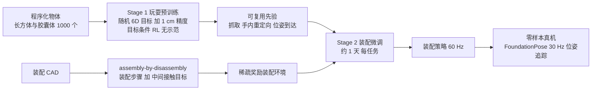
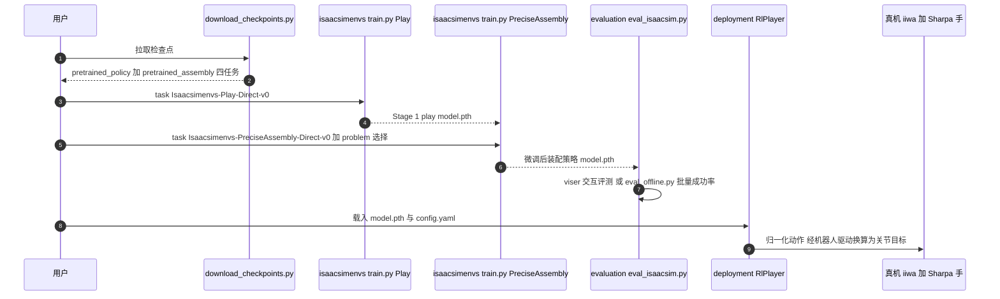

# Play2Perfect：灵巧「玩耍」预训练如何成就精密装配

**Play2Perfect**（*Play2Perfect: What Matters in Dexterous Play Pretraining for Precise Assembly?*，[arXiv:2606.26428](https://arxiv.org/abs/2606.26428)，[项目页](https://play2perfect.github.io)）由 Tyler Ga Wei Lum、Kushal Kedia、C. Karen Liu 与 Jeannette Bohg 提出（署名机构为斯坦福大学与康奈尔大学）：多指手做精密装配的难点是奖励稀疏、接触丰富且难以遥操作，作者主张「完善装配之前，机器人先要学会玩」，用无示范 RL 先练出可复用的抓取、手内重定向与 6D 位姿到达先验，再用稀疏奖励微调到装配，并系统研究预训练中哪些设计真正有用。

## 一句话定义

**Play2Perfect = 在大量程序化物体与随机 6D 目标上做任务无关的目标条件 RL「玩耍」预训练，再在 CAD 派生的稀疏奖励装配环境中微调，零样本迁移到真实灵巧手。**

## 英文缩写速查

| 缩写 | 英文全称 | 简要说明 |
|------|----------|----------|
| RL | Reinforcement Learning | 预训练与微调均为无示范强化学习 |
| SAPG | Split and Aggregate Policy Gradients | 大规模 PPO 变体；本文两阶段训练所用算法 |
| 6D pose | 3D position + 3D rotation | 预训练的目标形式：物体到达随机 6D 目标位姿 |
| DoF | Degree of Freedom | Sharpa 手 22 DoF；策略动作 29 维（臂 + 手） |
| CAD | Computer-Aided Design | 装配环境由 CAD 经 assembly-by-disassembly 自动构建 |
| LSTM | Long Short-Term Memory | 演员网络的循环层，处理部分可观测与接触历史 |
| FoundationPose | Unified 6D Pose Estimation and Tracking of Novel Objects | 真机零件与夹具的位姿追踪（30 Hz），复用装配 CAD 网格 |

## 核心信息

| 项 | 内容 |
|----|------|
| **机构** | 斯坦福大学（Stanford）、康奈尔大学（Cornell University）；HTML 署名未逐作者标注归属 |
| **作者** | Tyler Ga Wei Lum\*、Kushal Kedia\*（\* 同等贡献）、C. Karen Liu、Jeannette Bohg（后二者同等指导） |
| **arXiv** | [2606.26428](https://arxiv.org/abs/2606.26428)；v1 2026-06-24；v4 2026-10-15（本页数字取自 v4） |
| **会议** | CoRL 2026（项目页标注；arXiv 页面未标，以项目页为准） |
| **平台** | 22-DoF Sharpa 五指手 + 7-DoF KUKA iiwa 14；Isaac Sim 训练；FoundationPose 追踪物体位姿 |
| **Sharpa 关系** | 署名为斯坦福/康奈尔；致谢感谢 Sharpa 的研究合作与技术支持，Sharpa 手为真机平台；文章把它归为「Bohg 与 Liu 团队基于 Sharpa Wave 的两项工作」之一 |
| **开源** | **已开源**（MIT）：[kushal2000/play2perfect](https://github.com/kushal2000/play2perfect)；检查点在 Hugging Face；仅支持 Isaac Sim |

## 为什么重要

- **稀疏奖励的精密装配，RL 从零探索不可行。** 论文设置下，在四个主任务上稠密奖励与稀疏奖励的从零训练 24 小时都没有成功 rollout；而灵巧手要同时发现抓取、手内重定向、对准与接触式插入才拿到第一个奖励。
- **不依赖遥操作与专用夹具。** 以往靠专用夹爪、工具、环境夹具或平行夹爪加模仿学习来「给问题加结构」；本文在不遥操作的前提下用多指手做装配。
- **回答「玩什么才有用」。** 作者对物体多样性、训练目标、轨迹多样性、目标精度做了对照，结论是预训练要逼着机器人用手指做手内操作，而不是固定抓取后搬运。
- **在 Sharpa 学术线中的位置（文章转述）：** 文章把 Bohg/Liu 团队的 SimToolReal 与 Play2Perfect 归为「自下而上」，与第三种接口（在仿真中训练大量原子技能、再蒸馏进统一框架）的思路形成呼应；与 Malik 团队的自上而下路线（见 [Do as I Do](./paper-do-as-i-do.md)）互补，与 Sharpa 自己的探索同在一张路线图上。

## 流程总览

## 核心机制（方法）

### 1）玩耍预训练

单一目标条件 RL 策略同时控制臂与手，操作程序化生成的长方体与胶囊体到随机 6D 目标位姿，不使用任何示范。奖励包含平滑项、抓取/抬起项与目标项（1 cm 内给 1000 点成功奖励，位姿距离按关键点度量）。算法为 SAPG；演员网络 LSTM(1024) + MLP，评论家使用训练期特权信息；140 维观测（本体、当前/目标物体关键点与几何），29 维动作（臂为关节增量，手为绝对目标）。

### 2）装配微调

由 CAD 设计经 assembly-by-disassembly 得到装配序列：从完成态反推可行的零件拆除顺序再反转；每步是把零件插入由已装零件构成的夹具，目标含最终位姿和中间接触目标（如插入前位姿）。微调环境为稀疏奖励，探索被聚焦到最后的高精度接触交互。

### 3）仿真到真机

域随机化覆盖动作延迟、本体观测延迟、当前与目标物体位姿噪声（1 cm、5°量级）及外力扰动；部署时复用装配 CAD 网格，用 FoundationPose 追踪零件与夹具位姿（30 Hz），策略 60 Hz 闭环。

### 4）论文回答的「什么重要」（自报）

| 设计选择 | 对比 | 结论 |
|----------|------|------|
| 物体多样性 | 10 / 100 / 1000 个 | 数量越多微调越稳定，最终成功率持续上升（默认 1000） |
| 训练目标 | 完整 6D / 仅平移 / 仅旋转 | 仅平移学不到朝向控制，无法提供手内重定向先验；仅旋转可迁移但平台期低约 10 个点 |
| 轨迹多样性 | 在线随机目标 / 固定 10 或 100 条 | 固定集合 10 与 100 相近；在线随机学得最快、平台最高 |
| 目标精度 | 1 cm / 5 cm / 10 cm | 10 cm 无法迁移；5 cm 更慢并停在约 60%；精确目标对紧间隙装配更匹配 |

## 源码运行时序图

图下说明：最短复现路径是 `download_checkpoints.py` → `evaluation/eval_isaacsim.py --policies-dir pretrained_assembly`（交互）或 `evaluation/eval_offline.py`（批量成功率）；从头训练则 `isaacsimenvs/train.py` 先跑 `Isaacsimenvs-Play-Direct-v0`，再以 `env.precise_assembly.problem=tight_insertion` 等微调。`deployment/` 只提供最小的策略推理封装（`RlPlayer`），不含完整硬件栈。

## 实验与评测

**设置（自报）：** 仿真每项 500 次 rollout、随机化初始零件与夹具位姿；真机每任务 10 或 20 次 rollout，固定夹具位姿、随机初始零件位姿；成功判据为零件到达最终目标位姿的 1 cm 容差内；任务为 Tight-Insertion（T 形件插入逐渐变紧的孔）、Assemble-Beam（取自 Fabrica 的多零件梁装配）、Screw-Leg（取自 FurnitureBench 的家具腿拧入）；后两者真机零件为 3 倍放大版。

**样本效率（Fig 4 / Fig 5，自报）：** Play2Perfect 约 2–5 小时在四个主任务上都达到高成功率；两种从零训练 24 小时均无成功 rollout。在简化版 Tight-Insertion（Fixtured，T 形件预先靠在夹具上）上从零训练才可行：Scratch（稠密奖励）需 100 小时以上接近满成功率，Play2Perfect 约 4 小时达到同水平，即 33 倍加速。10 N 外力扰动下 Scratch（稠密）降到约 20%、更大扰动降到 0%，Play2Perfect 在最大扰动下仍高于 75%；作者解读为前者靠拇指「顶着」平衡零件，后者学到稳定抓取与恢复。

**微调是否必要（Fig 7，自报）：**

| 间隙 | 仿真 Play-only | 仿真 Play2Perfect | 真机 Play-only | 真机 Play2Perfect |
|------|----------------|--------------------|-----------------|---------------------|
| 40 mm | 75% | – | – | – |
| 10 mm | – | – | 60% | 100% |
| 4 mm | 接近 0% | 95% | – | – |
| 2 mm | – | – | 20% | 90% |
| 1 mm | – | 92% | – | – |
| 0.5 mm | – | – | 0% | 60% |
| 0.2 mm | – | 80% | – | – |

「–」表示论文正文未给出该格数字。微调分布为 5–0.5 mm 间隙，0.2 mm 比训练分布更紧。

**真机零样本（Table 1，自报）：**

| 任务 | 设置 | 成功 | 平均用时（成功试验） |
|------|------|------|----------------------|
| Tight-Insertion | 10 mm | 10/10 | 6.8 ± 1.5 s |
| Tight-Insertion | 2 mm | 9/10 | 9.4 ± 1.9 s |
| Tight-Insertion | 0.5 mm | 6/10 | 11.1 ± 5.1 s |
| Assemble-Beam | Step 1 | 16/20 | 21.0 ± 8.9 s |
| Assemble-Beam | Step 2（以 Step 1 成功为条件） | 12/16 | 15.6 ± 2.9 s |
| Screw-Leg | 插入 | 7/10 | – |
| Screw-Leg | 拧入（以插入成功为条件） | 5/7 | – |

端到端两步梁装配（附录 B）12/20；60 次真机 rollout 共 18 次失败：超时 6、插入时掉落 5、重定向时掉落 3、位姿追踪灾难性失败 4。

**日常插入（Fig 8，仅仿真，自报）：** 同一预训练检查点与配方，iPhone 插头与 YCB 叉子插入分别微调约 8.4 与 2.8 小时达到 90% 仿真成功率。

**统一策略（附录 F，自报）：** 在四任务上训练的一个策略与任务专用策略表现相当。

**文章转述：** 文章称「样本效率比从零训练高 33 倍，在 0.5 毫米间隙的紧配合插入任务上取得 60% 的成功率」，与论文摘要一致；口径见下文「常见误区」。

## 与其他工作对比

| 对象 | 差异 |
|------|------|
| 从零 RL（稠密 / 稀疏奖励，论文内基线） | 主任务上 24 小时内都无成功；稠密奖励在简化任务上学到的是脆弱的「平衡」策略 |
| Play-only（论文内消融） | 只预训练不微调：松间隙可用，紧间隙崩溃；说明先验不等于精度 |
| [SimToolReal](./simtoolreal.md) | 同团队此前工作；仓库说明 Stage 1 的 play 预训练基于它的「以物体为中心的工具操作」。SimToolReal 面向跨工具零样本操作，Play2Perfect 面向精密装配的预训练加微调 |
| [Do as I Do](./paper-do-as-i-do.md) | 文章中的「自上而下」对照：用人类视频重建数据；本文不用任何人类数据，全靠仿真玩耍 |
| [Learning from Play（Play-LMP）](../methods/learning-from-play-lmp.md) | 用人类遥操作玩耍轨迹做模仿学习；本文是仿真里无示范的 RL 玩耍，目标是可迁移的位姿控制先验 |
| [ArtManip](./paper-artmanip.md) / [WM-Craftnet](./paper-wm-craftnet.md) | 同在 Sharpa 手上做仿真 RL 到真机；前者聚焦铰接物体手内操作，后者聚焦刚体旋转，Play2Perfect 聚焦「通用先验 + 装配微调」 |
| [Peg-in-Bench](./paper-peg-in-bench.md) / [Wrap](./paper-wrap-wrench-aware-assembly.md) | 其他精密插孔基准 / 多机装配工作，用于对照「间隙」与「装配序列」的设定，设置不同，数字不可直接比 |

## 结论

**Play2Perfect 的核心发现是：精密装配 RL 的瓶颈在探索而不在精度，先验要靠「手指做手内 6D 操作」练出来，再用稀疏奖励微调去补最后的接触精度；33 倍与 0.5 mm 两个数字都有明确口径限制。**

1. **玩耍必须逼出手内操作** — 仅平移目标学不到重定向；10 cm 宽松目标无法迁移；先验的有用部分是精确的 6D 位姿控制。
2. **预训练与微调缺一不可** — Play-only 在 4 mm 间隙时仿真近 0%，真机 0.5 mm 为 0%；微调后分别为 95%（4 mm，仿真）与 60%（0.5 mm，真机）。
3. **33 倍是简化插入任务上对稠密奖励的比值** — 100 小时以上对约 4 小时；主任务上从零训练 24 小时没有成功，所以没有可比的倍数。
4. **0.5 mm 是孔–销间隙，不是定位精度** — 成功判据是到达目标位姿 1 cm 容差内；真机 6/10 的样本量很小。
5. **物体多样性与在线随机目标便宜且有效** — 1000 个物体优于 100 与 10 个；在线随机轨迹学得最快；复现时优先扩这两项。
6. **真机依赖 CAD 位姿追踪** — FoundationPose 在遮挡与快速运动下会失败（60 次中 4 次灾难性失败）；策略也不直接观测夹具几何。
7. **不是端到端装配系统** — 任务排序、主动零件选择与目标位姿由外部给定，每个任务单独微调。

## 常见误区与局限

- **误区：33 倍适用于所有任务。** 仅限简化的 Tight-Insertion（Fixtured）对 Scratch（稠密）；摘要里的「即便给稠密多阶段奖励」也是这个口径。
- **误区：0.5 mm 60% = 亚毫米定位精度。** 论文把间隙定义为孔与销横截面尺寸之差（例：销截面 30 × 20 mm，1 mm 间隙对应 31 × 21 mm 的孔；按同一定义 0.5 mm 对应 30.5 × 20.5 mm）；成功判据则是零件到达目标位姿的 1 cm 容差内；真机仅 10 次试验，6 次成功。
- **「超过 50%」的长程成功率口径：** 摘要称长程多零件装配与拧螺丝超过 50%。按表 1 自行换算，端到端两步梁装配 12/20 为 60%，Screw-Leg 端到端约 5/10 即 50%（本页换算，非论文原话）；引用时以论文原文为准。
- **局限（作者自述）：** 学短时程技能；序列、主动零件、目标位姿外部给定；按任务或基准族分别微调；依赖物体位姿估计；策略不直接观测夹具与周围几何，可考虑引入视觉或触觉。
- **局限（本页补充）：** 真机每任务只有 10 或 20 次试验，固定夹具位姿；Assemble-Beam 与 Screw-Leg 用 3 倍放大零件；日常插入只在仿真验证；play 预训练约 7 天（单卡 RTX A6000），算力门槛不低。

## 复现边界

| 项 | 结论（2026-10-16 核查：项目页 + GitHub README / LICENSE / 脚本） |
|----|------|
| 项目页 | [play2perfect.github.io](https://play2perfect.github.io)：含视频、浏览器交互演示与 Code 链接；页内未复述 33 倍、0.5 mm 数字，也未点名 Sharpa 手 |
| 代码 | **已开源**：[kushal2000/play2perfect](https://github.com/kushal2000/play2perfect)，MIT；含 Stage 1 / Stage 2 训练环境（`isaacsimenvs/`）、内置 `rl_games`（PPO + SAPG）、评测（`evaluation/`）、最小部署参考（`deployment/`）、URDF 资产 |
| 检查点 | 由 `download_checkpoints.py` 从 Hugging Face（`Kushal20/play2perfect-checkpoints`）拉取：Stage 1 play 策略 + 4 个装配策略 |
| 范围 | 官方说明本次发布只面向 **Isaac Sim**（Isaac Lab，Python 3.11）；任务为 tight_insertion、beam_assembly_step1/2、screwing |
| 真机 | 仅提供最小策略推理封装（`RlPlayer`）与接线说明，不含完整硬件栈与位姿追踪部署；需自备 Sharpa 手 + 机械臂与 FoundationPose 管线 |
| 数据 | 无外部数据依赖（预训练物体程序化生成）；未发布真机评测录像数据集 |
| 源码运行时序图 | 见上文「源码运行时序图」 |

## 关联页面

- [夏帕机器人（Sharpa Robotics）](./sharpa-robotics.md) — 文章对路线与 Sharpa Wave 平台的整体叙述
- [SimToolReal](./simtoolreal.md) — 同团队前作，Stage 1 的基础
- [Do as I Do](./paper-do-as-i-do.md) — 自上而下对照
- [ArtManip](./paper-artmanip.md) / [WM-Craftnet](./paper-wm-craftnet.md) — 同平台仿真 RL 到真机
- [FurnitureBench（入口页）](./painode-013-furniturebench.md) — Screw-Leg 任务所取自的家具装配基准
- [Peg-in-Bench](./paper-peg-in-bench.md) / [Wrap](./paper-wrap-wrench-aware-assembly.md) — 其他精密插孔与装配工作
- [强化学习](../methods/reinforcement-learning.md) / [课程学习](../concepts/curriculum-learning.md) — 训练范式背景
- [手内重定向](../methods/in-hand-reorientation.md) — 预训练先验里最关键的技能
- [接触丰富操作](../concepts/contact-rich-manipulation.md) / [域随机化](../concepts/domain-randomization.md) / [Sim2Real](../concepts/sim2real.md)

## 参考来源

- [play2perfect_arxiv_2606_26428.md](../../sources/papers/play2perfect_arxiv_2606_26428.md) — 原始摘录（arXiv 摘要、项目页、仓库核查、文章转述）
- [wechat_sharpa_dexterous_manipulation_2026-10-16.md](../../sources/blogs/wechat_sharpa_dexterous_manipulation_2026-10-16.md) — 机器之心采访稿来源页
- [arXiv:2606.26428](https://arxiv.org/abs/2606.26428)
- [项目页](https://play2perfect.github.io)
- [官方仓库](https://github.com/kushal2000/play2perfect)

## 推荐继续阅读

- [arXiv PDF](https://arxiv.org/pdf/2606.26428)
- [项目页浏览器交互演示](https://play2perfect.github.io)（页内 interactive 链接）
- SAPG 项目页：<https://sapg-rl.github.io/> — 本文所用的大规模 PPO 变体
