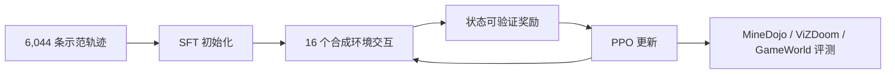

# Player-1：从合成经验中学习游戏控制

## 一句话定义

Player-1 是一条计算机使用模型后训练路线：先用人类游戏轨迹做监督初始化，再用合成环境中的交互和可验证奖励强化游戏控制能力。

## 英文缩写速查

| 缩写 | 英文全称 | 简要说明 |
| --- | --- | --- |
| SFT | Supervised Fine-Tuning | 用示范轨迹监督微调策略的初始化阶段 |
| RL | Reinforcement Learning | 在 Player-1-Gym 中根据交互奖励更新策略 |
| PPO | Proximal Policy Optimization | 论文用于合成环境多任务强化学习的策略优化方法 |
| GUI | Graphical User Interface | 此处涉及键鼠交互的计算机使用场景 |

## 为什么重要

人类示范能教模型常见动作，但涵盖不了开放游戏中不断变化的状态。Player-1 尝试将通用游戏操作拆成跨游戏共享的控制能力（瞄准、持续移动、导航、驾驶、UI 操作），在程序可判定成功的环境里反复练习，再看能力能否迁移到训练套件之外。它与 [GameHorizon Suite](paper-gamehorizon-suite.md) 互补：前者研究如何训练，后者提供多时间尺度的数据与评测方式。

## 方法与流程总览

Player-1 将计算机使用动作空间扩展为相对鼠标移动、持续输入和键鼠复合动作；示范样本将任务指令、截图、视觉推理和记录动作对齐。训练分两阶段：对 6,044 条轨迹做 SFT，再在 Player-1-Gym 的 16 个合成 2D/3D 环境用 PPO 学习。奖励从游戏状态直接计算，可验证任务进展或成功；环境随机化外观、相机、场景和控制动态以扩大训练分布。

## 实验与评测

### MineDojo-300

MineDojo-300 含 300 个 Minecraft 目标任务，论文报告每个任务 8 次试验。Player-1-9B 的成功率从 Base 模型 9.21%、SFT 后 10.54% 升至 RL 后 38.33%，相对 SFT 提升 27.79 个百分点。论文列出的最强外部基线 GameWAM 为 12.63%，但跨论文比较需以 Player-1 使用的评测协议为准。

### 其他游戏

在 ViZDoom-10 上，9B 模型的 mean scaled return 从 SFT 后 0.4361 提升到 RL 后 0.6922；GameWorld 上的 task progress 从 31.43% 提升到 34.45%。这些是各自基准中的分数，指标定义与 MineDojo 成功率不同，不应合并成一个通用“游戏能力”百分比。

论文还展示 Player-1-9B 在训练中未见的商业游戏 Watch Dogs 2 中完成步行导航、接近车辆、上车和驾驶的操作序列。这是**定性案例**，没有给出 Watch Dogs 2 成功率或大规模试验结果。

## 与其他工作对比

| 维度 | Player-1 | GameHorizon Suite |
| --- | --- | --- |
| 主要目标 | 训练更强的通用游戏控制策略 | 评测不同模型的游戏理解与执行 |
| 核心机制 | SFT 示范初始化 + 合成环境 RL | AAA 玩家数据 + L1/L2/L3 指令 + 分层基准 |
| 结果读法 | 同一模型 SFT 与 RL 的变化、跨游戏迁移 | 各模型在任务时间跨度和评测轨道上的表现 |
| 当前开放状态（2026-10-23） | 论文与项目页公开；数据、环境、权重、训练/评测代码待发布 | 论文、项目页、排行榜公开；数据与工具待发布 |

## 工程实践

- **动作接口：** 将鼠标相对位移、键盘持续按压与并行动作表示清楚，避免把持续控制压成含义不明的单帧点击。
- **奖励设计：** 从环境内部可验证状态计算奖励，明确无效动作、进度与任务终态的判定，防止策略通过奖励漏洞得分。
- **随机化范围：** 外观、相机、场景和控制灵敏度随机化能增加变化，但仍需检查训练环境与目标游戏之间的动作接口差异。
- **数据规模口径：** 论文称 6,044 条轨迹、来自 172 款游戏；附录按 200 ms 采样步估算约 16.4 小时控制时长。因此轨迹条数不等同于数千小时示范数据。
- **开源状态（2026-10-23）：** 论文和项目介绍已开放；官方 README 把数据集、16 个环境、模型权重和训练/评测代码列为待发布。仓库当前不能被描述为已提供完整可运行训练实现。

## 结论

**Player-1 的主要证据是合成环境中的可验证奖励训练能显著提高同一初始化策略的任务成绩；未见商业游戏的证据仍是定性展示。**

1. MineDojo-300 上应比较同一 9B 模型的 SFT（10.54%）与 RL（38.33%），即增加 27.79 个百分点。
2. 38.33% 高于论文评测协议下 GameWAM 的 12.63%，但不同基准实现和协议会影响横向结论。
3. ViZDoom、GameWorld 的收益用不同指标报告，需分别解释，不可与 Minecraft 成功率直接相加。
4. Watch Dogs 2 只展示一次未见游戏案例；目前没有该环境量化成功率。
5. 复现前需等待官方数据、环境、权重和代码公开；论文数字暂时不构成独立复现实验。

## 局限与风险

- 合成环境的任务组成有限；即便覆盖 16 种环境，也不能代表开放世界游戏的全部规则与视觉状态。
- 可验证奖励降低主观打分需求，但需要正确的游戏状态访问和可靠任务判定；真实游戏往往不能直接读取完整状态。
- 6,044 条示范约为 16.4 小时采样控制时长，轨迹数量大不代表人类演示时长巨大。
- 论文结果显示跨环境迁移，但要评估广泛的未见游戏泛化，仍需更多目标游戏、重复次数和量化结果。
- 截至 2026-10-23，官方可复现材料尚未发布，运行时序图暂不适用。

## 关联页面

- [GameHorizon Suite：游戏理解的多时间尺度数据与评测](paper-gamehorizon-suite.md)
- [深度强化学习游戏里程碑](../concepts/deep-rl-game-milestones.md)
- [AI Agent 评测](../concepts/ai-agent-evaluation.md)

## 参考来源

- [Player-1 论文来源归档](../../sources/papers/player_1_arxiv_2610_20584.md)
- [Player-1 项目页归档](../../sources/sites/player-1-project.md)
- [TencentARC/Player-1 仓库归档](../../sources/repos/tencentarc-player-1.md)

## 推荐继续阅读

- [Player-1 论文](https://arxiv.org/abs/2610.20584)
- [GameHorizon Suite](paper-gamehorizon-suite.md)
