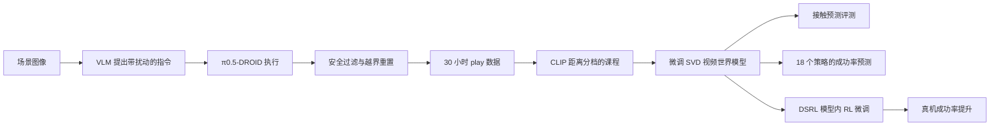

# PlayWorld（arXiv:2603.09030）

**PlayWorld**（*PlayWorld: Learning Robot World Models from Autonomous Play*，[arXiv:2603.09030](https://arxiv.org/abs/2603.09030)，普林斯顿大学 Majumdar 组）最初作为 [具身智能研究室 · 具身世界模型六路线综述](https://mp.weixin.qq.com/s/mmIJRp9g6NqblMCjd9D5GQ) **趋势与判断** 段的策展节点入库；本页已据论文全文（v2）原地升级，归档见 [来源归档](../../sources/papers/playworld_arxiv_2603_09030.md)。

## 一句话定义

用 VLM 自动提出任务指令、预训练 VLA 去执行，在 DROID 平台上无人监督地采集机器人「自玩」数据，再用它微调动作条件视频世界模型，使其能预测漏抓、滑动、碰撞、形变等接触失败，并用于策略评估和模型内强化学习微调。（作者自述：「first system capable of learning entirely from unsupervised robot self-play」，摘要。）

## 英文缩写速查

| 缩写 | 英文全称 | 简要说明 |
|------|----------|----------|
| WM | World Model | 根据状态与动作预测未来观测/状态 |
| SVD | Stable Video Diffusion | 本文世界模型的预训练视频扩散骨干（§3.3） |
| VLM | Vision-Language Model | 本文用作任务提出者与重置检测器（§3.2） |
| VLA | Vision-Language-Action | 本文用 π0.5-DROID 作任务执行者（附录 A） |
| DSRL | Diffusion Steering via Reinforcement Learning | 冻结扩散策略、只学初始噪声的 RL 微调（§4.5） |
| LPIPS / SSIM | Learned Perceptual Image Patch Similarity / Structural Similarity | 生成帧与真值帧的感知相似度指标（Table 1） |
| DROID | Distributed Robot Interaction Dataset | 采集平台与世界模型预训练数据（§3.2） |

## 为什么重要

- 论文论点（§1）：现有动作条件视频世界模型几乎只在成功偏置的人类示教上训练，对反事实动作与失败后果缺乏监督；PlayWorld 用自动采集的 play 数据补这块覆盖。
- 它把「数据从哪来」作为世界模型的核心变量，而不是只改架构：架构基本沿用 Ctrl-World（§3.3），主要变化是数据与课程。
- 在六路线综述里被放在「趋势与判断」，是因为它指向「世界模型要能预测失败」这一评价取向；本页给出的是论文本身的证据。

## 核心原理与流程总览

- **Play 数据分布（§3.1）：** 用语言条件策略 π_play 与多样指令 ℓ 产生数据集 D_play，近似多种策略会访问的状态分布，而不是仅专家分布。
- **采集（§3.2）：** VLM 看当前图像提指令并加入动词、物体描述的小扰动；VLA 执行，对指令扰动敏感的行为差异被当作多样性来源；关节限位加 VLM 检测越界物体并下发「移回中心」；最长 8 小时连续采集。
- **训练（§3.3，附录 A）：** SVD 骨干，3 视角联合预测，先 DROID 预训练再在 play 数据上用扩散损失微调；课程按到「成功质心」的 CLIP 距离分 5 档，逐步提高难样本比例。
- **应用（§4.4–4.5）：** 开环重放评估接触预测；用世界模型 rollout 预测 18 个策略的成功率；用 DSRL 在世界模型里对扩散策略做 RL 微调后上真机。

## 工程实践

- **硬件与平台：** DROID 操作平台，无硬件改动（§3.2）。
- **训练：** 8×H200，batch 64，两天（§3.3）；学习率 5e-6，预测 5 帧、历史 7 帧，5 Hz，50 步去噪，guidance 2.0，分辨率 320×192（附录 A，Table 2）。
- **课程参数：** K=5、R=5，分布从 (0.5,0.3,0.1,0.05,0.05) 每 5000 步更新到 (0.1,0.2,0.2,0.25,0.25)；作者承认具体参数对模型质量「有明显影响」（附录 A）。
- **DSRL 微调（§4.5，附录 D）：** 起点为 5–10 条示教的扩散策略；10–20 个初始物体构型作为世界模型起点；基于进度差分的稠密奖励 r_t = p̂(s_{t+1}) − p̂(s_t)；每个检查点做 20 次真机试验。作者称 VLM 奖励不稳、稀疏 0/1 奖励需更多交互（附录 D）。
- **采集 prompt：** 提示 VLM 在胶带标记的方形区域内随机操作物体，越界则输出「move the <> towards the center of the table」（附录 A）。
- **代码：** 论文首页给出项目页 robot-playworld.github.io；本次未见公开仓库链接，故 frontmatter 不写 code。

## 评测证据与清单说法的对比核对

清单（Berseth 的 CoRL 2026 阅读清单，作者说明摘要由 LLM 据摘要起草）一句话：「Trains robot world models on autonomous play data, reducing contact hallucinations compared with demonstrations or policy rollouts.」

| 清单措辞 | 论文核对 |
|----------|----------|
| 在自主 play 数据上训练机器人世界模型 | 属实（§3、§4.1：30 小时、VLM+VLA 自动采集）。 |
| 相比示教减少接触幻觉 | 有对照：Human Demo（6h）与 Human Play（6h）（§4.3，Table 1），失败类（漏抓、滑动、打滑、碰撞等）LPIPS/SSIM 多数更好，Fig. 5 展示基线「幻觉成功」；但对象是示教/人类 play，且 Robot Play 6h 对 Human Demo 6h 在「成功」类 LPIPS 仅 0.082 对 0.084；形变类 Robot Play 6h 的 SSIM 与 Human Play 相同（0.831）。论文自己也说幻觉「未完全消除」（§6）。 |
| 相比策略 rollout | 论文没有以「策略 rollout 训练的世界模型」为基线；基线只有人类示教与人类 play。基准的测试片段来自 20+ 策略 rollout（Table 3），但那是评测集，不是对照训练数据。清单这一半说法在论文里找不到对应实验。 |
| 隐含内容 | 清单未提：数据集仅限 DROID 平台受控实验室、三个小物体集；策略评估（18 个策略，Pearson 0.8766）与「最多 65%」真机提升属于该论文的主要后续结果，但清单没写。 |

## 结论

PlayWorld 表明机器人自玩数据有助于世界模型覆盖失败交互，但模型幻觉和采集冗余仍限制后训练。

- 按相同采集小时比较机器人与人类数据，并单独核验课程中成功示范的人工贡献。
- 同时评估漏抓、碰撞等事件保真度与下游策略表现，不能仅凭视频观感选模型。
- 模型内 RL 应监测过拟合与真实迁移并设置早停，不能把预测器当无误差模拟器。

## 局限

**论文自述（§6）：** 采集策略不优化样本效率、轨迹冗余；依赖足够强的 play 策略；幻觉未被消除，开环 rollout、固定动作视野、数据采集与评估时控制模式不匹配会累积误差；超出受控实验室环境的扩展仍是开放问题。

**我读到的未验证之处：**
- 摘要与 §4.5 的「最多 65%」来自 Fig. 9 对两项任务的比较（对象是基线视频模型中微调），正文和附录没有给出具体基线与最终成功率的表格数字，需看图；起点策略仅 5–10 条示教、每检查点 20 次真机试验，样本很小，未见置信区间。
- 基线数据量不对等：Robot Play 为 30 小时（以及 6 小时子集），人类基线为 6 小时；Table 1 的 6 小时对 6 小时比较才是等量比较，且差距在 LPIPS 上多为百分位级别。
- 课程学习用人类成功示教定义「成功质心」，因此并非完全无人参与；附录 A 也说明设置较简单、参数敏感。
- Pearson 0.8766 的样本是 18 个策略，且都是本实验室构造的扩散策略与 π0 微调，策略分布相对单一（推测：对其他策略族的泛化未验证）。
- 附录 D 自述世界模型的幻觉被策略「利用」后仍可能迁移到真机，同时长时间微调会过拟合世界模型而降低真机表现，说明模型内 RL 需要早停（作者观察，未提供系统的停止准则）。

## 关联页面

- [具身世界模型六路线技术地图](../overview/embodied-wm-six-routes-technology-map.md)
- [趋势与判断 分类 hub](../overview/embodied-wm-route-outlook.md)
- [Generative World Models](../methods/generative-world-models.md)
- [World Action Models](../concepts/world-action-models.md)
- [Video as Simulation](../concepts/video-as-simulation.md)
- [Curriculum Learning](../concepts/curriculum-learning.md)
- [Diffusion Policy](../methods/diffusion-policy.md)
- [Ctrl-World](./paper-ctrl-world.md)：PlayWorld 沿用其视频世界模型设置与 DROID 预训练权重
- [DROID 策略学习](./droid-policy-learning.md)
- [WorldGym](./paper-shenlan-wm-15-worldgym.md)：同样把世界模型用于策略评估
- [GR00T-Dreams](./paper-gr00t-dreams-synthetic-trajectories.md)、[GigaWorld-0](./gigaworld-0.md)：靠模型合成扩规模的邻接路线

## 参考来源

- [playworld_arxiv_2603_09030.md](../../sources/papers/playworld_arxiv_2603_09030.md)：论文通读归档
- [wechat_embodied_ai_lab_wm_six_routes_survey_2026-08-25.md](../../sources/blogs/wechat_embodied_ai_lab_wm_six_routes_survey_2026-08-25.md)：六路线综述中的定位

## 推荐继续阅读

- [arXiv:2603.09030](https://arxiv.org/abs/2603.09030)
- 项目页：<https://robot-playworld.github.io>
- [具身世界模型六路线原文](https://mp.weixin.qq.com/s/mmIJRp9g6NqblMCjd9D5GQ)
