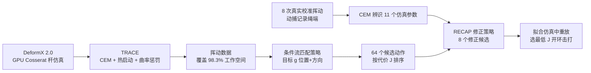

# Point It, Strike It

**Point It, Strike It**（arXiv:2610.09573，CMU 机器人研究所等）研究**单次挥绳击打**：给定绳端目标 3D 位置与到达方向，机械臂一次开环挥动。系统由四部分组成：GPU 绳仿真 DeformX 2.0、数据生成方法 TRACE、条件流匹配策略、以及用 8 次真实挥动校准仿真并修正动作的 RECAP。

## 英文缩写速查

| 缩写 | 英文全称 | 简要说明 |
|------|----------|----------|
| DLO | Deformable Linear Object | 可变形线状物体，绳、线缆等 |
| CFM | Conditional Flow Matching | 条件流匹配，生成式策略的训练目标 |
| CEM | Cross-Entropy Method | 交叉熵采样优化，TRACE 的底层优化器 |
| TRACE | 论文的数据生成方法（全称原文未展开核实） | 热启动、惩罚弯折与突变的可重复挥动生成 |
| RECAP | 论文的残差校准策略（全称原文未展开核实） | 用少量真实挥动拟合仿真参数并输出修正动作 |
| SR@5 / SR@10 | Success Rate within 5 / 10 cm | 绳端落点距目标不超过 5 / 10 cm 的成功率 |

## 为什么重要

- 动态操作里"同一目标多种挥法"是常态，回归策略会平均不兼容的动作；论文用条件流匹配保留多模态，仿真中回归只有 21.4%，本文 73.5%（一次采样）。
- 只加方向条件就把任务从"打中点"变成"以指定方向打中点"，真机方向目标成功率从 50% 到 79%。
- 校准成本很低：每根绳 8 次真实挥动，不重新训练大模型。
- 与同类 [RopeFormer](./paper-ropeformer.md) 的跨 trial 记忆不同，这里用仿真参数辨识 + 修正策略补 sim2real 差距。

## 流程总览

## 方法

### 问题与动作表示

- 目标 g=(p*, d*)：绳端 3D 位置与到达方向（cosθ, sinθ），方向为绳端速度在臂中心球面切平面上的投影。
- 动作 w 为 21 维：5 个关节 × 4 个等间隔路点 + 挥动时长，经截断三次样条解码，时长随关节速度限自动调整。

### DeformX 2.0

在 Isaac Sim 中实现稳定 Cosserat 杆求解和每段垂直切线的二次阻力；每 60 Hz 控制步 100 个子步、16 次约束迭代。1 m、20 段绳：8,192 环境并行下仿真/墙钟比 4,710，对 DeformX 单线程 0.22，论文称加速超过 20,000 倍，每 GPU 每小时超过 100 万条轨迹。

### TRACE 数据生成

CEM 优化 J = L_target + L_spd + L_lim + L_curv；最大归一化损失 ≤1 才接受；新目标从绳端轨迹最近的已存挥动热启动；曲率项使绳伸展、绳端平滑，利于可重复。工作空间覆盖 98.3%（带示例 CEM 为 49.5%）。

### 流匹配策略与 RECAP

- 策略：6 个 adaLN-Zero 块、宽度 512、约 11.3M 参数，目标与流时间注入每个块；推理 64 个样本、50 步 Euler，按 J 取最优。
- RECAP：8 次校准挥动 + 动捕，CEM 辨识 11 个仿真参数；增量 CFM 在扰动参数的仿真中训练；运行时产生 8 个修正，在拟合仿真里重放选最低 J。

## 源码运行时序图

不适用：项目页与 arXiv 均未提供仓库或数据，截至 2026-10-12 无可对齐的官方代码。

## 工程实践

| 项 | 内容 |
|----|------|
| 机构 | 卡内基梅隆大学 RI；上海交通大学；哈佛大学 SEAS（据 arXiv HTML 作者脚注） |
| 真机 | 墙装 UR5e + 0.65 m 刚性杆 + 1.0 m 绳；30° 锥、半径 1.6–2.3 m、最大高 2.5 m |
| 标定 | 每根绳 8 次固定挥动 + 动捕，需要动捕系统 |
| 项目页 | [deformx.github.io/DeformY](https://deformx.github.io/DeformY)，归档见 [deformy-rope-project.md](../../sources/sites/deformy-rope-project.md) |
| 开源状态 | 截至 2026-10-12 页面无 GitHub 链接，也未声明将发布 |

## 实验与评测

- **真机 3D 位置目标（三绳均值）**：SR@5 Base 72%、Baseline 74%、RECAP 87%；SR@10 92/94/98%；平均距离 4.5/4.2/3.1 cm。
- **真机 4D 目标**：SR@5 28/28/52%；SR@10 50/51/79%；平均距离 10.6/10.2/5.6 cm；平均角误差 8.2°/8.5°/5.1°。成功要求误差 ≤10° 且沿方向速度至少 1 m/s。Baseline 参照 Wiggle&Go（仿真网络估计参数、不修正动作）。
- **仿真 5,700 个留出目标**：本文一次采样 73.5% / best-of-64 92.1% / 3.6 cm / 2.4°；朴素 FM 67.9% / 88.9% / 5.3 cm / 3.0°；回归 21.4% / 24.0 cm / 12.4°；最近邻 33.6% / 9.2 cm / 6.4°。
- **数据生成消融**：CEM+示例覆盖 49.5%、best-of-64 68.5%；TRACE 无示例 96.8%、83.9%；TRACE 98.3%、92.1%。
- 每根绳每种目标 25 个目标 × 3 次挥动，样本量小，未报告置信区间（原文未报告）。

## 结论

**RECAP 对方向条件目标的收益远大于对纯位置目标，说明方向精度才是 sim2real 差距的敏感点；整条链仍是单次开环击打。**

1. **看 4D 指标而非 3D** — SR@10 50%→79%，而 3D SR@10 只是 92%→98%。
2. **多模态建模是前提** — 回归在仿真 21.4%，FM 达 73.5%，best-of-64 达 92.1%，推理时需要多采样 + 代价排序。
3. **数据覆盖决定策略上限** — TRACE 覆盖 98.3% 对 CEM 49.5%，best-of-64 从 68.5% 到 92.1%。
4. **校准要少量真实数据** — 8 次挥动和动捕即可，但需要动捕硬件。
5. **别外推到连续接触** — 论文只覆盖单次开环挥击。
6. **无代码** — 复现需自建 DeformX 2.0 级别仿真。

## 局限与风险

- 仅单次挥绳、固定工作空间；不含持续接触、障碍或多阶段。
- 校准后开环，挥动中扰动无法修正。
- 依赖仿真生成与排序，真实动力学超出仿真范围时会退化。
- 三根绳、小样本；训练集规模正文未给出。
- 开源：代码、数据、权重均未见发布。

## 与其他工作对比

- [RopeFormer](./paper-ropeformer.md)：Transformer-XL 跨 trial 记忆绳交互历史，侧重在线适应；本文用离线仿真 + 8 次校准，侧重方向精度。
- [流匹配具身策略](../concepts/flow-matching-embodied-policy.md)：本文把 CFM 用于低维动作路点而不是视觉策略。
- [物理保真度与 sim2real 缺口](../concepts/physics-fidelity-sim2real-gap.md)：本文用参数辨识 + 修正策略缓解缺口。
- 同周布料对照：[Same Action, Different Outcome](./paper-same-action-different-outcome-cloth.md) 说明动态柔性体的同动作结果变化可比机器人重复误差大 1–3 个数量级，RECAP 的开环单击需考虑这种波动。

## 关联页面

- [Manipulation 周报汇总（2026-10-05 至 10-09）](../overview/frontier-manipulation-2026-10-05-10-09.md)
- [操作任务](../tasks/manipulation.md)
- [Sim2Real](../concepts/sim2real.md)

## 参考来源

- [point_it_strike_it_arxiv_2610_09573.md](../../sources/papers/point_it_strike_it_arxiv_2610_09573.md) — 论文归档
- [deformy-rope-project.md](../../sources/sites/deformy-rope-project.md) — 项目页核查
- [frontier_manipulation_2026_10_05_10_09.md](../../sources/blogs/frontier_manipulation_2026_10_05_10_09.md) — 周报线索
- 论文：<https://arxiv.org/abs/2610.09573>

## 推荐继续阅读

- [项目页 DeformY](https://deformx.github.io/DeformY)
- [前作 DeformX 项目页](https://deformx.github.io/)
- [arXiv HTML 全文](https://arxiv.org/html/2610.09573v1)
