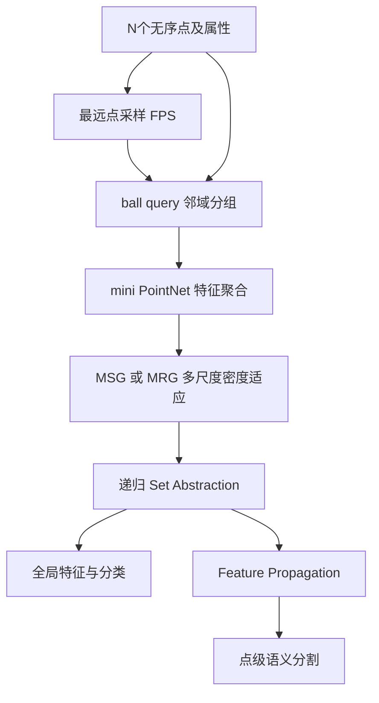
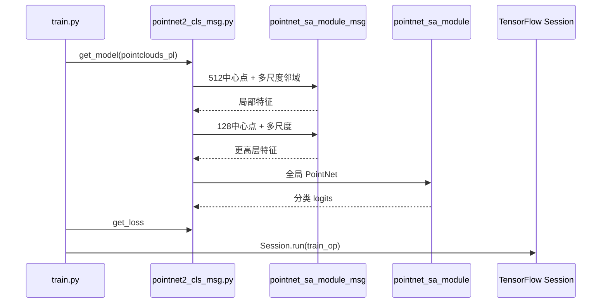

# PointNet++ / Deep Hierarchical Feature Learning on Point Sets in a Metric Space

## 一句话定义

PointNet++ 以层级 Set Abstraction 的 FPS 采样、半径邻域分组和局部 PointNet 建模点云几何，并以 MSG/MRG 适应密度变化。

## 英文缩写速查

| 缩写 | 英文全称 | 简要说明 |
|---|---|---|
| CNN | Convolutional Neural Network | 卷积特征学习网络 |
| 3D | Three Dimensional | 三维空间中的数据表示 |
| IoU | Intersection over Union | 空间候选/标注框重叠程度 |
| FPS | Farthest Point Sampling | 空间均匀采样点 |

## 为什么重要

PointNet++ 以层级 Set Abstraction 的 FPS 采样、半径邻域分组和局部 PointNet 建模点云几何，并以 MSG/MRG 适应密度变化。 对机器人视觉、点云感知和三维重建的意义在于清楚分离**测量数据、几何特征、网络预测与评价协议**；跨方法比较必须使用同类实验输入和指标。

## 核心原理与方法

每个 Set Abstraction（SA）层通过 Farthest Point Sampling（FPS）选中心点，ball query 在固定空间半径内找邻居；邻域点转为相对中心的坐标，局部 PointNet MLP+max-pool 聚合，再递归 SA 扩大感受野。Multi-Scale Grouping（MSG）用多个半径编码同一中心点并随机丢点训练，Multi-Resolution Grouping（MRG）融合跨层尺度以降低计算成本。分割时 Feature Propagation 将粗层表征插值回原始点。

## 流程总览（原论文方法）

## 源码运行时序图

**实际检查的入口：** train.py → models/pointnet2_cls_ssg.py 或 pointnet2_cls_msg.py get_model → pointnet_sa_module_msg / pointnet_sa_module → get_loss → TensorFlow optimizer.minimize；evaluate.py 单独读测试集。。以下 Mermaid 对照作者仓库与运行模块，未宣称 GPU 运行成功。

## 实验与评测

arXiv v1 Table2 ModelNet40 点坐标输入：PointNet 89.2%、PointNet++ 90.7% 分类准确率；输入增加法线并用 5000 点时达到 91.9%，不能与前者视为同条件。论文另在 ScanNet、SHREC15 和附录分割、kNN/ball query、FPS 随机性进行分析。

## 与其他工作对比

PointNet++ 在 PointNet 的「逐点 MLP + 全局 max-pool」上加入层级局部分组，之后又被用作 3D 检测的点云骨干；下表数字为论文自报。

| 对照 | 差异 | 论文结果/说明 |
|---|---|---|
| [PointNet](./paper-rcl-ref-a6e65f34d4c161a2ba59-pointnet-deep-learning-on-point-sets-for-3d-clas.md) | PointNet 对全部点做一次全局 max-pool，没有局部邻域结构；PointNet++ 用 FPS + ball query 分组，在局部区域递归运行 mini PointNet，并用 MSG/MRG 应对密度不均 | 论文 Table2 ModelNet40、仅 xyz 输入：PointNet 89.2% vs PointNet++ 90.7%；91.9% 用了法线和 5000 点，不是同条件 |
| [PointRCNN](./paper-pointrcnn.md) | 下游使用者：PointRCNN 在两个阶段都用 PointNet++ 作骨干，分别做逐点前景分割/proposal 和 RoI 内框精修 | 定性：PointNet++ 提供的是逐点特征，3D 框的生成与精修由 PointRCNN 另行设计 |
| [PV-RCNN](./paper-pv-rcnn.md) | 只借用 set abstraction 思路：FPS 选关键点，再用 PointNet 式聚合把稀疏体素特征汇到关键点（VSA）；主干换成稀疏体素 CNN | 定性：体素 CNN 负责主干特征和 proposal，点集抽象只负责关键点特征汇聚 |

## 结论

**PointNet++ 的价值在于明确的数据流与约束设计，而不是无条件提高所有场景的性能。**

1. 首先理解核心模块与原论文优化目标；
2. 比较结果时保留数据集、val/test、分辨率、是否带额外监督等条件；
3. 迁移到机器人平台应重新测量延迟、显存与传感器标定；
4. 原论文报告的结果不等于这里已独立复现。

## 工程实践

- 官方实现：[PointNet++](https://github.com/charlesq34/pointnet2)。
- 训练/评测时遵循作者 README，核对依赖版本、数据路径、模型配置和 checkpoint。
- 生产/机器人部署前需要验证误差/延时/坐标系，而不是直接套用论文训练超参数。

## 局限与风险

MSG 多半径局部特征计算较重，ball query 半径需要依据实际采样密度调整。旧 TF1.2 GPU/Python2.7 环境不保证在现有 GPU 驱动直接运行；表中含 normal 的结果不等同于 xyz-only 输入。

## 关联页面

- [机器人视觉感知栈选型闭环](../queries/robot-perception-stack-selection-loop.md) — ③层 2D→3D 提升与语义建图：点云语义/分割的骨干表征
- [OpenPCDet](./openpcdet.md)
- [FeatDepth](./paper-featdepth.md)
- [COLMAP](./colmap.md)

## 参考来源

- [作者原论文全文归档](../../sources/papers/vision3d_pointnet2_primary_paper_20261108.md)
- [作者官方源码归档](../../sources/repos/vision3d_pointnet2_20261108.md)
- [arXiv 原始全文](https://arxiv.org/html/1706.02413)
- [作者代码](https://github.com/charlesq34/pointnet2)

## 推荐继续阅读

- [完整原论文及引用](https://arxiv.org/html/1706.02413)
