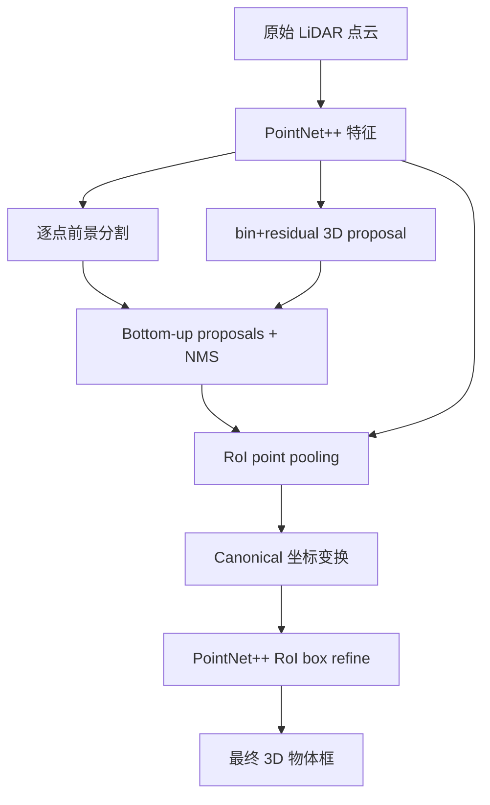
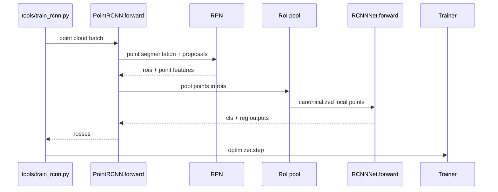

# PointRCNN / 3D Object Proposal Generation and Detection from Point Cloud

## 一句话定义

PointRCNN 先从原始 LiDAR 点云逐点前景分割生成 bottom-up 3D proposals，再在规范坐标的 RoI 中精修物体框。

## 英文缩写速查

| 缩写 | 英文全称 | 简要说明 |
|---|---|---|
| CNN | Convolutional Neural Network | 卷积特征学习网络 |
| 3D | Three Dimensional | 三维空间中的数据表示 |
| IoU | Intersection over Union | 空间候选/标注框重叠程度 |
| RPN | Region Proposal Network | 物体候选生成 |

## 为什么重要

PointRCNN 先从原始 LiDAR 点云逐点前景分割生成 bottom-up 3D proposals，再在规范坐标的 RoI 中精修物体框。 对机器人视觉、点云感知和三维重建的意义在于清楚分离**测量数据、几何特征、网络预测与评价协议**；跨方法比较必须使用同类实验输入和指标。

## 核心原理与方法

Stage1 PointNet++ 学习逐点前景/背景、语义特征与 bin-based 中心/朝向/尺寸残差；经鸟瞰旋转 NMS 获得 proposals。Stage2 对每个 proposals 加上下文池化点云，结合前景 mask、深度与第一阶段特征，将相对候选框坐标规范化（canonical transform），再用 PointNet++ 执行 box refinement 与置信度预测。论文 Table4 消融显示没有 canonical transform 的中等难度检测 AP 仅 13.68（其它模块保持）而完整 77.67。

## 流程总览（原论文方法）

## 源码运行时序图

**实际检查的入口：** 官方 sshaoshuai/PointRCNN：tools/train_rcnn.py、lib/net/point_rcnn.py::PointRCNN.forward 调用 RPN 和 proposal_layer，RoI pooling 后 lib/net/rcnn_net.py::RCNNNet.forward，loss 回传 Trainer；README 另有先保存 RPN proposals 再训练 Stage2 的离线方案。。以下 Mermaid 对照作者仓库与运行模块，未宣称 GPU 运行成功。

## 实验与评测

arXiv v2 KITTI test（Table1）车类 easy/mod/hard 3D AP 85.94/75.76/68.32（IoU 0.7）；val（Table2、GT-AUG）88.88/78.63/77.38，不能把 test 与 val 结果混用。50 个 proposal、IoU 0.5 的召回率为 96.01%（val、car moderate，Table3）。

## 结论

**PointRCNN 的价值在于明确的数据流与约束设计，而不是无条件提高所有场景的性能。**

1. 首先理解核心模块与原论文优化目标；
2. 比较结果时保留数据集、val/test、分辨率、是否带额外监督等条件；
3. 迁移到机器人平台应重新测量延迟、显存与传感器标定；
4. 原论文报告的结果不等于这里已独立复现。

## 工程实践

- 官方实现：[PointRCNN](https://github.com/sshaoshuai/PointRCNN)。
- 训练/评测时遵循作者 README，核对依赖版本、数据路径、模型配置和 checkpoint。
- 生产/机器人部署前需要验证误差/延时/坐标系，而不是直接套用论文训练超参数。

## 局限与风险

纯点云对稀疏远距离小目标、行人可能不如融合 RGB 方法。两阶段 proposal+RoI 池化会增加延迟；bin/NMS 阈值取自特定 KITTI 配置，不能照搬其他激光雷达。

## 关联页面

- [OpenPCDet](./openpcdet.md)
- [FeatDepth](./paper-featdepth.md)
- [COLMAP](./colmap.md)

## 参考来源

- [作者原论文全文归档](../../sources/papers/vision3d_point_rcnn_primary_paper_20261108.md)
- [arXiv 原始全文](https://arxiv.org/html/1812.04244)
- [作者代码](https://github.com/sshaoshuai/PointRCNN)

## 推荐继续阅读

- [完整原论文及引用](https://arxiv.org/html/1812.04244)
