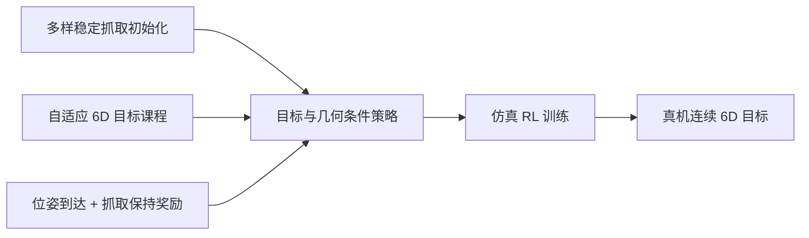

# POISE：手内物体到达任意 6D 位姿

**POISE**（*Learning In-Hand Object Reaching to General 6D Poses*，[arXiv:2609.13761](https://arxiv.org/abs/2609.13761)，[项目页](https://junxiaolin.github.io/poise-website/)）由悉尼大学、Sharpa、香港大学合作（据项目页）。天南的 Sharpa 学术线文章把它放在「路线二：动作如何落地」的自下而上一侧，与 [TacBPM](./paper-tacbpm.md) 同期。

## 一句话定义

**POISE = 手内 6D 位姿到达的 sim-to-real 强化学习框架**：目标不再只是旋转，而是物体在掌心坐标系下的位置 + 姿态（SE(3)），且全程不松手。

## 英文缩写速查

| 缩写 | 英文全称 | 简要说明 |
|------|----------|----------|
| POISE | Palm-relative Object reaching In SE(3) | 本文方法：掌心相对的 SE(3) 物体到达 |
| SE(3) | Special Euclidean group | 三维刚体位置 + 姿态 |
| RL | Reinforcement Learning | 训练手指协同策略 |
| Sim2Real | Simulation to Real | 仿真训练后迁移真机 |

## 核心信息

| 字段 | 内容 |
|------|------|
| 机构 | 悉尼大学（The University of Sydney）、夏帕机器人（Sharpa）、香港大学（HKU） |
| 作者 | Junxiao Lin 等（ Tianyue Wu, Jie Yin, Jia Pan, Kaifeng Zhang, Weiming Zhi） |
| 任务 | 从现有抓取出发，手指协同把物体移到掌心相对目标 6D 位姿 |

## 为什么重要

- 多数学习式手内操作只管重定向、连续旋转或平移；很多任务（装配、递送）需要位置与姿态联合控制。
- 在天南的归纳里，它与 TacBPM 一起代表「自下而上」：先把底层接触行为练稳，再给上层调用（文章表述）。

## 流程总览

## 核心机制

- **多样稳定抓取初始化**：留出抓取成功率 40.1% → 51.5%，掉落后恢复 33.8% → 72.9%（论文自报）。
- **目标与几何条件控制**：策略同时看目标位姿与物体几何。
- **自适应 6D 目标课程**：全范围成功率 6.2% → 59.5%。
- **紧凑奖励**：位姿到达 + 抓取保持；真机连续三目标 20% → 80%。

## 工程实践

| 项 | 状态 |
|----|------|
| 代码 | 截至 2026-10-22 项目页标 “Code Coming soon”，无 GitHub 链接（见 [sources/sites/poise.md](../../sources/sites/poise.md)） |
| 源码运行时序图 | **不适用**（代码未发布） |
| 手型号 | 项目页未写明；本库未核实是否为 Sharpa Wave |

## 实验与评测

以上全部数字来自 arXiv 摘要与项目页自报，本库未独立复现；真机跨多种物体几何与腕部朝向，并报告外部扰动下恢复。

## 与其他工作对比

| 路线 | 任务目标 | 与 POISE 的差异 |
|------|----------|-----------------|
| [手内重定向](../methods/in-hand-reorientation.md)（重定向 / 连续旋转 / 平移） | 只控制姿态或单一自由度 | POISE 把目标扩展为掌心相对的完整 SE(3) 位姿，并要求连续多目标不松手（摘要所述动机） |
| [TacBPM](./paper-tacbpm.md) | 触觉与本体条件的手内行为先验，下游学隐空间残差 | 同属 Sharpa 线“自下而上”；TacBPM 侧重可复用行为先验，POISE 侧重目标条件的 6D 到达与抓取保持 |
| [Dex-X](./paper-dex-x.md) | 从人类视频重建手-物轨迹再蒸馏触觉学生策略 | “自上而下”路线：先有演示再学；POISE 不依赖人类演示，靠仿真 RL + 课程 |

上表为任务定义与路线层面的定性对比；POISE 自报的 6.2% → 59.5% 等数字是作者自身消融（有/无课程、有/无保持奖励），并非与上述工作的同协议数值比较。

## 结论

**POISE 的价值在任务定义与课程设计：把“转起来”升级为“按序到达多个 6D 目标且不掉”。**

- 真正的影响指标是课程带来的全范围成功率（6.2% → 59.5%）和抓取保持奖励带来的真机序列成功率（20% → 80%）。
- 初始化多样性主要提升泛化与掉落恢复，而非峰值性能。
- 代码未发布前，复现与跨手型迁移无法判断。
- 与 TacBPM 的分工（推测）：TacBPM 学触觉条件的行为先验，POISE 学目标条件的位姿到达；两者是否可叠加文中未讨论。

## 常见误区与局限

- 文章称其为 Sharpa 线工作，但手型、传感配置项目页未披露，勿默认带触觉。
- 论文数字为自报，且课程前后对比限于作者设定的仿真。

## 复现边界

代码待发布；需关注项目页 Code 状态变化。

## 关联页面

- [Sharpa Robotics](./sharpa-robotics.md) — 公司学术线
- [TacBPM](./paper-tacbpm.md) — 同属“自下而上”底层行为
- [Dex-X](./paper-dex-x.md) — “自上而下”对照
- [In-hand Reorientation](../methods/in-hand-reorientation.md) — 方法谱系
- [Sharpa 学术路线三条主线（阅读坐标）](../overview/sharpa-academic-route-three-lines.md)

## 参考来源

- [poise_arxiv_2609_13761.md](../../sources/papers/poise_arxiv_2609_13761.md)
- [poise.md](../../sources/sites/poise.md)
- [天南具身公园：Sharpa 学术路线](../../sources/blogs/wechat_tiannan_sharpa_academic_route_2026-10-22.md)

## 推荐继续阅读

- [arXiv 摘要页](https://arxiv.org/abs/2609.13761)
- [项目页](https://junxiaolin.github.io/poise-website/)
