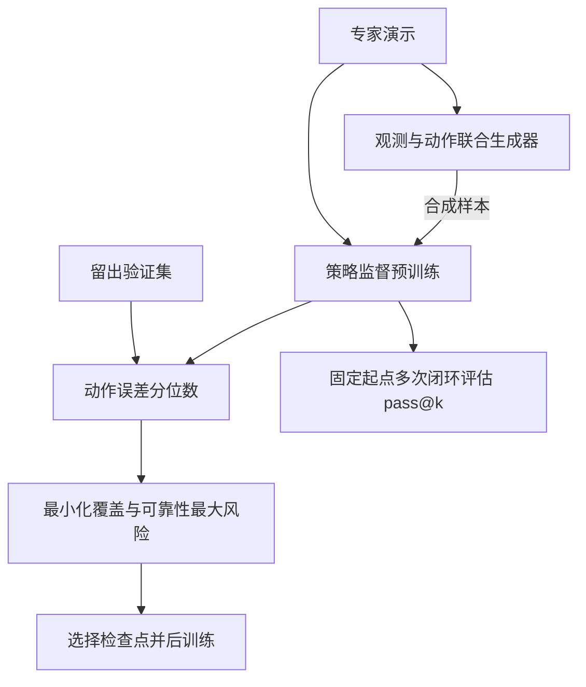

# Beyond Validation Loss: Coverage and Reliability Dynamics in Robot Policy Pretraining / 超越验证损失：机器人策略预训练的覆盖度与可靠性动态

## 一句话定义

本文研究机器人策略预训练中覆盖度与可靠性的权衡，提出离线检查点选择和生成式数据增强。

## 英文缩写速查

| 缩写 | 英文全称 | 简要说明 |
|------|----------|----------|
| BC | Behavior Cloning | 从演示监督学习策略 |
| RL | Reinforcement Learning | 强化学习后训练 |
| SFT | Supervised Fine-Tuning | 监督微调 |
| MSE | Mean Squared Error | 评估生成动作与演示的均方误差 |

## 核心信息

| 项 | 内容 |
|----|------|
| 机构 | 斯坦福大学（Stanford University）；卡内基梅隆大学（Carnegie Mellon University） |
| 论文 | [arXiv v1](https://arxiv.org/pdf/2611.01565v1)；正文与相关实现附录已核对，其余附录待通读 |
| 官方项目 | [项目页](https://zhanyisun.github.io/robot-policy-learning-dynamics/) |

## 流程总览

## 核心机制

- **固定起点 pass@k**：同一初始配置独立采样 k 条闭环轨迹，至少成功一次即计成功，再对初始配置平均。pass@1 衡量平均成功率，大 k 反映有限采样预算内的成功覆盖；不是单次部署成功率。
- **训练动态**：在实验中，大 k 的峰值常早于 pass@1；后期平均成功率上升，困难初始条件的低概率成功行为仍可能消失。相近 pass@1 的检查点后训练结果可不同，但较大 pass@k 不能无条件排序所有检查点。
- **离线选点**：每个验证观测采样动作并计算相对示范动作的 MSE 分位数，对观测求平均，再按整个训练区间逐分位归一化。分别平均低半区与高半区风险，选择两者最大值最小的检查点。best-of-k 只看最优动作，可能过早选点，不能保证整条轨迹稳定。
- **JointAug**：联合生成观测与动作，策略训练混合真实和合成样本各 50%；RoboCasa 的可扩展变体使用选定策略的动作协方差扰动目标，并非完整联合图像生成。

## 源码运行时序图

**不适用**：2026-11-03 项目页 Code、Models 链接为空，未发现可运行官方实现。

## 实验与评测

- MimicGen 操作任务中，JointAug 在论文报告的多数任务上保留较高 pass@10，同时维持或提高 pass@1；RoboCasa 使用动作扰动变体。后训练结果取决于任务和预算。
- 真机 Push-T 使用 680 条训练演示、60 条验证演示；20 个固定起点各运行五次，所选第 46 轮与最终第 200 轮的 pass@1 分别为 0.62、0.52，pass@5 分别为 0.95、0.75。该结果来自单任务、小样本实验。
- 真机早期策略采集数据训练世界模型的预测质量优于最终策略采集数据；这是该实验设置下的结果。

## 与其他工作对比

| 维度 | 本页 | [Validation Loss vs Real-Robot Success](./paper-validation-loss-vs-real-robot-success.md) | [DRIVE](./paper-drive-diversity-rl-vla.md) |
|------|------|------|------|
| 关注阶段 | 预训练检查点选择与后训练起点 | 模仿策略的离线误差与真机闭环成功 | VLA 的 RL 微调 |
| 对“覆盖”的处理 | 固定起点 pass@k 度量覆盖；离线用动作误差分位数选点 | 指出静止不动等失败无法由专家示范验证集暴露 | 以 Pass@K / Coverage@K 做分析，把成功轨迹多样性写成塑形奖励 |
| 实验平台 | MimicGen、RoboCasa 仿真 + 真机 Push-T | 低成本机械臂 | LIBERO-Plus、ManiSkill3、RoboTwin 2.0 + AgileX PiPER-X |
| 代码 | 项目页 Code 链接为空 | 项目页未列 GitHub | 未见官方仓库 |

- **怎么选**：要一个可落地的离线选点规则看本页；只想确认“验证损失能否跨模型排名”看 Validation Loss vs Real-Robot Success（站内为索引级页）；已进入 RL 微调、担心行为收窄看 DRIVE。
- **读法**：三者都提示单一平均成功率或验证损失会掩盖覆盖变化，但指标与实验协议各不相同。

## 结论

选择预训练模型时，平均成功率应结合成功覆盖及后训练预算一起判断。

- 在可重置仿真中，对固定起点重复采样可观察覆盖变化。
- 真机闭环重复测试昂贵时，可用留出动作误差分位数作为离线选点指标，但它是代理指标。
- 比较微调结果时应控制初始状态、成功判定和后训练预算。

## 局限与工程实践

生成动作相对单个示范的 MSE 无法完整代表闭环多模态成功；较大 k 依赖重复采样和固定初始状态。论文主要使用仿真与一个真机 Push-T 任务，结果不保证迁移到所有策略或场景。联合生成器带来额外训练成本。项目页尚未提供可运行代码，论文其余附录尚待通读，故本条目为草稿。

## 关联页面

- [行为克隆](../methods/behavior-cloning.md)
- [Diffusion Policy](../methods/diffusion-policy.md)
- [机器人操作](../tasks/manipulation.md)

## 参考来源

- [论文资料记录](../../sources/papers/policy_coverage_reliability_arxiv_2611_01565.md)
- [官方项目页核查](../../sources/sites/policy_coverage_reliability.md)

## 推荐继续阅读

- [论文 v1](https://arxiv.org/abs/2611.01565v1)
