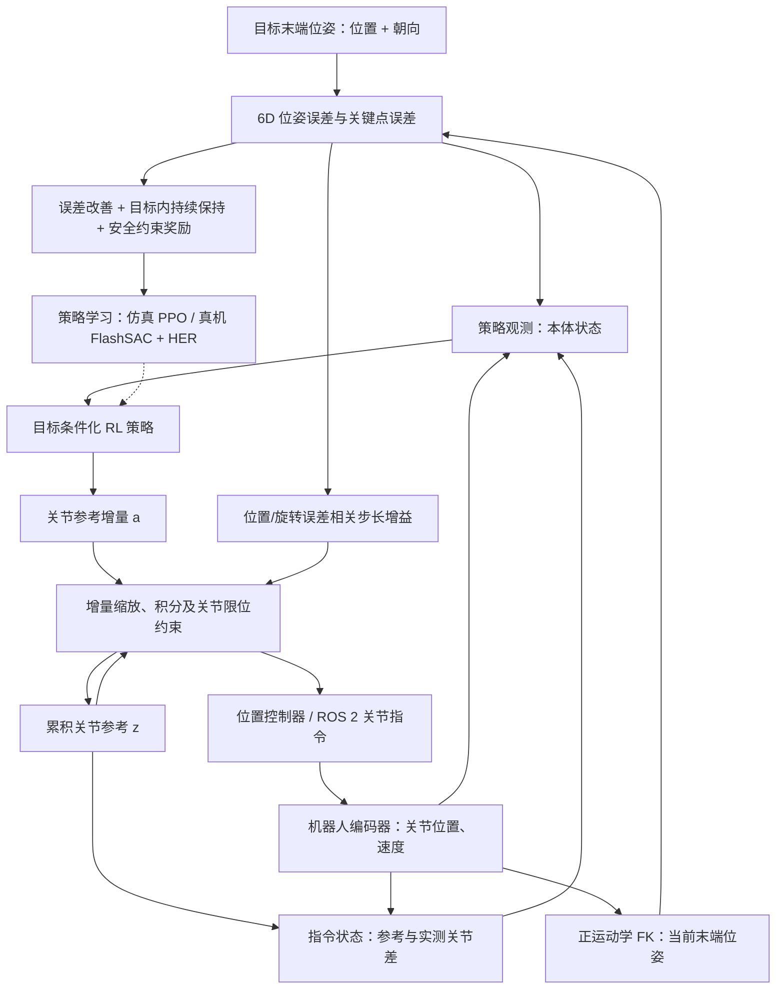
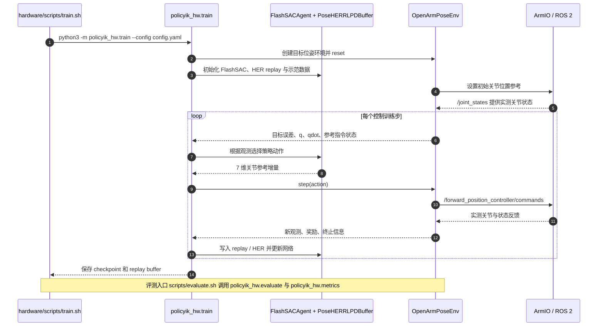

# PolicyIK：高精度强化学习逆运动学 / High-Precision RL Inverse Kinematics

**PolicyIK**（*PolicyIK: High-Precision Inverse Kinematics for Robot Arms with Reinforcement Learning*；[arXiv:2611.05372](https://arxiv.org/abs/2611.05372)）由 Yuhan Liu、Xinqi Liu、Zixuan Dong、Keith W. Ross、Shenji Wan 提出，研究机构为**纽约大学（New York University）及纽约大学阿布扎比分校（New York University Abu Dhabi）**。项目[主页](https://tinaliu0123.github.io/PolicyIK/)和[源码](https://github.com/Tinaliu0123/PolicyIK)已公开。本文是对[原论文](../../sources/papers/policyik_arxiv_2611_05372.md)与实际训练/评测源码的归纳，不以公众号转述替代原始实验。

## 一句话定义

PolicyIK 将逆运动学视为**闭环的目标位姿跟踪与稳定保持问题**：目标条件化 RL 策略逐步修正关节位置参考，利用实际关节反馈与剩余 6D 位姿误差，既到达目标，也在阈值内持续停住。

## 英文缩写速查

| 缩写 | 英文全称 | 简要说明 |
|---|---|---|
| IK | Inverse Kinematics | 逆运动学：由期望末端位姿寻找关节配置或控制更新 |
| RL | Reinforcement Learning | 与环境交互学习长期回报最大化策略 |
| PPO | Proximal Policy Optimization | 仿真 OpenArm 训练使用的 on-policy 策略优化 |
| SAC | Soft Actor-Critic | 真机使用的离策略算法；公开实现为 FlashSAC |
| HER | Hindsight Experience Replay | 将经历按事后目标重新标注以提升稀疏目标学习效率 |
| DLS | Damped Least Squares | 典型阻尼最小二乘雅可比 IK 对照 |
| FK | Forward Kinematics | 利用编码器关节位置计算/估计末端位姿 |

## 为什么重要

- **到达成功不等于保持成功**：在真实 OpenArm 60 个任务里，PolicyIK 在 25 秒预算内有 54 次到达、43 次保持；性能最好的经典 IK 对照虽然也能多次到达，却在最终连续 5 秒稳定性上明显掉队。
- **全位姿目标**：同时处理末端三维位置与三维方向，不把任务简化为只到达某个点。对大角度旋转与接近运动学奇异位形的测试尤为有意义。
- **训练与部署一体**：仿真 PPO 和真实机械臂上的 FlashSAC + HER 都把当前关节、目标误差和已发指令状态放进闭环；对 [强化学习](../methods/imitation-learning.md) 的硬件实践与 [仿真评测](../concepts/simulation-evaluation-infrastructure.md) 都有参考价值。

## 流程总览

以下为依据论文的方法图、观测设计和开源 action/env 实现绘制的**控制数据流**；仿真与真机的训练器分别标注，避免将 PPO 误当作真机算法。

## 核心原理

### 1. 闭环关节参考而非一次性解析解

策略动作并非直接固定某个最终逆解。论文/源码将输出看作关节参考的增量；在时刻 t 更新关节参考 z，形式上可以理解为：

\[
z_t = \operatorname{clip}\bigl(z_{t-1} + \eta\,g(e_p,e_R)\,a_t,\;q_{\min},q_{\max}\bigr).
\]

这里 a 为策略动作，g 依据位置误差与方向误差调整更新幅度，z 是累积的关节位置指令；实现上还做软/硬关节限位约束。接近目标时适当减小步幅，有助于避免在很小的目标容差附近反复越界。

### 2. 让策略知道「发过什么指令」

- **本体信息**：关节位置、速度，以及由 FK 算出的末端位姿。
- **目标条件**：相对目标的位置和方向误差；误差采用不同精度尺度以及关键点几何特征编码，兼顾大范围靠近和精细终点纠正。
- **指令状态**：已累计的关节参考与当前实测关节之间的偏差。它揭示执行器对先前指令的跟随差异，避免策略只看关节实测而忽略已发送但尚未达到的目标位置。
- **优化目标**：奖励不仅鼓励距离下降，也通过进展、回退惩罚、目标内 dwell 奖励及关节约束项鼓励到位后持续保持。

### 3. 两条强化学习训练路径

| 环境 | 学习器 / 平台 | 入口与要点 |
|---|---|---|
| 仿真 OpenArm | Isaac Lab + rl_games PPO | simulation/scripts/train.sh → policyik_sim.train；4,096 并行环境，训练到 13,000 PPO epochs |
| 真实 OpenArm | FlashSAC + HER + scripted demonstrations | hardware/scripts/train.sh → policyik_hw.train；120,000 个真实动作步，示范数据 22,500 transitions |
| 仿真部署与评估 | 预训练权重 + 单次 / 目标修正 / transient 重试 | simulation/scripts/evaluate.sh → policyik_sim.evaluate / corrected_goals / metrics |
| 真机评估 | 已训练的 FlashSAC checkpoint + ROS 2 | hardware/scripts/evaluate.sh → policyik_hw.evaluate / metrics；60 个固定任务 |

## 源码运行时序图

已核对[官方仓库](../../sources/repos/policyik.md)的训练脚本、模型交互、真机环境类与 ROS 2 I/O。下图**只展示真机训练与评测可运行调用链**；仿真 PPO 为独立入口，见上表。

- **仿真代码要点**：[tasks/actions.py](https://github.com/Tinaliu0123/PolicyIK/blob/main/simulation/policyik_sim/tasks/actions.py) 的 AccumulatedJointReferenceAction 使用位置/方向误差增益并累计 reference；[tasks/mdp.py](https://github.com/Tinaliu0123/PolicyIK/blob/main/simulation/policyik_sim/tasks/mdp.py) 实现观测和奖励项。
- **真机代码要点**：[pose_env.py](https://github.com/Tinaliu0123/PolicyIK/blob/main/hardware/policyik_hw/envs/pose_env.py) 的 OpenArmPoseEnv.step 执行控制和观测；[ros_io.py](https://github.com/Tinaliu0123/PolicyIK/blob/main/hardware/policyik_hw/robot/ros_io.py) 的 ArmIO 连接关节状态与位置指令；[train.py](https://github.com/Tinaliu0123/PolicyIK/blob/main/hardware/policyik_hw/train.py) 组装学习器与 HER buffer。

## 工程实践

1. **快速验证仿真权重**：官方 README 在 simulation/ 目录提供 bash scripts/evaluate.sh 1 checkpoints/policyik_s1.pth；同时提供评估数据与另外两个种子权重。
2. **从头训练仿真**：bash scripts/train.sh 1，经多个 PPO 阶段与末尾 checkpoint 平均，之后复用相同评测脚本。这里不是在真机上跑 PPO。
3. **真实 OpenArm 先校准硬件**：官方 hardware/README.md 需要 Ubuntu 24.04 / ROS 2 Jazzy、CAN 设备、openarm_right_bringup 启动、gravity feedforward、motor health 与 watchdog 检查；不能忽略安装姿态（官方 gravity 配置假设手臂基座 z 轴朝下）。
4. **真机在线训练**：hardware/scripts/train.sh 进入 policyik_hw.train；默认 120k 步并在 runs/policyik 保存 checkpoint/replay；示范批次与 HER relabeling 用于支持较大旋转的目标。
5. **安全评估**：真实评估脚本明确带有 --no-collision-guard，论文为研究设置；直接复制到其他硬件或有人环境存在碰撞与设备损坏风险，先检查限位、急停及电机保护。

## 实验与评测

| 测试条件 | 指标 | PolicyIK | 可比基线 / 说明 |
|---|---|---|---|
| 仿真 OpenArm，4,120 留出任务 | 严格阈值，单次执行 | 93.49% ± 0.20% | 1 mm 与 0.2°；不能写成 98.9% |
| 仿真 OpenArm，含部署重试 | 严格阈值，多阶段协议 | 98.92% ± 0.23% | 目标修正 + transient-goal 重试，最多 8 次扰动候选 |
| 仿真 OpenArm | 最终中位误差 | 0.25 mm / 0.04° | 仿真结果 |
| 真实 OpenArm，60 任务，25 s 预算 | 到达 reached | 54/60 | 连续 0.5 秒位姿误差均满足阈值 |
| 真实 OpenArm，同一任务 | 保持 held | **43/60** | 最终 5 秒持续满足阈值；最佳经典 DLS 为 **17/60** |
| 真实 OpenArm | 最终 1 秒任务中位误差 | **0.50 mm / 0.12°** | 由编码器位置 + 机器人 FK 计算，不是外部测量绝对误差 |
| xArm7 真机，扩展测试 | standard / large rotation | 各 60/60 | 标准目标上经典 DLS/QP/MPC 也有 60/60；不要跨平台概括 |

以上成功率与误差均按论文/官方评测协议引用，未复现实验。**成功达到、持续保持、最终一秒的统计中位误差**是三个不同指标。研究报告在 15 s 预算下，OpenArm 最后 5 秒 held 会降至 27/60，不能省略时间预算。

## 与经典 IK 对比

- **传统 DLS/QP/MPC**：依赖雅可比、约束和轨迹/反馈律；某些目标能够在时限内到达，但现实电机动力学、参考滞后与目标附近反复修正会影响「保持」指标。
- **PolicyIK**：策略显式接收已发参考与实测关节的差，学会逐步纠错与减速。对真实 OpenArm 任务，保持成功率 43/60 ÷ 17/60 ≈ **2.53 倍**。
- **适用边界**：这证明了该论文 OpenArm 任务集上的性能优势，并非「经典 IK 普遍只有 40%」「RL 在所有机器人上都更快、更准」。论文 xArm7 的标准目标对照就有经典方法同样全部成功的情况。

## 结论

**PolicyIK 的关键贡献是把逆运动学的终点精度从「算出一次关节解」变为「真实执行器反馈下持续到达并保持目标位姿」的可学习闭环过程。**

1. **报告成功率必须附协议**：仿真 93.5% 对应单次，98.9% 对应目标修正与重试后。
2. **真机核心收益在保持**：OpenArm 的 held 为 43/60，相同设置下最佳经典 DLS 为 17/60；2.53× 是任务与指标限定的比较。
3. **低误差不等于无误差保证**：0.50 mm / 0.12° 是任务中位统计值，且末端位姿从编码器 + FK 估计。
4. **状态设计可迁移**：目标误差之外纳入命令参考与实测位置的差，是闭环策略工程上值得复用的观测设计。
5. **训练路线不同**：仿真 PPO、真机 FlashSAC + HER + 示范；复现时不要把算法、数据来源混为一谈。
6. **稳定性依赖条件**：接近奇异位形表现较好不等于对所有奇异点免疫；成功率还受时间预算、目标分布和安装/控制配置影响。

## 局限与风险

- **实验范围**：主要证据来自所选 OpenArm 与 xArm7 任务，并不构成对任意机械臂、任意工具端负载或未见过任务的保证。
- **真机精度来源**：模型 FK 与关节编码器不能独立验证模型偏差、连杆柔顺性或外部标定误差；若要求对外部工件的真实亚毫米精度，需额外测量。
- **安全与调参**：所谓「不用调参」不意味着没有算法超参数、关节增益、重力前馈、机器人安装与保护设置。仓库真机评估关闭碰撞保护，不能不审查就用于生产。
- **速度与预算**：25 s 与 15 s 成功率差距显著；不是所有初始位姿都能在很短时间达到并稳定保持。
- **开源边界**：官方仓库确实提供 OpenArm 的训练评估代码和权重；xArm7 的独立驱动/数据完整复现范围仍须按实际仓库目录核实。

## 关联页面

- [仿真与评估基础设施](../concepts/simulation-evaluation-infrastructure.md)——何时将单次成功与重试后成功分别统计
- [模仿学习](../methods/imitation-learning.md)——真机 scripted demonstrations 为训练服务，但主算法为 RL
- [VLA](../methods/vla.md)——PolicyIK 作为末端位姿控制低层接口的研究语境
- [具身智能 43 篇论文技术地图](../overview/embodied-station-2026-11-05-43-papers-technology-map.md)——保留已有索引与入链
- [具身评测基准](../overview/hub-embodied-eval-benchmark.md)——不同平台与成功率定义的公平比较

## 参考来源

- [PolicyIK 一手论文通读归档](../../sources/papers/policyik_arxiv_2611_05372.md)——全文方法、实验、附录与口径
- [PolicyIK 官方项目页归档](../../sources/sites/policyik.md)——公开主页与开放状态
- [PolicyIK 官方仓库阅读归档](../../sources/repos/policyik.md)——实际训练、评测、ROS 2 与动作实现
- [官方 arXiv 论文 PDF](https://arxiv.org/pdf/2611.05372)
- [PolicyIK 官方代码](https://github.com/Tinaliu0123/PolicyIK)

## 推荐继续阅读

- [PolicyIK 论文全文及扩展实验](https://arxiv.org/abs/2611.05372)
- [官方 README：仿真 PPO 与真实 OpenArm 复现](https://github.com/Tinaliu0123/PolicyIK/blob/main/README.md)
- [真机硬件安全与训练配置](https://github.com/Tinaliu0123/PolicyIK/blob/main/hardware/README.md)
