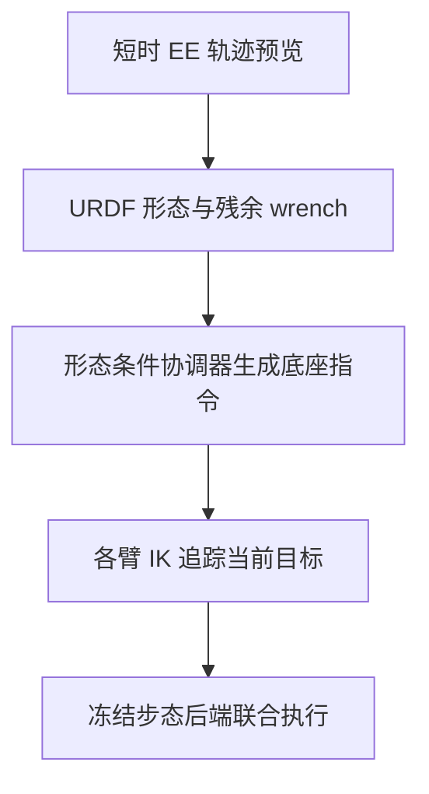

# 四足跨机械臂形态末端轨迹全身控制 PolyMorphWBC（PolyMorphWBC: Whole-Body Control from End-Effector Trajectories for Quadrupedal Mobile Manipulation across Arm Morphologies with Extended Reach）

**机构：** 中国科学技术大学  
**论文：** [arXiv:2611.15117](https://arxiv.org/abs/2611.15117)

## 一句话定义

**任务层只给末端短时预览轨迹；协调器将 EE 目标转换到基座坐标，结合 URDF 提取的形态条件及残余外力反馈，输出底座运动；各机械臂单独 IK 跟踪当前 EE 目标，冻结 locomotion 后端执行底座命令。**

## 英文缩写速查

| 缩写 | 英文全称 | 简要说明 |
|---|---|---|
| EE | End Effector | 任务层末端轨迹 |
| IK | Inverse Kinematics | 臂专属逆运动学 |
| URDF | Unified Robot Description Format | 形态编码来源 |
| WBC | Whole Body Control | 底座与臂协调 |

## 为什么重要

末端轨迹本身不告诉四足底座何时移动；不同臂长会改变可达范围与底座调整需求。

## 核心原理

任务层只给末端短时预览轨迹；协调器将 EE 目标转换到基座坐标，结合 URDF 提取的形态条件及残余外力反馈，输出底座运动；各机械臂单独 IK 跟踪当前 EE 目标，冻结 locomotion 后端执行底座命令。

### 流程总览

以下根据论文方法整理，箭头表示控制/数据流向。

## 实验与评测

四个 6DoF 臂家族下 held-out anchor arms：ARX X5 99.30%、Compact xArm6 99.27%、PiPER 93.16%、Compact MICO 86.62% 轨迹完成率；MuJoCo 末端位置误差 1.38–2.04 cm；真机 Go2+ARX5 实现超初始臂展的抓放。

## 与其他工作对比

任务层只给末端短时预览轨迹；协调器将 EE 目标转换到基座坐标，结合 URDF 提取的形态条件及残余外力反馈，输出底座运动；各机械臂单独 IK 跟踪当前 EE 目标，冻结 locomotion 后端执行底座命令。 与传统同方向方法的主要区别见以上控制接口及研究动机；跨论文统计结果不具有相同测试协议。

## 结论

**四足跨机械臂形态末端轨迹全身控制 PolyMorphWBC 的实际价值在于明确研究对象与实验边界，而非脱离原文场景比较单个成功率。**

1. 统一外部接口为 EE 轨迹而非底座动作序列。
2. 真机只验证 Go2–ARX5，不应把仿真跨臂归纳为跨平台真机。
3. 离线形态编码与在线残余 wrench 都影响可达控制。

## 工程实践

实际验证时先检查任务接口与坐标系，再按论文试验复现主指标；记录 EE / IK / URDF 相关状态、控制采样与异常回退路径，不能以论文中的概念图代替可执行模块证明。

**源码开放状态：** 本次核对的论文未发现可核实的作者算法运行入口，不臆测代码接口。

## 源码运行时序图

**不适用**：尚无可确认的官方完整算法运行入口；以上主干流程是论文方法图，不是虚构源码调用。

## 局限与风险

依赖准确 URDF、单 Go2 底座及低速平滑 EE 轨迹；跨机型的数值多数来自仿真，未见全套官方可运行代码。

## 关联页面

- [Loco-Manipulation (移动操作)](../tasks/loco-manipulation.md) — 末端轨迹经形态条件协调器转换为底座运动，任务验收需联合检查机械臂可达性与底座执行。
- [Locomotion](../tasks/locomotion.md) — 冻结步态后端消费底座命令，跨机械臂协调收益不能混算成重新学习的步态能力。

- [whole body control](../concepts/whole-body-control.md)
- [cross embodiment](../../roadmap/depth-cross-embodiment.md)
- [loco manipulation](../../roadmap/depth-loco-manipulation.md)
- [11.09–11.13 29 篇总览](../overview/humanoid-quadruped-2026-11-09-13-29-papers.md)

## 参考来源

- [arXiv v1 原文核对归档](../../sources/papers/polymorphwbc-quadruped_arxiv_2611_15117.md)
- [arXiv v1 HTML 全文](https://arxiv.org/html/2611.15117v1)

## 推荐继续阅读

- [论文 PDF](https://arxiv.org/pdf/2611.15117v1)
