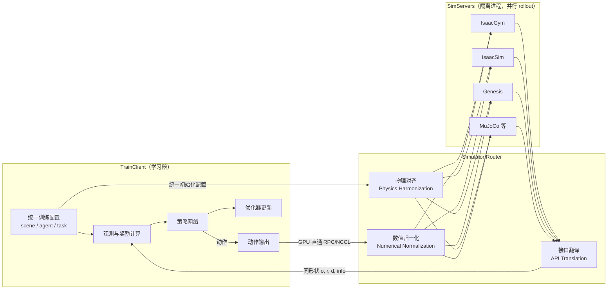

# PolySim: bridging the sim-to-real gap for humanoid control via multi-simulator dynamics randomization

**PolySim: bridging the sim-to-real gap for humanoid control via multi-simulator dynamics randomization**（[arXiv:2510.01708](https://arxiv.org/abs/2510.01708)）收录于 [自由度FreeDof · Sim2Real 四条路线梳理](../../sources/blogs/wechat_freedof_sim2real_four_routes_dr_to_residual_2026-08-23.md) 参考文献 **[19/44]**，归类 **域随机化**。

## 一句话定义

并行 IsaacSim/IsaacGym/Genesis 等多引擎训练，把随机化从参数层扩到动力学结构层。

## 英文缩写速查

| 缩写 | 英文全称 | 简要说明 |
|------|----------|----------|
| PolySim | Poly Simulator training | 多仿真器训练 |
| DR | Domain Randomization | 域随机化 |
| Sim2Real | Simulation to Real | 仿真到真机 |

## 为什么重要

- 文内 52.8% 跟踪成功率提升与真机人形零样本部署案例。
- 在 [44 篇技术地图](../overview/freedof-sim2real-44-papers-technology-map.md) 与 [四条路线对比](../comparisons/sim2real-four-routes-identifiability.md) 中作为 **域随机化** 节点。
- 开源结论：**待核实**（步骤 2.5，2026-09-20）。

## 流程总览

图依据：论文 §III（A 训练-仿真隔离、B Simulator Router、C GPU 直通通信）、Fig.3 系统总览（Mode III）；箭头按 Fig.3 图注与正文归纳。

## 核心机制

| 项 | 内容 |
|----|------|
| **出处** | arXiv 2025 |
| **文内章节** | 域随机化 |
| **要点** | 多异构仿真器并行 rollout + 结构层 DR。 |
| **开源** | **待核实** |

## 源码运行时序图

**不适用（待核实）** — 截至 2026-09-20 以项目页/论文 Code availability 为准；入库未核验可运行入口。

## 实验与评测

- **本页为索引级节点**（FreeDof 44 篇梳理 [19/44]）：正文固化文内角色与机制要点，**未转存原文实验表**。
- **回原文须核对的证据**：本页要点是「多异构仿真器并行 rollout + 结构层 DR」，对应证据是多引擎混训与单引擎训练在跨引擎 / 真机上的成功率对比。
- **读法：** 先对齐平台、任务、指标定义与成功阈值，再读任何数字；勿从公众号摘录外推。

## 与其他工作对比

| 维度 | 读法 |
|------|------|
| **文内路线** | 归类 **域随机化**；同路线其他节点见 [44 篇技术地图](../overview/freedof-sim2real-44-papers-technology-map.md) 与 [四条路线对比](../comparisons/sim2real-four-routes-identifiability.md) |
| **横比口径** | 收益取决于所选引擎之间的差异谱：引擎组合不同，结论不同；同 [20/44] Erez 的引擎差异表一起读才完整。 |
| **开源状态** | **待核实** — 部署 / 复现前以项目页或原文 Code availability 为准 |

## 结论

**当 gap 来自引擎近似而非仅参数时，多引擎训练比单引擎宽 DR 更对症。**

1. 文内角色：域随机化 路线上的参考节点，非重复 arXiv 页面。
2. 机制要点：多异构仿真器并行 rollout + 结构层 DR。…
3. 部署/复现前请对照原文与项目页，勿直接外推公众号数字。

## 关联页面

- [Sim2Real 四条路线（可辨识性）](../comparisons/sim2real-four-routes-identifiability.md)
- [44 篇技术地图](../overview/freedof-sim2real-44-papers-technology-map.md)
- [Sim2Real](../concepts/sim2real.md)

## 参考来源

- [freedof_sim2real_19_polysim-multi-simulator-humanoid-sim2real.md](../../sources/papers/freedof_sim2real_19_polysim-multi-simulator-humanoid-sim2real.md)
- [wechat_freedof_sim2real_four_routes_dr_to_residual_2026-08-23.md](../../sources/blogs/wechat_freedof_sim2real_four_routes_dr_to_residual_2026-08-23.md)
- [freedof_sim2real_44_catalog.md](../../sources/papers/freedof_sim2real_44_catalog.md)
- [arXiv PDF](https://arxiv.org/pdf/2510.01708)：已通读方法部分（实验与附录以略读为准）：§III 方法（A/B/C）

## 推荐继续阅读

- [arXiv PDF](https://arxiv.org/pdf/2510.01708)
- [44 篇 Sim2Real 技术地图](../overview/freedof-sim2real-44-papers-technology-map.md)
