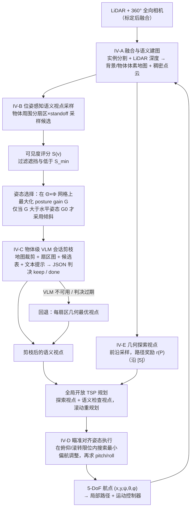

# POSE（arXiv:2609.19460）

**POSE**（*Pose-aware Legged Robot Semantic Exploration with Omnidirectional Perception in Confined Unknown Environments*，[arXiv:2609.19460](https://arxiv.org/abs/2609.19460)）来自 [senlanke 具身运控lab 周更盘点](../../sources/blogs/wechat_senlanke_weekly_humanoid_quadruped_2026-09-14_18.md)（2026-09-14–18）。

## 一句话定义

**POSE 规划器把机身 pitch/roll 纳入语义视点选择；VLM 据历史与 BEV 剪枝冗余视点。**

## 英文缩写速查

| 缩写 | 英文全称 | 简要说明 |
|------|----------|----------|
| POSE | Pose-aware Semantic Exploration | 本文规划器 |
| BEV | Bird's-Eye View | 鸟瞰地图 |
| VLM | Vision-Language Model | 视觉语言模型 |

## 为什么重要

- 狭窄未知环境探索中机身姿态影响传感器覆盖；纯平移视点规划不足。

## 流程总览

图依据：论文 §IV（A–E）与 Fig. 2–4、Algorithm 1

## 核心机制

| 项 | 内容 |
|----|------|
| **arXiv** | [2609.19460](https://arxiv.org/abs/2609.19460) |
| **开源** | **待发布**（步骤 2.5，2026-09-20） |
| **方法摘要** | Pose-aware semantic viewpoint selection + VLM pruning on BEV/history. |

## 源码运行时序图

**不适用**（截至 2026-09-20 未发布可运行官方代码或待核实）。

## 实验与评测

- Confined unknown environments（以 PDF 为准）。
- 读法：先对齐任务设定、传感器与成功定义，再解读 headline 数字。

## 与其他工作对比

| 维度 | 读法 |
|------|------|
| **同周对照** | 见对应 [周更盘点](../../sources/blogs/wechat_senlanke_weekly_humanoid_quadruped_2026-09-14_18.md) 映射表，勿跨任务直接比 SR |
| **开源状态** | **待发布** — 部署前以项目页/arXiv 为准 |

## 结论

**POSE 把腿式机身姿态作为语义探索的一等变量，适合全向感知狭窄场景。**

1. 开源：**待发布**；勿凭公众号摘要臆断可复现性。
2. 指标须连同实验条件解读（仿真/真机、平台、成功阈值）。
3. 关注 arXiv 版本更新与代码发布。

## 关联页面

- [locomotion](../tasks/locomotion.md)
- [vla](../methods/vla.md)
- [embodied-semantic-cognitive-map](../concepts/embodied-semantic-cognitive-map.md)
- [robot-perception-stack-selection-loop](../queries/robot-perception-stack-selection-loop.md) — VLM 依历史与 BEV 剪枝语义视点，属该闭环第 ③ 层「2D→3D 提升与语义建图」；把机身 pitch/roll 纳入视点选择又反过来约束第 ① 层的可视条件

## 参考来源

- [pose-semantic-legged-exploration_arxiv_2609_19460.md](../../sources/papers/pose-semantic-legged-exploration_arxiv_2609_19460.md)
- [wechat_senlanke_weekly_humanoid_quadruped_2026-09-14_18.md](../../sources/blogs/wechat_senlanke_weekly_humanoid_quadruped_2026-09-14_18.md)
- [arXiv:2609.19460](https://arxiv.org/abs/2609.19460)
- [arXiv PDF](https://arxiv.org/pdf/2609.19460)：已通读方法部分（实验与附录以略读为准）：摘要、§I 引言、§III 问题定义、§IV 方法 A–E（实验章节略读）

## 推荐继续阅读

- [arXiv PDF](https://arxiv.org/pdf/2609.19460)
