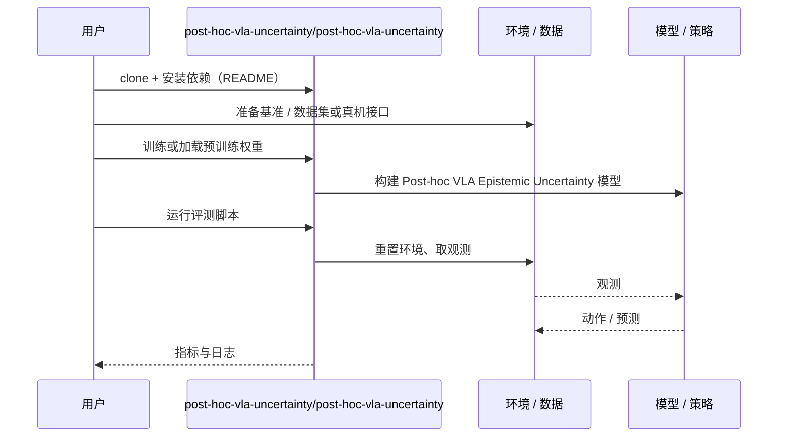

# Post-hoc VLA Epistemic Uncertainty（arXiv:2610.29730）

**Post-hoc VLA Epistemic Uncertainty**（*Post-hoc Epistemic Uncertainty for Vision–Language–Action Policies*，[arXiv:2610.29730](https://arxiv.org/abs/2610.29730)，[代码](https://github.com/post-hoc-vla-uncertainty/post-hoc-vla-uncertainty)）来自 [具身智能小站 2026-10-29 盘点](../../sources/blogs/wechat_embodied_station_58_papers_diverse_demonstrations_2026-10-29.md)，属「评测、安全与不确定性」组。

## 一句话定义

**事后核方差头从单策略嵌入估计知识缺口，无需梯度更新；SmolVLA与LIBERO-10支持筛选示范和转交监督，但任务间覆盖差异不能替代任务内风险排序。**

## 英文缩写速查

| 缩写 | 英文全称 | 简要说明 |
|------|----------|----------|
| Post-hoc VLA Epistemic Uncertainty | Post-hoc Epistemic Uncertainty for Vision–Language–Action Policies | 本文方法 / 基准的简称 |

## 为什么重要

- 只用一个VLA估计认知不确定性。
- 开源结论：**已开源**（步骤 2.5，2026-10-29）。仓库可达（git ls-remote）。
- 同期同组工作见 [多样成功示范、触觉工具链与预见式感知：具身智能小站 10-29 期 58 篇阅读坐标](../overview/embodied-station-2026-10-29-58-papers-technology-map.md)。

## 核心机制

| 项 | 内容 |
|----|------|
| **arXiv** | [2610.29730](https://arxiv.org/abs/2610.29730) |
| **开源** | **已开源** |
| **要点** | 事后核方差头从单策略嵌入估计知识缺口，无需梯度更新；SmolVLA与LIBERO-10支持筛选示范和转交监督，但任务间覆盖差异不能替代任务内风险排序。 |
| **文内指标** | 公众号未给具体数字，本页不引用。 |

## 源码运行时序图

以下为按仓库入口（`post-hoc-vla-uncertainty/post-hoc-vla-uncertainty`）推断的通用运行链路；入库日仅核实仓库可达，未逐文件阅读，具体脚本名以 README 为准。

## 实验与评测

- 公众号未给具体数字，本页不引用。
- **读法：** 本页为索引级摘要，依据公众号转述的官方摘要与仓库信息整理；逐项数字与 baseline 以原文 PDF 为准。

## 与其他工作对比

- 横向索引见 [多样成功示范、触觉工具链与预见式感知：具身智能小站 10-29 期 58 篇阅读坐标](../overview/embodied-station-2026-10-29-58-papers-technology-map.md)；同 arXiv 不重复造页。

## 结论

**只用一个VLA估计认知不确定性：事后核方差头从单策略嵌入估计知识缺口，无需梯度更新；SmolVLA与LIBERO-10支持筛选示范和转交监督，但任务间覆盖差异不能替代任务内风险排序。**

1. 开源边界：**已开源** — 仓库可达（git ls-remote）。
2. 核心机制：事后核方差头从单策略嵌入估计知识缺口，无需梯度更新；SmolVLA与LIBERO-10支持筛选示范和转交监督，但任务间覆盖差异不能替代任务内风险排序。
3. 复现与选型前核对任务协议、硬件与基准口径，勿直接横比公众号摘录数字。

## 关联页面

- [simulation-evaluation-infrastructure](../concepts/simulation-evaluation-infrastructure.md)
- [vla](../methods/vla.md)
- [manipulation](../tasks/manipulation.md)
- [llm-robotics-control-interfaces](../concepts/llm-robotics-control-interfaces.md)
- [embodied-station-2026-10-29-58-papers-technology-map](../overview/embodied-station-2026-10-29-58-papers-technology-map.md)
- [具身大模型评测基准选型闭环](../queries/embodied-eval-benchmark-selection-loop.md) — 评测基准在选型闭环中的定位与取舍

## 参考来源

- [post_hoc_vla_epistemic_uncertainty_arxiv_2610_29730.md](../../sources/papers/post_hoc_vla_epistemic_uncertainty_arxiv_2610_29730.md)
- [wechat_embodied_station_58_papers_diverse_demonstrations_2026-10-29.md](../../sources/blogs/wechat_embodied_station_58_papers_diverse_demonstrations_2026-10-29.md)
- [arXiv:2610.29730](https://arxiv.org/abs/2610.29730)

## 推荐继续阅读

- [arXiv PDF](https://arxiv.org/pdf/2610.29730)
- [https://github.com/post-hoc-vla-uncertainty/post-hoc-vla-uncertainty](https://github.com/post-hoc-vla-uncertainty/post-hoc-vla-uncertainty)
