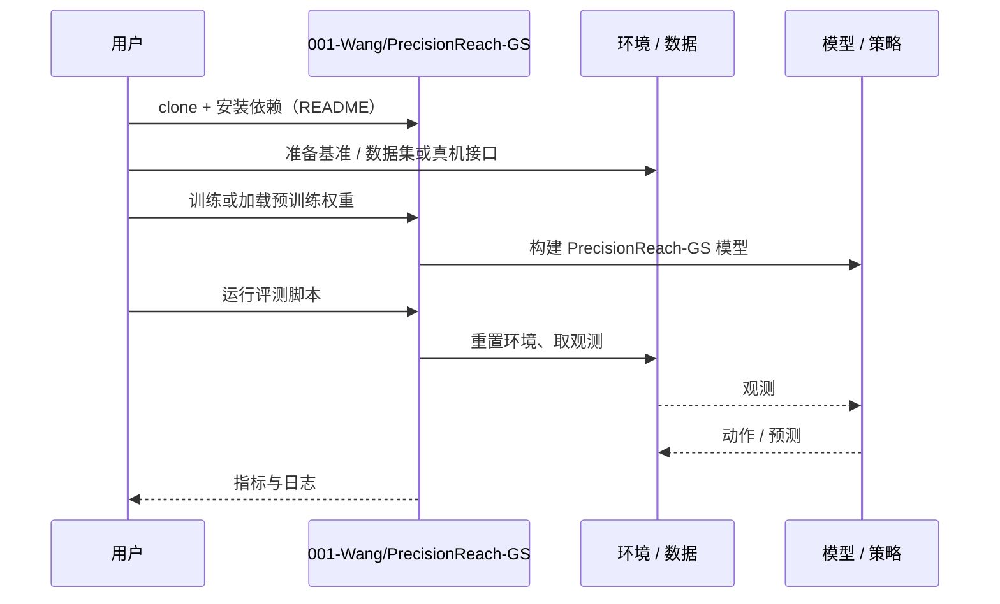

# PrecisionReach-GS（arXiv:2610.35626）

**PrecisionReach-GS**（*Robot-Aligned 3D Gaussian Splatting for Precise Reaching with Wrist-Camera VLA Policies*，[arXiv:2610.35626](https://arxiv.org/abs/2610.35626)，[项目页](https://001-wang.github.io/PrecisionReach-GS/)，[代码](https://github.com/001-Wang/PrecisionReach-GS)）来自 [具身智能小站 2026-10-28 盘点](../../sources/blogs/wechat_embodied_station_59_papers_human_video_to_robot_experience_2026-10-28.md)，属「数据采集与示范迁移」组。

## 一句话定义

**把真实工作区重建为高斯场景，对齐机器人坐标后渲染腕部视角，并配对平滑到达轨迹。**

## 英文缩写速查

| 缩写 | 英文全称 | 简要说明 |
|------|----------|----------|
| PrecisionReach-GS | Robot-Aligned 3D Gaussian Splatting for Precise Reaching with Wrist-Camera VLA Policies | 本文方法 / 基准的简称 |
| VLA | Vision-Language-Action | 视觉–语言–动作策略 |
| 3D | 3D | 三维 |

## 为什么重要

- 用三维重建生成腕部相机到达数据。以主板场景验证接触前定位，还加入到达校验器；结果不代表完整拆卸能力。
- 开源结论：**已开源**（步骤 2.5，2026-10-28）。仓库可达（git ls-remote）。项目页 HTTP 200。
- 同期同组工作见 [潜在动作、免渲染事件仿真与机器人评测：具身智能小站 10-28 期 59 篇阅读坐标](../overview/embodied-station-2026-10-28-59-papers-technology-map.md)。

## 核心机制

| 项 | 内容 |
|----|------|
| **arXiv** | [2610.35626](https://arxiv.org/abs/2610.35626) |
| **开源** | **已开源** |
| **要点** | 把真实工作区重建为高斯场景，对齐机器人坐标后渲染腕部视角，并配对平滑到达轨迹。 |
| **文内指标** | 公众号转述：以主板场景验证接触前定位，还加入到达校验器；结果不代表完整拆卸能力。 |

## 源码运行时序图

以下为按仓库入口（`001-Wang/PrecisionReach-GS`）推断的通用运行链路；入库日仅核实仓库可达，未逐文件阅读，具体脚本名以 README 为准。

## 实验与评测

- 公众号转述：以主板场景验证接触前定位，还加入到达校验器；结果不代表完整拆卸能力。
- **读法：** 本页为索引级摘要，依据公众号转述的官方摘要与仓库信息整理；逐项数字与 baseline 以原文 PDF 为准。

## 与其他工作对比

- 横向索引见 [潜在动作、免渲染事件仿真与机器人评测：具身智能小站 10-28 期 59 篇阅读坐标](../overview/embodied-station-2026-10-28-59-papers-technology-map.md)；同 arXiv 不重复造页。

## 结论

**用三维重建生成腕部相机到达数据：以主板场景验证接触前定位，还加入到达校验器；结果不代表完整拆卸能力。**

1. 开源边界：**已开源** — 仓库可达（git ls-remote）。项目页 HTTP 200。
2. 核心机制：把真实工作区重建为高斯场景，对齐机器人坐标后渲染腕部视角，并配对平滑到达轨迹。
3. 复现与选型前核对任务协议、硬件与基准口径，勿直接横比公众号摘录数字。

## 关联页面

- [embodied-data-collection-four-layers-taxonomy](../concepts/embodied-data-collection-four-layers-taxonomy.md)
- [teleoperation](../tasks/teleoperation.md)
- [imitation-learning](../methods/imitation-learning.md)
- [embodied-station-2026-10-28-59-papers-technology-map](../overview/embodied-station-2026-10-28-59-papers-technology-map.md)

## 参考来源

- [precisionreach_gs_arxiv_2610_35626.md](../../sources/papers/precisionreach_gs_arxiv_2610_35626.md)
- [wechat_embodied_station_59_papers_human_video_to_robot_experience_2026-10-28.md](../../sources/blogs/wechat_embodied_station_59_papers_human_video_to_robot_experience_2026-10-28.md)
- [arXiv:2610.35626](https://arxiv.org/abs/2610.35626)

## 推荐继续阅读

- [arXiv PDF](https://arxiv.org/pdf/2610.35626)
- [项目页](https://001-wang.github.io/PrecisionReach-GS/)
- [https://github.com/001-Wang/PrecisionReach-GS](https://github.com/001-Wang/PrecisionReach-GS)
