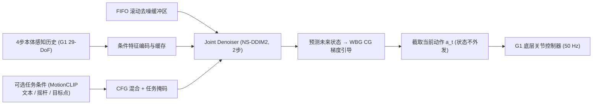
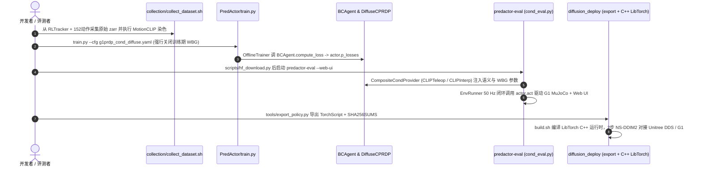

# PredActor（arXiv:2609.24840）

**PredActor**（*Predictive Action Diffusion for Steerable Onboard Humanoid Control*，[arXiv:2609.24840](https://arxiv.org/abs/2609.24840)，[项目页](https://masteryip.github.io/predactor.github.io/)，[代码](https://github.com/MasterYip/PredActor)）由哈尔滨工业大学、上海创新研究院、RoboParty Lab、清华大学、上海交通大学等机构联合提出。工作在 **联合状态–动作扩散（joint state–action diffusion）** 框架内，仅依靠本地本体感知（proprioception）历史与可选任务条件，同时去噪未来全身状态与动作序列，但**仅向底层电机下发选中动作、将未来状态留在扩散内部供测试时物理与语义引导**，并在 Unitree G1 机载 Jetson Orin NX 上实现了 **50 Hz** 完整闭环控制。

## 一句话定义

**通过纯本体感知输入的联合状态–动作扩散去噪，把未来全身状态留在策略内部以支持免重训物理分类器引导（CG）与文本无分类器引导（CFG），并将动作推理压缩到 20 ms 机载控制周期以内。**

## 英文缩写速查

| 缩写 | 英文全称 | 简要说明 |
|------|----------|----------|
| CG | Classifier Guidance | 在预测未来状态残差上求梯度以修正去噪轨迹（WBG） |
| CFG | Classifier-Free Guidance | 混合有条件与空条件去噪预测以增强语义动作可控性 |
| WBG | Whole-Body Guidance | 论文面向局部根节点、躯干与末端的测试时物理引导模块 |
| NS-DDIM | Non-Synchronized DDIM | 对状态与动作采用异步噪声日程的两步加速采样器 |
| DAgger | Dataset Aggregation | 用强化学习教师策略在线纠正分布偏移的聚合训练阶段（当前唯一未开源模块） |
| PRDP / FK | Proprioceptive-Root/Pos Diffusion Policy / Forward Kinematics | 本体剖面族；公开部署版设为 `use_fk: false` 避免正向运动学额外开销 |
| BC | Behavior Cloning | 离线行为克隆训练（已在 `PredActor/train.py` 开源） |

## 为什么重要

- **人形机载扩散控制的标杆落地：** 将扩散策略带出机械臂桌面操作，针对高维不稳定双足人体运动完成计算图重构与推理优化，在 **Jetson Orin NX** 机载端以 FP32 `batch=1` 达成 **p50 16.790 ms / p95 19.383 ms**（593/600 次回调稳居 20 ms / 50 Hz 预算内）。
- **打破“生成-跟踪两段式”与“纯动作扩散无法物理改向”的局限：** 相对先生成参考轨迹再交由独立跟踪器（如 `ARDY+SONIC`）的层级方案，PredActor 在单一扩散网络内部完成姿态演化与抗扰恢复；相对纯动作扩散（`w/o state`），内部显式去噪的未来状态使策略无需重训即可在测试时叠加点导航与躯干高度等 **WBG CG**，同时反哺 MotionCLIP 文本检索精度。
- **工程管线已主体开放验证：** 不同于早期仅发布占位页或仅公开评测器的状态，目前官方仓已完整放出数据采集与 MotionCLIP 语义染色（`PredActor/collection/`）、离线 BC 训练（`PredActor/train.py`）和 G1 LibTorch C++ / Unitree DDS 部署栈（`PredActor/diffusion_deploy/`）。

## 核心原理

### 核心信息

| 项 | 内容 |
|----|------|
| **机构** | 哈尔滨工业大学（HIT）；上海创新研究院（SII）；RoboParty Lab；清华大学；上海交通大学 |
| **硬件平台** | Unitree G1（29 DoF）+ 机载 Jetson Orin NX，50 Hz 控制循环（`control_dt=0.02s`） |
| **输入条件** | 4 步历史本体状态 `n_obs_steps=4`（关节/IMU 等）+ 可选任务条件（G1 MotionCLIP 文本、手柄速度、点导航目标） |
| **预测视野** | 未来 20 步联合状态–动作视野（内部未来状态不外发，仅下发动作序列首部执行） |
| **开源状态（2026-11-19）** | **主体已开源（MIT）** — [MasterYip/PredActor](https://github.com/MasterYip/PredActor) 已开放 Web UI 评测、采集染色、离线 BC 训练与 G1 C++ 部署，**仅 DAgger 暂未开放**；权重托管于 [PredActor_Artifacts](https://huggingface.co/MasterYip/PredActor_Artifacts) |

### 关键机制

1. **联合状态–动作表达与状态重点投影（`DiffuseCLoC` / `DiffuseCPRDP`）：** 在同一扩散时空窗口内交替排布未来状态和关节动作 token；由于状态维度高但关键全局特征（`root_pos_local`、`root_lin_vel_local`）对导航与平衡更决定性，架构引入 `state_emphasis` 投影突出根节点等关键状态分量，训练目标联合监督动作与状态去噪损失。
2. **双路引导机制（CFG + 免重训 WBG CG）：**
   - **语义可控性（CFG + 条件掩码）：** 通过 `CondCompressor`、`PerTermConditionDropout` 和 `TaskMaskGenerator` 在训练期独立随机丢弃条件项，使推理期可通过 **Classifier-Free Guidance** 在 `walk` / `jog` / `squat down` / `jump` 等 MotionCLIP 语义隐空间平滑过渡与插值；
   - **物理导向可控性（WBG CG）：** 推理期在每步去噪后利用预测的未来局部根节点与末端位置，计算速度（`vx_guide`, `vy_guide`, `wz_guide`）、骨盆高度（`hz_guide`）或世界坐标目标点跟随（`destination_follow_config`）等 PD 物理误差，通过向量 Jacobian 乘积反向修改均值偏移，零样本解锁点导航能力。
3. **机载 50 Hz 工程加速链路：**
   - **异步非同步调度（`NS-DDIM2`）与滚动去噪（Rolling Denoising）：** 状态与动作按非同步噪声水平递进更新（`from_xT_decreasing` / `from_xT_step`），配合 FIFO 滚动缓冲区复用上一控制步尚未完全耗尽的半成品轨迹，将每次控制周期的前向去噪压缩至 **仅 2 步（`NS-DDIM2`）**；
   - **五步系统优化（Table 4）：** 在 LibTorch C++ 运行时上依次叠加 1）堆叠 WBG（`-3.147 ms`）、2）DDIM 系数预计算（`-0.872 ms`）、3）全 QKV 矩阵融合打包（`-1.111 ms`）、4）条件特征缓存（`-0.401 ms`）与 5）LibTorch `inference_mode`，在不损失精度的前提下（数值漂移 `< 1.073e-6`）将 actor 前向 p50 由 `21.461 ms` 降至 `13.175 ms`。

### 流程总览

## 评测与实验对比

基于 **`arXiv:2609.24840v3`** 正文 Table 2–4、Fig. 6–7 与附录 Table 8 实测结果（注：早先条目记录的旧版 `15/15`、`0.580`、`0.535` 已按 v3 终稿全面校订）：

### 1) MuJoCo 综合仿真评测（Table 2 & Table 8）

| 方法 | Basic Jerk RMS ↓ / Latency ↓ | Perturbation Survival ↑ | Point Navigation (Survival / Arrival / 末态误差) | Text Command (Survival / MotionCLIP Retrieval) |
|------|------------------------------|-------------------------|--------------------------------------------------|------------------------------------------------|
| `ARDY + SONIC` | `19.221` / N/E | `0.534` `[100/100]` | `1.000` / `0.500` / `0.656 m`（仅 `[2/15*]` 合法步态） | `1.000` `[23/45*]` / `0.237` |
| `DiffuseLoco w TextCFG` | `15.899±6.870` / `12.141 ms` | `0.563±0.009` | N/A `[0/45]`（无状态引导支持） | `0.947±0.047` / `0.424±0.159` |
| `CLoC+FK` / `w TextCFG` | `266.6` (`101.7`) / `6.10` (`8.79 ms`) | `0.303` / `0.296` | `CLoC+FK` 仅 `0.064 / 0.000 / 3.194 m` | `0.782` / `0.416` (`w TextCFG`) |
| `PredActor w/o state` | `12.448±0.675` / `1.050 ms` | `0.487±0.033` | N/A `[0/45]`（剥离状态后丧失 CG 导航） | `0.778±0.145` / `0.397±0.023` |
| **PredActor（完整版）** | `16.810±1.409` / **1.321±0.011 ms** | `0.511±0.030` `[300/300]` | **0.983±0.029 / 0.978±0.028** `[45/45]` / **0.605 m** | `0.888±0.068` / **0.539±0.075** `[119/135*]` |

- **Table 8 消融校验：** 关掉测试时 CG 的匹配对比中，PredActor 保持 **0.535±0.009** 推扰存活与 **0.538±0.087** 文本检索分（`w/o state` 为 `0.487 / 0.397`），进一步证实联合状态预测本身也能强化动作与语义表征的一致性；加入滚动去噪后，2 步采样在强外推下的存活率达 **58%**（接近 3 步 `61%`），优于关闭滚动的方案。

### 2) Orin NX 机载延迟演进（Table 4）与真机实验（Table 3）

- **Orin NX 机载分项计时（TorchScript + LibTorch FP32, B=1, NS-DDIM2）：**
  - 结构基线（序列 WBG）：`21.461 / 22.036 ms`（`600/600` 超时）；
  - 叠加堆叠 WBG + DDIM 预计算 + QKV 打包 + 条件缓存 + `inference_mode`：Actor 前向降至 **13.175 / 13.400 ms**（`0/600` 超时）；
  - **最终 live 完整控制回调（含观测处理、推理、下发）：p50 `16.790 ms` / p95 `19.383 ms`，`593/600` 满足 20 ms（50 Hz）硬实时门禁**。
- **Unitree G1 物理样机测试（Table 3，每项 5 次实验）：** `Stand→Walk` **5/5**、`Walk→Jog` **5/5**、`Stand→Squat` **5/5**、`Squat→Stand` **4/5**、`Stand push` **4/5**、`Walk push` **4/5**。

## 与其他工作对比

> 下表聚焦系统范式与部署设计差异，各项数字受各自机器人硬件与测试集约束，不可脱离协议直接横比：

| 对照工作 | 运动规划 vs 控制分拆 | 引导机制（Steerable） | 机载端部署形态 |
|----------|----------------------|----------------------|----------------|
| [NVIDIA SONIC](./nvidia-sonic.md) | 两段式：上游提供参考轨迹，下游 RL 策略追踪 | 依赖上游运动参考流或任务接口 | 专用高速跟踪策略部署 |
| [Sample, Simulate, Select](./paper-sample-simulate-select.md) | 零训练：冻结 MoMask + SONIC 仿真挑优 | 依靠仿真 best-of-N 重采样筛选 | 离线/仿真筛选，非高频端到端闭环 |
| [Diffusion Policy 方法综述](../methods/diffusion-policy.md) | 仅对动作序列本身去噪 | 原生主要支持观测条件，缺通用 WBG CG | 常见桌面臂 10–30 Hz GPU 离板/桌面推演 |
| **PredActor（本文）** | **单一联合状态–动作去噪策略**直出关节指令 | **CFG（MotionCLIP 文本）+ CG（免重训 WBG 物理目标）并存** | **TorchScript + LibTorch C++ 50 Hz 机载 Orin NX** |

## 结论

**PredActor 证明纯本体感知输入的小巧联合状态–动作扩散模型，通过“状态内置引导 + 非同步两步滚动采样 + LibTorch 图级加速”，足以在双足人形机器人机载算力预算内跑通 50 Hz 文本与物理双可控闭环。**

- **联合预测未来状态不只是为了 CG：** 哪怕在纯文本条件、关闭物理引导时，去除未来状态（`w/o state`）也会让检索准确率跌 14 个百分点，说明预测运动学演化本身能稳固语义-本体对齐。
- **50 Hz 机载落地的瓶颈常在框架调度而非步数本身：** 从结构基线 `21.46 ms` 压到 `13.18 ms`，主要收益来自 WBG 向量化堆叠、QKV 融合与移除 Python/PyTorch Eager 开销，而不是只靠牺牲去噪步数。
- **评估开源生态已跨越“仅推理 Demo”阶段：** 当前可直接在 `MasterYip/PredActor` 复现 MuJoCo Web UI 评测、152 动作集采数染色、BC 训练（`g1prdp_cond_diffuse.yaml`）及 C++ Unitree 部署导出。
- **复现论文极限抗扰成绩仍缺 DAgger：** 公开代码尚未放出 DAgger 在线纠偏聚合管线，仅运行开源离线 BC 管线在大幅外推分布漂移下的极限稳定性可能弱于论文最终指标。

## 源码运行时序图

节点对照 `MasterYip/PredActor` 公开仓库 `PredActor/collection/collect_dataset.sh`、`PredActor/train.py`、`PredActor/diffusion_policy/agent/bc_agent.py`、`PredActor/diffusion_policy/modules/{diffuse_cloc.py,diffuse_cprdp.py}`、`PredActor/cond_eval.py` 与 `PredActor/diffusion_deploy/` 源码：

## 工程实践

| 阶段 | 官方入口与关键注意事项 |
|------|------------------------|
| 快速 MuJoCo 评测 | 使用 Python 3.10 + `uv sync --locked`，先跑 `uv run --locked python scripts/hf_download.py --filter checkpoints`（校验 SHA-256），再跑 `uv run --locked predactor-eval` 打开 `http://127.0.0.1:8765/`；支持 `--web-perturb` 鼠标推扰和文本插值。 |
| 采集与 BC 训练 | 先运行 `PredActor/collection/collect_dataset.sh` 与染色管线生成 `motion_dyed_text_t0.01.zarr`，再用 `PredActor/train.py --cfg g1prdp_cond_diffuse.yaml` 训练条件版（或 `g1prdp_diffuse.yaml` 跑无条件对照）；`train.py` 会自动屏蔽训练期引导避免梯度污染。 |
| G1 C++ 部署 | 通过 `PredActor/diffusion_deploy/tools/export_policy.py --obs-profile G1 --no-use-fk` 导出完整资源目录及 `SHA256SUMS`（Orin 选用 `--target jetson-jp5-torch21`），运行 `verify_model_resources.sh` 后使用 `./build.sh --backend torch --with-sdk2` 构建 Unitree MuJoCo 环回或真机节点。 |
| 门禁监控 | 机载端严格盯紧完整回调 **p95 < 20 ms**；切忌只用 ONNX 转换而丢失 WBG Jacobian 与滚动缓冲区逻辑，亦勿对 PRDP 剖面误开 `use_fk: true`。 |

## 局限与风险

- **DAgger 阶段代码仍未开放：** 官方仓库 README Release Checklist 仍仅剩 **DAgger** 未勾选（`cond_eval.py` 仅保留 `_is_dagger_checkpoint` 加载分支），因此目前无法一键端到端复现论文中的在线 DAgger 教师-学生聚合收敛效果。
- **纯本体传感器的视野缺失：** 策略不接收外视 RGB 或深度点云，仅凭关节与 IMU 本体感知，因此长距主动避障、台阶提前识别仍须依赖上游指定可通行目标点或外部感知输入。
- **实机安全边界仍须独立审计：** 开源评测与 C++ 部署接口提供了硬件链路参考，但更换负载、地面摩擦或驱动参数后必须先经 Unitree MuJoCo 环回（`lo` DDS）与悬空/保护绳测试验证。
- **序列化安全与依赖锁：** PyTorch checkpoint 采用 pickle 兼容反序列化（`weights_only=False`），务必经 `scripts/hf_download.py` 下载官方 [PredActor_Artifacts](https://huggingface.co/MasterYip/PredActor_Artifacts) 并核对 SHA-256。

## 与其他页面的关联

- [Diffusion Policy 方法页](../methods/diffusion-policy.md) — 动作去噪与条件扩散控制的理论底座
- [Action Chunking](../methods/action-chunking.md) — 预测 20 步动作–状态视野与滚动复用思想
- [Behavior Cloning](../methods/behavior-cloning.md) — 离线 BC 管线与分布偏移对 DAgger 的需求
- [人形移动控制（Humanoid Locomotion）](../tasks/humanoid-locomotion.md) 与 [移动/腿足（Locomotion）](../tasks/locomotion.md) — 双足步态切换、推扰恢复与点导航任务定义
- [Whole-Body Control](../concepts/whole-body-control.md) — 与物理引导 WBG 模块相关的全身协调控制概念
- [NVIDIA SONIC](./nvidia-sonic.md) — 对比“上游参考运动生成 + 下游轨迹跟踪”的主流分离范式
- [Sample, Simulate, Select](./paper-sample-simulate-select.md) — 同在 G1 上探索文本控制运动的对比工作
- [Unitree G1](./unitree-g1.md) — 本文实验与开源部署锁定的 29-DoF 人形硬件平台
- [扩散与流匹配纵深路线](../../roadmap/depth-robotics-diffusion-dit-flow.md) — 路线中展示人形机载扩散控制的核心实体节点

## 参考来源

- [PredActor 论文归档](../../sources/papers/predactor_arxiv_2609_24840.md) — `arXiv:2609.24840v3` 全文通读与 Table 2–4 / Table 8 数据校订
- [PredActor 官方仓库归档](../../sources/repos/predactor.md) — 评测、采集染色、BC 训练与 LibTorch C++ 部署源码核对
- [PredActor 项目页归档](../../sources/sites/predactor-masteryip-github-io.md) — 项目页与演示对齐核查
- [PredActor HF 工件归档](../../sources/repos/predactor-artifacts.md) — `PredActor_Artifacts` 模型工件核查记录
- [森兰克周报来源](../../sources/blogs/wechat_senlanke_weekly_humanoid_quadruped_2026-09-21_25.md) — 早期入库线索溯源

## 推荐继续阅读

- [论文全文（arXiv:2609.24840v3）](https://arxiv.org/abs/2609.24840)
- [官方代码仓库（MasterYip/PredActor）](https://github.com/MasterYip/PredActor)
- [Hugging Face 模型工件（MasterYip/PredActor_Artifacts）](https://huggingface.co/MasterYip/PredActor_Artifacts)
- [官方项目页（predactor.github.io）](https://masteryip.github.io/predactor.github.io/) · [团队与联系](https://masteryip.github.io/predactor.github.io/#people)
