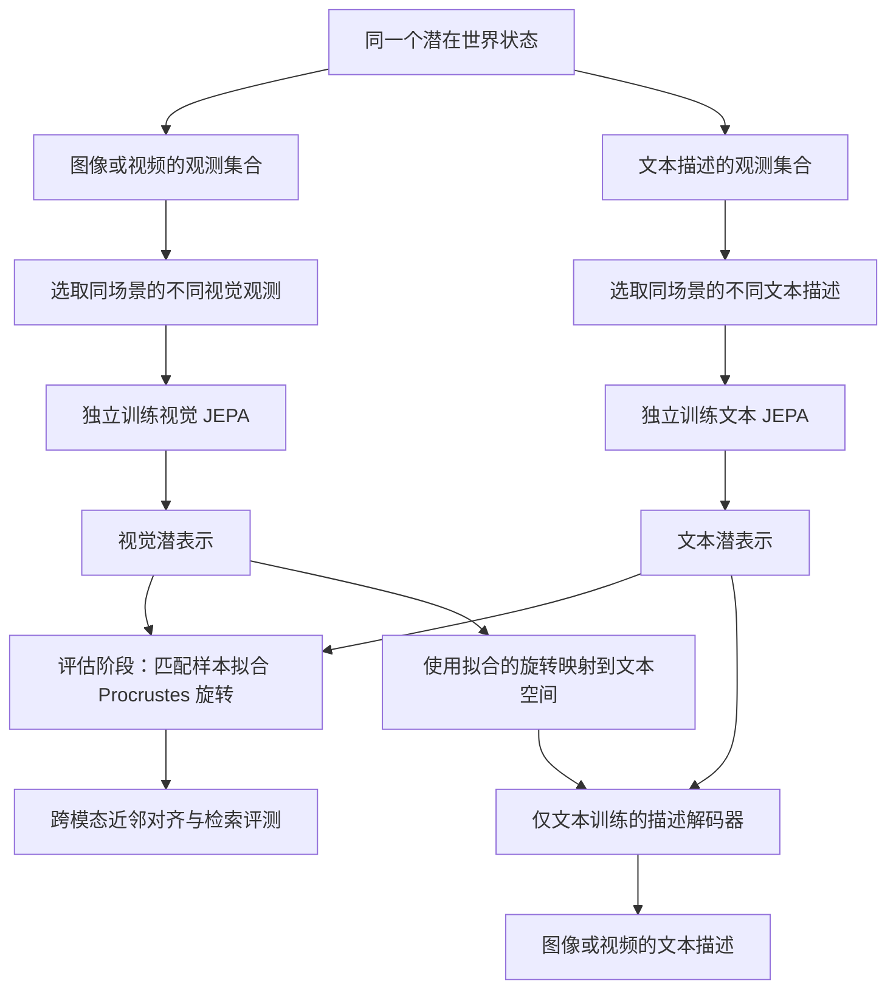
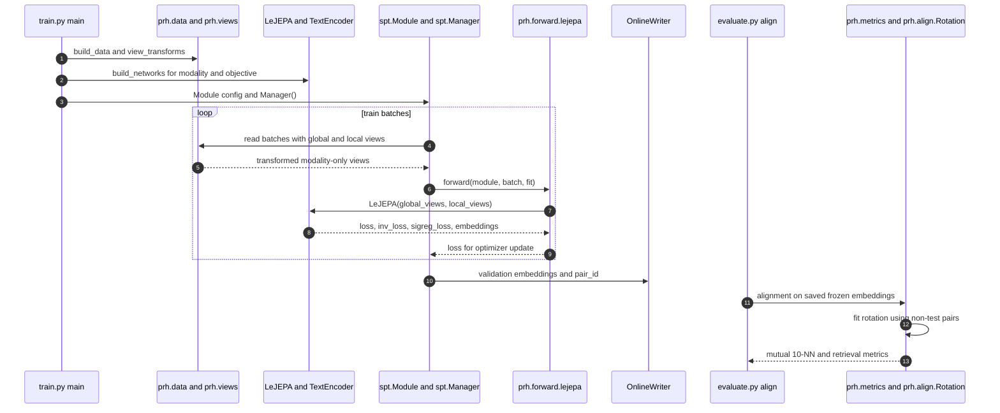

# 用 JEPA 证明并改进柏拉图式表征假说（Proving and Improving the Platonic Representation Hypothesis with JEPAs）

## 一句话定义

**PRH with JEPAs** 研究不同模态独立训练的 JEPA 何时能学习同一个世界的表征，并指出用**同一世界状态的不同真实观测**构造正样本，比只对单次观测裁剪/遮蔽，更有利于得到跨模态一致的几何结构。

## 英文缩写速查

| 缩写 | 英文全称 | 简要说明 |
|---|---|---|
| PRH | Platonic Representation Hypothesis | 不同模态的强表征趋向描述同一世界结构的假说 |
| JEPA | Joint-Embedding Predictive Architecture | 在表示空间施加视图一致性/预测约束的自监督架构 |
| LeJEPA | Latent-Euclidean Joint-Embedding Predictive Architecture | 实验使用的不对称性较少的 JEPA 训练目标 |
| SIGReg | Sketched Isotropic Gaussian Regularization | 约束表征分布、防止坍缩 |
| NTP | Next-Token Prediction | 本文研究的自回归下一个 token 预测对照 |
| CKA | Centered Kernel Alignment | 比较两个表示空间几何结构的指标 |
| WIT | Wikipedia-based Image Text | WIT-1024 跨模态表征对齐测试集 |

## 为什么重要

视觉与语言各自训练成功，不意味着两个 embedding 空间可以直接互换。本文给出一种**带条件的数学解释**：需要让每个模态从同一世界状态中抽取出一致的正样本结构，而不仅仅在单个观测上制造噪声。对于多传感器表征学习，这使“如何采集/构造正样本”成为比单纯堆叠模型规模更明确的研究变量。

## 核心原理与理论前提

论文将世界状态记为 `w`，不同模态经观测过程各自产生 `x_m`；JEPA 目标使正样本视图的表征接近。两种模态如果在世界状态层面诱导**相同的正样本核**，在论文研究的有限世界、可辨识观测、谱条件与人口目标设定下，最优表示与共同表征之间可相差一个正交旋转。这个结论不能直接读成“任意真实语言模型和视觉模型必然相同”。

- **Good views（好视图）**：两种视图来自同一个世界状态的不同观测；文本例子是同一图片的两条独立描述，视频例子是同一片段的不同帧。
- **Bad views（坏视图）**：从**同一个观测**构造两个 mask/span/crop；可能保留模态特有细节，却没有强制学习各模态共同的世界变量。
- **误差与可辨识性**：论文给出正样本核差异及特征谱间隔与表征对齐误差的联系；接近退化的特征谱会使跨模态对齐更脆弱。
- **NTP 的角色**：论文把 next-token softmax 目标拆为预测项和归一化项，论证其作为 bad-view JEPA 的对应关系；不是否定语言模型在其他任务上的能力。

## 流程总览

图中两个编码器的训练彼此独立；**配对样本出现在评估/拟合旋转时**。如果使用单次 caption 的不同 span 代替同场景不同描述，则对应作者的 bad-view 消融而非主方法。

## 源码运行时序图

基于官方仓库 `train.py`、`prh/views.py`、`prh/forward.py`、`evaluate.py`、`prh/align.py` 的实际入口，而非通用架构推测：

训练目标由 `stable-pretraining` 的 `LeJEPA` 实现，`spt.Manager` 负责训练循环；`OnlineWriter` 产出的验证特征交给 `evaluate.py align` 离线对齐。文本 good-view 入口：`python train.py --modality text --caption-views`；省略 `--caption-views` 是 bad-view 对照。

## 实验与评测

| 评测 | 论文结果 | 应如何读 |
|---|---|---|
| 109M 参数文本编码器，在同一对齐目标下比较训练样本数 | good-view **21.6M** 样本 vs NTP **900M** 样本，约 **42×** | 同架构/训练设置的**样本效率**比较，不是生成推理速度 |
| WIT-1024，DINOv2-B 对齐 | JEPA **0.184**；Qwen2.5-72B **0.154**、Llama-3-70B **0.151** | 论文的表示对齐分数，非视觉语言任务准确率 |
| WIT-1024，CLIP ViT-H 对齐 | JEPA **0.230**；Qwen2.5-72B **0.210** | 更换图像编码器后的对比 |
| COCO-5k | JEPA **0.161**，Llama-3-70B **0.113** | 数据集变更下的另一项对齐结果 |
| 可预测的样本/好视图比例规律 | 对 85 个新增训练运行的分数预测 RMSE **0.0093** | 仅在实验覆盖的范围内验证，不能无界外推 |
| 跨模态图像描述生成 | COCO CIDEr **0.838**；MSR-VTT **0.246** | 图像编码器冻结、解码器只训练于文本；**旋转使用图文配对数据拟合** |

## 与其他工作对比

| 工作 | 与本文区别 |
|---|---|
| [LeJEPA](./paper-lejepa.md) | LeJEPA 研究自监督目标和 SIGReg；本文沿用训练框架，讨论**正样本生成机制如何决定跨模态可对齐性** |
| [H-JEPA](./paper-h-jepa-visual-planning.md) | H-JEPA 学习**动作条件、分层**世界模型用于规划；本文重点是无动作跨模态表征几何及其证明 |
| [Sensorimotor Alignment](./paper-sensorimotor-alignment.md) | 后者讨论感知与机器人轨迹几何的离线代理指标；本文的实验并未评价机器人策略成败 |

## 结论

**总判：跨模态表征一致性的关键并不只是模型规模，更是能否通过正样本采样让不同模态捕捉到同一个世界核；论文同时给出了严格的适用条件。**

1. **先定义世界状态**：机器人或多传感器实验中，分清共享场景因素与传感器私有噪声。
2. **优先采集独立正观测**：同一事件的多视角、多描述或多帧，比重复遮蔽单一观测更符合论文的 good-view 条件。
3. **单模态训练与跨模态旋转分开核算**：无联合图文训练不等于“无需配对数据”。
4. **正确解释结果**：0.184、0.230 是表征相似度协议指标；42× 是特定训练设置的样本差异。
5. **机器人迁移须重新验证**：未经行动条件控制和实体机器人闭环实验，不应据此承诺 Sim2Real 或操作成功率。

## 工程实践

- **快速启动**：使用官方 `prh-proof` 仓库的 Python ≥3.11 / PyTorch ≥2.6 环境与 Flickr30k 数据；先跑 `pytest -m "not slow"` 验证理论/组件，再执行 `train.py --modality text --caption-views`。
- **运行协议**：`evaluate.py embed` 生成图像侧特征；`evaluate.py align` 在非测试图文对拟合单一旋转，并报告测试数据的相互 10-NN、R@1/R@5；务必与“无配对匹配”子实验区分。
- **方法消融**：固定数据、参数量、训练预算，分别比较 `--caption-views` on/off、`--objective ntp`，以及不同 good-view 占比；对齐指标与下游任务指标分列报告。
- **成本与许可**：研究复现包含大型 Recap 文本与图像语料、GPU 训练和可能受限的 DINOv3 权重；官方 `prh-proof` 源码为 MIT，数据和预训练模型各自有许可约束。

## 局限与风险

- **理论前提较强**：有限、可辨识的世界状态和一致的正样本核、人口最优解与谱条件不等于现实深网训练的普适保证。
- **自动重描述并非“天然无视觉知识”**：论文使用的某些 LLaVA 再描述已包含从图文联合训练学到的信息。
- **配对成本依旧存在**：论文最优描述生成配置使用约 30k 对图文样本学习旋转；仓库有独立的 zero-pair 匹配实验，不应混为一谈。
- **与机器人控制边界**：本文没有 action-conditioned 控制器、机器人硬件闭环或操作任务成功率实证；对机器人主要是视图采样/表征对齐的研究启示。

## 关联页面

- [LeJEPA：自监督目标与 SIGReg](./paper-lejepa.md)
- [H-JEPA：动作条件分层世界模型](./paper-h-jepa-visual-planning.md)
- [Sensorimotor Alignment：机器人相关代理指标](./paper-sensorimotor-alignment.md)

## 参考来源

- [arXiv:2610.39302 论文归档](../../sources/papers/platonic_representation_jepas_arxiv_2610_39302.md)
- [galilai-group/prh-proof 官方代码归档](../../sources/repos/prh-proof.md)
- [论文 HTML 全文](https://arxiv.org/html/2610.39302)
- [官方源码](https://github.com/galilai-group/prh-proof)

## 推荐继续阅读

- [Proving and Improving the Platonic Representation Hypothesis with JEPAs（PDF）](https://arxiv.org/pdf/2610.39302)
- [官方逐实验复现指南](https://github.com/galilai-group/prh-proof/blob/main/docs/reproduce.md)
