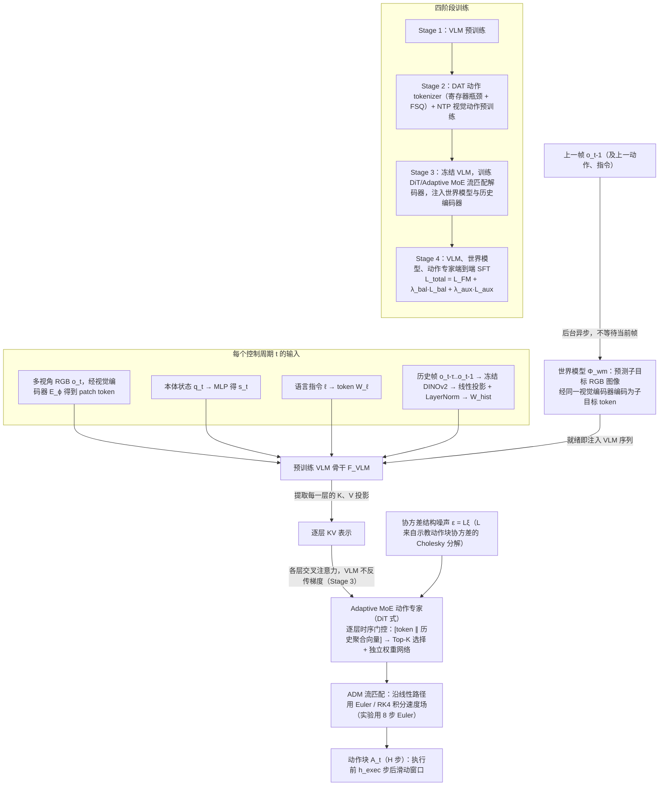

# PRIME W0：利用世界模型物理先验进行具身操作

**PRIME W0**（*PRIME W0: Physical Priors from World Models for Embodied Manipulation*，[arXiv:2610.39528](https://arxiv.org/abs/2610.39528)）收录于 senlanke「具身运控lab」10-26–10-30 前沿论文动态（Manipulation）。本页依据**周报条目 + arXiv 摘要页**整理，流程图依据论文方法部分（见参考来源），未逐页核对实验数字；指标与结论以论文为准。

## 一句话定义

**PRIME W0：利用世界模型物理先验进行具身操作——提出分层条件 Flow Matching 框架，结合 VLM 逐层 KV 注入、自适应 MoE 动作专家和异步世界模型子目标图像预测。同时引入历史视觉特征桥接和协方差结构噪声，使 Flow Matching 的动作生成过程能够利用机器人运动维度之间的耦合关系。**

## 英文缩写速查

| 缩写 | 英文全称 | 简要说明 |
|------|----------|----------|
| WAM | World Action Model | 世界–动作联合建模 |
| VLA | Vision-Language-Action | 视觉–语言–动作模型 |

## 为什么重要

- 周报所述待解决的问题：VLA 通常只使用当前观测生成动作，缺少长期历史信息和未来环境变化的有效条件化。

## 流程总览

图依据：论文 §3.1 总体架构与闭环推理（式 (1)–(3)）、§3.2 四阶段训练、§3.4 DAT/NTP、§3.5 世界模型异步注入、§3.6 历史帧编码、§3.7 Adaptive MoE、§3.8–3.9 协方差噪声与 ADM、Fig. 1/2。

## 核心机制

| 项 | 内容 |
|----|------|
| **arXiv** | [2610.39528](https://arxiv.org/abs/2610.39528) · [PDF](https://arxiv.org/pdf/2610.39528) |
| **作者（arXiv）** | Peng, Huabin, Jin, Fagang, Wei, Yancong, Ma, Tengfei, Liu, Chuhang, Yu, Chao, Chen, Liqing |
| **机构（周报所述，未逐条核实）** | 待核实（作者：Huabin Peng、Fagang Jin 等）。 |
| **arXiv 评论栏** | （无） |
| **开源** | arXiv 摘要页与评论未见代码或项目页链接（仅核对 arXiv 摘要页，不代表未发布）（2026-11-02） |
| **周报所述创新点** | 提出分层条件 Flow Matching 框架，结合 VLM 逐层 KV 注入、自适应 MoE 动作专家和异步世界模型子目标图像预测。同时引入历史视觉特征桥接和协方差结构噪声，使 Flow Matching 的动作生成过程能够利用机器人运动维度之间的耦合关系。 |

### arXiv 摘要节选（英文原文）

> Vision-Language-Action (VLA) models excel at instruction following, yet most remain feed-forward: they condition actions only on the current observation and discard both long-horizon temporal context and the hierarchical structure of VLM representations. We present PRIME W0, a hierarchical conditional flow-matching framework that closes this gap through three synergistic designs: (1)per-layer KV injection from a pretrained VLM into an Adaptive MoE action expert; (2)dynamics-aware conditioning via asynchronous world-model subgoal-image prediction and a DINOv2 historical-frame semantic bridge; and (3)Action Dynamic Manifold (ADM) flow matching with covariance-structured noise that respects robot kinematic coupling.

## 源码运行时序图

**不适用**：arXiv 摘要页与评论未见代码或项目页链接（仅核对 arXiv 摘要页，不代表未发布），无可对齐的官方代码流程。

## 实验与评测

- 周报与摘要给出的数字/场景已写入上表「创新点」与摘要节选；其余实验细节、基线与成功率定义请回到论文正文。
- 读法：先对齐任务设定、传感器与成功定义（仿真/真机），再解读 headline 数字，勿跨论文直接比较。

## 与其他工作对比

| 维度 | 读法 |
|------|------|
| **同周对照** | 见 [Manipulation周报技术地图](../overview/senlanke-weekly-2026-10-26-30-manipulation-technology-map.md)，按方向浏览同期论文 |
| **开源状态** | arXiv 摘要页与评论未见代码或项目页链接（仅核对 arXiv 摘要页，不代表未发布） |

## 结论

**PRIME W0：利用世界模型物理先验进行具身操作。**

1. 本页是入库级摘要，复现前请核对论文正文、附录与代码仓库。
2. 指标须连同实验条件解读。
3. 关注 arXiv 版本更新与代码发布。

## 关联页面

- [senlanke-weekly-2026-10-26-30-manipulation-technology-map](../overview/senlanke-weekly-2026-10-26-30-manipulation-technology-map.md)
- [manipulation](../tasks/manipulation.md)
- [vla](../methods/vla.md)

## 参考来源

- [prime-w0-physical-priors-world-models_arxiv_2610_39528.md](../../sources/papers/prime-w0-physical-priors-world-models_arxiv_2610_39528.md)
- [wechat_senlanke_weekly_manipulation_2026-10-26_30.md](../../sources/blogs/wechat_senlanke_weekly_manipulation_2026-10-26_30.md)
- [arXiv:2610.39528](https://arxiv.org/abs/2610.39528)
- [arXiv PDF](https://arxiv.org/pdf/2610.39528)：已通读方法部分（实验与附录以略读为准）：§3 方法（总体架构、四阶段训练、DAT/NTP、世界模型异步注入、历史帧编码、Adaptive MoE、协方差噪声与 ADM）；§4 实验仅浏览基线与设定

## 推荐继续阅读

- [arXiv PDF](https://arxiv.org/pdf/2610.39528)
