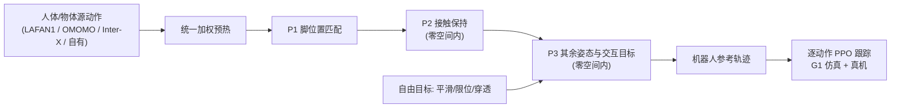

# PriMoRetarget：用优先级层级保住关键接触的人形动作重定向

**PriMoRetarget**（*Humanoid Motion Transfer Through Prioritized Motion Retargeting*，[arXiv:2610.12642](https://arxiv.org/abs/2610.12642)，[项目页](https://nickioan.github.io/primoretarget-page/)）由 **FieldAI 与 Simon Fraser University（Xue Bin Peng 组）** 提出：重定向目标之间不再靠权重折中，而是按「脚位置 → 接触保持 → 其余姿态/交互」分级，低优先级更新必须落在高优先级目标的零空间内。

## 一句话定义

**把重定向写成词典序优化：先保脚落点，再保接触，最后才贴姿态，权重不用调。**

## 英文缩写速查

| 缩写 | 英文全称 | 简要说明 |
|------|----------|----------|
| PriMoRetarget | Prioritized Motion Retargeting | 本文方法 |
| GMR | General Motion Retargeting | 常用基线，见站内 GMR 页 |
| IK | Inverse Kinematics | 重定向的底层机器人配置求解问题 |
| PPO | Proximal Policy Optimization | 逐动作跟踪策略训练算法（DeepMimic 风格） |
| PD | Proportional–Derivative | 策略输出关节 PD 目标 |
| OMOMO | Object Motion Guided Human Motion Synthesis（数据集名） | 角色–物体交互数据，用其大箱子类 |

## 为什么重要

- 交互动作（搬箱、扶人起身、多人协作）的接触一旦丢失，下游 RL 就跟不上；论文在 Inter-X 上 RL 成功率 93.6% 对基线 57.2–72.8%。
- 免去多目标权重调参，且论文给出分块对角结构使复杂度从 O(T³m³) 降到 O(Tm³)。

## 方法栈 / 流程总览

## 方法

- **词典序约束：** 每一级在所有更高级的解集内优化，用一阶零空间局部实施；阻尼投影 P = I − Jᵀ(JJᵀ + λI)⁻¹J。
- **效率：** 每帧可分离使雅可比按时间分块对角，复杂度 O(Tm³)。
- **求解：** 普通梯度下降 x ← x − α·g_total，未指定专用 IK 求解器；先短暂统一加权预热，再施加层级。
- **自由目标：** 时间平滑、关节限位、地面穿透不分级直接加到梯度。
- **状态：** 每帧 6 + nθ（根位置、根朝向、关节角）。
- **数据与机器人：** LAFAN1、OMOMO 大箱子类、Inter-X 辅助起身子集、自有 35 分钟多角色协作；主测 Unitree G1，另有 DR02、H1-2、Booster T1。

## 源码运行时序图

不适用：项目页写 “Code (coming soon)”，论文称发表后公开代码与重定向数据，截至 2026-10-12 无官方仓库。

## 工程实践

| 项 | 建议 |
|----|------|
| 优先级设计 | 层级需手工设定；论文用 脚 > 接触 > 其余 |
| 预热 | 论文消融含“去预热”，建议保留 |
| 数据质量 | 源动作的抖动与穿透会被继承，先清洗 |
| 评估 | 看 RL 跟踪成功率与物体误差，不只看运动学指标 |

## 实验与评测

- **RL 跟踪成功率 / 身体误差（Ours vs 最佳基线）：** LAFAN1 100.0%/1.8 cm（GMR、OmniRetarget 90.0%）；OMOMO 100.0%/2.8 cm，物体误差 3.0 cm（OmniRetarget 99.1%/3.5/5.8，PHC 86.6%，GMR 79.8%）；Inter-X 93.6%/4.5 cm（PHC 72.8%，OmniRetarget 66.1%，GMR 57.2%）；自有协作数据 62.6%/12.5 cm，物体误差 47.4 cm（GMR 24.1%，OmniRetarget 4.3%）。共 50 条动作，每条单独训 PPO，成功判据偏差 ≤0.5 m。
- **接触保持（%）：** OMOMO 96.9（OmniRetarget 86.4）；Inter-X 78.8（PHC 35.2）；自有数据 92.4（GMR 29.3）。
- **运动学并非全面占优：** LAFAN1 穿透时长 12.2%（OmniRetarget 1.5%）；OMOMO 悬浮 2.4 cm 高于其他；Inter-X 穿透时长 55.7%（OmniRetarget 33.6%）。抖动在 LAFAN1/Inter-X/自有数据上最低（135.6 / 103.9 / 67.5 m/s³），OMOMO 上 PHC 76.3、GMR 94.7 更低于 Ours 108.0。
- **真机：** G1 部署选定动作，含两台机器人协作搬运，原文无定量成功率。
- **消融：** 去预热、自由目标放最后一级均有变化，但消融数字与主表口径不一致，本页不据此下结论。

## 结论

**优先级层级让接触与脚落点不被一般姿态目标稀释，下游 RL 跟踪明显受益，尤其是交互数据；代价是层级手设、源数据缺陷会继承。**

1. 交互数据上最大收益在接触保持与 RL 成功率，而非穿透/悬浮等单项运动学指标。
2. 先定优先级，再谈权重：脚 > 接触 > 其余。
3. 保留预热阶段，避免直接进入层级而陷入局部不良解。
4. 使用前清洗源数据的抖动与穿透。
5. 多机器人协作场景仍难（62.6%），不要当成已解决。

## 与其他工作对比

| 对照 | 差异读法 |
|------|----------|
| [GMR](../methods/motion-retargeting-gmr.md) | 加权式通用重定向；本文在交互数据上跟踪成功率高得多 |
| OmniRetarget（[数据集页](./omniretarget-dataset.md)） | 交互保持重定向基线；OMOMO 上 RL 成功率 99.1% vs 100.0%，Inter-X 与自有数据差距大 |
| PHC | 论文基线之一，OMOMO/Inter-X 穿透较重 |
| [重定向三条路线](../queries/motion-retargeting-three-routes-landscape.md) | 站内选型综述 |

## 局限与风险

- **开源状态：** 截至 2026-10-12 项目页 “Code (coming soon)”，代码与重定向数据未发布。
- 源数据缺陷继承；物体轨迹大体沿用源数据；层级手设。
- 逐动作 PPO，而非通用跟踪策略；真机无定量结果。

## 关联页面

- [34 篇论文空间落地技术地图（汇总页）](../overview/embodied-station-34-papers-spatial-grounding-technology-map.md)
- [运动重定向](../concepts/motion-retargeting.md)
- [GMR 重定向](../methods/motion-retargeting-gmr.md)
- [OmniRetarget 数据集](./omniretarget-dataset.md)
- [重定向三条路线](../queries/motion-retargeting-three-routes-landscape.md)
- [Loco-manipulation 任务](../tasks/loco-manipulation.md)

## 参考来源

- [34 篇论文盘点（具身智能小站，2026-10-12）](../../sources/blogs/wechat_embodied_station_34_papers_spatial_grounding_2026-10-12.md)
- [primoretarget_arxiv_2610_12642.md](../../sources/papers/primoretarget_arxiv_2610_12642.md) — 论文摘录
- [primoretarget-project.md](../../sources/sites/primoretarget-project.md) — 项目页核查
- [arXiv:2610.12642](https://arxiv.org/abs/2610.12642)

## 推荐继续阅读

- [PriMoRetarget 项目页](https://nickioan.github.io/primoretarget-page/)
- [arXiv HTML 全文](https://arxiv.org/html/2610.12642v1)
