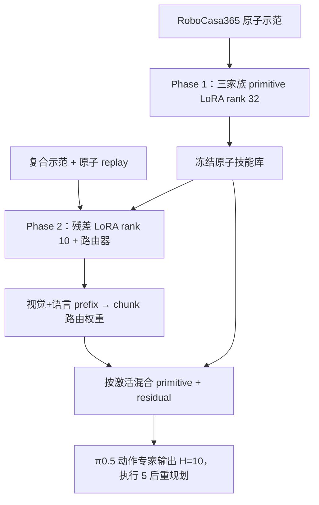

# PRISM：可保留技能的上下文原语路由与混合

**英文题名：** PRISM: Primitive Routing via In-context Skill Mixing for Retentive VLA Adaptation。官方原文：[arXiv:2611.08917v1](https://arxiv.org/abs/2611.08917v1)。已核对 v1 正文与必要附录，**未独立复现训练/真机**。

## 一句话定义
PRISM 为 π0.5 动作专家构建冻结的**原子 LoRA 技能库**，在复合任务中使用 VLM 前缀路由器与可训练残差按动作块混合原语，以在新技能组合时保留已有原子任务表现。

## 英文缩写速查
| 缩写 | 英文全称 | 简要说明 |
|---|---|---|
| VLA | Vision-Language-Action | 视觉语言动作策略 |
| LoRA | Low-Rank Adaptation | 低秩参数更新 |
| FM | Flow Matching | 动作流匹配损失 |
| SR | Success Rate | 成功率 |

## 为什么重要
新任务微调可能覆盖已有操作技能，不能只验证新任务结果。 论文的价值在于将这一失败模式单独建模，而非依靠笼统的端到端指标解释。

## 核心机制
1. **技能几何（§3）**：不同任务的 LoRA 权重更新形成近 N 维子空间，N=6/11 的参与比为 5.59/10.78；复合更新约 56% 能量可投影到原语张成空间，剩余结构由残差补充。
2. **阶段一（§4、附录 A）**：在 RoboCasa365 28 个原子任务按 Pick & Place、Turn Lever、Close 三个家族训练独立动作专家 primitive LoRA（**rank=32**；30k steps），之后冻结 primitive。
3. **阶段二**：对组合任务与原子回放混合数据训练**rank=10** 残差、VLM 前缀路由器和共享模块（20k steps），路由标签由任务身份和夹爪开闭边界生成，训练加路由 CE。
4. **推理**：图像 SigLIP 和指令 Gemma prefix 池化，经 MLP softmax 输出 chunk 级权重；注意力投影混合 LoRA 贡献、FFN 混合完整分支**激活输出**，避免参数空间混合的交叉项。
5. **协议**：动作预测 horizon H=10，但每次只执行前 5 步再决策；原子成功率评估使用任务指定 one-hot 路由，组合评估采用学习的路由器，不能误作相同路由设置。

## 流程总览
以下为论文原文中的数据/控制流程，不表示本站运行了代码。

## 工程实践
- **训练细节**：附录 A 明确语言共享 LoRA rank=16，动作 primitive rank=32、residual rank=10；第一阶段 30k steps，第二阶段 20k，原语从第二阶段起冻结。
- **代码**：本次没有核验到可运行的官方 PRISM 仓库；论文公布了方法与训练协议，不据此编造源码时序。

## 源码运行时序图
**不适用**：截至本次检查未核实可运行官方源码入口；禁止由论文方法虚构函数和脚本调用。

## 实验与评测
- **仿真（Table 1）**：RoboCasa365 28 原子任务每任务 20 次测试，4 复合任务每任务 100 次；PRISM 原子/复合成功率 **56.43%/20.00%**，普通 π0.5-LoRA 两阶段 **17.86%/17.50%**；“replay”基线 49.82%/10.25%。
- **路由消融（Table 2）**：VLM prefix 20% vs 仅视觉 10.25%、仅状态 7.50%；激活混合 20% vs 参数混合 15.50%、动作平均 13.50%。
- **真机（Table 3）**：AgileX PIPER 6-DoF、单腕部鱼眼 RGB，2 原子+1 复合，每任务 20 条遥操作示范、20 次评测；PRISM 两原子分别 65%/85%，复合 55%，两阶段 LoRA 25%/35%/45%。
- **数据/外推限制**：28 原子任务其实来自**三类原语**；实验确证的组合行为仅三槽库、四复合任务，N=6/11 仅用于权重几何分析，不可宣称大型库已完成长期持续学习实验。

**证据边界：** 指标均来自指定版本论文/官方材料，并非本站独立复现；具体基线、统计区间与硬件已按表号区分。

## 局限与风险
附录 B：技能 taxonomy 预先定义，任务/夹爪事件的相位标注依赖可定位的动作边界，缺少这类边界的任务须另设标注器。冻结的是原语参数，**共享视觉编码器、语言 LoRA、残差和路由器仍会变化**；最终行为保留由实验衡量，不能仅凭原语参数冻结推断所有旧行为不变。仿真基于固定家族，实机固定初始条件，暂未验证长期不断增量技能库。

## 与其他工作对比
- 在[九篇研究趋势地图](../overview/embodied-trends-2026-11-h1.md)中按“技术介入层”定位，不能比较跨论文不同任务、机器人和数据集的绝对指标。
- 相关基础：[VLA](../methods/vla.md)、[机器人操作](../tasks/manipulation.md)。

## 结论
**PRISM 的贡献在于原语参数隔离 + 激活级路由，不是把所有 VLA 层冻结。**
- 仿真下可在 28 个原子任务上保留 56.43% SR，并在四种复合任务得 20.00%；指标不同不要相互平均。
- 训练时原语 LoRA 保持冻结，复合任务的 residual/routing/共享模块可训练，路由阶段需要动作标注规则。
- 实机 PIPER 仅覆盖两类原子技能与一个复合任务，不能视作任意组合泛化证据。
- 评测请对齐 atomic 指定路由与 composite 学习路由两种不同协议。

## 关联页面
- [VLA](../methods/vla.md)
- [机器人操作](../tasks/manipulation.md)
- [2026.11 上半月九篇论文技术图](../overview/embodied-trends-2026-11-h1.md)
- [VLA 纵深路线](../../roadmap/depth-vla.md)

## 参考来源
- [论文来源核对](../../sources/papers/prism-2611-08917.md)
- [策展资料](../../sources/blogs/duomo_embodied_2026_11_first_half.md)
- [arXiv 指定版本](https://arxiv.org/abs/2611.08917v1)

## 推荐继续阅读
- [指定版本 arXiv HTML](https://arxiv.org/html/2611.08917v1)
- [VLA 纵深路线](../../roadmap/depth-vla.md)
