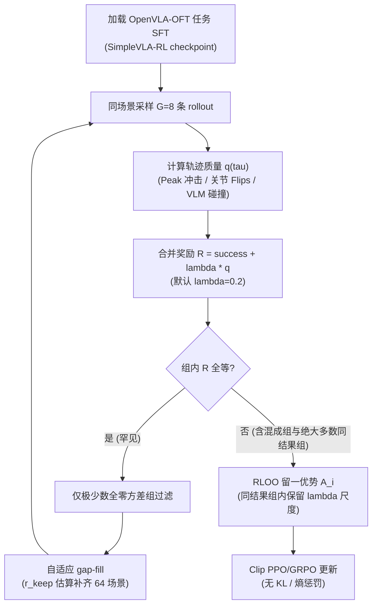

# Prism-GRPO：以轨迹执行质量打破同结果退化组的 VLA 强化学习

**Prism-GRPO**（*Faster VLA Policy Optimization via Splitting Same-outcome Groups*，[arXiv:2608.17423](https://arxiv.org/abs/2608.17423) v1，2026-08-18）由 **AWS AI**（含 Purdue University 实习第一作者 Zeyun Deng；真机 Piper 硬件平台致谢 UCLA Mobility Lab）提出。该方法面向以 [SimpleVLA-RL](../overview/vla-open-source-repro-landscape-2025.md) 为代表的二值结果 **GRPO** 训练痛点：在二值成功奖励上叠加有界、任务无关的 **轨迹执行质量** \(q(\tau)\in[0,1]\)（默认权重 \(\lambda=0.2\)），并采用 **RLOO** 优势与自适应 gap-fill 批补齐，将原本因优势为零被直接丢弃的全成功 / 全失败 **退化组（same-outcome groups）** 转化为有效排序信号，在保持成功严格支配失败的同时大幅减少采样消耗并抑制真机作弊行为。

## 一句话定义

**针对二值 GRPO 在同场景全成功或全失败时组内优势归零并被 dynamic sampling 丢弃的问题，Prism-GRPO 用任务无关的碰撞/平滑/VLM 轨迹质量 \(R=\mathrm{success}+\lambda q\)（\(\lambda=0.2\)）与 RLOO 在组内破平，保持成功主导的同时将 rollout 需求降低 22%–56% 并压制 shove-cheat。**

## 英文缩写速查

| 缩写 | 英文全称 | 简要说明 |
|---|---|---|
| GRPO | Group Relative Policy Optimization | 组内相对优势策略优化，无需单独 value critic |
| VLA | Vision-Language-Action | 视觉-语言-动作模型（本文骨干为离散动作头 OpenVLA-OFT） |
| RLOO | REINFORCE Leave-One-Out | 留一基线优势估计；本文用以避免组内标准差归一化消去 \(\lambda\) |
| SFT | Supervised Fine-Tuning | 监督微调；本文从 SimpleVLA-RL 公开任务 SFT checkpoint 起训 RL |
| SR | Success Rate | 任务成功率；RoboTwin 2.0 仿真与 Piper 真机主评估指标 |
| VLM | Vision-Language Model | 视觉语言模型；用于 Prism-VLM-Contact 零样本碰撞判别 |

## 为什么重要

- **拯救 RL 早期的高淘汰浪费：** 在 SimpleVLA-RL 等二值结果 GRPO 中，同场景 \(G\) 条 rollout 全成功或全失败时优势恒为 0，dynamic sampling 只能整组丢弃。在训练早期低成功率阶段（如 Lift Pot），退化组丢弃率可高达 **70%**；Prism-GRPO 将该丢弃率压低至初期接近 **0%**（中后期约 14% vs Binary GRPO 约 20%）。
- **理论不增期望采样代价且梯度可控：** Theorem 1 证明 `combined reward` 构造有效信息组（informative group）的期望 rollout 消耗严格不高于二值奖励（在成功率趋近 0 或 1 时仍有限）；Proposition 1–2 给出了策略下质量与成功梯度同向局部对齐的充要条件。
- **Task-agnostic 的物理执行先验：** 质量项来自非预期接触脉冲峰值、接触次数、关节速度反向次数、action jerk 或零样本 VLM 碰撞评分，跨任务无需手写分阶段 Dense Reward 或重新训练奖励模型。
- **从仿真「擦边过关」收敛到真机稳健控制：** 在 RoboTwin 的 Move Can Pot 等任务上，单纯优化零方差梯度（如 RL-ZVP）容易学会「猛推锅体撞开障碍再完成」的 **shove-cheat**；Prism-GRPO 通过惩罚非预期碰撞与剧烈抖动，在仿真和 **Piper 真机** 上同时降低作弊率并提高干净成功率。

## 核心信息

| 维度 | 核对内容（基于 arXiv:2608.17423 v1） |
|---|---|
| **作者与机构** | Zeyun Deng（Purdue / AWS AI 实习）、Yuzhe Lu、Yawei Wang 等，Jun Huan（AWS AI）；真机硬件致谢 UCLA Mobility Lab（Piper） |
| **策略骨干与基座** | [OpenVLA](./paper-openvla.md)-OFT（离散 256-bin 动作头，action chunk \(25\times 14\)），基于公开 **SimpleVLA-RL** 管线与任务 SFT checkpoint |
| **核心公式** | \(R_{\mathrm{combined}}(\tau)=\mathrm{success}(\tau)+\lambda q(\tau)\)，默认 \(\lambda=0.2\)（严格满足 \(0<\lambda<1\)）；优势采用 **RLOO** |
| **采样参数** | RoboTwin 2.0；组大小 \(G=8\)；每更新步保留 `512` 条 rollout（64 场景）；PPO clip `(0.2, 0.28)`，`lr=5e-6`，`temp=1.6`，无 KL 惩罚 |
| **开源现状** | **基座开源、Prism 补丁未发布** —— `2608.17423` 全文无 Prism 代码仓或项目页链接；可基于 [SimpleVLA-RL](https://github.com/PRIME-RL/SimpleVLA-RL) 按论文算法自行实现 |

## 核心原理与方法

### 1. 成功支配的有界质量奖励与 RLOO 优势

对同一场景采样的轨迹 \(\tau\)，定义：

$$R_{\mathrm{combined}}(\tau) = \mathrm{success}(\tau) + \lambda q(\tau), \qquad 0 < \lambda < 1, \quad q(\tau) \in [0, 1]$$

当 \(0 < \lambda < 1\) 时，失败轨迹奖励严格落在 \([0, \lambda]\)，成功轨迹严格落在 \([1, 1+\lambda]\)，因此在成功与失败混合组内成功永远优于失败。对同组 \(G\) 条轨迹，Prism-GRPO 放弃标准 GRPO 的「减均值除以组内标准差」，改用 **RLOO（Eq. 22–23）**：

$$A_i = R_{\mathrm{combined}}(\tau_i) - \frac{1}{G-1}\sum_{j \neq i} R_{\mathrm{combined}}(\tau_j)$$

在全部成功或全部失败（\(\mathrm{success}\equiv b\)）的组内，\(b\) 在差值中完全抵消，\(A_i = \lambda\bigl(q_i - \bar{q}_{-i}\bigr)\)，直接保留 \(\lambda\) 对非成功信号的缩放控制；若采用标准 GRPO 除以组内标准差，同结果组内的 \(\lambda\) 会被分母约去，导致质量更新与混合组更新尺度失衡（Appendix G.6 实验证实组内归一化会破坏训练稳定性）。

### 2. 六类轨迹质量信号与 SFT 基线标定

所有原始执行代价 \(r(\tau)\) 均按 256 个 SFT 验证场景的分布事前标定基线 \((r_0, T)\) 后固定：

$$q(\tau) = \max\left(0,\; 1 - \frac{\max(0,\; r(\tau) - r_0)}{T}\right) \in [0, 1]$$

- **非目标接触类（\(r_0=0\)）：** 默认 **Prism-Peak**（GT-Max Force，非目标机械接触最大冲击脉冲，`T_peak` 在 Lift Pot / Move Can Pot / 另两任务分别设为 `10 / 6 / 3 N·s`）、**Prism-Count**（非预期接触次数，`T_n=30`）、**Prism-VLM-Contact**（无特权接触量测时用 `Qwen3-VL-235B` 均匀抽 8 帧零样本判碰撞，仅增 `4.8%` 时钟开销 vs 仿真接触检测 `0.04%`）。
- **动作平滑类（针对 12 个 ALOHA 手臂关节，不含夹爪）：** **Prism-Flips**（关节速度符号翻转数，`T_flips=12`，高基础抖动任务 `r_0=12`）、**Prism-MeanFlips**（步长归一化的翻转数，`T_meanflips=7`）、**Prism-Jerk**（轨迹 jerk RMS，`T_J=10`）。

### 3. 自适应 Gap-Fill 批补齐（Algorithm 2）

由于只有 \(q(\tau)\) 全部完全相等（极罕见，例如全零接触）的组才仍被过滤，Prism 仍需过滤零方差组；但它将 SimpleVLA-RL「每次固定补采样完整 512 条轨迹」替换为按历史有效保留率 \(r_{\mathrm{keep}} = \max(0.3, N_{\mathrm{keep}}/N_{\mathrm{gen}})\) 自适应估算缺口场景数 \(\lceil 1.2 \cdot B_{\mathrm{short}} / r_{\mathrm{keep}}\rceil\)（按 DP 卡数对齐并封顶 `B=64`），避免尾部超采丢弃。

### 流程总览

## 源码运行时序图

**不适用。** 截至核对日（2026-11-14），通读 `arXiv:2608.17423` 全文及 HTML 元数据未发现任何官方发布的 Prism-GRPO 独立代码仓、PR 补丁或项目页链接；论文实验明确依托开源基座 [SimpleVLA-RL](https://github.com/PRIME-RL/SimpleVLA-RL) 与 OpenVLA-OFT checkpoint 运行，而 Prism 核心增量（Algorithm 1 的质量归一化与合并奖励、RLOO 优势替换、Algorithm 2 自适应 gap-fill 与 `Qwen3-VL-235B` 接触代理）尚未作为独立可运行代码发布。

## 工程实践

| 工程决策点 | 论文实证建议 |
|---|---|
| **质量项作用于哪类组** | **必须作用于全部组（All groups）**：Appendix G.3 消融表明若只在同结果组或全失败组加入 \(q(\tau)\)，准确率增益减半；全局一致的奖励定义同时让成功样本朝更平稳路径优化 |
| **优势估计器选择** | **必须使用 RLOO**：不要启用标准 GRPO 的组内标准差归一化，否则 \(\lambda\) 缩放失效并引发性能塌缩（Appendix G.6） |
| **超参 \(\lambda\) 安全窗** | 严格保持 \(0 < \lambda < 1\)；默认 **\(\lambda=0.2\)** 在省算力与稳健性间最平衡。Move Can Pot 上当 \(\lambda=1\) 时节省率跌至 `3%`，\(\lambda=2\) 直接训崩（Table 1） |
| **高质量代理切换优先级** | 有仿真器优先 **Prism-Peak**（仅增 `0.04%` wall-clock 开销）；无特权碰撞信息时可选 **Prism-Flips / Jerk** 或 **Prism-VLM-Contact**（均保留 `25%–44%` 级节流收益） |
| **何时收益递减** | 当采样组 \(G\) 极小到中等（\(G=8\)）时退化组最多、收益最大；\(G=16\) 收益收敛，\(G=32\) 时 Binary GRPO 自身退化率已很低，两者差距消失（Appendix G.4） |

## 实验与评测

### 1. RoboTwin 2.0 效率与 \(\lambda\) 消融（§5.1–5.2、Table 1）

在 **RoboTwin 2.0** 四个双臂操作任务（Lift Pot、Move Can Pot、Handover Block、Beat Block Hammer；5 随机种子，8×H100-80GB）上，Prism-GRPO 达到 Binary GRPO 峰值平均成功率所需的 rollout 总数减少 **22%–56%**，其中 **Lift Pot 节省 56%（约 20.5K rollouts）**、**Move Can Pot 节省 41%（约 14.6K rollouts）**。六种质量指标全部优于 Binary 基线（Lift Pot 上各类碰撞代理节省 `38%–56%`，平滑代理节省 `25%–44%`）。

| 任务 | 指标 | Random (\(\lambda=0.2/0.5\)) | Prism (\(\lambda=0.2\)) | Prism (\(\lambda=0.5\)) | Prism (\(\lambda=0.9\)) | Prism (\(\lambda=1\)) | Prism (\(\lambda=2\)) |
|---|---|---|---|---|---|---|---|
| Lift Pot | 计算节省 CS (%) | × / × | **56%** | 49% | 45% | 25% | 53% |
| Lift Pot | 成功轨迹质量增益 Q (%) | × / × | +11% | +14% | +15% | +14% | +26% |
| Move Can Pot | 计算节省 CS (%) | 24% / 33% | 41% | **48%** | 41% | 3% | ×（崩溃） |
| Move Can Pot | 成功轨迹质量增益 Q (%) | +1% / +0% | +7% | +10% | +13% | +16% | ×（崩溃） |

### 2. Shove-Cheat 抑制与 Piper 真机迁移（Fig. 5、Table 2、Appendix I）

在容易通过「推撞锅体移位（\(\ge 10\,\mathrm{cm}\)）」骗过仿真器终局判定的 Move Can Pot 上，仿真作弊率由 **RL-ZVP**（`5.3%`，最高达 `20.0%`）和 **Binary GRPO**（`3.5%`）降至 **Prism-GRPO `0.7%`**。真机部署到 **Piper 7-DoF 机械臂**（Orbbec DaBai DC1 相机，640×480 缩至 240×320，单步关节角限幅 \(\eta=0.05\,\mathrm{rad}\)，从约 65% 仿真成功率的 checkpoint 各跑 25 trials）：

| 方法（Piper 真机 25 trials） | Clean Success ↑ | Shove-Cheat ↓ |
|---|---|---|
| Binary GRPO | 4/25 (16%) | 1/25 (4%) |
| RL-ZVP（零方差组梯度法） | 2/25 (8%) | 5/25 (20%) |
| **Prism-GRPO（默认 Prism-Peak）** | **6/25 (24%)** | **0/25 (0%)** |

## 与其他工作对比

| 对比对象 | 核心机制与差异读法 |
|---|---|
| Binary GRPO（SimpleVLA-RL 默认） | 仅用 `{0, 1}` 成功奖励并由 dynamic sampling 整组丢弃退化组；早期 70% 组被废置，而 Prism-GRPO 用有界质量信号拆解退化组、节省 `22%–56%` rollout |
| RL-ZVP（零方差组直接反向） | 保留无奖励差异组但不区分物理质量，在仿真学会「撞推取巧」后导致真机 shove-cheat 飙升到 `20%`（5/25）；Prism 彻底将其压至 `0/25` |
| [Temporal GRPO](./paper-temporal-grpo.md) | 沿着 **时间/阶段轴** 细分长程信用分配；Prism-GRPO 沿着 **同结果样本组轴** 以全局执行质量破平——二者正交且互补 |
| [SDPG（LLM 自蒸馏）](./paper-sdpg-self-distilled-policy-gradient.md) | 同属 GRPO 族引入密集/特权指导信号打破稀疏奖励困局，但 SDPG 服务于 LLM 数学自蒸馏，Prism 聚焦机器人动作物理执行质量 |
| 传统 Task-specific Dense Reward | 需按每个新任务设计里程碑与子目标函数；Prism 采用跨任务通吃的力学接触与关节平滑代理（或通用 VLM 判别），零任务定制成本 |

## 局限与风险

- **独立代码尚未开源：** 虽然依赖公开的 SimpleVLA-RL 管线，但 Prism-GRPO 的质量计算插件、RLOO 与自适应 gap-fill 尚未公布源码，团队需自行复现对齐。
- **质量与成功对齐的分布前提（Proposition 1 & App. H）：** 理论要求同场景内质量偏好与成功梯度正相关；对于必须主动「接触/推挤」而非避碰的强接触操作任务（如擦拭、推箱、高阻装配），把非目标碰撞惩罚作默认质量信号可能与任务目标冲突，需切换为对齐该任务的执行指标。
- **大组规模（\(G \ge 32\)）下红利收敛：** 随着采样组大小扩大，全失败/全成功概率呈指数衰减，Prism 相对 Binary GRPO 的退化组拯救优势趋于消退（App. G.4）。
- **依赖离散动作头管线：** 全文仅在基于 OpenVLA-OFT 离散 256-bin 的 SimpleVLA-RL 上验证，尚未验证在连续流匹配 VLA（如 \(\pi_0\) 系列）上同构 `RLOO + q(τ)` 对多步去噪似然的适配。

## 结论

**Prism-GRPO 证明不需要手工编写分任务 Dense Reward，只要在二值成功 GRPO 中叠加有界、任务无关的物理执行质量并配以 RLOO 优势，就能以低成本回收绝大多数被丢弃的同结果轨迹并阻止仿真作弊向真机迁移。**

1. **直接可借鉴的核心公式：** 保持 \(0<\lambda<1\)（推荐 `0.2`）使成功永远支配失败，确保基础探索不会退化成「宁可不动也要零碰撞」的奖励黑客。
2. **RLOO 是必要配对项：** 切勿沿用 GRPO 默认的组内标准差归一化，否则同结果组里的 \(\lambda\) 会被约掉并在高梯度方差下毁坏策略。
3. **全局统一施压优于按需打补丁：** 对全批轨迹一致施加质量信号，而非只拯救退化组，能同时提高已成功轨迹在真机上的物理稳健性。
4. **接触惩罚不是万能质量指标：** 非接触/低碰撞搬运类任务优先采用仿真脉冲峰值或平滑度；若迁移到力控/强接触操作任务，需谨慎重新校核对齐性。
5. **工程复现路径：** 基于 [SimpleVLA-RL](../overview/vla-open-source-repro-landscape-2025.md) 与 [RoboTwin](./robotwin.md) 可迅速搭建底层栈，但需自行补齐 Algorithm 1–2 与 256-scene 标定流程。

## 关联页面

- [VLA（Vision-Language-Action）方法页](../methods/vla.md)
- [强化学习方法页（Reinforcement Learning）](../methods/reinforcement-learning.md)
- [操作任务页（Manipulation）](../tasks/manipulation.md)
- [Temporal GRPO](./paper-temporal-grpo.md)
- [VLA 开源复现景观 2025](../overview/vla-open-source-repro-landscape-2025.md)
- [RoboTwin](./robotwin.md)
- [OpenVLA](./paper-openvla.md)
- [SDPG（自蒸馏策略梯度）](./paper-sdpg-self-distilled-policy-gradient.md)

## 参考来源

- [Prism-GRPO 论文全文核对归档（arXiv:2608.17423）](../../sources/papers/prism_grpo_arxiv_2608_17423.md)

## 推荐继续阅读

- 论文原文（arXiv:2608.17423）：<https://arxiv.org/abs/2608.17423>
- 底层公开 RL 训练基座（SimpleVLA-RL）：<https://github.com/PRIME-RL/SimpleVLA-RL>
