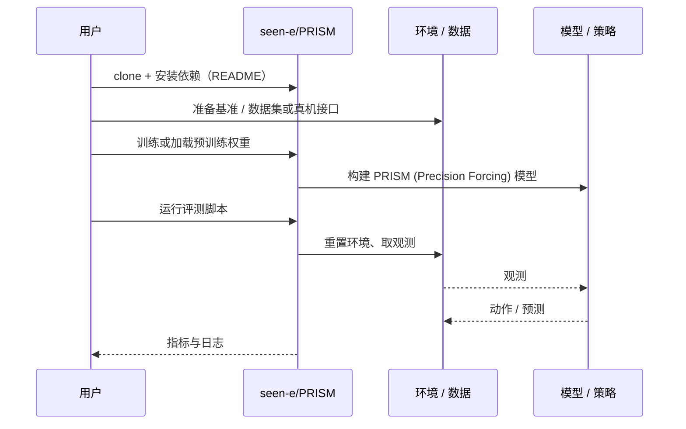

# PRISM (Precision Forcing)（arXiv:2610.14704）

**PRISM (Precision Forcing)**（*PRISM: Precision Forcing for Generalist Vision-Language-Action Policies*，[arXiv:2610.14704](https://arxiv.org/abs/2610.14704)，[项目页](https://seen-e.github.io/PRISM/)，[代码](https://github.com/seen-e/PRISM)）来自 [具身智能小站 2026-10-14 盘点](../../sources/blogs/wechat_embodied_station_41_papers_streamingwam_2026-10-14.md)，属「VLA 与动作生成」组。

## 一句话定义

**按精度需求对流匹配监督重加权，并把精度需求写入条件表示，让训练更关注容差敏感时刻。**

## 英文缩写速查

| 缩写 | 英文全称 | 简要说明 |
|------|----------|----------|
| VLA | Vision-Language-Action | 视觉–语言–动作策略 |
| FM | Flow Matching | 流匹配 |
| PF | Precision Forcing | 精度强制加权 |

## 为什么重要

- 流匹配损失平均分摊到所有时刻，连接器插拔、拧螺丝等关键瞬间得不到足够监督。
- 开源结论：**已开源**（步骤 2.5，2026-10-14）。项目页链接的 GitHub 仓库可达。与库内同名 PRISM 节点为不同论文。
- 同期同组工作见 [流式动作块与世界模型记忆：具身智能小站 10-14 期 41 篇阅读坐标](../overview/embodied-station-2026-10-14-41-papers-technology-map.md)。

## 核心机制

| 项 | 内容 |
|----|------|
| **arXiv** | [2610.14704](https://arxiv.org/abs/2610.14704) |
| **开源** | **已开源** |
| **要点** | 精度权重 + 条件编码；实验涉及连接器与拧螺丝。 |
| **文内指标** | 以原文为准。 |

## 源码运行时序图

以下为按仓库入口（`seen-e/PRISM`）推断的通用运行链路；入库日仅核实仓库可达，未逐文件阅读，具体脚本名以 README 为准。

## 实验与评测

- 以原文为准。
- **读法：** 本页为索引级摘要，依据公众号转述的官方摘要与仓库信息整理；逐项数字与 baseline 以原文 PDF 为准。

## 与其他工作对比

- 横向索引见 [流式动作块与世界模型记忆：具身智能小站 10-14 期 41 篇阅读坐标](../overview/embodied-station-2026-10-14-41-papers-technology-map.md)；同 arXiv 不重复造页。

## 结论

**精密操作先改监督分配再扩模型：对关键时刻加权是便宜的第一步。**

1. 开源边界：**已开源** — 项目页链接的 GitHub 仓库可达。与库内同名 PRISM 节点为不同论文。
2. 核心机制：精度权重 + 条件编码；实验涉及连接器与拧螺丝。
3. 复现与选型前核对任务协议、硬件与基准口径，勿直接横比公众号摘录数字。

## 关联页面

- [vla](../methods/vla.md)
- [flow-matching-embodied-policy](../concepts/flow-matching-embodied-policy.md)
- [manipulation](../tasks/manipulation.md)
- [embodied-station-2026-10-14-41-papers-technology-map](../overview/embodied-station-2026-10-14-41-papers-technology-map.md)

## 参考来源

- [prism_precision_forcing_vla_arxiv_2610_14704.md](../../sources/papers/prism_precision_forcing_vla_arxiv_2610_14704.md)
- [wechat_embodied_station_41_papers_streamingwam_2026-10-14.md](../../sources/blogs/wechat_embodied_station_41_papers_streamingwam_2026-10-14.md)
- [arXiv:2610.14704](https://arxiv.org/abs/2610.14704)

## 推荐继续阅读

- [arXiv PDF](https://arxiv.org/pdf/2610.14704)
- [项目页](https://seen-e.github.io/PRISM/)
- [https://github.com/seen-e/PRISM](https://github.com/seen-e/PRISM)
