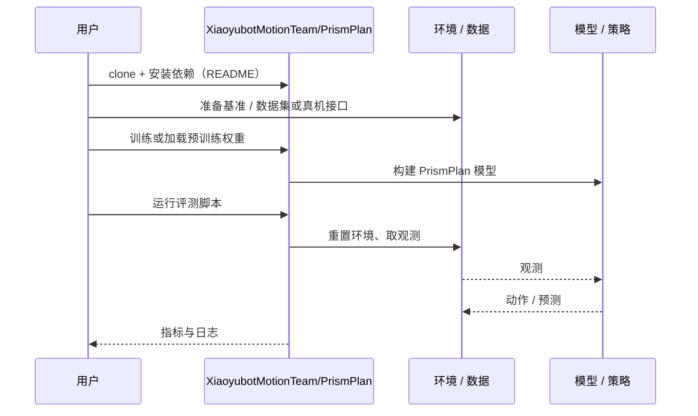

# PrismPlan（arXiv:2610.23884）

**PrismPlan**（*PrismPlan: A Shared GPU Substrate for Motion Planning Across Paradigms*，[arXiv:2610.23884](https://arxiv.org/abs/2610.23884)，[代码](https://github.com/XiaoyubotMotionTeam/PrismPlan)）来自 [具身智能小站 2026-11-01 盘点](../../sources/blogs/wechat_embodied_station_56_papers_libero_dynamic_latency_eval_2026-11-01.md)，属「感知、规划与系统」组。

## 一句话定义

**PrismPlan把采样、搜索和优化接到同一GPU运动学与碰撞计算底座；统一预算下比较多种规划器，结果揭示维度和问题类型会改变算法取舍。**

## 英文缩写速查

| 缩写 | 英文全称 | 简要说明 |
|------|----------|----------|
| PrismPlan | PrismPlan: A Shared GPU Substrate for Motion Planning Across Paradigms | 本文方法 / 基准的简称 |

## 为什么重要

- 规划器公平比较，先共用碰撞后端。
- 开源结论：**已开源**（步骤 2.5，2026-11-01）。仓库可达（git ls-remote）。
- 同期同组工作见 [动态评测、技能编译与环境潜变量适配：具身智能小站 11-01 期 56 篇阅读坐标](../overview/embodied-station-2026-11-01-56-papers-technology-map.md)。

## 核心机制

| 项 | 内容 |
|----|------|
| **arXiv** | [2610.23884](https://arxiv.org/abs/2610.23884) |
| **开源** | **已开源** |
| **要点** | PrismPlan把采样、搜索和优化接到同一GPU运动学与碰撞计算底座；统一预算下比较多种规划器，结果揭示维度和问题类型会改变算法取舍。 |
| **文内指标** | 公众号未给具体数字，本页不引用。 |

## 源码运行时序图

以下为按仓库入口（`XiaoyubotMotionTeam/PrismPlan`）推断的通用运行链路；入库日仅核实仓库可达，未逐文件阅读，具体脚本名以 README 为准。

## 实验与评测

- 公众号未给具体数字，本页不引用。
- **读法：** 本页为索引级摘要，依据公众号转述的官方摘要与仓库信息整理；逐项数字与 baseline 以原文 PDF 为准。

## 与其他工作对比

- 横向索引见 [动态评测、技能编译与环境潜变量适配：具身智能小站 11-01 期 56 篇阅读坐标](../overview/embodied-station-2026-11-01-56-papers-technology-map.md)；同 arXiv 不重复造页。

## 结论

**规划器公平比较，先共用碰撞后端：PrismPlan把采样、搜索和优化接到同一GPU运动学与碰撞计算底座；统一预算下比较多种规划器，结果揭示维度和问题类型会改变算法取舍。**

1. 开源边界：**已开源** — 仓库可达（git ls-remote）。
2. 核心机制：PrismPlan把采样、搜索和优化接到同一GPU运动学与碰撞计算底座；统一预算下比较多种规划器，结果揭示维度和问题类型会改变算法取舍。
3. 复现与选型前核对任务协议、硬件与基准口径，勿直接横比公众号摘录数字。

## 关联页面

- [manipulation](../tasks/manipulation.md)
- [locomotion](../tasks/locomotion.md)
- [sim2real](../concepts/sim2real.md)
- [embodied-station-2026-11-01-56-papers-technology-map](../overview/embodied-station-2026-11-01-56-papers-technology-map.md)

## 参考来源

- [prismplan_arxiv_2610_23884.md](../../sources/papers/prismplan_arxiv_2610_23884.md)
- [wechat_embodied_station_56_papers_libero_dynamic_latency_eval_2026-11-01.md](../../sources/blogs/wechat_embodied_station_56_papers_libero_dynamic_latency_eval_2026-11-01.md)
- [arXiv:2610.23884](https://arxiv.org/abs/2610.23884)

## 推荐继续阅读

- [arXiv PDF](https://arxiv.org/pdf/2610.23884)
- [https://github.com/XiaoyubotMotionTeam/PrismPlan](https://github.com/XiaoyubotMotionTeam/PrismPlan)
