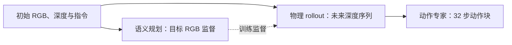
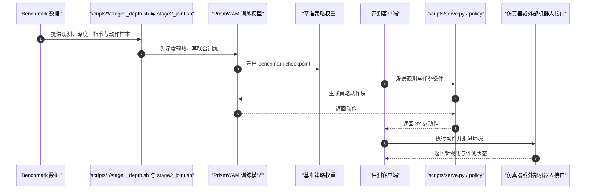

# PrismWAM：解耦世界–动作模型中的状态表征

**PrismWAM** 将世界状态分成“场景看起来怎样”与“场景在物理上如何变化”：前者提供语义目标，后者用深度序列描述几何和运动，再由物理 rollout 生成机器人动作。

## 英文缩写速查

| 缩写 | 英文全称 | 简要说明 |
|---|---|---|
| WAM | World Action Model | 同时建模动作相关世界演化与可执行策略 |
| RGB | Red Green Blue | 彩色视觉输入与稀疏语义目标 |
| VAE | Variational Autoencoder | 将视觉数据编码至潜空间的模型组件 |
| SR | Success Rate | 操作基准中的任务成功率 |
| CUDA | Compute Unified Device Architecture | README 指定的 NVIDIA GPU 计算软件栈 |

## 为什么重要

视频模型的潜表示常把颜色、纹理、照明与物体位置、姿态、接触等信息混在一起。动作主要改变物理状态，却不必改变场景语义外观；让同一种表示同时承担这两类预测，可能造成目标混淆。PrismWAM 的设计把语义目标和物理演化分开，再用后者指导动作生成。

这为 WAM 表征设计提供了一个具体问题：**动作是否需要对 RGB 视频外观变化建模，还是更应直接预测几何与运动等物理状态？** PrismWAM 以深度 rollout 作为动作相关的未来状态，提供了后一种实现。

## 方法与训练流程

### 三段式任务分解

1. **Semantic Planning：** 以初始 RGB 观测为输入，学习预测动作块结束时的目标 RGB 图像，提供高层语义目标。
2. **Physical Rollout：** 预测逐帧深度序列，以占据几何、物体位置和运动描述细粒度物理变化；深度会弱化纹理、颜色和光照差异。
3. **Executable Action：** 动作专家通过单向 RGB → Depth → Action 注意力读取表征，生成可执行动作块。

官方 README 说明目标 RGB 属于训练监督；推理时不生成未来 RGB，而主要依靠深度 rollout 生成动作。

### 两阶段训练

| 阶段 | 输入与目标 | 训练组件 |
|---|---|---|
| **Stage 1：Depth warm-up** | 当前深度与任务指令 → 未来深度帧 | 视觉 Transformer，从预训练视频模型初始化 |
| **Stage 2：联合训练** | RGB 历史、当前深度、机器人状态、指令 → 稀疏目标 RGB、密集深度 rollout、32 步动作 | RGB/深度 Transformer 与动作专家 |

README 将 Stage 1 描述为预测未来 8 帧深度、覆盖未来 32 个控制步；每个 benchmark 提供独立 YAML 配方与启动脚本。论文称无需具身动作预训练或额外数据增强。

## 源码运行时序图

仓库提供 benchmark 适配与 HTTP 推理服务；真机控制频率、动作单位、同步和安全限制仍需由具体机器人接口处理。

## 实验与评测

官方 README 报告的策略结果如下，指标来自不同基准及测试协议，不能直接横向比较：

| 基准 | README 报告结果 | 读法 |
|---|---:|---|
| RoboTwin 2.0 Clean → Randomized | 70.57 | 从 clean 场景训练、在 clean 与 randomized 场景评测 |
| RoboDojo | Score 25.10 / SR 18.55 | 同时报告基准分数与成功率 |
| LIBERO（4 suites） | 99.35% | LIBERO 四个任务套件 |
| LIBERO-Plus（LIBERO 训练，无额外训练） | 79.44% | 在扰动版本上直接评测 |
| LIBERO-Pro（LIBERO 训练，无额外训练） | 54.48% | 在 Pro 测试集评测 |

README 还提供 RoboTwin、RoboDojo、LIBERO 的预训练模型入口。论文摘要称方法在仿真与真实世界操作中取得较强表现；具体真机结果应按论文实验协议阅读，不外推为任意机器人上的部署性能。

## 与其他路线对比

- **相对 RGB 视频未来预测：** PrismWAM 把动作条件化的细粒度未来主要交给深度序列，语义 RGB 目标提供终态约束；因此减少纹理与照明变化对物理 rollout 的干扰，是其设计动机而非已证明的普遍结论。
- **相对 Cascaded WAM：** 系统按语义目标、物理 rollout、动作生成分段组织；深度 rollout 是连接未来预测与动作的中间状态。
- **与 GreenWAM：** 两者都将世界预测与动作策略结合，但 PrismWAM 聚焦语义 / 物理状态解耦；GreenWAM 聚焦跨本体共享关节表示和联合训练。
- **与一般 VLA：** PrismWAM 显式预测未来深度再生成动作，加入未来状态建模路径；VLA 通常从当前观测与语言直接产生动作。

## 结论

**PrismWAM 的主要价值是把“语义目标”和“动作相关物理未来”分开学习，并以深度 rollout 作为动作生成的中间条件；公开证据支持其在论文所测仿真和真实操作任务中的可行性。**

1. 复现时按 Stage 1 深度预热、Stage 2 联合训练及对应 benchmark 配方逐项核对。
2. 评估其核心贡献时比较深度 rollout、目标图像监督与动作条件化的消融结果，不只看最终成功率。
3. 区分训练监督和推理输入：README 称目标 RGB 是训练目标，推理不需生成未来 RGB。
4. 不要把不同 benchmark 的成功率视为同分布结果，也不要把仿真分数直接外推到目标真机。
5. 部署前确认动作空间、控制频率、动作单位和机器人端安全接口；HTTP 策略服务不等同于真机控制器。

## 局限与风险

- RGB 目标的语义约束与深度 rollout 的几何预测仍需正确对齐；摘要 / README 的机制描述本身不能证明所有任务中物理预测都准确。
- 深度表示削弱外观变化，但是否保留接触、遮挡和透明物体等任务关键信息，要按具体数据与测试验证。
- 项目依赖 CUDA、基准数据、仿真器和初始化权重；代码仓库开源不等于全部依赖随仓库提供。
- 论文报告含真实机器人实验，但需在目标硬件上另外验证动作限幅、时延、状态反馈和故障处理。

## 关联页面

- [World Action Models（WAM）](../concepts/world-action-models.md)
- [生成式世界模型](../methods/generative-world-models.md)
- [Vision-Language-Action（VLA）](../methods/vla.md)
- [机器人操作](../tasks/manipulation.md)
- [GreenWAM](./paper-greenwam.md)

## 参考来源

- [PrismWAM 论文来源](../../sources/papers/prismwam_arxiv_2610_26564.md)
- [PrismWAM 项目页与开放状态核查](../../sources/sites/prism-wam-project.md)
- [PrismWAM 官方代码归档](../../sources/repos/prismwam.md)

## 推荐继续阅读

- [PrismWAM 论文](https://arxiv.org/abs/2610.26564)
- [PrismWAM 官方项目页](https://prism-wam.github.io/)
- [PrismWAM GitHub](https://github.com/THUSI-Lab/PrismWAM)
- [PrismWAM Hugging Face](https://huggingface.co/THUSI-Lab/PrismWAM)
