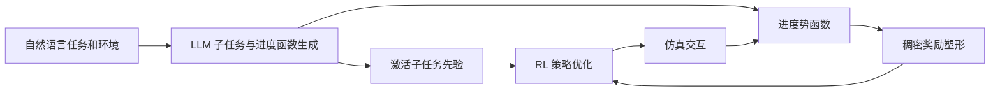

# PRM4RL：大语言模型生成的任务进度奖励

## 一句话定义

**LLM 将稀疏成功任务分解为子任务并生成进度判定函数，再以势函数形式向 RL 提供低层稠密学习信号。**

## 英文缩写速查

| 缩写 | 英文全称 | 简要说明 |
|------|----------|----------|
| PRM | Progress Reward Model | 进度奖励模型 |
| LLM | Large Language Model | 大型语言模型 |
| RL | Reinforcement Learning | 强化学习 |
| PPO | Proximal Policy Optimization | 近端策略优化 |

## 为什么重要

子任务进度函数驱动的稠密强化学习奖励，关注现有控制、数据或机器人学习方法在复杂任务中的失效点。这里单独建论文实体，避免与其他论文共用详情页；当前是待完成全文与源码复核的草稿。

## 核心机制

LLM 生成任务分解与子任务判定 Ψ、进度函数 Φ，策略从当前状态获取子任务先验，同时使用 r=γΦ(s_next)-Φ(s_now)+成功奖励 进行潜势塑形训练；论文使用 PPO、SAC 进行验证。

## 方法流程（待全文逐节复核）

以下流程仅依据已核对的论文 HTML 方法描述，不代替源代码调用图。

## 源码运行时序图

**待核实，不绘制未经代码阅读确认的时序图。** 官方存在公开仓库，但本次仅核对了 README 和部分发布说明；需继续阅读真实运行入口及关键模块后补充。

## 实验与评测

在 MetaWorld 与 ManiSkill 仿真任务中以 5 个随机种子比较 Text2Reward、ELLM 和 Oracle 奖励；在论文所设环境中优于多种 LLM 规划和奖励基线。NeurIPS 2025 会议论文、2026 年 arXiv 编号不是同一发布日期。

## 局限与工程实践

- 势函数塑形的最优策略不变性需满足理论假设；仿真收益不代表任意真机或 RL 算法保证收敛。代码 README 提醒原实验 GPT-4o 不易精确复现。
- **源码状态：** 官方训练代码公开，README 包含 train_mw.py、train_ms.py 入口与 LLM 版本复现说明。
- **原文状态：** 本轮已核查 arXiv 部分章节，尚未通读全部正文/附录，保持 draft，不宣称健康度满分。

## 结论

**将进度信号以势函数方式加入基础 RL，比直接让 LLM 写一套任意奖励更便于分析理论边界。**

1. 使用与论文一致的任务、硬件和评测协议复验，不跨实验口径比较数据。
2. 把方法改善的指标与额外的数据、计算或控制成本分开记录。
3. 对未经独立核查的复现入口，暂不声称完成验证。

## 关联页面

- [CoDA：失败驱动的数据引擎与动作策略协同进化](./paper-coda-coevolving-data-policy.md)
- [SPEAR：机器人强化学习中的选择性 VLM 偏好询问](./paper-spear-selective-preference.md)

## 参考来源

- [论文归档](../../sources/papers/prm4rl-progress-reward_arxiv_2610_22056.md)
- [官方仓库归档](../../sources/repos/prm4rl-progress-reward.md)

## 推荐继续阅读

- [arXiv 原文](https://arxiv.org/abs/2610.22056)
- [公开仓库](https://github.com/deng-ai-lab/PRM4RL)
