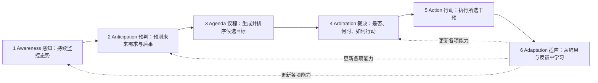
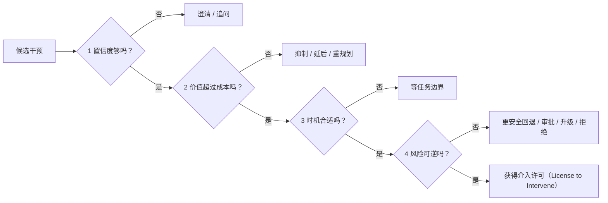
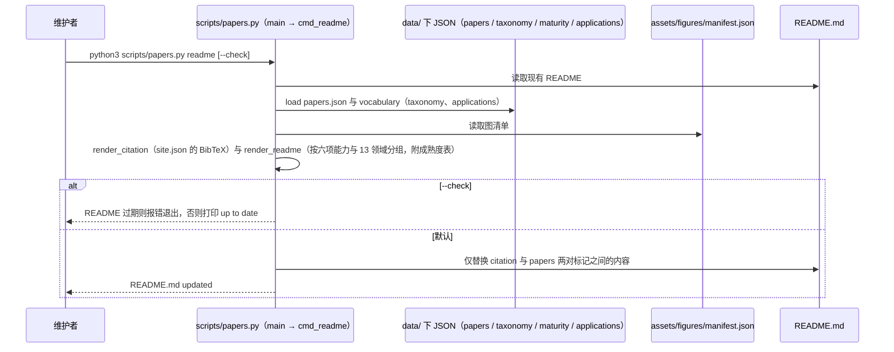

# Proactive AI for Superintelligent Agents

## 一句话定义

**Proactive AI for Superintelligent Agents**（Ke Yang 等，UIUC / Google / Stanford / UC Berkeley / CMU，2026 年 manuscript，203 页）是一篇综述：把**主动性**定义为智能体在无需针对该干预的新显式请求时发起面向目标行动的能力（即行使被委托的剩余裁量），并提出六项能力框架、三层评估体系和 13 个应用领域的横向比较。

## 英文缩写速查

| 缩写 | 英文全称 | 简要说明 |
|------|----------|----------|
| 6A | Awareness / Anticipation / Agenda / Arbitration / Action / Adaptation | 论文的六项能力：感知、预判、议程、裁决、行动、适应 |
| ODD | Operational Design Domain | 运行设计域（表 6 中 Waymo 的授权边界） |
| VLA | Vision-Language-Action | 视觉–语言–动作模型（表 6 中的具身系统多属此类） |
| RECAP | RL with Experience and Corrections via Advantage-conditioned Policies | π0.6 的训练方法（表 6 引用） |

## 为什么重要

- 对机器人 / 具身智能：论文判断多数已部署具身系统仍是「反应式自主」或「有界主动」，开放式主动尚缺可靠性与通用性；这给「具身智能体该在多大授权下自己发起行动」提供了一套可对照的语言（论文口径，§6.4）。
- 提供「校准的主动性」视角：把主动程度调到与不确定性、风险、时机、用户偏好与权限相称，并强调**沉默也可以是正确的决定**。
- 与库内 [VLA](../methods/vla.md)、[智能体评测](../concepts/ai-agent-evaluation.md)、[LLM 机器人控制接口](../concepts/llm-robotics-control-interfaces.md) 互补：后者讲能力与接口，本页讲「何时该自己动」。

## 论文结构（目录）

| 章 | 内容 |
|----|------|
| 1 引言 | 主动性是智能体在智能与对齐之外的第三类能力 |
| 2 概念框架 | 定义主动性；自我发起的两个问题；反应–主动光谱 |
| 3 历史 | 控制与控制论、规划与世界模型、BDI、普适计算、混合主动、目标推理、基础模型，最后综合为机制 |
| 4 机制 | 六项能力及其子维度（表 1 分类） |
| 5 评估 | 任务级、机制级、用户体验级 |
| 6 应用 | 13 个领域（编程、GUI、信息获取、具身与机器人、安全、自主科研、智能家居、智慧城市、医疗、法律、教育、娱乐与媒体、农业）与跨行业趋势 |
| 7 未来工作 | 评估与机制进展、长程任务与自我演化、安全与治理、应用前沿 |
| 8 结论 | — |

## 流程总览

图依据论文图 6（六项能力的循环）：感知维护态势模型，预判识别未来需求并预测可选行动的后果，议程把预测转成排序后的承诺，裁决决定是否与何时介入，行动执行所选干预，适应用结果与反馈更新其他能力。论文称预判与裁决是自我发起工作特有的两个难点。

## 核心框架

### 定义与光谱（第 2 章）

- 主动性 = 自我发起：不是被触发后才响应，而是在被授权的目标、约束与权限内自己选择并发起干预。论文更精确的表述是**在任务欠规定的剩余决策空间内行使被委托的裁量权**（图 2 的例子：原型机装配里，偏好权衡、流程欠规定、意外与风险欠规定、自适应重规划都留在剩余决策空间）。目标可来自用户的高层指令、系统内置（如安全裕度）、甚至智能体自己生成。
- 与相邻概念严格区分：**主动性管「能否发起」，自治（autonomy）管「被授予多大权限」**；它与智能（intelligence，理解与推理）、对齐（alignment，行动符合用户意图）是互补的三类能力（图 3），信任来自可靠的记录，自治是「挣来的」。
- 自我发起要回答两个问题：**做什么**（what to act on，与目标对齐不可分）与**是否、何时、如何做**（whether / when / how）。
- 反应式 → 混合主动 → 自我发起是一条光谱（图 4），人的角色从操作者到协作者再到评审者；多数实际系统是「反应层 + 主动层」的混合体（论文以自动驾驶：急刹是反应、提议加充电站是主动；编程助手：补全当前行是反应、提议重构是主动 来举例）。
- 校准的主动性（calibrated proactiveness）：把主动程度调到与不确定性、风险、时机、用户偏好和权限相称；太积极会打断用户、追错目标、越权，太犹豫则遗漏重要需求。

### 历史脉络（第 3 章，图 5）

主动性在各社区被不同名字研究，论文把各脉络对应到六项能力：控制与控制论（反馈回路）→ 最小底座（感知 + 行动 + 适应）；规划与世界模型（STRIPS、学习式世界模型）→ 预判；BDI 与智能体理论（Bratman、Cohen & Levesque、Rao & Georgeff；Wooldridge & Jennings 把主动性列为智能体规范属性）→ 议程；普适与情境感知计算（Weiser、Schilit、Abowd）→ 感知；混合主动交互（Horvitz 1999 把介入看作不确定性下的决策；Tennenhouse 2000 主动计算）→ 裁决；目标推理与内在动机（goal-driven autonomy、好奇心、学习进度）→ 议程生成；基础模型 → 在开放、语言中介的环境里把这些机制重组。论文还借「不完全契约」类比：提示 / 指令是类契约的委托，无法写尽未来状态，关键是「剩余控制权」归谁。

### 六项能力（第 4 章，图 6、表 1）

| 能力 | 核心问题 | 论文要点 |
|------|----------|----------|
| 感知 Awareness | 现在是什么情况、缺什么信息 | 请求到来前就维护态势；多模态状态跟踪、主动信息获取（澄清提问要权衡信息增益与打扰成本）、分层记忆（working / episodic / semantic / procedural，语义记忆的时效性：过期偏好导致的主动错误比被动错误更伤信任）、运行时架构（事件流 + 轻量「该不该动」判断、空闲时计算、分层常开感知）；常开感知的算力 / 能耗 / 隐私代价被称为「标准税」 |
| 预判 Anticipation | 将来会需要什么、做了会怎样 | 建模用户（心智理论，LLM 在信息不对称下脆弱）、建模世界（预测有用性比保真度更重要）、反事实推理（干预价值 = 干预与不干预两个未来的差值）、生成式场景模拟（LLM 模拟用户有偏、谄媚，会高估干预的可接受度） |
| 议程 Agenda | 把需求变成哪些承诺 | 目标生成（goal-driven autonomy、内在动机、潜在意图）、子目标与长程议程（常设议程：注册触发条件 → 挂起 → 重新接入；局部计划修复）、优先级与冲突（工具性趋同、关机抵抗等安全证据；corrigibility） |
| 裁决 Arbitration | 是否、何时、如何介入 | 四道闸，见下 |
| 行动 Action | 在授权内怎么执行与呈现 | 自主谱系；呈现作为决策变量（从环境感知式到前景告警；预览式、未提交的变更最干净；具身要运动可读性） |
| 适应 Adaptation | 从结果里学什么 | 隐式反馈（被忽略的建议是噪声标签，「避免的事故」不可观测）、推理时反思（对象从「答案好不好」变成「该不该行动」）、长期校准与个性化；目标会随智能体自身干预而移动（performative prediction） |

论文称预判与裁决是自我发起工作特有的两个难点，其余四项在通用智能体里本就有，但主动形态要大改。

### 裁决：四道闸（§4.4，图 10）

四闸依据论文图 10 与 §4.4.1–4.4.4：置信度（校准、拒答与选择性预测、learning-to-defer、保形预测集）、价值对成本（Horvitz 式：期望收益超过个性化打断成本；信任是跨交互累积的跨期成本）、时机（把打断看作最优停止问题；交付模式 immediate / negotiated / mediated / scheduled）、风险与可逆性（软闸：按风险缩放权限；硬闸：外部权限系统与护栏）。论文强调「不做」在主动场景里是看不见的，要把选项拉成梯度：行动 → 核实 / 询问 → 保持观察。

### 自主谱系与交付（§4.5）

- 等级来源：Sheridan & Verplank 十级自动化、Parasuraman 的四类功能（信息获取 / 分析 / 决策 / 行动实施）、自动驾驶六级、部署里的 ask-always / ask-on-risk / allowlist / auto-execute 档位、用户残余角色的 operator → collaborator → consultant → approver → observer。论文称这些分级被多个领域各自重新推导，这本身就是结论。
- 可调自主：不是固定等级，而是随置信度、可逆性、后果与人是否可接管而转移控制权；情境自适应优于任何固定等级（Salikutluk 等）。风险闸决定「做不做」，自主等级决定「做多狠」，共用同一个估计。
- 争议：有人主张未被请求的动作前一律先问，有人主张根本不该造完全自主的智能体，也有人警告确认过于频繁会造成审批疲劳。

## 三层评估（第 5 章）

任务级、机制级、用户体验级，彼此不可替代：任务级看结果是否改善（成功、效率，成功可有多种合法形态：信息、澄清、准备、部分完成、恰当沉默）；机制级按六项能力归因（如感知：长上下文 / 记忆基准与「决策前证据覆盖」；预判：ProactiveBench、ProAgentBench、PIRA-Bench、JIR-Arena；议程：π Bench、UserBench、ProactiveMobile；裁决：Ask Before Plan、HiL Bench、KnowU Bench，指标含 selective risk、risk-coverage、过早 / 过晚介入率；行动：执行成功、可编辑性、撤销成本、可理解性；适应：ProPerSim、PAHF、LongMemEval 等）；用户体验级含负担（NASA-TLX）、可用性（SUS、UEQ）、控制感（形式权限与有效权限之间的差距）、信任与适当依赖。论文还提出需要新指标，如「决策前证据覆盖」与任务发现的精确率 / 召回率。关键观察：成功可能掩盖有问题的干预过程；基准标准化程度对话智能体高于具身、移动、视觉和跨应用系统。

## 13 个应用领域（第 6 章）

| 领域 | 论文的主要判断（节选） |
|------|------------------------|
| 编程 | 感知与行动强、裁决渐强，缺项目级预判 / 议程 / 适应；可信的主动发现依赖「窄领域 + 强验证回路」；授权是硬边界；跨会话承诺靠外化到仓库产物与前瞻性交接笔记（Handoff Debt）；FixedBench 显示问题已解决时智能体仍常改代码（行动偏差） |
| GUI | 桌面（长流程所有权）、Web（情境判断）、移动（需求与时机）；GUI 与 CLI / API / MCP 混合执行；结果奖励只在出错后告知，没教会预判计划何时失效 |
| 信息获取 | 预判丰富、议程浅；ChatGPT Pulse 一年内下线改为用户定时任务；过滤气泡与自我塑造的反馈回路；成熟的主动性是让沉默与主动同样刻意 |
| 具身与机器人 | 见下节 |
| 安全 | 主动性 = 在常设保护目标下自己决定下一步查什么；DARPA AI Cyber Challenge 决赛中系统发现 54 个植入漏洞、修补 43 个，另发现 18 个真实漏洞；CrowdStrike 2024 年 7 月的错误更新影响约 850 万台 Windows（说明可逆性闸的必要）；调查与提议可放开，难撤销的动作须人工批准 |
| 自主科研 | 最易把主动与自治混淆；自治在执行层，主动体现在提出假设 / 实验；LLM 想法新颖性高于人类但可行性低；评委会偏爱模型生成的问题（novelty mirage）；应按认识论过程评测并保留失败分支与决策理由 |
| 智能家居 | 部署最广、主动性最浅（Amazon 2022 称约四分之一的 Alexa 智能家居交互无需语音请求）；瓶颈在裁决；多数系统只建模单一主人，多人冲突基本未解 |
| 智慧城市 | 最强的已部署主动性是预警（有预测、无执行）；权限分散、每个动作都是公共行为；公平性问题在单用户领域无对应 |
| 医疗 | 主动性集中在进行中的病例内，纵向主动性早期；诊疗权威属临床医生；MINT 显示模型常在证据不足时过早下结论 |
| 法律 | 议程范围基本继承自用户；合规监测最接近主动发现，但通常仍要材料提交后才触发 |
| 教育 | 需求常在学习者能表述之前出现；评测应看延迟表现、保持、迁移与能否撤出支持；学习者状态只能部分观察 |
| 娱乐与媒体 | 价值是体验性的，成本是沉浸感被打断；建议以可接受 / 丢弃的分级主动合约交付；参与度是满意度的差代理 |
| 农业 | 症状出现前就需介入；评测看提前量、不必要干预；不作为也可能是正确的主动决策；表 15 中唯一标为 Physical 部署的是无人机虫害管理系统 |

## 具身与机器人（§6.4）

### 表 6：系统与六项能力

| 系统 | 部署 | 论文口径（节选） | 库内节点 |
|------|------|------------------|----------|
| Gemini Robotics 2 / ER 2 | 机器人，商业 | 全身人形与双臂操作；议程为给定任务 + 子目标规划；进度跟踪、多机交接；失败驱动的重规划 | [gemini-robotics](./gemini-robotics.md) |
| Helix 2.5 | 机器人，商业 | 经人类视频预训练的 VLA；给定家务任务；执行时自我纠正 | [helix-25](./helix-25.md) |
| π0.6（RECAP） | 机器人，商业 | VLA + 学得的优势函数；从 rollout 与纠正中离线 RL | [π0.6 论文节点](./paper-rcl-2511-14759-0-6-a-vla-that-learns-from-experience.md) |
| GR00T N1 / N1.7 | 机器人，商业 | 双系统 VLA（VLM + 扩散头）；给定语言指令；适应未单独报告 | [paper-gr00t-n1-7](./paper-gr00t-n1-7.md) |
| 1X NEO | 机器人，商业 | Redwood VLA；用户请求或定时的家务；远程专家监督；teleop → 自主的数据飞轮 | [1x-redwood-policy](./1x-redwood-policy.md) |
| Waymo Driver | 车辆，商业 | 在运行设计域（ODD）内；ODD 门控与最小风险机动 | 库内无独立节点 |
| CoFRIDA / ProAct / AssistantX / GAP / GLOBE / NIA / RoboGuard | 研究 | 人机共画、沉默 vs 干预决策、取物备物（有界自主）、只否决或修复计划的安全仲裁层等 | 库内无独立节点 |

表注称「汇总已记录的机制，不代表具备完整主动能力」；「-」表示来源未单独报告。多数条目的议程是「给定任务」。

### 论文给出的实测与部署数字

- **家庭：** Figure 03 + Helix 2.5 在 30 个未见家庭、无家内数据，铺床 / 叠毛巾 / 收玩具成功 56%，没有大规模人类视频预训练的对照为 9%；2025 BEHAVIOR Challenge 冠军在 50 个长程家务上端到端仅完成 12.4%；LongAct 最佳智能体全任务成功 16%；NormAct 多模态智能体达成目标 67.4%、遵守不成文规范 24.7%。数据飞轮三路线：远程专家（1X NEO）、付费第一视角视频（Figure Index、Sunday Skill Capture Glove）、授权多本体基础模型；代价是隐私（远程操作员可见家庭，导出的地图和清单也能重识别家庭）与顺序微调遗忘（经验回放可缓解）。
- **自动驾驶（商业最成熟、有界主动）：** Waymo 报告每周超 50 万次付费行程、超 4000 辆、15 个美国城市；2.7 亿自动驾驶英里致伤碰撞少 82%、严重伤害碰撞少 95%（企业自报、对人类基准）；失败后的补救实质是收缩运行边界，如空车被淹水路面冲走后召回 3,791 辆并限制高风险时空运营；UN GTR No. 26 禁止自修改软件；车队层面的主动性最不成熟。
- **工业：** BMW Figure 02 试点约 1,250 运行小时、放置超 9 万个钣金件；Agility Digit 在 9 个客户设施累计超 6.5 万小时；Figure 公司直播 3 台 Figure 03 在 24 小时内分拣超 2.8 万包裹且无报告干预。论文判断这些都是固定围栏任务，更接近任务级反应式自主，不是主动；腿式平衡机器人「停下」本身是主动行为，经典功能安全链只能围绕不能进入平衡控制器，在制的 ISO/CD 25785-1 针对这一缺口（仅限工业场景，家用机器人仍适用 2014 年的个人护理标准，欧盟把产品内嵌高风险 AI 义务推迟到 2028 年）。
- **人机共创：** 目前多是自动化制造而非共创（Machina Labs 等）；研究原型有 FRIDA / CoFRIDA / CoBrush；论文认为缺把备选生成、可行性评分、生产中检查和用户在环精修纳入统一「何时提议 / 验证 / 询问」策略的单一系统。

### 评估与挑战（§6.4.5）

- 评估要同时看任务表现与交互质量（流畅度、可读性、感知安全、用户能动性），并抓主动特有的失败：错失机会、不必要干预、过度澄清、时机不当、不当升级。新基准把「决策」本身计分：ProActBench、RobotEQ 含「该沉默」的负例陷阱；NIABench 惩罚打断人的计划；ProAct-75 报告触发检测准确率与节省步数；NormAct 评不成文规范。视觉语言模型远低于人类且对提示措辞脆弱（某失败恢复基准上，选项重排使拒绝率从接近全部摆动到接近零）。
- 离线对静态人类模型评估会高估主动性能，闭环中自适应人类会使其失效；用户研究发现更频繁的介入并不提高参与度；家庭纵向研究很小（数户、数周）。
- 安全：红队研究显示无防护 VLA 在几乎所有测试场景中可被诱导做出不安全动作，只用安全示范微调甚至增加危险执行；趋势是解耦的仲裁层（RoboGuard 只否决或修复计划）。

## 跨行业趋势与成熟度（§6.14）

- 五级主动性阶梯：反应式 → 触发式 → 预测式 → 受托式（mandate-directed）→ 议程生成式；与正交的授权轴（只建议 / 闸门内行动 / 无监督行动）。**没有任何领域到达议程生成式，且安全、医疗、法律、教育认为不该到达**，收敛于「受授权约束的受托式主动性」：前沿是主动性的质量，而不是无监督权限的范围。
- 三个趋势：共享架构（基础模型内核 + 领域专用部件；具身因延迟强制快慢混合：快行为流 + 慢 LLM 认知、轻量常开监测 + 重推理器）；从辅助人到承载整条工作流（人的角色从操作者到评审者；做出后果性首步的系统恰恰不是约束最少的，扩散的是「委托人能安全接受的主动性」）；验证与反馈基础设施是关键约束（软件有廉价 oracle，湿实验 / 农业 / 教育 / 市政反馈慢而贵；数字孪生与自驱动实验室是「买一个廉价 oracle」；瓶颈会从生成候选工作转向检查与完成，论文以 Project Glasswing 一个月内合作方报告超过一万条高危或严重漏洞为例）。
- 表 16（节选，具身行）：主动性 Reactive–mandate，授权 Gated action，下一里程碑「推断人类意图的相互认知伙伴」，约束为时延、物理不可逆与泛化。其余 12 行见仓库 `data/maturity.json`（编程 Forecast–mandate / Gated action，自主科研 Mandate / Gated action，信息获取 Forecast / Suggestion，智能家居 Trigger–forecast / Acceptance-gated action 等）。

## 未来工作与治理（第 7 章）

- **7.1 评估与机制：** 现有基准多是单轮、文本、逐轮预测，需覆盖对话到具身、并同时测任务结果与用户体验、再加机制级「单元测试」；各能力的下一步（感知要为主动性做压缩并保留「为何触发」的证据；预判要带显式不确定性；议程要可追责、可修订、由用户主导；裁决要多层且被监控；行动按风险缩放且尽量可逆；适应要把反馈当长期关系，接受率与表面信任是误导性代理）；主动性与自我演化应并行互促，同样需被治理。
- **7.2 治理：** 护栏要从事后输出过滤转向对内部主动回路（情境访问、记忆检索、预判、议程、裁决）的机制级监督并保留把行动关联回内部推断的审计链；审计用户模型与议程的构造、防止偏差在推理链中累积；治理「私有情境 → 主动发起」的转换；目标是适当依赖而不是无条件最大化信任，区分形式控制与有效控制；风险分层的同意模型（低风险按默认、模糊则澄清、高影响需确认、异常阻断）；责任可追溯到同意边界、证据、议程项、裁决与执行轨迹；区分操作性自我监控与拟人化的道德自我主张，避免欺骗性拟人与操纵（谄媚、toxic proactivity）。
- **7.3 应用前沿：** 个人智能体、具身（可穿戴、家庭与建筑、工厂 / 农场 / 实验室、交通与公共空间、远程与危险环境：延迟使完整指令序列不可行，智能体在任务宗旨内修订本地议程）、互联生态（智能体群体）、社会与制度适应（合同与责任、就业、署名、日常规范）。
- **结论：** 主动性补上的是无需为每次干预发出新请求即可识别并推进有用工作的能力；评估需要证明行动的价值、产生行动的机制的有效性与对用户的影响。

## 官方仓库与源码运行时序图

仓库是**综述配套资源**（文献库、网站、PDF），**没有可运行的主动式智能体实现**；唯一脚本 `scripts/papers.py` 是文献库工具。以下时序图来自对 `readme` 子命令的静态阅读（**未运行**，本环境拒绝执行仓库代码）：

同一脚本还有 `validate`（按 schema 与分类校验条目）与 `stats`（按能力 / 领域 / 年份 / 状态计数）；两者本页未画图。

## 参考文献核对

第 116–203 页全是参考文献（作者–年份格式，无编号），没有附录。按行拆条估计约 1,450–1,500 条（拆条规则的估算，非精确值），与仓库 README 的 1,410 篇数量级吻合，精确值对不上；可能因参考文献含公司页、新闻、法规、GitHub 项目等非论文条目，以及同作者同年条目分开计。参考文献含 Gemini Robotics、Helix、GR00T、π0 / π0.6、1X NEO 等条目（正文表 6 引述）。论文大量引用 2026 年的 arXiv 编号与网页（访问日期到 2026-10），本页未逐条核对。

## 局限

- **阅读方式：** 203 页由 7 个分段读取（第 1–12、13–24、25–46、47–69、70–96、97–114、115–203 页），每段逐页读完后写笔记，再由我并入本页；我对其中 12 个关键数字回原文抽查，一致（Helix 2.5 的 56% / 9%、BEHAVIOR 12.4%、NormAct 67.4% / 24.7%、Waymo 82% / 95%、召回 3,791 辆、BMW 约 1,250 小时、Figure 24 小时 2.8 万包裹、CrowdStrike 约 850 万台、AI Cyber Challenge 54 / 43 / 18、ISO/CD 25785-1、Handoff Debt）。其余数字与各段笔记按论文口径转述，未逐条回原文。
- 论文引述的各系统（Gemini Robotics 2、Helix 2.5 等）与大量 2026 年的公司页、论文，本页按论文口径转述，**未回各系统一手资料核对**；商业数字（Waymo 的 82% / 95%、Figure 的 56% 等）多为企业自报。
- 综述无自己的实验；本页的数字都是论文引述他人的结果。
- Google Research 版 PDF 与仓库附带 PDF 是否一致未比对。第 24–25 页之间的 §4.4.1 由两个分段共同覆盖。

## 关联页面

- [VLA](../methods/vla.md)
- [AI Agent 评测](../concepts/ai-agent-evaluation.md)
- [LLM 机器人控制接口](../concepts/llm-robotics-control-interfaces.md)
- [World Action Models](../concepts/world-action-models.md)
- [Loco-Manipulation](../tasks/loco-manipulation.md)
- [Proactive Thought Partners（写作场景的主动 AI，不同论文）](./paper-proactive-thought-partners-writing.md)
- [Gemini Robotics](./gemini-robotics.md)
- [Helix 2.5](./helix-25.md)
- [GR00T N1.7](./paper-gr00t-n1-7.md)

## 参考来源

- [论文来源归档](../../sources/papers/proactive_ai_superintelligent_agents.md)
- [项目页归档](../../sources/sites/proactive-ai-superintelligent-agents-site.md)
- [官方仓库归档](../../sources/repos/proactive-ai-superintelligent-agents.md)
- [Google Research 条目](https://research.google/pubs/proactive-ai-for-superintelligent-agents/)

## 推荐继续阅读

- [论文 PDF（Google Research）](https://storage.googleapis.com/gweb-research2023-media/pubtools/1048480.pdf)
- [项目页](https://empathyang.github.io/Proactive-AI-for-Superintelligent-Agents/)
- [官方仓库](https://github.com/EmpathYang/Proactive-AI-for-Superintelligent-Agents)
