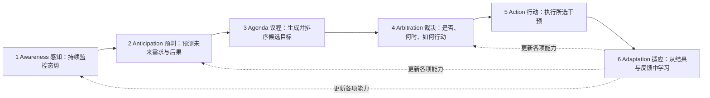
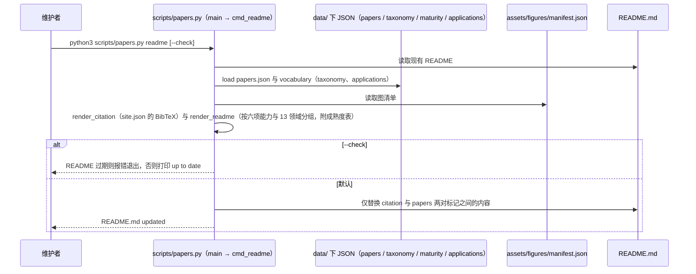

# Proactive AI for Superintelligent Agents

## 一句话定义

**Proactive AI for Superintelligent Agents**（Ke Yang 等，UIUC / Google / Stanford / UC Berkeley / CMU，2026 年 manuscript，203 页）是一篇综述：把**主动性**定义为智能体在无需针对该干预的新显式请求时发起面向目标行动的能力（即行使被委托的剩余裁量），并提出六项能力框架、三层评估体系和 13 个应用领域的横向比较。

## 英文缩写速查

| 缩写 | 英文全称 | 简要说明 |
|------|----------|----------|
| 6A | Awareness / Anticipation / Agenda / Arbitration / Action / Adaptation | 论文的六项能力：感知、预判、议程、裁决、行动、适应 |
| ODD | Operational Design Domain | 运行设计域（表 6 中 Waymo 的授权边界） |
| VLA | Vision-Language-Action | 视觉–语言–动作模型（表 6 中的具身系统多属此类） |
| RECAP | RL with Experience and Corrections via Advantage-conditioned Policies | π0.6 的训练方法（表 6 引用） |

## 为什么重要

- 对机器人 / 具身智能：论文判断多数已部署具身系统仍是「反应式自主」或「有界主动」，开放式主动尚缺可靠性与通用性；这给「具身智能体该在多大授权下自己发起行动」提供了一套可对照的语言（论文口径，§6.4）。
- 提供「校准的主动性」视角：把主动程度调到与不确定性、风险、时机、用户偏好与权限相称，并强调**沉默也可以是正确的决定**。
- 与库内 [VLA](../methods/vla.md)、[智能体评测](../concepts/ai-agent-evaluation.md)、[LLM 机器人控制接口](../concepts/llm-robotics-control-interfaces.md) 互补：后者讲能力与接口，本页讲「何时该自己动」。

## 论文结构（目录）

| 章 | 内容 |
|----|------|
| 1 引言 | 主动性是智能体在智能与对齐之外的第三类能力 |
| 2 概念框架 | 定义主动性；自我发起的两个问题；反应–主动光谱 |
| 3 历史 | 控制与控制论、规划与世界模型、BDI、普适计算、混合主动、目标推理、基础模型，最后综合为机制 |
| 4 机制 | 六项能力及其子维度（表 1 分类） |
| 5 评估 | 任务级、机制级、用户体验级 |
| 6 应用 | 13 个领域（编程、GUI、信息获取、具身与机器人、安全、自主科研、智能家居、智慧城市、医疗、法律、教育、娱乐与媒体、农业）与跨行业趋势 |
| 7 未来工作 | 评估与机制进展、长程任务与自我演化、安全与治理、应用前沿 |
| 8 结论 | — |

## 流程总览

图依据论文图 6（六项能力的循环）：感知维护态势模型，预判识别未来需求并预测可选行动的后果，议程把预测转成排序后的承诺，裁决决定是否与何时介入，行动执行所选干预，适应用结果与反馈更新其他能力。论文称预判与裁决是自我发起工作特有的两个难点。

## 核心框架

### 定义与光谱（第 2 章）

- 主动性 = 自我发起：不是被触发后才响应，而是在被授权的目标、约束与权限内自己选择并发起干预。目标可来自用户的高层指令、系统内置（如安全裕度）、甚至智能体自己生成。
- 自我发起要回答两个问题：**做什么**（what to act on）与**是否、何时、如何做**（whether/when/how）。
- 反应式 → 混合主动 → 自我发起是一条光谱，人的角色从操作者到协作者再到评审者；多数实际系统是反应层加主动层的混合体（论文以自动驾驶与编程助手举例）。

### 三层评估（第 5 章）

任务级、机制级、用户体验级（含负担、可用性、控制感、信任与依赖）。论文指出现有评估多只看任务成功，缺少对任务发现、打扰成本与「正确沉默」的评分。

## 具身与机器人（§6.4）

| 论文表 6 中的系统 | 类型 | 库内节点 |
|-------------------|------|----------|
| Gemini Robotics 2 / ER 2 | 商业 | [gemini-robotics](./gemini-robotics.md) |
| Helix 2.5 | 商业 | [helix-25](./helix-25.md) |
| π0.6（RECAP） | 商业 | [π0.6 论文节点](./paper-rcl-2511-14759-0-6-a-vla-that-learns-from-experience.md) |
| GR00T N1 / N1.7 | 商业 | [paper-gr00t-n1-7](./paper-gr00t-n1-7.md) |
| 1X NEO | 商业 | [1x-redwood-policy](./1x-redwood-policy.md) |
| Waymo Driver / CoFRIDA / ProAct / NIA / RoboGuard / AssistantX | 商业 / 研究 | 库内无独立节点（未核对） |

- 论文把这些系统映射到六项能力，并明示映射「只汇总已记录的机制，不代表具备完整主动能力」；多数条目的议程是「给定任务」。
- 评估上：ProActBench、RobotEQ 含「应保持沉默」的负样本，NIABench 惩罚打断人的计划，ProAct-75 报告触发检测准确率与节省步数，NormAct 评估对家庭隐性规范的遵守；视觉语言模型远低于人类且对提示措辞脆弱（某失败恢复基准上，选项重排使拒绝率从接近全部到接近零）。
- 离线评估对静态人类模型会高估主动性能；用户研究发现更频繁的介入并不提高参与度；长期家庭研究规模仍小（数个家庭、数周）。
- 成熟度（论文 `maturity` 数据）：具身领域为 Reactive–mandate 主动性、Gated action 授权，下一里程碑是「推断人类意图的相互认知伙伴」，约束是时延、物理不可逆性与泛化。

## 跨行业趋势（§6.14）

1. 共享架构：基础模型内核 + 领域专用部件。
2. 从辅助人到承载整条工作流，人的角色从操作者到评审者。
3. 验证与反馈基础设施是关键约束（编程可自测，物理实验与季节性 / 公共干预反馈慢且贵）。
4. 没有任何领域到达「议程生成式」，且若干领域认为不该到达；安全、医疗、法律、教育收敛于「受授权约束的使命导向」。

## 安全与治理（§7.2，部分阅读）

护栏要覆盖「内化的主动推理」：审计用户模型与议程的构造方式，防止偏差与错误在推理链中累积，治理「私有上下文被悄悄转成主动发起」的转换，并在执行与适应阶段补护栏。同意、能动性、问责与道德自我等小节只读了目录。

## 官方仓库与源码运行时序图

仓库是**综述配套资源**（文献库、网站、PDF），**没有可运行的主动式智能体实现**；唯一脚本 `scripts/papers.py` 是文献库工具。以下时序图来自对 `readme` 子命令的静态阅读（**未运行**，本环境拒绝执行仓库代码）：

同一脚本还有 `validate`（按 schema 与分类校验条目）与 `stats`（按能力 / 领域 / 年份 / 状态计数）；两者本页未画图。

## 局限

- 203 页并未逐页读完：第 3 章历史、第 4 章各能力细节、第 5 章评估细节、第 6 章除机器人与跨行业外的各领域、附录与 1,410 篇引用均未核对；表 6 中各系统的能力归类是论文口径，未回各系统一手资料核对。
- 综述无自己的实验；本页的「成功率 / 数字」只有上文引用的论文定性结论，没有量化指标。
- Google Research 版 PDF 与仓库附带 PDF 是否一致未比对。

## 关联页面

- [VLA](../methods/vla.md)
- [AI Agent 评测](../concepts/ai-agent-evaluation.md)
- [LLM 机器人控制接口](../concepts/llm-robotics-control-interfaces.md)
- [World Action Models](../concepts/world-action-models.md)
- [Loco-Manipulation](../tasks/loco-manipulation.md)
- [Proactive Thought Partners（写作场景的主动 AI，不同论文）](./paper-proactive-thought-partners-writing.md)
- [Gemini Robotics](./gemini-robotics.md)
- [Helix 2.5](./helix-25.md)
- [GR00T N1.7](./paper-gr00t-n1-7.md)

## 参考来源

- [论文来源归档](../../sources/papers/proactive_ai_superintelligent_agents.md)
- [项目页归档](../../sources/sites/proactive-ai-superintelligent-agents-site.md)
- [官方仓库归档](../../sources/repos/proactive-ai-superintelligent-agents.md)
- [Google Research 条目](https://research.google/pubs/proactive-ai-for-superintelligent-agents/)

## 推荐继续阅读

- [论文 PDF（Google Research）](https://storage.googleapis.com/gweb-research2023-media/pubtools/1048480.pdf)
- [项目页](https://empathyang.github.io/Proactive-AI-for-Superintelligent-Agents/)
- [官方仓库](https://github.com/EmpathYang/Proactive-AI-for-Superintelligent-Agents)
