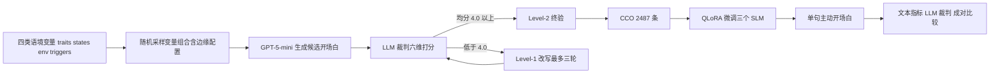

# How to start a conversation proactively?（CCO 主动开场白）

**一句话定位：** 一篇面向社交机器人的**对话生成**论文（arXiv 分类 cs.HC），不是机器人学习或控制论文：它定义「什么语境下该说什么开场白」的变量 schema，用合成数据集 CCO 对小语言模型做监督微调，再用文本指标与 LLM 裁判评测（[arXiv:2611.09906](https://arxiv.org/abs/2611.09906)，TCS Research, India）。

## 一句话定义

把用户特质、用户状态、环境状态与触发事件序列化成结构化文本，让经 QLoRA 微调的小语言模型映射为一句贴合语境的主动开场白，即 f(trigger, context) → opener（§IV-C）。

## 英文缩写速查

| 缩写 | 英文全称 | 简要说明 |
|------|----------|----------|
| CCO | Contextually-aligned Conversation Openers | 本文数据集，2,487 条合成样本（§IV） |
| SLM | Small Language Model | 本文用 llama-3.2-3b、gemma-3-4b、phi-3.5-mini（§V-B） |
| LLM | Large Language Model | 零样本基线：llama-70b、grok-4-1-fast、gemini-2.5-flash |
| SFT | Supervised Fine-Tuning | 下一词交叉熵监督微调（§V-A） |
| LoRA | Low-Rank Adaptation | 低秩适配，只训练少量附加参数 |
| QLoRA | Quantized LoRA | 4 bit 量化底座加 LoRA（§V-D） |
| LLM-as-a-Judge | LLM 作评审 | 用大模型按 6 维 0–5 分打分（§VI-C） |
| HRI | Human-Robot Interaction | 人机交互 |

## 为什么重要

- 作者自述：多数对话系统是被动应答，主动发起对话是社交机器人的基本能力，但缺少「对话语境」的原则性定义（摘要、§I）。
- 作者自述：小模型可本地部署，时延低、隐私更好（§I），所以选 SLM 而非云端大模型。
- 我的判断：对机器人栈而言，价值在于一个可复用的「触发 + 语境」接口设计，以及一份可训练的开场白数据；它处在具身系统的语言交互层，与本站运动控制、强化学习主线距离较远。

## 核心机制

### 流程总览

### 语境 schema（§III，图 2）

- **user traits：** 偏好语气、问候形式、啰嗦程度、主动程度等，决定风格而非是否发起。
- **user states：** 活动、情绪、健康状态等，用于避免不合时宜的打扰、校准共情。
- **environmental states：** 时间、地点、天气、公共事件。
- **proactive triggers：** 用药、补水、运动、体检、环境紧急、健康紧急、小聊天；共用「前置检查 / 语境约束 / 目标状态核验」逻辑，例如药已服用则不再提醒。
- 变量按功能分五种角色：modifiers、context、constraints、prerequisites、goal states。

### 数据集 CCO（§IV）

- 2,487 条，train/val/test = 1,760 / 245 / 482；七类触发（表 I，每类 240~406 条）。
- 由 GPT-5-mini 生成、LLM 裁判筛选、三位共同作者人工改写与终验；全为合成数据（§IV-A、§IV-D）。

### 微调（§V）

- 三个指令模型：llama-3.2-3b-instruct、gemma-3-4b-it、phi-3.5-mini-instruct；QLoRA（4 bit），LoRA 加在 key projection 层；按验证集 loss 早停；三者优化设置相同。
- 输入为「指令加 key-value 对」的线性化纯文本，不改模型结构。

## 实验结果（作者报告，未复现）

| 评测 | 结果 | 出处 |
|------|------|------|
| 自动指标 | 微调 gemma 最优：BLEU-1 0.2864、ROUGE-L 0.3174、BERTScore-F1 0.8962、BLEURT -0.4606、COMET 0.6534、PPL 59.06；最强预训练 grok-4-1-fast 的 BLEU-1 为 0.1689 | 表 II |
| LLM 裁判「好」占比（三裁判平均） | 微调 gemma 83.61、微调 llama-3.2-3b 83.40、微调 phi-3.5 77.45；grok-4-1-fast 70.44、gemini-2.5-flash 66.87、llama-70b 44.99；预训练 SLM 31.95~53.80 | 表 III |
| 成对比较（482 个测试语境，GPT-5-mini 裁判） | 微调 gemma 胜 337，grok-4-1-fast 胜 136，平 9；均分 4.5539 对 4.1169 | 表 IV |

「好」的定义是六维（trigger alignment、saliency selection、constraint adherence、value sensitivity、noise suppression、coherence）均分 ≥ 4.0（§VI-C-e）。

## 工程实践

- 训练成本低：单卡 RTX 4090（原文写 16 GB VRAM）即可完成 QLoRA 微调（§V-E）；论文未给学习率、LoRA rank、epoch、batch size，复现需自行补齐或查仓库（仓库 README 只描述数据集，未核实训练代码）。
- 接口建议（我的读法）：把感知模块输出整理成 schema 的 key-value，再交给本地 SLM；论文明确这一感知到变量的环节尚未实现（§VII-B）。
- 数据：仓库提供 `cco_dataset.json`（README 称合并了三个 split；本页未下载核对，许可证未核实）。

## 局限

**论文自己承认（§VII-B）：**
- 只做单轮开场，微调后能否维持多轮对话而不退化未知。
- 依赖人工设计的结构化变量，面对更杂乱的真实语境可能需要更多变量与数据。
- 真机部署需要从传感器实时抽取这些变量，可靠性与时延是未解难题。

**我看到的未验证之处：**
- 数据与评审同源：训练目标由 GPT-5-mini 生成并经同一类 LLM 裁判筛选（§IV-A），评测又由 LLM 裁判打分（§VI-C），其中 GPT-5-mini 同时是数据生成器、裁判和成对比较裁判，存在自洽偏置风险（推测，论文未做消融）。
- 人工参与只有三位共同作者，没有独立标注者一致性或真人偏好评测；全部为合成语境，无真实用户。
- 「时机」（when）在题目中出现，但实验只评测说什么（给定触发后的措辞），不评测何时触发。
- 零样本基线没有说明提示词细节，微调后的优势有多少来自 schema、多少来自任务内数据，论文没有做拆分；"统计显著，p < 0.001" 未说明检验方法（§VI-F）。
- 全文无机器人实机、无真人实验、无强化学习；性质上是语言生成与数据集工作。

## 关联页面

- [RealCompanion](./paper-realcompanion.md)：AI companion 长期关系基准（纵向用户理解与记忆调用），可对照本文只做单轮开场的局限。
- [Proactive Agent：LLM 智能体从被动到主动](./paper-sa-2410-12361-proactive-agent-shifting-llm-agents-from-reactiv.md)：同属「主动」范式，侧重从被动应答转向主动的过程性协助。
- [社交人形机器人](./paper-social-humanoid.md)：人形机器人双人社交交互系统（动作生成），与本文的语言侧互补。
- [HiBridge 对话](./paper-hibridge-dialogue.md)：群体对话中「对谁说话 / 说什么」的不确定性建模。
- [LLM 与机器人控制接口](../concepts/llm-robotics-control-interfaces.md)：语言模型接入机器人系统的常见接口。
- [具身基础模型的时延与泛化权衡](../concepts/embodied-fm-latency-generalization-tradeoff.md)：本地小模型与时延取舍的背景。

## 参考来源

- [论文通读归档](../../sources/papers/proactive-conversation-opener-cco_arxiv_2611_09906.md)
- arXiv：<https://arxiv.org/abs/2611.09906>；数据集仓库：<https://github.com/mohit-nathani1/conversation-opener-dataset>

## 继续阅读

- 论文引用的相关工作：Proactive conversational agents with inner thoughts（CHI 2025，论文参考文献 [3]）、FlowAct（arXiv:2408.15864，[17]）。
- 想把开场白接入机器人：先读 [LLM 与机器人控制接口](../concepts/llm-robotics-control-interfaces.md)。
