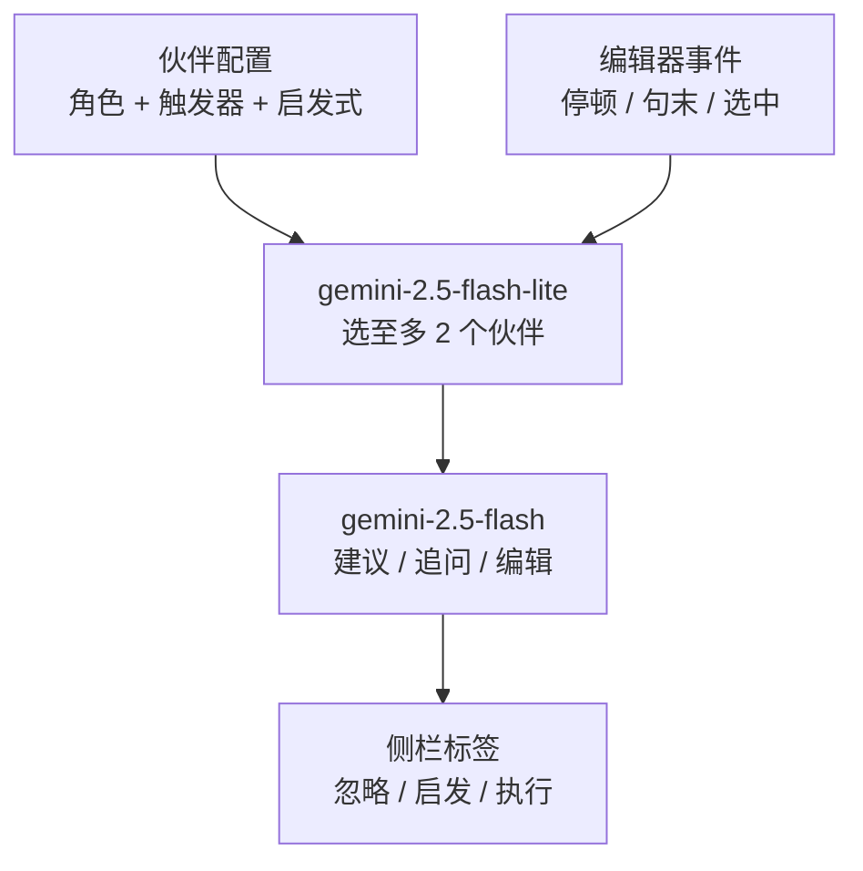

# Proactive Thought Partners：写作中的主动思考伙伴

**Proactive Thought Partners**（*Designing Proactive Thought Partners for Writing*，[arXiv:2609.01588](https://arxiv.org/abs/2609.01588)）由 Cornell 与 Google DeepMind 作者完成：搭一个技术探针，让写作者预先配置 AI 伙伴的角色与主动程度，AI 自行选择发言时机，并用一周的日记研究看人怎么用。

## 一句话定义

**一个带建议侧栏的 Markdown 编辑器：写作者定义“伙伴”（角色 + 触发事件 + 情境启发式），LLM 在停顿、句末或选中文字时决定谁该开口、说什么。**

## 英文缩写速查

| 缩写 | 英文全称 | 简要说明 |
|------|----------|----------|
| LLM | Large Language Model | 决策引擎与建议生成（Gemini 系列） |
| RQ | Research Question | 研究问题 RQ1 伙伴创建、RQ2 互动、RQ3 体验 |
| DI | Design Implication | 论文总结的 DI1–DI9 设计启示 |
| UMUX-LITE | Usability Metric for User Experience Lite | 可用性问卷，折算 SUS |
| SUS | System Usability Scale | 系统可用性量表，本研究折算均值 82.81 |
| PII | Personally Identifiable Information | 要求参与者不得输入的个人敏感信息 |

## 为什么重要

- 把“主动式 AI”从自动补全推向认知支持（构思、论证、自我监控），并给出一手使用数据。
- 数据显示用户大多忽略干预（58.27%），说明“何时说”和“怎么说”同等重要。

## 方法栈 / 流程总览

## 方法

- **界面：** 引导面板、伙伴配置面板、BlockNote 编辑器 + 右侧建议栏。
- **触发器：** Long Pause（静止 5 秒）、Sentence End（句末后 1 秒）、Text Selection（选中后 5 秒），均为规则式。
- **决策：** LLM 接收会话目标、当前文本、光标位置、触发事件和前 15 秒键盘日志，至多挑 2 个启发式匹配的伙伴；选择约 1 秒内出标签，建议生成约 8 秒。
- **呈现：** 先确认写作者意图，再给问题式建议；标签 15 秒后渐隐；Inspire 展开卡片/聊天；Execute 由“Help Me Write”直接改文，可撤销。
- **研究设计：** 16 人（26–53 岁），60 分钟入门 + 7 天日记（≥4 次会话）+ 60 分钟访谈；采集配置、键盘与互动日志、日记、UMUX-LITE，两名研究者做主题分析。

## 实验与评测

- 66 次会话（人均 4.13），平均 390.34 词、17.09 分钟；SUS 折算 82.81，日均满意度 8.16/10 且随会话上升（p=.036）；有用性 8.11、及时性 7.85。
- 54 个伙伴：43 个（79.63%）面向高层认知（信息获取 14、论证发展 12、批判反思 10、构思 7），11 个（20.37%）面向文字辅助。
- 1,100 次干预：忽略 641（58.27%）、Inspire 215（19.55%）、Execute 244（22.18%）；Execute 被接受 206/244（84.43%）。
- Pause 触发最常被忽略（425/660，64.39%）；Selection 触发最常被执行（79/145，54.48%）。
- 无对照组或基线系统，不能比较“主动 vs 被动”的效果。

## 源码运行时序图

不适用：论文页没有代码、数据或演示链接；提示词与预设伙伴在补充材料中，未读到。截至 2026-10-12 未发现官方仓库。

## 工程实践

- 把事件视作“候选时刻”而非需求证据，用多线索再判断一次是否打扰。
- 让忽略成为一等公民：标签自动淡出，不要求回应。
- 先给低承诺的启发，把“直接执行”留给用户已明确的意图。
- 隐私默认：数据最小化、本地或临时处理、保留期限、训练另行同意。

## 与机器人学习的关系

无直接关系；“何时介入、以什么口吻介入”对共享自主、人机协作中的主动提示有参考意义（推测，论文未涉及机器人）。

## 结论

**主动协作助手的成败在于介入时机与措辞，用户更愿意预先规划并接受低打扰、非指令性的提示。**

1. 预先配置比事后抱怨更能定制期望的介入。
2. 多数用户把伙伴用于高层认知而非文字润色。
3. 大多数干预被忽略是正常现象，应让忽略零成本。
4. Execute 一旦发生，接受率高（84.43%），但反思类建议用户不愿外包。
5. 周边、渐隐的视觉比弹窗更不打扰。
6. 结论来自 16 人探针研究，不含因果结论。

## 局限与风险

- 探针研究，不能推出对写作质量、效率或长期自主性的因果影响。
- 样本为英语流利、有 AI 经验的日常写作者；隐私限制排除了高风险工作写作。
- 结果依赖特定 Gemini 模型与提示词，LLM 推断意图并不可靠。
- **开源状态：** 无公开代码、数据或演示链接；截至 2026-10-12 未发现项目页。附录约后 4.6 万字符未读到。

## 与其他工作对比

| 对照 | 差异读法 |
|------|----------|
| 自动补全类写作工具 | 只做文本续写；本文面向构思与自我监控 |
| [AI 智能体评测](../concepts/ai-agent-evaluation.md) | 本文属用户研究，不是基准评测 |
| [LLM 机器人控制接口](../concepts/llm-robotics-control-interfaces.md) | 同为 LLM 与人交互，但本文无机器人 |

## 关联页面

- [WaytoAGI 本周顶级 AI 论文技术地图](../overview/waytoagi-top-ai-papers-2026-09-07-09-13-technology-map.md)
- [AI 智能体评测](../concepts/ai-agent-evaluation.md)
- [LLM 机器人控制接口](../concepts/llm-robotics-control-interfaces.md)

## 参考来源

- [waytoagi_feishu_top_ai_papers_2026-09-07-09-13.md](../../sources/blogs/waytoagi_feishu_top_ai_papers_2026-09-07-09-13.md) — 周报线索
- [proactive_thought_partners_arxiv_2609_01588.md](../../sources/papers/proactive_thought_partners_arxiv_2609_01588.md) — 论文归档
- [arXiv:2609.01588](https://arxiv.org/abs/2609.01588)

## 推荐继续阅读

- [arXiv HTML 全文](https://arxiv.org/html/2609.01588v1)
- [DAIR Academy 论文页（周报线索）](https://academy.dair.ai/papers/designing-proactive-thought-partners-for-writing-2609.01588)
