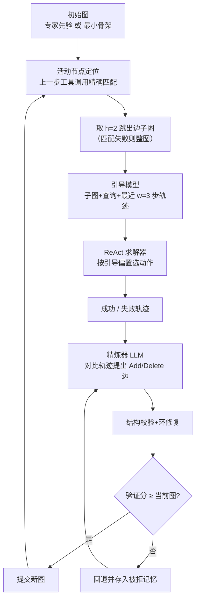
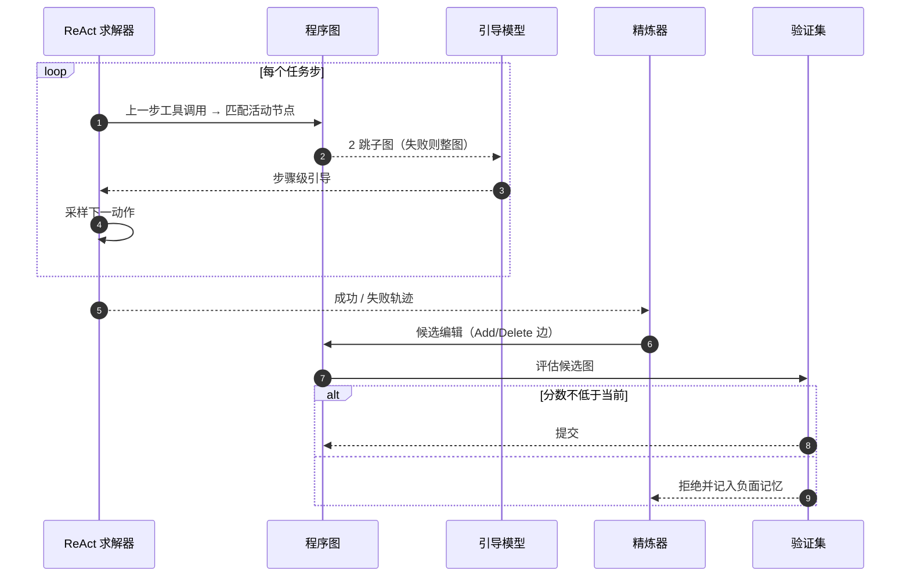

# Procedural Graphs：自演化的智能体程序图

**Procedural Graphs（PG）**（[arXiv:2609.09153](https://arxiv.org/abs/2609.09153)，Google 的 Yuxing Lu、Yicheng Chen、Shanchan Wu、Sercan Ö. Arık；2026-09-08）把长时程工具型 LLM 智能体“下一步该做什么、按什么顺序、在什么条件下”的程序性知识，存成可查询、可自我编辑的图，在每一步给求解器提供偏置性的引导。

## 一句话定义

**用 (过程, 关系, 过程) 三元组图替代越来越长的历史来承载程序性知识：运行时按活动节点取局部子图做引导，离线由 LLM 精炼器对比成败轨迹改图，且只在验证分不下降时才接受修改。**

## 英文缩写速查

| 缩写 | 英文全称 | 简要说明 |
|------|----------|----------|
| PG | Procedural Graph | 本文的程序图：节点为工具/技能/推理步/任务状态，边为带 condition/guidance/pitfalls 的三元组 |
| ReAct | Reasoning and Acting | 论文所有方法统一使用的求解器范式（推理与工具调用交替） |
| KG | Knowledge Graph | 存实体-关系-实体事实三元组，对照物，PG 存的是“过程”之间的关系 |
| EM / F1 | Exact Match / F1 | HotpotQA 的评分指标 |
| τ-bench / BFCL | Tau-bench / Berkeley Function-Calling Leaderboard | 工具调用与对话任务基准 |
| GDPval | GDP-valued tasks benchmark | 职业任务基准之一（本页仅引用其得分） |

## 为什么重要

- **长任务偏航是常见故障：** 论文指出的现象是失去目标、乱序调用工具、重复失败动作，原因是程序性知识只隐含在历史里。
- **改的是可检查的结构，而不是权重：** 图的边与属性可以被人读、审、回退；每次编辑要过验证门，被拒的编辑留案，避免反复提同一修改。
- **能修复坏先验：** 在 MultiChallenge 上，仅用专家先验图使成功率由 87.50% 掉到 58.93%，加在线演化后回升到 92.86%。

## 方法栈 / 流程总览

## 方法

- **图结构：** G=(V,R,E,Φ)；节点可是工具函数、技能、推理步或任务状态；关系词表四种 LEADS_TO、TRIGGERS、PROVIDES_INPUT_FOR、CONVERGES_TO；每条边带 condition（何时走）、guidance（怎么做）、pitfalls（常见坑）。
- **运行时：** 以上一步工具调用与节点精确匹配定位活动节点；成功则取 2 跳出边邻域，失败则给完整图。引导模型读子图、查询与最近 3 步轨迹，输出步骤级建议；求解器据此采样动作，引导“偏置而非强制”。
- **离线演化：** 精炼器对比失败/成功轨迹，只提出 Add / Delete 拓扑编辑（改属性 = 删除再加回），做结构有效性检查并修复环；候选图验证分不低于当前图才提交，被拒候选及其轨迹作为负面证据回传；轨迹上下文从头截断保留末尾 L_max token。
- **配置：** 引导模型与精炼器沿用求解器的同一个 LLM；temperature 0；HotpotQA 1000/1000/1000、MultiChallenge 100/100/56 的 train/val/test 划分；EnterpriseArena 演化 10 轮。

## 实验与评测

- **基准与模型：** HotpotQA、MultiChallenge、GDPval、ALFWorld、τ-bench、BFCL v3、EnterpriseArena；Claude Sonnet 4.6、Gemini 3.1 Pro、Gemini 3.5 Flash、Grok 4.1 Fast；基线 Vanilla ReAct、MemoryBank、RAP、ExpeL、AutoGuide、AWM、KnowAgent。
- **主表：** 24 个模型×基准设置中 PG 第一或并列第一 21 个；对各设置最强基线 19 胜 2 平 3 负（符号检验 p=4.3×10⁻⁴）。Gemini 3.1 Pro 上 ALFWorld 100.00、MultiChallenge 95.78、HotpotQA 87.30；最大优势 BFCL v3 + Gemini 3.5 Flash（67.00 对 58.00）、GDPval + Gemini 3.1 Pro（78.78 对 71.37）、τ-bench + Gemini 3.1 Pro（80.00 对 73.04）。HotpotQA 相对最强基线仅 −0.90 至 +1.30。
- **EnterpriseArena（长时程财务模拟）：** 生存率 Claude 44.0%→58.0%，Gemini 3.1 Pro 6.0%→34.0%，Grok 4.1 Fast 26.0%→40.0%；Gemini 3.5 Flash 全部配置下全程存活率仍为 0.0%。10 轮自演化中验证生存率 0%→90%（第 8 轮），返回图测试 85% 对基线 0%（Fisher p=2.6×10⁻⁸）；单轮最佳 95%，论文报告返回图以避免测试集挑选。
- **使用方式消融（Gemini 3.5 Flash）：** 局部化生成式引导在 MultiChallenge 89.31、GDPval 63.99、ALFWorld 81.53；整图注入与整图生成式引导在 ALFWorld 只有 70.34 / 54.48，低于无图的 72.58。局部化相对整图引导省 token（ALFWorld 70.9%、GDPval 18.1%、MultiChallenge 14.8%），但相对无图仍增耗（GDPval +33.4%、ALFWorld +55.4%）。
- **构建方式消融：** HotpotQA 从骨架起加在线演化 66.30 EM / 78.79 F1，无引导 58.8 EM / 71.21 F1。

## 源码运行时序图

不适用：论文与 arXiv 页面均未给出官方代码或项目页，截至 2026-10-12 未发现公开实现。以下为按论文算法描述的流程示意（非仓库时序）：

## 工程实践

- 论文未发布实现；若自行复现（推测）需要：节点词表与工具目录对齐（论文称通用结构校验器不强制工具目录成员）、固定的验证划分、被拒编辑的存档。
- 引导会增加 token：论文建议复用引导或选择性生成，实践中先上局部子图而非整图。
- 验证集很小时（如 EnterpriseArena 每划分 20 个 episode）接受/拒绝决策噪声大，应加大验证规模再信任演化结果。

## 与机器人学习的关系

无直接实验关系；可借鉴的是“把任务程序以图显式化、局部检索作提示、编辑需过验证门”的思路，对比机器人里的行为树或技能图编排（参见 [行为树 VLA 编排](../concepts/behavior-tree-vla-orchestration.md)），属类比而非论文结论。

## 结论

**把程序性知识做成带验证门的可编辑图，是比堆历史/记忆更可检查的长任务引导方式，但收益依赖验证规模与 token 预算。**

1. 局部子图引导优于整图注入：整图在 ALFWorld 反而低于无图。
2. 只接受“验证分不降”的编辑，并保留被拒记录，可以修复有缺陷的专家先验（MultiChallenge 58.93%→92.86%）。
3. 长时程场景收益最大（EnterpriseArena 测试 85% 对 0%），但这是单一模拟器、小样本。
4. 评估时区分“最强基线的优势”：HotpotQA 上差距只有 −0.90 至 +1.30。
5. 预算上要计入引导增加的 token（最高 +55.4%）。
6. 无官方代码，复现前先确认自己的验证集足够大。

## 局限与风险

- 引导模型与精炼器共用求解器的 LLM，贪心解码；跨求解器、跨工具接口的迁移未评估。
- EnterpriseArena 每划分仅 20 个 episode，单个决策取决于一两个 episode；论文称其为搜索轨迹而非显著性检验。
- Gemini 3.5 Flash 在 EnterpriseArena 全部配置存活率为 0.0%；案例研究（Seed 14）仅一个任务实例。
- 聚合统计不能指认具体哪条边编辑起作用；附录中 h、w、L_max 取值本归档未全部核到。
- **开源状态：** 截至 2026-10-12 未见官方代码或项目页（arXiv 页无链接）。

## 与其他工作对比

| 对照 | 差异读法 |
|------|----------|
| MemoryBank / ExpeL / AWM 等记忆基线 | 论文的对照组；PG 存的是过程间关系图而非经验文本，并有验证门 |
| [递归自我改进](../concepts/recursive-self-improvement.md) | PG 的自演化只改外部图结构，不改模型权重 |
| [AI 智能体评测](../concepts/ai-agent-evaluation.md) | 本文基准覆盖问答、工具调用、长时程模拟，可对照评测方法论 |
| [FrogNano](paper-frognano-4b-coding-agent.md) | 同期周报论文；一个改权重（RL），一个改外部结构 |

## 关联页面

- [WaytoAGI 本周顶级 AI 论文技术地图](../overview/waytoagi-top-ai-papers-2026-09-07-09-13-technology-map.md)
- [AI 智能体评测](../concepts/ai-agent-evaluation.md)
- [递归自我改进](../concepts/recursive-self-improvement.md)
- [智能体编码软件基础](../concepts/agentic-coding-software-fundamentals.md)
- [FrogNano](paper-frognano-4b-coding-agent.md)

## 参考来源

- [procedural_graphs_arxiv_2609_09153.md](../../sources/papers/procedural_graphs_arxiv_2609_09153.md) — 论文摘录与开源核查
- [WaytoAGI 周报归档](../../sources/blogs/waytoagi_feishu_top_ai_papers_2026-09-07-09-13.md) — 线索来源
- [arXiv:2609.09153](https://arxiv.org/abs/2609.09153) — 原文

## 推荐继续阅读

- [arXiv HTML 全文](https://arxiv.org/html/2609.09153v1)
- [DAIR Academy 论文页](https://academy.dair.ai/papers/procedural-graphs-self-evolving-execution-structures-for-llm-agents-2609.09153)
