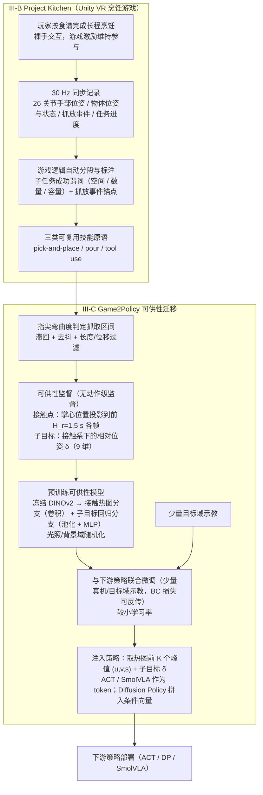

# Project Kitchen（arXiv:2609.18650）

**Project Kitchen**（*From Gameplay to Policy: Towards Scalable Robot Data Collection via Gamified Robot-Free Interaction*，[arXiv:2609.18650](https://arxiv.org/abs/2609.18650)）来自 [senlanke 具身运控lab 周更盘点](../../sources/blogs/wechat_senlanke_weekly_manipulation_2026-09-14_18.md)（2026-09-14–18）。

## 一句话定义

**VR 游戏化无机器人数据采集；Game2Policy 提取 embodiment-invariant affordance 预训练，再 few-shot 真机联合微调；仿真 +10pp、真机 +18.3pp。**

## 英文缩写速查

| 缩写 | 英文全称 | 简要说明 |
|------|----------|----------|
| VR | Virtual Reality | 虚拟现实 |
| IL | Imitation Learning | 模仿学习 |
| BC | Behavior Cloning | 行为克隆 |

## 为什么重要

- 机器人数据贵；游戏化跨本体数据可放大预训练再 few-shot 落地。

## 流程总览

图依据：论文 §III（A 系统概览 / B Project Kitchen / C Game2Policy）与 Fig. 2、式 (1)–(5)

## 核心机制

| 项 | 内容 |
|----|------|
| **arXiv** | [2609.18650](https://arxiv.org/abs/2609.18650) |
| **开源** | **待发布**（步骤 2.5，2026-09-20） |
| **方法摘要** | Project Kitchen VR game → affordance pretrain → few-shot real robot co-fine-tune. |

## 源码运行时序图

**不适用**（截至 2026-09-20 未发布可运行官方代码或待核实）。

## 实验与评测

- Sim +10.0pp, real +18.3pp few-shot（作者报告）。
- 读法：先对齐任务设定、传感器与成功定义，再解读 headline 数字。

## 与其他工作对比

| 维度 | 读法 |
|------|------|
| **同周对照** | 见对应 [周更盘点](../../sources/blogs/wechat_senlanke_weekly_manipulation_2026-09-14_18.md) 映射表，勿跨任务直接比 SR |
| **开源状态** | **待发布** — 部署前以项目页/arXiv 为准 |

## 结论

**Project Kitchen 把 scalable 人类游戏数据接入 cross-embodiment few-shot 策略学习。**

1. 开源：**待发布**；勿凭公众号摘要臆断可复现性。
2. 指标须连同实验条件解读（仿真/真机、平台、成功阈值）。
3. 关注 arXiv 版本更新与代码发布。

## 关联页面

- [data-flywheel](../concepts/data-flywheel.md)
- [imitation-learning](../methods/imitation-learning.md)
- [manipulation](../tasks/manipulation.md)

## 参考来源

- [project-kitchen_arxiv_2609_18650.md](../../sources/papers/project-kitchen_arxiv_2609_18650.md)
- [wechat_senlanke_weekly_manipulation_2026-09-14_18.md](../../sources/blogs/wechat_senlanke_weekly_manipulation_2026-09-14_18.md)
- [arXiv:2609.18650](https://arxiv.org/abs/2609.18650)
- [arXiv PDF](https://arxiv.org/pdf/2609.18650)：已通读方法部分（实验与附录以略读为准）：摘要、§I 引言、§III 方法 A–C（实验与附录以略读为准）

## 推荐继续阅读

- [arXiv PDF](https://arxiv.org/pdf/2609.18650)
