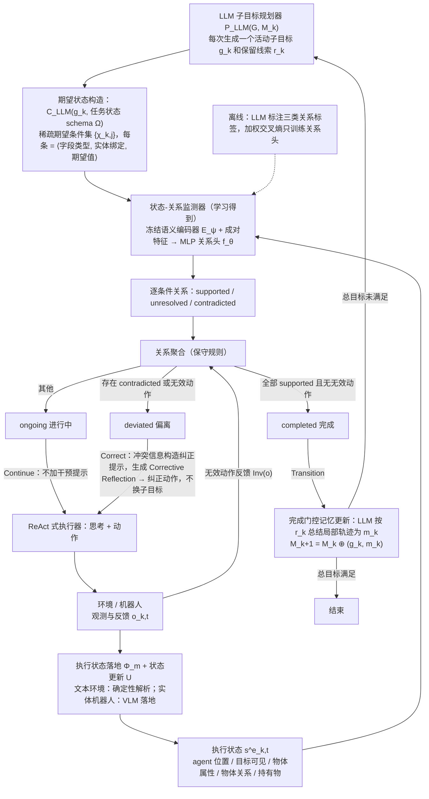

# ProLoop：基于结构化状态关系的进度感知长程机器人闭环规划

**ProLoop**（*ProLoop: Progress-Aware Closed-Loop Framework via Structured State Relations for Long-Horizon Robotic Task Planning*，[arXiv:2610.39319](https://arxiv.org/abs/2610.39319)）收录于 senlanke「具身运控lab」10-26–10-30 前沿论文动态（Manipulation）。本页依据**周报条目 + arXiv 摘要页**整理，流程图依据论文方法部分（见参考来源），未逐页核对实验数字；指标与结论以论文为准。

## 一句话定义

**ProLoop：基于结构化状态关系的进度感知长程机器人闭环规划——提出 State-Relation Monitor，根据目标状态和实际执行状态之间的结构化关系，判断任务处于执行中、偏离目标还是已经完成。在 AgentBoard ALFWorld 和真实机器人实验中，整体成功率提升 **12.94%**，环境交互次数减少 **32.3%**。**

## 英文缩写速查

| 缩写 | 英文全称 | 简要说明 |
|------|----------|----------|
| VLA | Vision-Language-Action | 视觉–语言–动作模型 |
| IL | Imitation Learning | 模仿学习 |

## 为什么重要

- 周报所述待解决的问题：长程操作通常分解为多个子目标，但 LLM 规划器对任务进度的判断主要依赖历史文本，容易误判某个子任务是否真正完成。

## 流程总览

图依据：论文 §IV-A 至 §IV-F、Fig. 2/3、式 (11)–(14)。

## 核心机制

| 项 | 内容 |
|----|------|
| **arXiv** | [2610.39319](https://arxiv.org/abs/2610.39319) · [PDF](https://arxiv.org/pdf/2610.39319) |
| **作者（arXiv）** | Zou, Runxin, Liang, Qingmiao, Zhang, Jiatao, Lv, Xinyan, Qie, Liangyu, Bu, Meiyi, Song, Wei, Zhu, Shiqiang |
| **机构（周报所述，未逐条核实）** | 待核实（作者：Runxin Zou、Shiqiang Zhu 等）。 |
| **arXiv 评论栏** | （无） |
| **开源** | arXiv 摘要页与评论未见代码或项目页链接（仅核对 arXiv 摘要页，不代表未发布）（2026-11-02） |
| **周报所述创新点** | 提出 State-Relation Monitor，根据目标状态和实际执行状态之间的结构化关系，判断任务处于执行中、偏离目标还是已经完成。在 AgentBoard ALFWorld 和真实机器人实验中，整体成功率提升 **12.94%**，环境交互次数减少 **32.3%**。 |

### arXiv 摘要节选（英文原文）

> Long-horizon robotic tasks are commonly decomposed into semantic subgoals to simplify planning. However, subgoal progress in LLM-based planning is typically inferred implicitly from interaction histories.

## 源码运行时序图

**不适用**：arXiv 摘要页与评论未见代码或项目页链接（仅核对 arXiv 摘要页，不代表未发布），无可对齐的官方代码流程。

## 实验与评测

- 周报与摘要给出的数字/场景已写入上表「创新点」与摘要节选；其余实验细节、基线与成功率定义请回到论文正文。
- 读法：先对齐任务设定、传感器与成功定义（仿真/真机），再解读 headline 数字，勿跨论文直接比较。

## 与其他工作对比

| 维度 | 读法 |
|------|------|
| **同周对照** | 见 [Manipulation周报技术地图](../overview/senlanke-weekly-2026-10-26-30-manipulation-technology-map.md)，按方向浏览同期论文 |
| **开源状态** | arXiv 摘要页与评论未见代码或项目页链接（仅核对 arXiv 摘要页，不代表未发布） |

## 结论

**ProLoop：基于结构化状态关系的进度感知长程机器人闭环规划。**

1. 本页是入库级摘要，复现前请核对论文正文、附录与代码仓库。
2. 指标须连同实验条件解读。
3. 关注 arXiv 版本更新与代码发布。

## 关联页面

- [senlanke-weekly-2026-10-26-30-manipulation-technology-map](../overview/senlanke-weekly-2026-10-26-30-manipulation-technology-map.md)
- [manipulation](../tasks/manipulation.md)
- [vla](../methods/vla.md)

## 参考来源

- [proloop-progress-aware-closed-loop_arxiv_2610_39319.md](../../sources/papers/proloop-progress-aware-closed-loop_arxiv_2610_39319.md)
- [wechat_senlanke_weekly_manipulation_2026-10-26_30.md](../../sources/blogs/wechat_senlanke_weekly_manipulation_2026-10-26_30.md)
- [arXiv:2610.39319](https://arxiv.org/abs/2610.39319)
- [arXiv PDF](https://arxiv.org/pdf/2610.39319)：已通读方法部分（实验与附录以略读为准）：§III 预备知识、§IV 方法（子目标规划器 / 结构化状态构造 / 状态关系监测器 / 进度引导适配 / 完成门控记忆更新 / 离线关系学习）、§V-A 实验设定

## 推荐继续阅读

- [arXiv PDF](https://arxiv.org/pdf/2610.39319)
