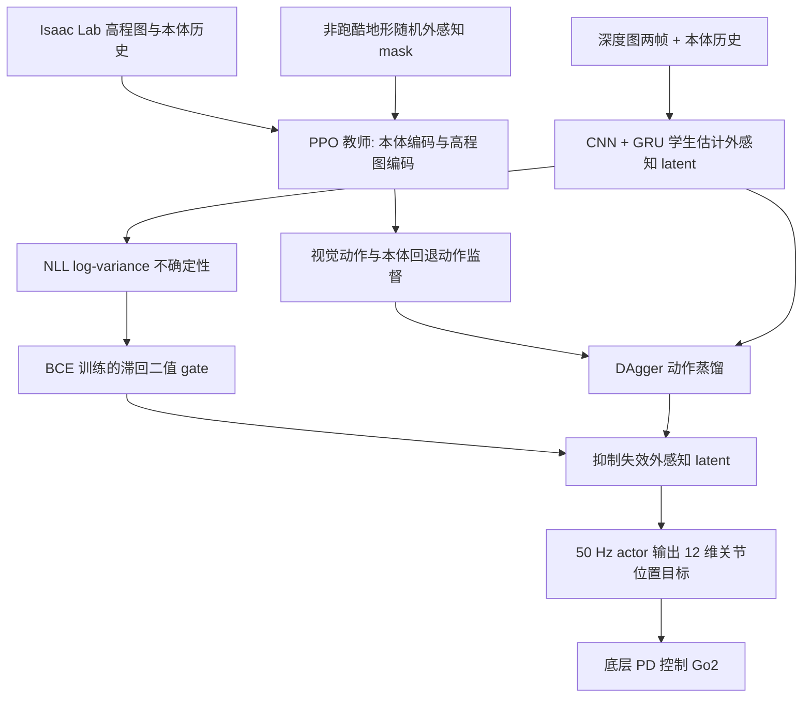
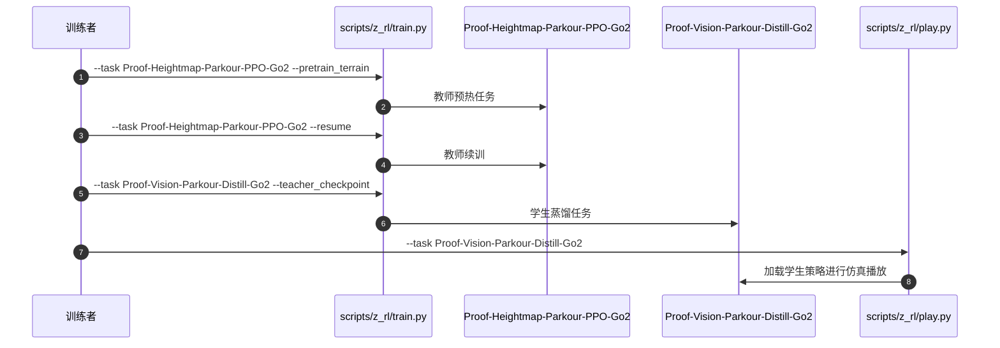

# PROOF：分布外视觉失效时的四足感知运动回退

**英文：** PROOF: Perceptive Robustness via Out-of-Distribution Fallback for Legged Locomotion。Siyuan Wang、Dongjie Zhu、Jinxuan Lu、Wenjun Xu、Jiankun Wang；南方科技大学、鹏城实验室、清华大学、香港科技大学（广州）；CoRL 2026；[arXiv:2611.18305v1](https://arxiv.org/abs/2611.18305)。

## 一句话定义

**在深度相机可靠时用地形感知跑酷，在视觉严重失真时自动屏蔽外感知特征，退回已训练的本体感知行走。**

## 英文缩写速查

| 缩写 | 英文全称 | 简要说明 |
| --- | --- | --- |
| PROOF | Perceptive Robustness via Out-of-Distribution Fallback | 本文框架 |
| OOD | Out-of-Distribution | 分布外视觉输入 |
| PPO | Proximal Policy Optimization | 教师强化学习算法 |
| DAgger | Dataset Aggregation | 在线教师动作监督蒸馏 |
| NLL | Negative Log-Likelihood | 预测外感知 latent 不确定性 |
| GRU | Gated Recurrent Unit | 学生时序特征估计器 |

## 为什么重要

传统感知运动策略遇到遮挡、反光、过曝时可能将错误深度图直接转成危险动作。PROOF 的关键不是始终相信视觉，而是让同一控制器预先学会视觉失效后的退路。与单纯 depth dropout 不同，训练目标同时包含回退动作监督、latent 不确定性与显式 gate。

## 核心原理与流程总览

- **教师（§3.2）：** 高程图编码器输出外感知 latent；10 帧本体历史编码器输出本体 latent。非跑酷地形随机 mask 外感知 latent，用 PPO 和速度估计辅助损失训练同一 actor。
- **学生（§3.3）：** CNN 处理两帧延迟深度图，GRU 从视觉与本体特征估计外感知 latent 均值；独立方差头以高斯 NLL 学习不确定性。
- **双重回退：** depth corruption burst 时，教师提供屏蔽视觉后的动作监督；gate head 学习何时关闭视觉，避免残余 latent 影响 actor。
- **滞回：** 关闭的 gate 只有分数 ≥0.8 才打开，打开的 gate 在分数 <0.5 时关闭；actor 只接收完整 latent 或零 latent，而非不稳定的中间插值。

## 工程实践

| 项目 | 原文或官方 README 设置 |
| --- | --- |
| 仿真 | Isaac Lab，4096 并行环境；论文实验单 RTX 4090 约 4.5 h |
| 训练 | 论文教师 8000 iter、学生 4000 iter；开源后续重实现 README 的迭代数不同 |
| 观测 | 本体历史、深度帧；深度裁剪 0.1–2.0 m，模拟 0.05 s 延迟 |
| 控制 | 50 Hz actor，12 维关节位置偏移；hip scale 0.125、thigh/calf 0.25 |
| 真机 | Unitree Go2 + RealSense D435；机载计算平台以论文硬件章节为准 |
| 开源 | [训练代码](https://github.com/syw-robotics/proof-loco) 已发布；部署代码尚待发布 |

## 源码运行时序图

以下只依据官方 README 确认入口和任务顺序，**尚未完成逐文件源码调用链审计**，不能视为已验证的实际内部函数时序。

## 评测与证据

官方项目页在强视觉损坏的非跑酷地形上报告：PROOF 在 rough flat、上坡、下坡、上楼、下楼的穿越成功率为 **100%、99%、100%、95%、100%**；无教师 mask 基线对应全部 0%。该测试是非跑酷地形，并不意味着失去视觉后仍可安全跨越不可见大沟。

真机展示 70 cm 沟、50 cm 高台、遮挡与弱光等案例。论文及项目页也承认稀疏草地 gate 可能误判，长时间高强度跑酷时电机过热扩大 sim-to-real 差距。

## 结论

PROOF 将感知失效处理从被动噪声增强推进到显式不确定性驱动的控制降级，但回退能力仍受本体感知可行地形限制。

- 部署时单独测试遮挡、过曝、反光、深度缺失的 gate 触发与恢复。
- 对比无教师 mask、仅 MSE 蒸馏与完整 NLL + gate，避免只看平均速度奖励。
- 在断续视觉信号下检验 0.8/0.5 滞回阈值与切换抖动。
- 区分正常视觉跑酷能力与视觉失效后的盲走安全边界。
- 将电机温升、推理时延和部署代码缺口纳入真机验收。

## 与其他工作对比

- **对比无教师回退监督与无门控蒸馏基线（论文 Table 1）：** 在 Isaac Lab 课程 level 5 的五类非跑酷地形强深度扰动评测中（100 episodes/类），**Baseline 1（移除教师外感知掩码）** 因学生缺乏无视觉时的本体回退目标，五类地形成功率全部跌至 **0%**；**Baseline 2（保留教师掩码但用 MSE 回归潜变量、无 NLL 方差头与 gate）** 在 rough flat / uphill / downhill / upstairs / downstairs 的成功率分别为 96% / 79% / 84% / 73% / 91%，而完整 **PROOF** 通过不确定性估计与滞回门控完全切断受损视觉通道，将成功率进一步提升至 **100% / 99% / 100% / 95% / 100%**（速度跟踪奖励也均高于两基线）。
- **与传统端到端视觉跑酷及盲走策略对比（§4.3）：** 相比 [Extreme Parkour](../tasks/stair-obstacle-perceptive-locomotion.md) 等依赖连续深度输入的方法，PROOF 在视觉正常时保留跨沟/爬台跑酷能力，在强光反射或遮挡时主动退回本体行走；相比单纯依赖本体估计（如 DreamWaQ 类无外感知方案），PROOF 在宽沟（70 cm）和高平台（50 cm）等需要提前落脚规划的任务上具备前瞻地形感知。论文同时明确：既有视觉跑酷工作多采用约 12 kg 的 A1/Go1/Lite3，而本文使用 15 kg 的 Unitree Go2（并将仿真力矩限幅从 45 Nm 调至 30 Nm），因此不直接与异构轻量化平台做跨硬件数字排名。

## 局限与风险

- 视觉严重失效后不能凭本体感知提前获知未知沟壑或窄梁；论文 OOD 强扰动鲁棒性实验主要在非跑酷地形进行。
- gate 对稀疏草地存在错误切换案例，极限运动下电机发热影响动力学。
- 训练仓 README 自述为后续重实现，尚未发布部署代码；未在本次入库执行训练/真机复现，源码内部时序尚待审计。

## 关联页面

- [Teacher-Student 与 DAgger](../methods/teacher-student-dagger-training.md)
- [强化学习](../methods/reinforcement-learning.md)
- [楼梯与障碍感知 locomotion](../tasks/stair-obstacle-perceptive-locomotion.md)
- [Privileged Training](../concepts/privileged-training.md)
- [Domain Randomization](../concepts/domain-randomization.md)
- [感知越障纵深路线](../../roadmap/depth-perceptive-locomotion.md)

## 参考来源

- [论文原文归档](../../sources/papers/proof_arxiv_2611_18305.md)
- [官方项目页归档](../../sources/sites/proof-loco.md)
- [官方源码归档](../../sources/repos/proof-loco.md)
- [arXiv HTML v1](https://arxiv.org/html/2611.18305)

## 继续阅读

- [官方项目页](https://syw-robotics.github.io/proof-loco/)
- [训练代码](https://github.com/syw-robotics/proof-loco)
