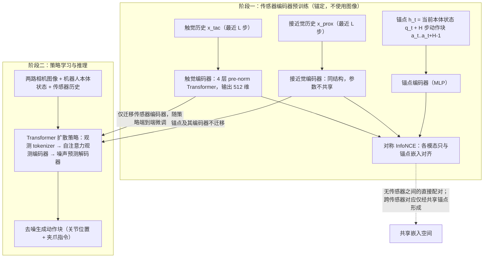

# Self-Supervised Anchoring of Fingertip Sensing to Proprioception and Proactive Actions for Robot Imitation Learning

**Self-Supervised Anchoring of Fingertip Sensing to Proprioception and Proactive Actions for Robot Imitation Learning**（*Self-Supervised Anchoring of Fingertip Sensing to Proprioception and Proactive Actions for Robot Imitation Learning*，[arXiv:2609.29822](https://arxiv.org/abs/2609.29822)，[项目页](https://tomohiromotoda.github.io/nia.propra/)）收录自 [具身智能小站 12 篇清单](../../sources/blogs/wechat_embodied_station_12_papers_research_checklist_2026-09-26.md)。

## 一句话定义

**接近传感在接触前、触觉在接触后——用自监督锚定把两类指尖信号对齐本体与主动作，而不是简单拼接模态。**

## 英文缩写速查

| 缩写 | 英文全称 | 简要说明 |
|------|----------|----------|
| VLA | Vision-Language-Action | 视觉-语言-动作策略 |
| IL | Imitation Learning | 模仿学习 |
| SR | Success Rate | 任务成功率 |
| WM | World Model | 世界模型 |

## 为什么重要

- 纳入 [12 篇具身研究清单](../../wiki/overview/embodied-research-12-papers-technology-map.md) 主线，与同期 VLA / 接触 / 规划 / 安全论文可横向对照。
- 公众号强调的可操作读法：先看 **任务信息需求**（如 PolyUMI 旋灯泡仍以视觉最优）与 **评测口径**（如 Self-Adaptive 多 trial、BeyondRetarget 仿真片段非真机 SR）。
- 开源状态（步骤 2.5）：**待发布**。

## 流程总览

图依据：论文 §III-B/C（动机与锚点条件）、§IV-A/B/C / Fig.2、Fig.3

## 核心信息

| 项 | 内容 |
|----|------|
| **arXiv** | [2609.29822](https://arxiv.org/abs/2609.29822) |
| **项目页** | https://tomohiromotoda.github.io/nia.propra/ |
| **代码** | 截至入库日未列 |
| **开源** | **待发布** |

## 实验与评测（公众号口径）

- 指标与消融以 [公众号盘点](../../sources/blogs/wechat_embodied_station_12_papers_research_checklist_2026-09-26.md) 与 **原文 PDF** 为准；本页不复制整表。
- 读复现前先核对：样本规模、是否仿真/真机、是否允许多次 attempt。

## 源码运行时序图

**不适用**（截至 2026-09-26 项目页未提供可运行官方代码仓库；见 [sources/papers/propra-fingertip-anchoring_arxiv_2609_29822.md](../../sources/papers/propra-fingertip-anchoring_arxiv_2609_29822.md)）。

## 结论

**总判：Self-Supervised Anchoring of Fingertip Sensing to Proprioception and Proactive Actions for Robot Imitation Learning 适合作为「接近传感在接触前、触觉在接触后——用自监督锚定把两类指尖信号对齐本体与主动作，而…」方向的入口页；细节以 arXiv 与项目页为准。**

1. 与 [12 篇技术地图](../overview/embodied-research-12-papers-technology-map.md) 对照选型，避免与同名不同 arXiv 的工作混淆（如 RAPID vs RAPID-VLM-RL）。
2. 开源为 **待发布** 时优先从项目页 Code 区核实，再写复现计划。
3. 长程 / 部署类条目（AdaHVLA、HarnessPAI、Self-Adaptive VLA）同时记录 **成功率定义** 与 **失败恢复预算**。

## 与其他工作对比

| 对照 | 差异读法 |
|------|----------|
| 朴素模态拼接 | 摘要指出：直接把指尖信号加进策略 **不能稳定提升**，甚至可能低于纯视觉策略——稀疏、分相位信号难从有限示范中利用 |
| 图像锚定预训练基线 | 把传感器历史对齐到图像；PROPRA 对齐到 **本体 + 动作段**，提供连续可用的感知运动参考，各传感器在其有信息的相位 **独立** 对齐，保留更多接触前状态信息 |
| [PolyUMI](./paper-polyumi.md) | 同期多模态接触工作：PolyUMI 侧重采集平台与融合策略，PROPRA 侧重 **表征预训练** |
| [视触觉融合](../concepts/visuo-tactile-fusion.md) | 主流讨论视觉 ↔ 触觉在接触瞬间的切换；PROPRA 额外引入 **反射式接近觉** 覆盖接触前阶段 |
| [足底接近觉离散地形](./paper-discrete-terrain-minimal-proximity-sensing.md) | 同用接近觉，但用于腿足落脚；PROPRA 用于指尖的接触前预判 |

## 关联页面

- [具身研究 12 篇技术地图](../overview/embodied-research-12-papers-technology-map.md)
- [Manipulation](../tasks/manipulation.md)
- [VLA](../methods/vla.md)

## 参考来源

- [propra-fingertip-anchoring 论文归档](../../sources/papers/propra-fingertip-anchoring_arxiv_2609_29822.md)
- [公众号 12 篇清单](../../sources/blogs/wechat_embodied_station_12_papers_research_checklist_2026-09-26.md)
- [arXiv PDF](https://arxiv.org/pdf/2609.29822)：已通读方法部分（实验与附录以略读为准）：§III 问题表述、§IV 方法（预训练与策略集成）、§V-A/B 数据与训练设定

## 推荐继续阅读

- [arXiv:2609.29822](https://arxiv.org/abs/2609.29822)
- [项目页](https://tomohiromotoda.github.io/nia.propra/)
